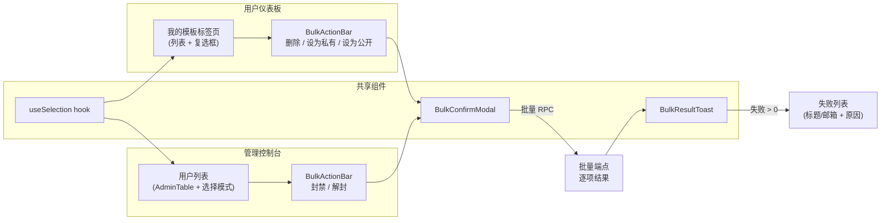
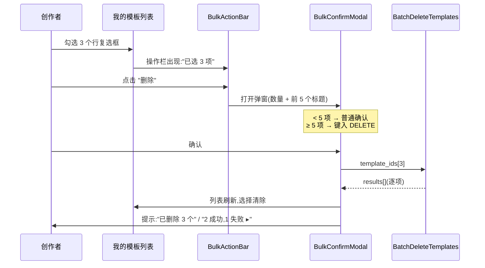
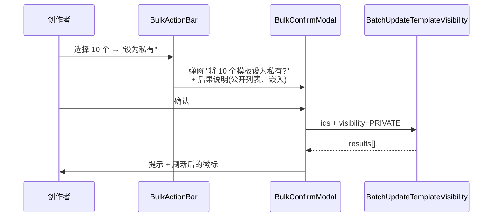
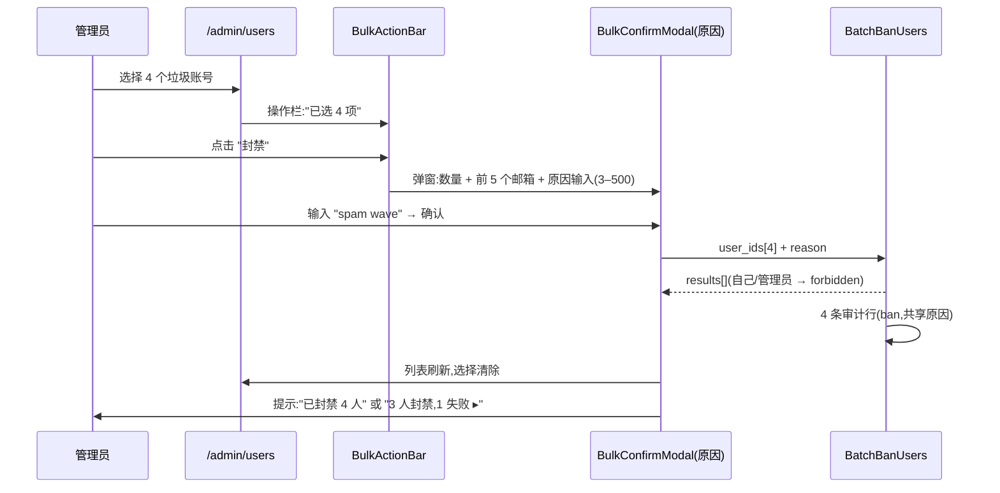

# 批量操作(Bulk Operations)— UI/UX 设计

- **功能 ID:** bulk-operations
- **版本:** 1.0
- **状态:** 已提议(待架构评审)
- **作者:** ui-ux-agent
- **日期:** 2026-10-12
- **相关需求文档:** [bulk-operations-requirements-zh-CN.md](./bulk-operations-requirements-zh-CN.md)

## 1. 设计原则

1. **选择始终可见且可逆。** 计数常驻屏幕;"清除" 一键即达;没有数量确认弹窗绝不执行破坏性操作。
2. **批量 = 诚实地报告 N 个单项。** 部分失败逐项展示 —— 绝不是一句 "出错了"。
3. **不用时零成本。** 点击第一个复选框前,没有选择列、没有操作栏、没有布局偏移。选择关闭时现有页面像素级一致。
4. **一个模式,多个表面。** 相同的 `useSelection` hook + `BulkActionBar` + `BulkConfirmModal` 服务于仪表板和管理控制台;未来列表免费复用。
5. **破坏性操作逐级升级。** 小批量(< 5)普通确认;大批量要求键入 `DELETE` —— 摩擦与影响范围成正比。

## 2. 信息架构



## 3. 用户流程

### 3.1 创作者:批量删除模板



### 3.2 创作者:批量更改可见性



### 3.3 管理员:批量封禁用户



## 4. 页面布局(线框图)

### 4.1 选择激活的 "我的模板" 标签页

```
┌────────────────────────────────────────────────────────────┐
│ 我的模板                                        [筛选…]    │
├────────────────────────────────────────────────────────────┤
│ [▣] 标题              可见性     点赞    更新时间          │
│ ────────────────────────────────────────────────────────── │
│ [✓] 代码审查助手      ● 公开     128    2 天前             │
│ [✓] SQL 讲解器        ● 公开     64     1 周前             │
│ [ ] 文章润色器        ○ 私有     0      3 周前             │
│ [ ] …                                                      │
├────────────────────────────────────────────────────────────┤
│ ‹ 1 2 3 … ›                                                │
└────────────────────────────────────────────────────────────┘
        ▲
        │ 浮动操作栏(选中 ≥1 项时出现)
┌────────────────────────────────────────────────────────────┐
│ 已选 3 项   [删除] [设为私有] [设为公开]            清除 ✕  │
└────────────────────────────────────────────────────────────┘
```

### 4.2 批量删除确认弹窗(≥ 5 项)

```
┌────────────────────────────────────────────────────────────┐
│  删除 7 个模板?                                   [×]      │
├────────────────────────────────────────────────────────────┤
│  以下模板将被永久移除:                                     │
│                                                            │
│  • 代码审查助手                                            │
│  • SQL 讲解器                                              │
│  • 文章润色器                                              │
│  • 提示词链接器                                            │
│  • API 写作器                                              │
│  另 2 项                                                   │
│                                                            │
│  ⚠ 这些模板上的点赞、收藏和评论                            │
│    也将一并移除。                                          │
│                                                            │
│  键入 DELETE 以确认:                                       │
│  ┌──────────────────────┐                                  │
│  │                      │                                  │
│  └──────────────────────┘                                  │
├────────────────────────────────────────────────────────────┤
│                        [ 取消 ]  [ 删除 7 个模板 ]         │
└────────────────────────────────────────────────────────────┘
```

### 4.3 批量可见性确认弹窗

```
┌────────────────────────────────────────────────────────────┐
│  将 10 个模板设为私有?                            [×]      │
├────────────────────────────────────────────────────────────┤
│  这些模板将从公开列表、搜索结果以及                        │
│  所有外部嵌入中消失。                                      │
│                                                            │
│  • 代码审查助手                                            │
│  • SQL 讲解器                                              │
│  另 8 项                                                   │
├────────────────────────────────────────────────────────────┤
│                     [ 取消 ]  [ 设为私有 ]                 │
└────────────────────────────────────────────────────────────┘
```

### 4.4 带选择的管理端用户列表 + 封禁弹窗

```
┌────────────────────────────────────────────────────────────┐
│ 用户  [搜索] [状态筛选]                                    │
├────────────────────────────────────────────────────────────┤
│ [▣] 邮箱             角色     状态     注册时间            │
│ [✓] spam1@x.com      user     active   2026-10-10          │
│ [✓] spam2@x.com      user     active   2026-10-10          │
│ [✓] spam3@x.com      user     active   2026-10-11          │
│ [✓] spam4@x.com      user     active   2026-10-11          │
└────────────────────────────────────────────────────────────┘
┌────────────────────────────────────────────────────────────┐
│ 已选 4 项   [封禁] [解封]                          清除 ✕  │
└────────────────────────────────────────────────────────────┘

封禁弹窗:
┌────────────────────────────────────────────────────────────┐
│  封禁 4 个用户?                                   [×]      │
├────────────────────────────────────────────────────────────┤
│  • spam1@x.com   • spam2@x.com                             │
│  • spam3@x.com   • spam4@x.com                             │
│                                                            │
│  原因(必填,3–500 字符):                                  │
│  ┌────────────────────────────────────────────────────┐    │
│  │ spam wave                                           │    │
│  └────────────────────────────────────────────────────┘    │
├────────────────────────────────────────────────────────────┤
│                          [ 取消 ]  [ 封禁 4 个用户 ]       │
└────────────────────────────────────────────────────────────┘
```

### 4.5 带失败项的结果提示

```
┌──────────────────────────────────────────────┐
│ ✓ 3 项成功,1 项失败                        [▸] │
├──────────────────────────────────────────────┤  ← 展开后
│  ✗ 文章润色器 — not found                     │
│    (该模板已不存在)                           │
└──────────────────────────────────────────────┘
```

## 5. 组件规格

### 5.1 `useSelection` hook(frontend/src/hooks/useSelection.js)

```js
const { selectedIds, isSelected, toggle, selectAll, clearAll,
        selectedCount, isIndeterminate, isAllSelected } = useSelection({
  items,        // 当前页行
  idKey,        // 'id'
  max: 50,      // FR-2 上限
  onMaxExceeded // 提示回调
});
```

基于集合(`Set<string>`);`selectAll` 在当前页的全选/清空间切换;跨客户端分页保持(FR-1);父组件在筛选/路由变化时通过 `clearAll` 清除。

### 5.2 `BulkActionBar`(frontend/src/components/bulk/BulkActionBar.js)

| Prop | 类型 | 说明 |
|---|---|---|
| `count` | number | 来自 `useSelection` |
| `actions` | array | `{id, label, icon?, danger?, onClick}` |
| `onClear` | func | — |

固定于视口底部(`position: fixed; bottom: 24px; z-index` 高于内容),居中,最大宽度 720px;滑入动画(尊重 `prefers-reduced-motion`);role=`toolbar` 带 `aria-label`;计数在 `aria-live="polite"` 区域。

### 5.3 `BulkConfirmModal`(frontend/src/components/bulk/BulkConfirmModal.js)

| Prop | 类型 | 说明 |
|---|---|---|
| `open` | bool | — |
| `action` | 'delete' \| 'visibility' \| 'ban' \| 'unban' | 决定标题/正文 |
| `items` | array | `{id, label}` — 显示前 5 个 + "另 N 项" |
| `count` | number | — |
| `requireTyped` | bool | action=delete 且 count ≥ 5 时为 true |
| `reasonRequired` | bool | 封禁/解封时为 true |
| `onConfirm(payload)` | func | `{reason?}` |
| `onClose` | func | — |

复用现有弹窗外壳(焦点陷阱、Escape、点击遮罩取消);键入确认输入仅在精确匹配 `DELETE` 时启用确认按钮;原因字段内联校验 3–500 字符。

### 5.4 `BulkResultToast`(frontend/src/components/bulk/BulkResultToast.js)

Props:`results[]`、`itemLabel(i)`。渲染 "X 项成功,Y 项失败";当 Y > 0 时可展开区域列出每个失败项(标签 + 本地化错误)。全部成功时 6 秒自动消失;存在失败时持久显示(带关闭按钮)。

### 5.5 `AdminTable` 选择模式(frontend/src/components/admin/AdminTable.js)

新可选 props:`selectable`(bool)、`selectedIds`(Set)、`onSelectionChange(next: Set)`、`rowKey`(已有)。`selectable` 时渲染前置复选框列;表头单元格是三态复选框(`checked` = 本页全选,`indeterminate` = 部分)。非选择用法渲染与今天完全一致(无额外列)。

### 5.6 仪表板 `MyTemplatesBulkPanel`

包裹 "我的模板" 标签页:接线 `useSelection` + `BulkActionBar` + `BulkConfirmModal` + `BulkResultToast`;调用 `services/api.js` 中的 `batchDeleteTemplates` / `batchUpdateTemplateVisibility`;完成后刷新列表并清除选择(FR-8)。

## 6. 交互细节

1. **点击复选框不打开行。** 行点击仍导航;复选框(及其 32px 加大命中区)切换选择;复选框上 `stopPropagation`。
2. **操作栏入场。** 首次选择滑入操作栏;取消最后选择滑出。操作栏绝不遮挡最后一行(可见时列表加 `padding-bottom`)。
3. **全选三态。** 半选时点击表头复选框全选;全选时点击清空。
4. **键入确认。** 输入区分大小写的 `DELETE`;匹配前确认按钮禁用;启用后 Enter 提交。
5. **批量执行期间** 确认按钮显示加载动画且弹窗不可关闭(防重复提交);操作栏隐藏。
6. **结果处理。** 全部成功 → 提示自动消失。任何失败 → 提示持久、可展开,每个失败行显示条目标签和本地化原因;失败条目保留在列表中(未选中)以便重试。
7. **选择生命周期。** 清除时机:批量操作成功、筛选变化、路由变化、手动 "清除"。保持:标签页内的客户端分页。
8. **限流反馈。** 批量端点返回 429 时显示友好的重试提示(本地化,无裸错误码)。
9. **键盘。** 复选框按 DOM 顺序可 Tab;空格切换;从列表可 Tab 到操作栏按钮;弹窗焦点陷阱遵循现有模式。

## 6a. 通知偏好交互

无 —— 批量操作不产生通知(可见性变更和删除今天都是静默的;管理员封禁沿用现有封禁流程的通知行为,如有)。

## 7. 状态汇总

| 表面 | 加载 | 空态 | 错误 | 成功 |
|---|---|---|---|---|
| 列表 + 复选框 | — | 无条目 → 现有空态;操作栏隐藏 | — | — |
| BulkActionBar | — | 隐藏(0 选中) | — | 计数实时更新 |
| BulkConfirmModal | 批量执行期间确认按钮加载动画 | — | 批量 429/5xx → 内联错误 + 重试 | 关闭;随后提示 |
| BulkResultToast | — | — | 失败列表(逐项) | "X 项成功" 自动消失 |
| AdminTable 选择 | — | — | — | 三态表头反映本页状态 |

## 8. 国际化字符串表

命名空间:`bulk.*`。键添加到 `frontend/src/locales/{en,zh}/translation.json`。

| 键 / 中文文案 | 英文 |
|---|---|
| `bulk.selectedCount` / "已选 {{count}} 项" | "{{count}} selected" |
| `bulk.clear` / "清除" | "Clear" |
| `bulk.delete` / "删除" | "Delete" |
| `bulk.makePrivate` / "设为私有" | "Make private" |
| `bulk.makePublic` / "设为公开" | "Make public" |
| `bulk.ban` / "封禁" | "Ban" |
| `bulk.unban` / "解封" | "Unban" |
| `bulk.deleteTitle` / "删除 {{count}} 个模板?" | "Delete {{count}} templates?" |
| `bulk.deleteBody` / "以下模板将被永久移除:" | "The following templates will be permanently removed:" |
| `bulk.deleteWarning` / "这些模板上的点赞、收藏和评论也将一并移除。" | "Likes, favorites and comments on these templates will be removed as well." |
| `bulk.typeDelete` / "键入 DELETE 以确认" | "Type DELETE to confirm" |
| `bulk.deleteConfirm` / "删除 {{count}} 个模板" | "Delete {{count}} templates" |
| `bulk.privateTitle` / "将 {{count}} 个模板设为私有?" | "Make {{count}} templates private?" |
| `bulk.publicTitle` / "将 {{count}} 个模板设为公开?" | "Make {{count}} templates public?" |
| `bulk.visibilityBody` / "这些模板将从公开列表、搜索结果以及所有外部嵌入中消失。" | "These templates will disappear from public listings, search results, and any external embeds." |
| `bulk.banTitle` / "封禁 {{count}} 个用户?" | "Ban {{count}} users?" |
| `bulk.unbanTitle` / "解封 {{count}} 个用户?" | "Unban {{count}} users?" |
| `bulk.reasonLabel` / "原因(必填,3–500 字符)" | "Reason (required, 3–500 characters)" |
| `bulk.reasonDefault` / "批量解封" | "bulk unban" |
| `bulk.moreItems` / "另 {{count}} 项" | "+{{count}} more" |
| `bulk.confirm` / "确认" | "Confirm" |
| `bulk.cancel` / "取消" | "Cancel" |
| `bulk.resultSuccess` / "{{count}} 项成功" | "{{count}} succeeded" |
| `bulk.resultMixed` / "{{success}} 项成功,{{failed}} 项失败" | "{{success}} succeeded, {{failed}} failed" |
| `bulk.resultAllFailed` / "全部 {{count}} 项操作失败" | "All {{count}} actions failed" |
| `bulk.failureReason.not_found` / "该条目已不存在" | "This item no longer exists" |
| `bulk.failureReason.forbidden` / "你没有此条目的权限" | "You don't have permission for this item" |
| `bulk.failureReason.invalid_state` / "该条目当前无法更改" | "This item can't be changed right now" |
| `bulk.failureReason.rate_limited` / "请求过于频繁 —— 请一分钟后再试" | "Too many requests — try again in a minute" |
| `bulk.failureReason.unknown` / "出错了" | "Something went wrong" |
| `bulk.capReached` / "每批最多可选择 50 项" | "You can select at most 50 items per batch" |
| `bulk.selectAll` / "全选本页" | "Select all on this page" |
| `bulk.toolbarLabel` / "批量操作" | "Bulk actions" |

## 9. 无障碍说明

1. 每个复选框都是 `<label>` 内的原生 `input[type=checkbox]`;行复选框的 label 包含条目标题("选择 代码审查助手")。
2. 表头三态复选框在部分选择时为 `aria-checked="mixed"`,可访问名称来自 `bulk.selectAll`。
3. `BulkActionBar` 是带 `aria-label={t('bulk.toolbarLabel')}` 的 `role="toolbar"`;计数文本位于 `aria-live="polite"` 区域,屏幕阅读器可播报变化。
4. 确认弹窗复用现有弹窗无障碍契约:焦点陷阱、`Escape` 关闭、点击遮罩取消、初始焦点在主操作(需要键入确认时在确认输入框)。
5. 键入确认输入通过 `aria-describedby` 指向说明;确认按钮的禁用状态通过 `aria-disabled` 加视觉样式传达。
6. 提示使用 `role="status"`(成功)/ `role="alert"`(存在失败);可展开失败列表是带正确 `aria-expanded` 的类 `<details>` 折叠组件。
7. 弹窗关闭后焦点返回触发的操作栏按钮;提示消失后不移动焦点(自然阅读继续)。
8. 所有交互目标 ≥ 32×32px(复选框命中区有内边距)。

## 10. 响应式行为

1. **浮动操作栏:** 视口低于 600px 时全宽并留 16px 边距;窄于 380px 时操作折叠进 "更多" 菜单(删除作为主破坏性操作保持可见)。
2. **确认弹窗:** 遵循现有低于 480px 全屏面板的弹窗模式;条目列表内部滚动(max-height 40vh)。
3. **AdminTable 复选框列:** 固定 48px;窄屏下表格保持横向滚动(现有行为),复选框列左粘滞以便始终可达。
4. **提示:** 移动端全宽底部面板;失败列表垂直堆叠。
5. **仪表板列表:** 复选框保持 48px;行布局按现有响应式规则降级(标题换行,次要列先隐藏)。

## 11. 分析事件(可选,若分析已上线)

- `bulk_selection_started` {surface}
- `bulk_action_confirmed` {surface, action, count}
- `bulk_action_result` {surface, action, count, failed_count}

## 12. 不在范围内(UI)

- 跨页 "选择所有匹配项" 交互、批量标签编辑器 UI、合集选择器、拖拽选择、撤销/恢复 UI、定时批量操作。
