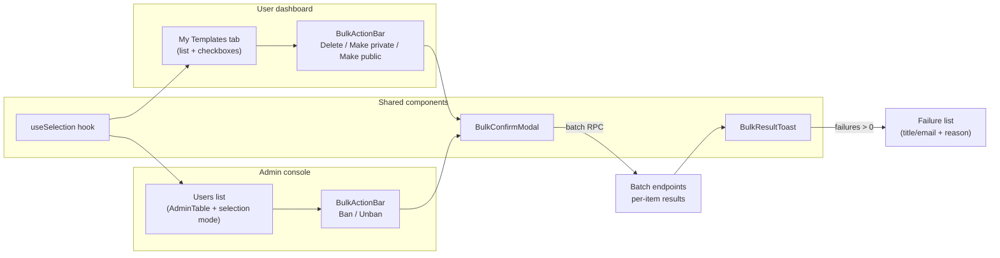
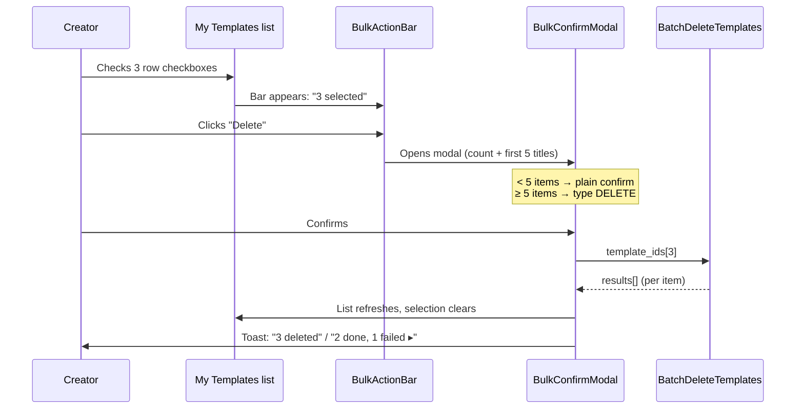
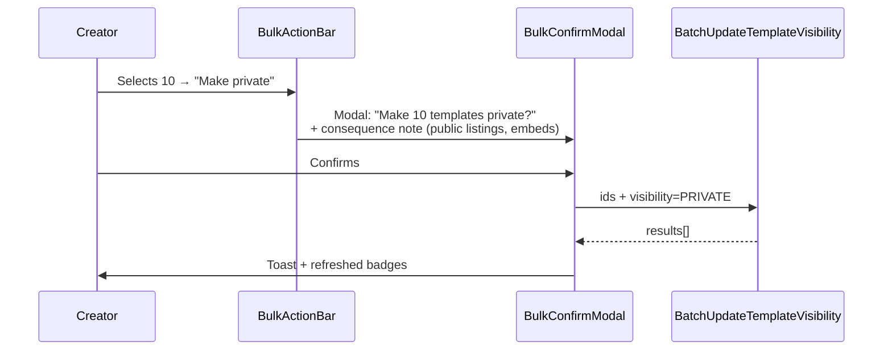
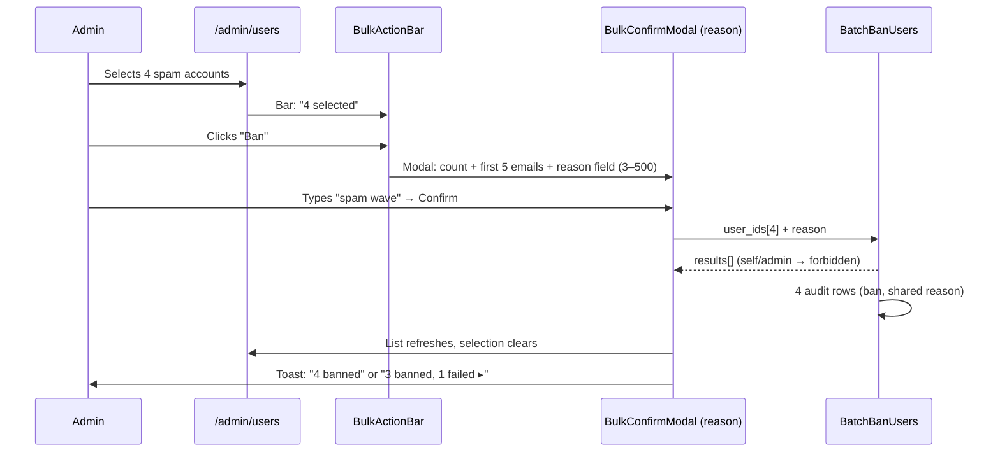

# Bulk Operations — UI/UX Design

- **Feature ID:** bulk-operations
- **Version:** 1.0
- **Status:** Proposed (for architecture review)
- **Author:** ui-ux-agent
- **Date:** 2026-10-12
- **Related requirements:** [bulk-operations-requirements.md](./bulk-operations-requirements.md)

## 1. Design Principles

1. **Selection is always visible and reversible.** The count is on screen at all times; "Clear" is one click; nothing destructive happens without a count-confirmed modal.
2. **Bulk = N singles, honestly reported.** Partial failures are shown per item — never a blanket "something failed".
3. **Zero cost when unused.** No selection column, no bar, no layout shift until the first checkbox is clicked. Existing pages are pixel-identical with selection off.
4. **One pattern, many surfaces.** The same `useSelection` hook + `BulkActionBar` + `BulkConfirmModal` serve the dashboard and the admin console; future lists adopt them for free.
5. **Destructive actions escalate.** Small batches (< 5) get a plain confirm; large batches require typing `DELETE` — friction proportional to blast radius.

## 2. Information Architecture



## 3. User Flows

### 3.1 Creator: bulk delete templates



### 3.2 Creator: bulk visibility change



### 3.3 Admin: bulk ban users



## 4. Page Layouts (Wireframes)

### 4.1 My Templates tab with selection active

```
┌────────────────────────────────────────────────────────────┐
│ My Templates                                    [filters…] │
├────────────────────────────────────────────────────────────┤
│ [▣] Title              Visibility   Likes   Updated        │
│ ────────────────────────────────────────────────────────── │
│ [✓] Code Review Buddy  ● Public     128     2 days ago     │
│ [✓] SQL Explainer      ● Public     64      1 week ago     │
│ [ ] Essay Polisher     ○ Private    0       3 weeks ago    │
│ [ ] …                                                      │
├────────────────────────────────────────────────────────────┤
│ ‹ 1 2 3 … ›                                                │
└────────────────────────────────────────────────────────────┘
        ▲
        │ floating bar (appears when ≥1 selected)
┌────────────────────────────────────────────────────────────┐
│ 3 selected   [Delete] [Make private] [Make public]  Clear ✕│
└────────────────────────────────────────────────────────────┘
```

### 4.2 Bulk delete confirmation modal (≥ 5 items)

```
┌────────────────────────────────────────────────────────────┐
│  Delete 7 templates?                               [×]      │
├────────────────────────────────────────────────────────────┤
│  The following templates will be permanently removed:      │
│                                                            │
│  • Code Review Buddy                                       │
│  • SQL Explainer                                           │
│  • Essay Polisher                                          │
│  • Prompt Chainer                                          │
│  • API Writer                                              │
│  + 2 more                                                  │
│                                                            │
│  ⚠ Likes, favorites and comments on these templates        │
│    will be removed as well.                                │
│                                                            │
│  Type DELETE to confirm:                                   │
│  ┌──────────────────────┐                                  │
│  │                      │                                  │
│  └──────────────────────┘                                  │
├────────────────────────────────────────────────────────────┤
│                        [ Cancel ]  [ Delete 7 templates ]  │
└────────────────────────────────────────────────────────────┘
```

### 4.3 Bulk visibility confirmation modal

```
┌────────────────────────────────────────────────────────────┐
│  Make 10 templates private?                       [×]      │
├────────────────────────────────────────────────────────────┤
│  These templates will disappear from public listings,      │
│  search results, and any external embeds.                  │
│                                                            │
│  • Code Review Buddy                                       │
│  • SQL Explainer                                           │
│  + 8 more                                                  │
├────────────────────────────────────────────────────────────┤
│                     [ Cancel ]  [ Make private ]           │
└────────────────────────────────────────────────────────────┘
```

### 4.4 Admin users list with selection + ban modal

```
┌────────────────────────────────────────────────────────────┐
│ Users  [search] [status filter]                            │
├────────────────────────────────────────────────────────────┤
│ [▣] Email            Role     Status    Created            │
│ [✓] spam1@x.com      user     active    2026-10-10         │
│ [✓] spam2@x.com      user     active    2026-10-10         │
│ [✓] spam3@x.com      user     active    2026-10-11         │
│ [✓] spam4@x.com      user     active    2026-10-11         │
└────────────────────────────────────────────────────────────┘
┌────────────────────────────────────────────────────────────┐
│ 4 selected   [Ban] [Unban]                          Clear ✕│
└────────────────────────────────────────────────────────────┘

Ban modal:
┌────────────────────────────────────────────────────────────┐
│  Ban 4 users?                                     [×]      │
├────────────────────────────────────────────────────────────┤
│  • spam1@x.com   • spam2@x.com                             │
│  • spam3@x.com   • spam4@x.com                             │
│                                                            │
│  Reason (required, 3–500 chars):                           │
│  ┌────────────────────────────────────────────────────┐    │
│  │ spam wave                                           │    │
│  └────────────────────────────────────────────────────┘    │
├────────────────────────────────────────────────────────────┤
│                          [ Cancel ]  [ Ban 4 users ]       │
└────────────────────────────────────────────────────────────┘
```

### 4.5 Result toast with failures

```
┌──────────────────────────────────────────────┐
│ ✓ 3 succeeded, 1 failed              [▸]    │
├──────────────────────────────────────────────┤  ← expanded
│  ✗ Essay Polisher — not found                │
│    (this template no longer exists)          │
└──────────────────────────────────────────────┘
```

## 5. Component Specifications

### 5.1 `useSelection` hook (frontend/src/hooks/useSelection.js)

```js
const { selectedIds, isSelected, toggle, selectAll, clearAll,
        selectedCount, isIndeterminate, isAllSelected } = useSelection({
  items,        // current page rows
  idKey,        // 'id'
  max: 50,      // FR-2 cap
  onMaxExceeded // toast callback
});
```

Set-based (`Set<string>`); `selectAll` toggles between all/none of the current page; persists across client-side pagination (FR-1); parent clears on filter/route change via `clearAll`.

### 5.2 `BulkActionBar` (frontend/src/components/bulk/BulkActionBar.js)

| Prop | Type | Notes |
|---|---|---|
| `count` | number | From `useSelection` |
| `actions` | array | `{id, label, icon?, danger?, onClick}` |
| `onClear` | func | — |

Fixed to bottom of viewport (`position: fixed; bottom: 24px; z-index` above content), centered, max-width 720px; enters with slide-up animation (respects `prefers-reduced-motion`); role=`toolbar` with `aria-label`; count in `aria-live="polite"`.

### 5.3 `BulkConfirmModal` (frontend/src/components/bulk/BulkConfirmModal.js)

| Prop | Type | Notes |
|---|---|---|
| `open` | bool | — |
| `action` | 'delete' \| 'visibility' \| 'ban' \| 'unban' | Drives title/body |
| `items` | array | `{id, label}` — first 5 shown + "+N more" |
| `count` | number | — |
| `requireTyped` | bool | true when action=delete && count ≥ 5 |
| `reasonRequired` | bool | true for ban/unban |
| `onConfirm(payload)` | func | `{reason?}` |
| `onClose` | func | — |

Reuses the existing modal shell (focus trap, Escape, backdrop click = cancel); typed confirmation input enables the confirm button only on exact `DELETE` match; reason field validates 3–500 chars inline.

### 5.4 `BulkResultToast` (frontend/src/components/bulk/BulkResultToast.js)

Props: `results[]`, `itemLabel(i)`. Renders "X succeeded, Y failed"; when Y > 0 an expandable section lists each failure (label + localized error). Auto-dismiss 6s on full success; persists (with close button) when failures exist.

### 5.5 `AdminTable` selection mode (frontend/src/components/admin/AdminTable.js)

New optional props: `selectable` (bool), `selectedIds` (Set), `onSelectionChange(next: Set)`, `rowKey` (already exists). When `selectable`, renders a leading checkbox column; header cell is the tri-state checkbox (`checked` = all page rows selected, `indeterminate` = some). Non-selectable usage renders exactly as today (no extra column).

### 5.6 Dashboard `MyTemplatesBulkPanel`

Wraps the "My Templates" tab: wires `useSelection` + `BulkActionBar` + `BulkConfirmModal` + `BulkResultToast`; calls `batchDeleteTemplates` / `batchUpdateTemplateVisibility` from `services/api.js`; refreshes list and clears selection on completion (FR-8).

## 6. Interaction Details

1. **Checkbox click does not open the row.** Row click still navigates; the checkbox (and its generous 32px hit area) toggles selection; `stopPropagation` on the checkbox.
2. **Bar entrance.** First selection slides the bar up; last deselection slides it away. The bar never covers the last list row (list gets `padding-bottom` while visible).
3. **Select-all tri-state.** Clicking the header checkbox when indeterminate selects all; when all selected, clears all.
4. **Typed confirmation.** Input is case-sensitive `DELETE`; confirm button disabled until match; Enter submits when enabled.
5. **During batch execution** the confirm button shows a spinner and the modal is non-dismissable (no double submits); the bar hides.
6. **Result handling.** Success-only → toast auto-dismisses. Any failure → toast persists, expandable, each failure row shows the item label and localized reason; failed items stay in the list (unselected) for retry.
7. **Selection lifecycle.** Cleared on: successful bulk action, filter change, route change, manual "Clear". Survives: client-side pagination within the tab.
8. **Rate limit feedback.** A 429 from the batch endpoint shows the friendly retry toast (localized, no raw error codes).
9. **Keyboard.** Checkboxes are tabbable in DOM order; Space toggles; bar buttons reachable via Tab from the list; modal focus trap per existing pattern.

## 6a. Notification-Preferences Interaction

None — bulk operations generate no notifications (visibility changes and deletes are silent today; admin bans use the existing ban flow's notification behavior, if any).

## 7. States Summary

| Surface | Loading | Empty | Error | Success |
|---|---|---|---|---|
| List + checkboxes | — | No items → existing empty state; bar hidden | — | — |
| BulkActionBar | — | Hidden (0 selected) | — | Count updates live |
| BulkConfirmModal | Confirm button spinner during batch | — | Batch 429/5xx → inline error + retry | Closes; toast follows |
| BulkResultToast | — | — | Failure list (per item) | "X succeeded" auto-dismiss |
| AdminTable selection | — | — | — | Tri-state header reflects page state |

## 8. i18n String Table

Namespace: `bulk.*`. Keys added to `frontend/src/locales/{en,zh}/translation.json`.

| Key / EN text | ZH |
|---|---|
| `bulk.selectedCount` / "{{count}} selected" | "已选 {{count}} 项" |
| `bulk.clear` / "Clear" | "清除" |
| `bulk.delete` / "Delete" | "删除" |
| `bulk.makePrivate` / "Make private" | "设为私有" |
| `bulk.makePublic` / "Make public" | "设为公开" |
| `bulk.ban` / "Ban" | "封禁" |
| `bulk.unban` / "Unban" | "解封" |
| `bulk.deleteTitle` / "Delete {{count}} templates?" | "删除 {{count}} 个模板?" |
| `bulk.deleteBody` / "The following templates will be permanently removed:" | "以下模板将被永久移除:" |
| `bulk.deleteWarning` / "Likes, favorites and comments on these templates will be removed as well." | "这些模板上的点赞、收藏和评论也将一并移除。" |
| `bulk.typeDelete` / "Type DELETE to confirm" | "键入 DELETE 以确认" |
| `bulk.deleteConfirm` / "Delete {{count}} templates" | "删除 {{count}} 个模板" |
| `bulk.privateTitle` / "Make {{count}} templates private?" | "将 {{count}} 个模板设为私有?" |
| `bulk.publicTitle` / "Make {{count}} templates public?" | "将 {{count}} 个模板设为公开?" |
| `bulk.visibilityBody` / "These templates will disappear from public listings, search results, and any external embeds." | "这些模板将从公开列表、搜索结果以及所有外部嵌入中消失。" |
| `bulk.banTitle` / "Ban {{count}} users?" | "封禁 {{count}} 个用户?" |
| `bulk.unbanTitle` / "Unban {{count}} users?" | "解封 {{count}} 个用户?" |
| `bulk.reasonLabel` / "Reason (required, 3–500 characters)" | "原因(必填,3–500 字符)" |
| `bulk.reasonDefault` / "bulk unban" | "批量解封" |
| `bulk.moreItems` / "+{{count}} more" | "另 {{count}} 项" |
| `bulk.confirm` / "Confirm" | "确认" |
| `bulk.cancel` / "Cancel" | "取消" |
| `bulk.resultSuccess` / "{{count}} succeeded" | "{{count}} 项成功" |
| `bulk.resultMixed` / "{{success}} succeeded, {{failed}} failed" | "{{success}} 项成功,{{failed}} 项失败" |
| `bulk.resultAllFailed` / "All {{count}} actions failed" | "全部 {{count}} 项操作失败" |
| `bulk.failureReason.not_found` / "This item no longer exists" | "该条目已不存在" |
| `bulk.failureReason.forbidden` / "You don't have permission for this item" | "你没有此条目的权限" |
| `bulk.failureReason.invalid_state` / "This item can't be changed right now" | "该条目当前无法更改" |
| `bulk.failureReason.rate_limited` / "Too many requests — try again in a minute" | "请求过于频繁 —— 请一分钟后再试" |
| `bulk.failureReason.unknown` / "Something went wrong" | "出错了" |
| `bulk.capReached` / "You can select at most 50 items per batch" | "每批最多可选择 50 项" |
| `bulk.selectAll` / "Select all on this page" | "全选本页" |
| `bulk.toolbarLabel` / "Bulk actions" | "批量操作" |

## 9. Accessibility Notes

1. Every checkbox is a native `input[type=checkbox]` inside a `<label>`; the row checkbox label includes the item title ("Select Code Review Buddy").
2. Header tri-state checkbox has `aria-checked="mixed"` when partial and an accessible name from `bulk.selectAll`.
3. `BulkActionBar` is `role="toolbar"` with `aria-label={t('bulk.toolbarLabel')}`; the count text sits in an `aria-live="polite"` region so screen readers announce changes.
4. Confirm modals reuse the existing modal a11y contract: focus trap, `Escape` closes, backdrop click cancels, initial focus on the primary action (or the typed-confirm input when required).
5. The typed-confirmation input has `aria-describedby` pointing at the instruction; the confirm button's disabled state is conveyed by `aria-disabled` plus visual styling.
6. Toasts use `role="status"` (success) / `role="alert"` (failures present); the expandable failure list is a `<details>`-like disclosure with proper `aria-expanded`.
7. Focus after modal close returns to the triggering bar button; after toast dismissal, focus is not moved (natural reading continues).
8. All interactive targets ≥ 32×32px (checkbox hit areas padded).

## 10. Responsive Behavior

1. **Floating bar:** full-width with 16px insets below 600px viewport; actions collapse into a "More" menu when narrower than 380px (Delete stays visible as the primary danger action).
2. **Confirm modals:** follow the existing full-screen-sheet-below-480px modal pattern; the item list scrolls internally (max-height 40vh).
3. **AdminTable checkbox column:** fixed 48px; on narrow screens the table keeps horizontal scroll (existing behavior) with the checkbox column sticky-left so selection is always reachable.
4. **Toast:** full-width bottom sheet on mobile; the failure list stacks vertically.
5. **Dashboard list:** checkboxes remain at 48px; row layout degrades per existing responsive rules (title wraps, secondary columns hide first).

## 11. Analytics Events (optional, if analytics shipped)

- `bulk_selection_started` {surface}
- `bulk_action_confirmed` {surface, action, count}
- `bulk_action_result` {surface, action, count, failed_count}

## 12. Out of Scope (UI)

- Cross-page "select all matching" affordance, bulk tag editor UI, bulk collection picker, drag-select, undo/restore UI, scheduled bulk actions.
