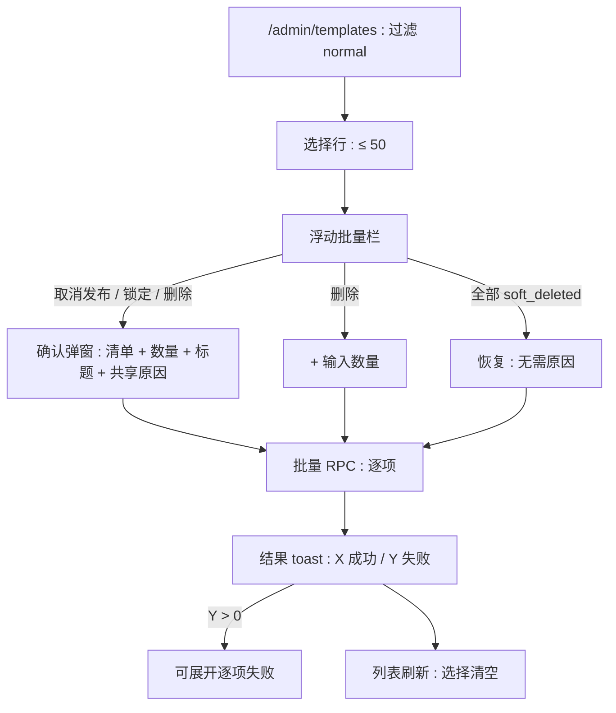
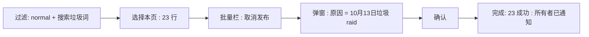

# 批量模板审核 — UI/UX 设计

- **功能 ID：** bulk-template-moderation
- **版本：** 1.0
- **状态：** Proposed（待架构评审）
- **作者：** ui-ux-agent
- **日期：** 2026-10-13
- **配套文档：** `bulk-template-moderation-requirements-zh-CN.md`

## 1. 设计原则

1. **复用肌肉记忆。** 与 bulk-operations 相同的复选框、浮动栏、结果 toast —— 批量封禁过的管理员已经会这个流程。
2. **一个原因，多张回执。** 单一共享原因字段；逐项审计与逐项结果保持监督粒度。
3. **摩擦随力度升级。** 取消发布/锁定用清单确认；删除加输入数量。
4. **感知状态，而非制造错误。** 操作栏只提供对当前选择有意义的操作。

## 2. 信息架构



## 3. 用户流程

### 3.1 垃圾内容 raid 响应



### 3.2 批量恢复误操作


## 4. 页面布局

### 4.1 带选择的 /admin/templates

```
+----------------------------------------------------------------------+
|  模板   [状态 ▾: normal]  [搜索…]                                     |
+----------------------------------------------------------------------+
| ☑ | 标题             所有者   状态     更新时间                        |
| ☑ | Spam Promo 1      bob12   normal   10月13日                       |
| ☑ | Spam Promo 2      bob13   normal   10月13日                       |
| ☐ | Logo Pack         Carol   normal   10月10日                       |
+----------------------------------------------------------------------+
|  ⚡ 已选 2 项   [取消发布] [锁定] [删除]                    [清除]      |
+----------------------------------------------------------------------+
```

### 4.2 批量确认弹窗（取消发布）

```
+----------------------------------------------------------------------+
|  取消发布 23 个模板？                                                   |
|                                                                      |
|  将会发生什么（每个模板）：                                              |
|    • 从公开界面移除（首页、搜索、嵌入、API）                             |
|    • 所有者保留访问权限并可编辑                                          |
|    • 所有者将收到含你原因的通知                                          |
|    • 可逆：随时可恢复                                                   |
|                                                                      |
|  模板：Spam Promo 1、Spam Promo 2、Spam Promo 3、Spam                 |
|        Promo 4、Spam Promo 5 +18 更多                                  |
|                                                                      |
|  原因（必填，对每位所有者可见）：                                        |
|  [                                                            ]     |
|                                                                      |
|                            [取消]  [取消发布 23 个]                    |
+----------------------------------------------------------------------+
```

删除变体额外增加："输入 23 以确认：[ ]"，按钮显示"删除 23 个"。

### 4.3 带失败的结果 toast

```
+----------------------------------------------+
| ✓ 完成：11 成功，1 失败            [详情 ▾]   |
+----------------------------------------------+
|  ✗ Spam Promo 7 —— 你不能审核自己的模板       |
+----------------------------------------------+
```

### 4.4 移动端

表格变为堆叠卡片，前置复选框；浮动栏横贯底部，含图标 + 计数；确认弹窗变为底部抽屉，原因字段最后。逐项失败以单列行展示。

## 5. 组件规格

| 组件 | 行为 | 状态 |
|---|---|---|
| BulkModerationBar | 浮动栏：计数 + 感知状态的操作 + 清除 | 无选择隐藏 / raid 模式（取消发布/锁定/删除）/ 恢复模式 |
| BulkConfirmModal | 清单 + 数量 + 前 5 标题 + 共享原因（3–500）；删除加输入数量 | 空闲 / 无效 / 提交中 |
| TypedCountInput | 数字输入必须等于所选数量；否则按钮禁用 | 空 / 不匹配 / 匹配 |
| ResultToast | "完成：X 成功，Y 失败" + 可展开失败 | 全成功 / 部分 / 全失败 |
| FailureList | 逐项标题 + 错误信息行 | 1..N 项 |

## 6. 交互细节

1. **选择：** 与 bulk-operations 完全一致 —— 三态表头、50 上限带 toast、过滤变更清空。选择仅在 `/admin/templates` 可用。
2. **感知状态的操作栏：** 由所选状态计算 —— 全部软删除 → 仅恢复；任一软删除 → 仅恢复 + 清除；否则取消发布/锁定/删除 + 清除。
3. **确认流程：** 弹窗打开时显示单操作后果清单（按模板措辞）、数量、前 5 标题与共享原因。原因有效（删除还需输入数量）前提交禁用。
4. **输入数量：** 输入仅接受数字；实时不匹配提示（"输入 23 以确认"）；按钮标签内嵌数量（"删除 23 个"）使目标无歧义。
5. **执行：** 提交时弹窗内显示 spinner；批量 RPC 返回逐项结果；弹窗关闭、toast 出现。
6. **失败：** 展开 toast 列出每个失败标题及人类可读错误；失败项保留在列表中、未选中，管理员可重试或单独检查。
7. **刷新：** 批次后列表重新获取；状态 chip 反映新状态；状态过滤保留。
8. **限速：** 429 显示带 retry-after 倒计时的 toast；弹窗保持打开、输入保留。
9. **审计视图：** 每项审计行显示共享原因；管理审计日志将 `bulk` 标记渲染为小 chip（"批量 ×23"样式）便于扫视。

## 7. 状态汇总

| 界面 | 加载中 | 空态 | 错误 |
|---|---|---|---|
| BulkModerationBar | — | 隐藏（无选择） | — |
| BulkConfirmModal | 提交中 spinner | — | 行内校验；429 → toast + 保持打开 |
| ResultToast | — | — | 由逐项结果渲染 |
| FailureList | — | 隐藏（Y=0） | — |
| 模板列表 | 表格骨架 | "没有匹配的模板" | toast + 重试 |

## 8. 国际化（i18n）

| Key | 中文 | 英文 |
|---|---|---|
| `bulkmod.bar.selected` | 已选 {{count}} 项 | {{count}} selected |
| `bulkmod.bar.unpublish` | 取消发布 | Unpublish |
| `bulkmod.bar.lock` | 锁定 | Lock |
| `bulkmod.bar.delete` | 删除 | Delete |
| `bulkmod.bar.restore` | 恢复 | Restore |
| `bulkmod.bar.clear` | 清除 | Clear |
| `bulkmod.modal.unpublish.title` | 取消发布 {{count}} 个模板？ | Unpublish {{count}} templates? |
| `bulkmod.modal.lock.title` | 锁定 {{count}} 个模板？ | Lock {{count}} templates? |
| `bulkmod.modal.delete.title` | 删除 {{count}} 个模板？ | Delete {{count}} templates? |
| `bulkmod.modal.restore.title` | 恢复 {{count}} 个模板？ | Restore {{count}} templates? |
| `bulkmod.modal.perTemplate` | 将会发生什么（每个模板）： | What happens (per template): |
| `bulkmod.modal.templates` | 模板：{{list}} +{{n}} 更多 | Templates: {{list}} +{{n}} more |
| `bulkmod.modal.reason` | 原因（必填，对每位所有者可见） | Reason (required, visible to every owner) |
| `bulkmod.modal.typeCount` | 输入 {{count}} 以确认 | Type {{count}} to confirm |
| `bulkmod.modal.countMismatch` | 输入 {{count}} 以确认 | Type {{count}} to confirm |
| `bulkmod.modal.confirm.unpublish` | 取消发布 {{count}} 个 | Unpublish {{count}} |
| `bulkmod.modal.confirm.delete` | 删除 {{count}} 个 | Delete {{count}} |
| `bulkmod.toast.done` | 完成：{{ok}} 成功，{{fail}} 失败 | Done: {{ok}} succeeded, {{fail}} failed |
| `bulkmod.toast.details` | 详情 | Details |
| `bulkmod.error.self_guard` | 你不能审核自己的模板 | You cannot moderate your own template |
| `bulkmod.error.invalid_state` | 当前状态不适用此操作 | Not in a state where this action applies |
| `bulkmod.error.conflict` | 已处于目标状态 | Already in the target state |
| `bulkmod.error.not_found` | 模板不存在 | Template not found |
| `bulkmod.error.rateLimited` | 批量操作过于频繁。{{seconds}} 秒后重试。 | Too many batch actions. Retry in {{seconds}}s. |
| `bulkmod.audit.bulkChip` | 批量 ×{{n}} | bulk ×{{n}} |

## 9. 无障碍

- 复选框列表头使用三态模式（`aria-checked="mixed"`）；每行复选框以其模板标题为标签。
- 浮动栏是带标签的工具栏（`role=toolbar`），可见时进入 Tab 顺序；操作按钮的可访问名称内嵌数量。
- 确认弹窗焦点陷阱；原因 textarea 与输入数量框有可见标签及 `aria-describedby` 规则；实时校验通过 `aria-live=polite` 播报。
- 结果 toast 为 `role=status`；可展开失败列表是语义列表，每个错误为文字（非仅颜色）。
- 审计批量 chip 有文字标签，非仅颜色。

## 10. 数据埋点（可选）

- `bulkmod_action_taken`（操作、数量、来源过滤）、`bulkmod_failures`（错误码）、`bulkmod_restore_used` —— 仅产品使用事件。

## 11. 不在范围内

- 跨页选择；评论/用户/合集批量操作；批量硬删除；批量申诉裁决；混合操作批次。
- 任何形式的变现 —— 本产品永久不做。
