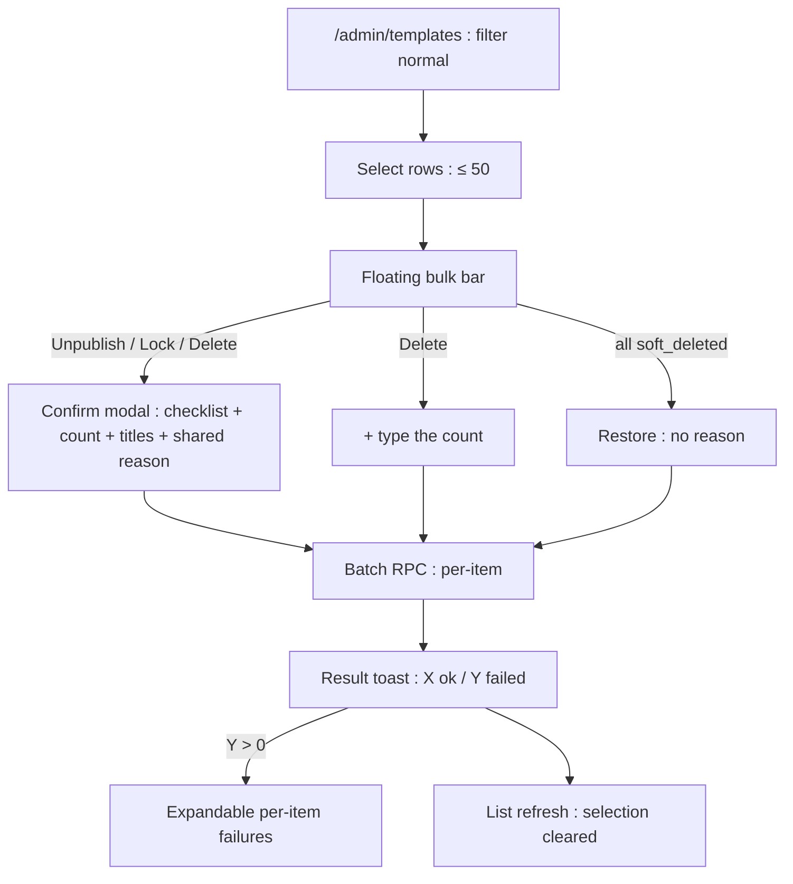
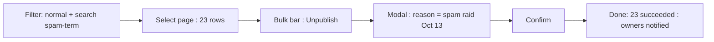
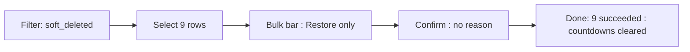

# Bulk Template Moderation — UI/UX Design

- **Feature ID:** bulk-template-moderation
- **Version:** 1.0
- **Status:** Proposed (for architecture review)
- **Author:** ui-ux-agent
- **Date:** 2026-10-13
- **Companion doc:** `bulk-template-moderation-requirements.md`

## 1. Design Principles

1. **Reuse the muscle memory.** Same checkboxes, same floating bar, same result toast as bulk-operations — admins who've banned in bulk already know this flow.
2. **One reason, many receipts.** A single shared reason field; per-item audit and per-item results keep oversight granular.
3. **Friction scales with force.** Unpublish/lock confirm with a checklist; delete adds type-the-count.
4. **State-aware, not error-prone.** The bar only offers actions that make sense for the current selection.

## 2. Information Architecture



## 3. User Flows

### 3.1 Spam raid response



### 3.2 Bulk restore a mistake



## 4. Page Layouts

### 4.1 /admin/templates with selection

```
+----------------------------------------------------------------------+
|  Templates   [Status ▾: normal]  [Search…]                           |
+----------------------------------------------------------------------+
| ☑ | Title             Owner   Status    Updated                      |
| ☑ | Spam Promo 1      bob12   normal    Oct 13                       |
| ☑ | Spam Promo 2      bob13   normal    Oct 13                       |
| ☐ | Logo Pack         Carol   normal    Oct 10                       |
+----------------------------------------------------------------------+
|  ⚡ 2 selected   [Unpublish] [Lock] [Delete]              [Clear]     |
+----------------------------------------------------------------------+
```

### 4.2 Bulk confirm modal (unpublish)

```
+----------------------------------------------------------------------+
|  Unpublish 23 templates?                                              |
|                                                                      |
|  What happens (per template):                                        |
|    • Removed from public surfaces (home, search, embeds, API)        |
|    • The owner keeps access and can edit                             |
|    • The owner is notified with your reason                          |
|    • Reversible: restore any time                                    |
|                                                                      |
|  Templates: Spam Promo 1, Spam Promo 2, Spam Promo 3, Spam           |
|             Promo 4, Spam Promo 5 +18 more                           |
|                                                                      |
|  Reason (required, visible to every owner):                          |
|  [                                                            ]     |
|                                                                      |
|                            [Cancel]  [Unpublish 23]                  |
+----------------------------------------------------------------------+
```

Delete variant adds: "Type 23 to confirm: [ ]" and the button reads "Delete 23".

### 4.3 Result toast with failures

```
+----------------------------------------------+
| ✓ Done: 11 succeeded, 1 failed    [Details ▾]|
+----------------------------------------------+
|  ✗ Spam Promo 7 — You cannot moderate your   |
|    own template                              |
+----------------------------------------------+
```

### 4.4 Mobile

The table becomes stacked cards with a leading checkbox; the floating bar spans the bottom with icons + count; the confirm modal becomes a bottom sheet with the reason field last. Per-item failures list as single-column rows.

## 5. Component Specs

| Component | Behavior | States |
|---|---|---|
| BulkModerationBar | Floating bar: count + state-aware actions + Clear | none hidden (no selection) / raid mode (unpublish/lock/delete) / restore mode |
| BulkConfirmModal | Checklist + count + first-5 titles + shared reason (3–500); delete adds typed-count | idle / invalid / submitting |
| TypedCountInput | Numeric input must equal selection count; button disabled otherwise | empty / mismatch / match |
| ResultToast | "Done: X succeeded, Y failed" + expandable failures | all-ok / partial / all-failed |
| FailureList | Per-item title + error message rows | 1..N items |

## 6. Interaction Details

1. **Selection:** identical to bulk-operations — tri-state header, 50 cap with toast, clears on filter change. Selecting is only available on `/admin/templates`.
2. **State-aware bar:** computed from the selection's statuses — all soft-deleted → Restore only; any soft-deleted → Restore + Clear only; otherwise Unpublish/Lock/Delete + Clear.
3. **Confirm flow:** modal opens with the single-action consequence checklist (per-template wording), the count, first 5 titles, and the shared reason. Submit disabled until reason is valid (and count typed for delete).
4. **Typed count:** input accepts digits only; live mismatch hint ("Type 23 to confirm"); button label embeds the count ("Delete 23") so the target is unambiguous.
5. **Execution:** submit shows a spinner in the modal; the batch RPC returns per-item results; the modal closes and the toast appears.
6. **Failures:** expanding the toast lists each failed title with its human-readable error; failed items stay in the list, unselected, so the admin can retry or inspect individually.
7. **Refresh:** the list refetches after the batch; status chips reflect the new states; the status filter is preserved.
8. **Rate limit:** a 429 shows a toast with the retry-after countdown; the modal stays open with inputs preserved.
9. **Audit view:** each item's audit row shows the shared reason; the admin audit log renders the `bulk` marker as a small chip ("bulk ×23" style) for scannability.

## 7. States Summary

| Surface | Loading | Empty | Error |
|---|---|---|---|
| BulkModerationBar | — | Hidden (no selection) | — |
| BulkConfirmModal | Submitting spinner | — | Inline validation; 429 → toast + stay open |
| ResultToast | — | — | Rendered from per-item results |
| FailureList | — | Hidden (Y=0) | — |
| Templates list | Table skeleton | "No templates match" | Toast + retry |

## 8. i18n

| Key | EN | ZH |
|---|---|---|
| `bulkmod.bar.selected` | {{count}} selected | 已选 {{count}} 项 |
| `bulkmod.bar.unpublish` | Unpublish | 取消发布 |
| `bulkmod.bar.lock` | Lock | 锁定 |
| `bulkmod.bar.delete` | Delete | 删除 |
| `bulkmod.bar.restore` | Restore | 恢复 |
| `bulkmod.bar.clear` | Clear | 清除 |
| `bulkmod.modal.unpublish.title` | Unpublish {{count}} templates? | 取消发布 {{count}} 个模板？ |
| `bulkmod.modal.lock.title` | Lock {{count}} templates? | 锁定 {{count}} 个模板？ |
| `bulkmod.modal.delete.title` | Delete {{count}} templates? | 删除 {{count}} 个模板？ |
| `bulkmod.modal.restore.title` | Restore {{count}} templates? | 恢复 {{count}} 个模板？ |
| `bulkmod.modal.perTemplate` | What happens (per template): | 将会发生什么（每个模板）： |
| `bulkmod.modal.templates` | Templates: {{list}} +{{n}} more | 模板：{{list}} +{{n}} 更多 |
| `bulkmod.modal.reason` | Reason (required, visible to every owner) | 原因（必填，对每位所有者可见） |
| `bulkmod.modal.typeCount` | Type {{count}} to confirm | 输入 {{count}} 以确认 |
| `bulkmod.modal.countMismatch` | Type {{count}} to confirm | 输入 {{count}} 以确认 |
| `bulkmod.modal.confirm.unpublish` | Unpublish {{count}} | 取消发布 {{count}} 个 |
| `bulkmod.modal.confirm.delete` | Delete {{count}} | 删除 {{count}} 个 |
| `bulkmod.toast.done` | Done: {{ok}} succeeded, {{fail}} failed | 完成：{{ok}} 成功，{{fail}} 失败 |
| `bulkmod.toast.details` | Details | 详情 |
| `bulkmod.error.self_guard` | You cannot moderate your own template | 你不能审核自己的模板 |
| `bulkmod.error.invalid_state` | Not in a state where this action applies | 当前状态不适用此操作 |
| `bulkmod.error.conflict` | Already in the target state | 已处于目标状态 |
| `bulkmod.error.not_found` | Template not found | 模板不存在 |
| `bulkmod.error.rateLimited` | Too many batch actions. Retry in {{seconds}}s. | 批量操作过于频繁。{{seconds}} 秒后重试。 |
| `bulkmod.audit.bulkChip` | bulk ×{{n}} | 批量 ×{{n}} |

## 9. Accessibility

- Checkbox column headers use the tri-state pattern with `aria-checked="mixed"`; each row checkbox labels its template title.
- The floating bar is a labelled toolbar (`role=toolbar`) that appears in Tab order when visible; action buttons embed the count in their accessible names.
- The confirm modal is focus-trapped; the reason textarea and typed-count input have visible labels with `aria-describedby` rules; live validation announces via `aria-live=polite`.
- The result toast is `role=status`; the expandable failure list is a semantic list with each error as text (not color alone).
- The audit bulk chip has a text label and is not color-only.

## 10. Analytics (optional)

- `bulkmod_action_taken` (action, count, source filter), `bulkmod_failures` (error codes), `bulkmod_restore_used` — product usage events only.

## 11. Out of Scope

- Cross-page selection; bulk comment/user/collection moderation; bulk hard-delete; bulk appeal resolution; mixed-action batches.
- Monetization of any kind — permanently out of scope for this product.
