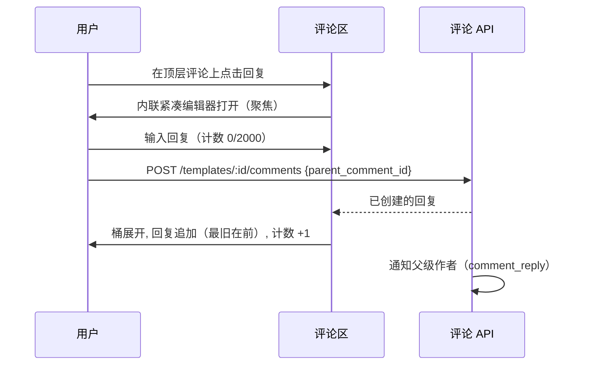
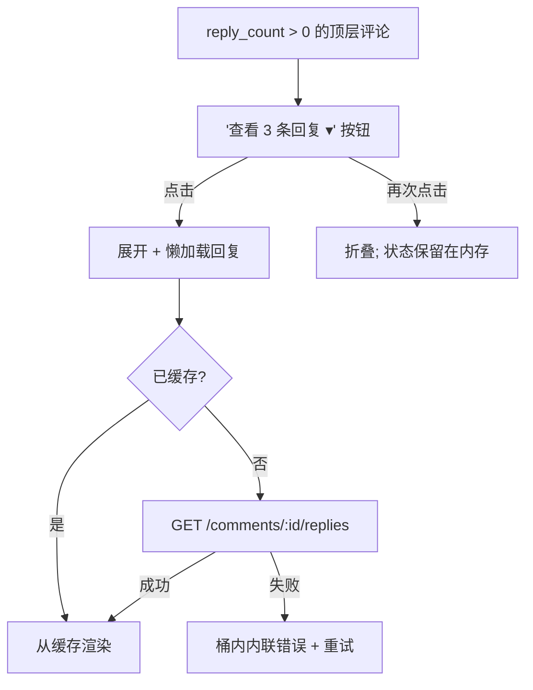
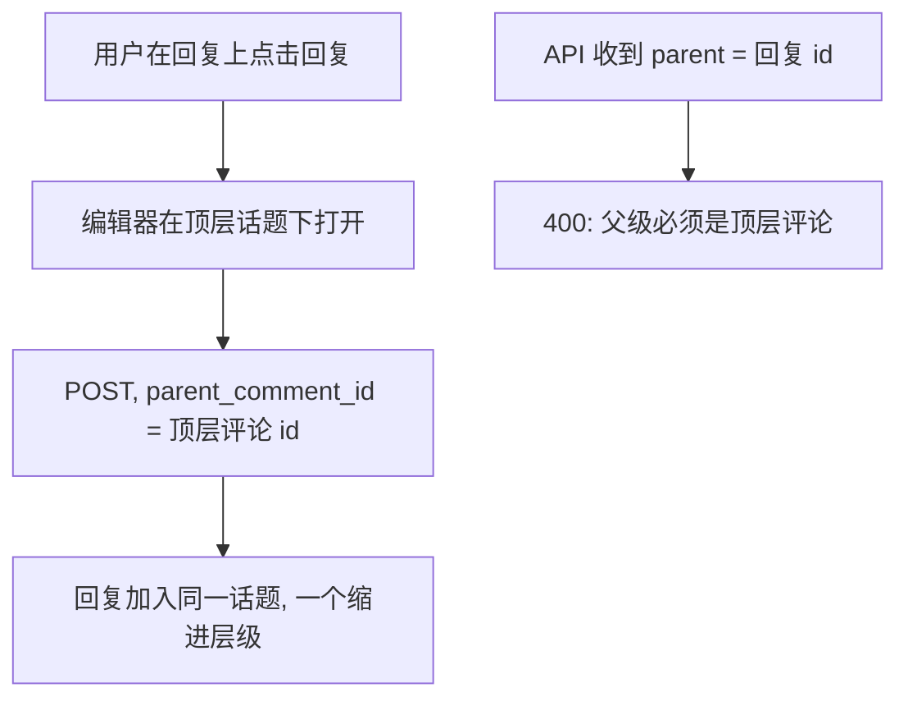
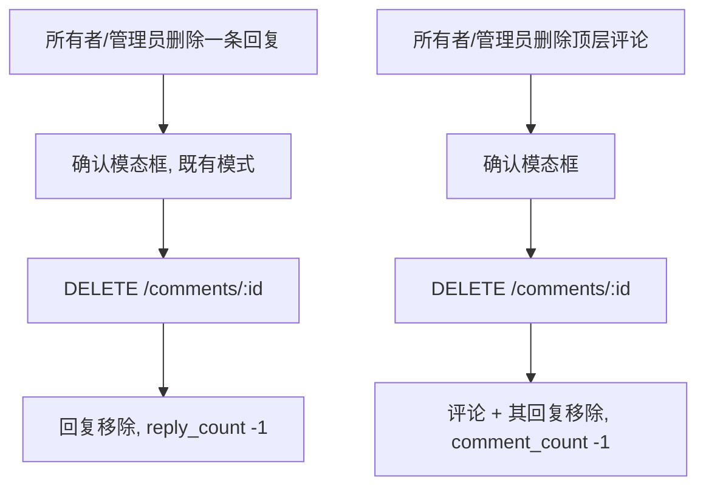

# 评论回复与话题 — UI/UX 设计

- **功能标识:** comment-replies-threads
- **版本:** 1.0
- **状态:** 已提案（待架构评审）
- **作者:** ui-ux-agent
- **日期:** 2026-10-12
- **配套文档:** `comment-replies-threads-requirements-zh-CN.md`

## 1. 设计原则

1. **一级，不再深。** GitHub/YouTube 式单级话题：回复在顶层评论下缩进一次；回复的回复加入同一话题。没有嵌套兔子洞。
2. **默认可扫读。** 回复桶折叠并显示计数；读者只展开关心的话题。评论区的节奏与已上线评论一致。
3. **Aurora 原生。** 复用已上线的 `CommentsSection`/`CommentItem`/`CommentComposer`/`CommentEditForm` 组件、令牌、Modal、toast、骨架屏和双主题。回复编辑器是既有编辑器的紧凑变体。
4. **对话要通知。** 回复提醒父级作者 —— 这是把评论墙变成对话的唯一关键改动。
5. **优雅降级。** 回复列表失败被限制在桶内；评论区和页面永不受影响。

## 2. 信息架构

```mermaid
flowchart LR
    A[/templates/:id] --> B[评论区]
    B --> C[顶层评论, 最新在前]
    C -->|回复操作| D[内联回复编辑器]
    D -->|发布| E[回复追加到话题]
    C -->|查看 N 条回复| F[回复桶: 最旧在前]
    F -->|按既有规则编辑/删除| F
    G[通知: comment_reply] -->|点击| A
    H[/admin/comments] --> I[parent 列 + 带理由删除]
```

**界面:**

| 界面 | 访问 | 内容 |
|---|---|---|
| `/templates/:id` 评论区 | 公开可读；登录可回复 | 话题：顶层评论 + 可折叠回复桶 |
| 内联回复编辑器 | 需登录 | 评论下方的紧凑编辑器 |
| 通知（`comment_reply`） | 父级作者 | 回复者、摘要、模板链接 |
| `/admin/comments` | 管理员 | 既有列表 + parent 列 |

## 3. 用户流程

### 3.1 回复评论



### 3.2 阅读话题



### 3.3 回复一条回复



### 3.4 审核



## 4. 页面布局

### 4.1 带话题的评论区

```text
┌──────────────────────────────────────────────────────────────┐
│ 评论 (12)                                                     │
├──────────────────────────────────────────────────────────────┤
│ [编辑器卡片 —— 不变]                                          │
│ ┌──────────────────────────────────────────────────────────┐ │
│ │ [av] Alice · 2小时前                   [编辑] [删除]      │ │
│ │      GPT-4o mini 能用吗？                                 │ │
│ │                              [回复]  ▾ 查看 2 条回复      │ │
│ │   ┌──────────────────────────────────────────────────┐   │ │
│ │   │ [av] Bob [创作者] · 1小时前          [删除]       │   │ │
│ │   │      可以 —— v2 修复了 JSON 输出。                 │   │ │
│ │   │                              [回复]               │   │ │
│ │   ├──────────────────────────────────────────────────┤   │ │
│ │   │ [av] Alice · 55分钟前              [编辑] [删除]  │   │ │
│ │   │      太好了，谢谢！（已编辑）                       │   │ │
│ │   │                              [回复]               │   │ │
│ │   └──────────────────────────────────────────────────┘   │ │
│ ├──────────────────────────────────────────────────────────┤ │
│ │ [av] Carol · 3天前  [已解答]                              │ │
│ │      推荐用什么模型？                                      │ │
│ │                              [回复]  ▾ 查看 1 条回复      │ │
│ └──────────────────────────────────────────────────────────┘ │
│                   [ 加载更多评论 ]                            │
└──────────────────────────────────────────────────────────────┘
```

- **回复操作:** 每条评论行上的文字按钮（仅登录；匿名处显示"登录以回复"）。在行正下方打开紧凑编辑器；同时只开一个编辑器（打开另一个会关闭前一个，草稿按行保留在组件状态中）。
- **回复桶:** 顶层评论下方的"查看 {N} 条回复 ▾"（单数"查看 1 条回复"）；带左侧竖线的缩进容器（既有边框令牌）；回复使用完整 `CommentItem` 视觉但无桶（回复不再嵌套）。
- **已解答角标:** `has_creator_reply` 为真时时间戳旁的小号填充角标。
- **回复行:** 按既有权限规则相同的悬停操作（编辑/删除）；所有者回复带 CREATOR 徽章。

### 4.2 内联回复编辑器（紧凑变体）

```text
│   ┌──────────────────────────────────────────────────┐   │
│   │ [av] ┌────────────────────────────────────┐      │   │
│   │      │ 回复 Alice…                        │      │   │
│   │      │ (textarea, 自适应 2 行)            │      │   │
│   │      └────────────────────────────────────┘      │   │
│   │                       64 / 2000  [取消] [回复]    │   │
│   └──────────────────────────────────────────────────┘   │
```

- 与主编辑器相同的校验、计数、禁用逻辑和状态；`取消` 关闭它（草稿在会话内存中保留）。

### 4.3 管理控制台 —— parent 列

```text
│ 内容                       │ 所属评论           │ 作者   │ 时间   │ ⋯│
├────────────────────────────┼────────────────────┼────────┼────────┼──┤
│ "可以 —— v2 修复了 JSON…"   │ 回复 Alice         │ Bob    │ 1小时前│ 🗑│
│ "GPT-4o mini 能用吗…"      │ —                  │ Alice  │ 2小时前│ 🗑│
```

- 顶层显示"—"；回复显示"回复 {作者}"（作者显示名，非 id）。删除流程不变（理由模态框 + 审计日志）。

### 4.4 通知行（通知页，新类型）

```text
┌──────────────────────────────────────────────────────────────┐
│ [av] Bob 回复了你在"SQL Helper"下的评论                       │
│      "可以 —— v2 修复了 JSON 输出。" · 1小时前                 │
└──────────────────────────────────────────────────────────────┘
```

- 与既有通知类型相同的行结构；点击导航到模板（评论区锚点）。

## 5. 组件规格

| 组件 | 说明 |
|---|---|
| `CommentsSection`（扩展） | 数据流不变；向下传递话题属性 |
| `CommentItem`（扩展） | 新增回复操作、回复桶切换、已解答角标；渲染回复（一级，不递归） |
| `ReplyComposer` | `CommentComposer` 的紧凑变体；parent_comment_id；通过区块状态协调同时只开一个 |
| `RepliesBucket` | 折叠计数按钮；懒加载 + 缓存；最旧在前列表；内联错误 + 重试 |
| `AdminCommentsPage`（扩展） | 既有表格新增 parent 列 |

所有新 i18n 键位于 `comments.*`（回复），新列标签复用 `admin.comments.*`；通知文案位于 `notifications.*`。

## 6. 交互细节

- **同时只开一个编辑器:** 区块记录打开编辑器的评论 id；打开新的关闭旧的（草稿按评论 id 存在 map 中，发布成功或页面卸载时清除）。
- **桶展开:** 首次展开请求；后续展开从缓存渲染；发布回复自动展开桶并追加回复（无需手动刷新）。
- **计数同步:** `reply_count` 在发布/删除时本地更新；`comment_count`（区块标题）不受回复影响。
- **顺序:** 顶层最新在前（不变）；回复最旧在前（对话顺序）。
- **键盘:** 回复是真实按钮；桶切换是带 `aria-expanded` 的按钮；Esc 关闭编辑器；打开时焦点移入编辑器 textarea，关闭时回到回复触发器。
- **话题已满（400）:** 编辑器下方内联错误显示本地化信息；草稿保留。
- **速率限制（429）:** 既有内联错误模式附 `Retry-After` 秒数；草稿保留。

## 7. 状态汇总

| 场景 | 加载 | 空 | 错误 |
|---|---|---|---|
| 顶层列表 | 既有骨架屏 | 既有空状态 | 既有内联错误 + 重试 |
| 回复桶 | 桶内 2 行微光 | 不适用（0 时桶隐藏） | 桶内内联错误 + 重试 |
| 发布回复 | 回复按钮 spinner | 不适用 | 内联错误, 草稿保留 |
| 话题已满 | 不适用 | 不适用 | 内联"话题已满"信息 |
| 管理列表 | 既有骨架屏 | 既有空状态 | 既有错误横幅 |

## 8. i18n 字符串表（EN/ZH）

| 键（EN） | ZH |
|---|---|
| comments.reply / Reply | 回复 |
| comments.replyTo / Reply to {{name}}… | 回复 {{name}}… |
| comments.loginToReply / Log in to reply | 登录以回复 |
| comments.viewReplies / View {{count}} replies | 查看 {{count}} 条回复 |
| comments.viewOneReply / View 1 reply | 查看 1 条回复 |
| comments.hideReplies / Hide replies | 收起回复 |
| comments.answered / Answered | 已解答 |
| comments.threadFull / This thread is full — post a new comment instead. | 此话题已满 —— 请发表新评论。 |
| comments.repliesError / Couldn't load replies. | 无法加载回复。 |
| comments.replyPosted / Reply posted | 回复已发布 |
| admin.comments.parent / Parent | 所属评论 |
| admin.comments.inReplyTo / in reply to {{author}} | 回复 {{author}} |
| admin.comments.topLevel / — | — |
| notifications.comment_reply / {{actor}} replied to your comment on "{{title}}" | {{actor}} 回复了你在"{{title}}"下的评论 |
| notifications.comment_reply.snippet / "{{snippet}}" | "{{snippet}}" |

## 8a. 通知偏好条目

通知偏好页（数据驱动类型列表）自动新增 `comment_reply` 行：

| 键（EN） | ZH |
|---|---|
| notifPrefs.type.comment_reply / Comment replies | 评论回复 |
| notifPrefs.type.comment_reply.desc / Someone replies to your comment. | 有人回复了你的评论。 |

## 9. 无障碍

- 话题是嵌套 `<ul>`/`<li>`：顶层列表包含回复子列表；深度由语义传达。
- 桶切换：真实按钮、`aria-expanded`、`aria-controls` 指向回复列表 id。
- 回复编辑器：带标签的 textarea（`aria-label`"回复 {name}"）；字符计数礼貌播报；禁用状态有传达。
- 已解答角标有文字（非仅颜色）；CREATOR 徽章不变。
- 焦点管理：编辑器打开时焦点移入 textarea；Esc/取消后焦点回到回复触发器；桶展开时焦点保持在切换按钮上。
- 所有颜色在两种主题下满足 WCAG AA（基于令牌）。

## 10. 响应式行为

- **回复缩进:** 桌面 32px，640px 以下 20px；回复头像在移动端降为 24px（既有小头像令牌）。
- **回复桶:** 父级下方全宽；左侧竖线保留为话题视觉锚点。
- **回复编辑器:** 缩进容器内全宽；窄屏按钮换行到计数下方。
- **管理台 parent 列:** 管理台平板断点以下隐藏（内容 + 作者 + 操作保留）；若表格支持则在行展开详情中显示全文，否则用提示。
- **通知行:** 摘要在移动端单行截断加省略号。

## 11. 分析（可选，若分析功能上线）

- `comment_reply_posted`、`thread_expanded`、`thread_collapsed`、`answered_chip_visible` —— 仅产品用途；v1 不新增埋点基础设施。

## 12. 范围之外（与需求 §8 一致）

多层嵌套、@提及、回复表情、回复排序选项、"continue this thread"分页、重新挂载回复、折叠单条回复、邮件摘要、置顶回复、向话题其他参与者通知、管理员话题视图 UI，以及任何货币化相关界面。
