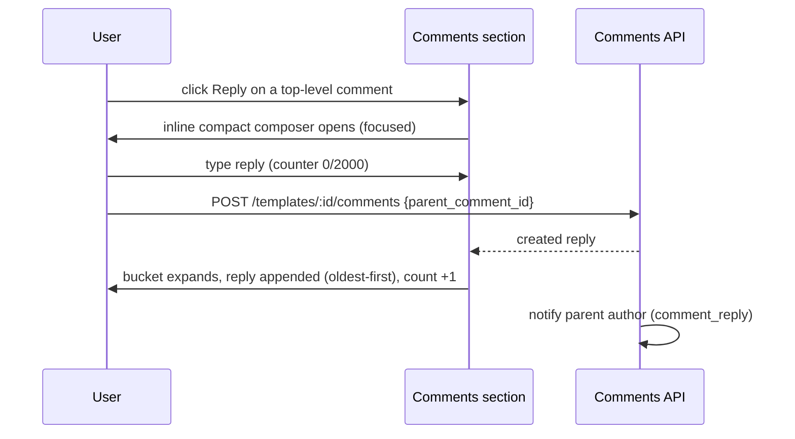
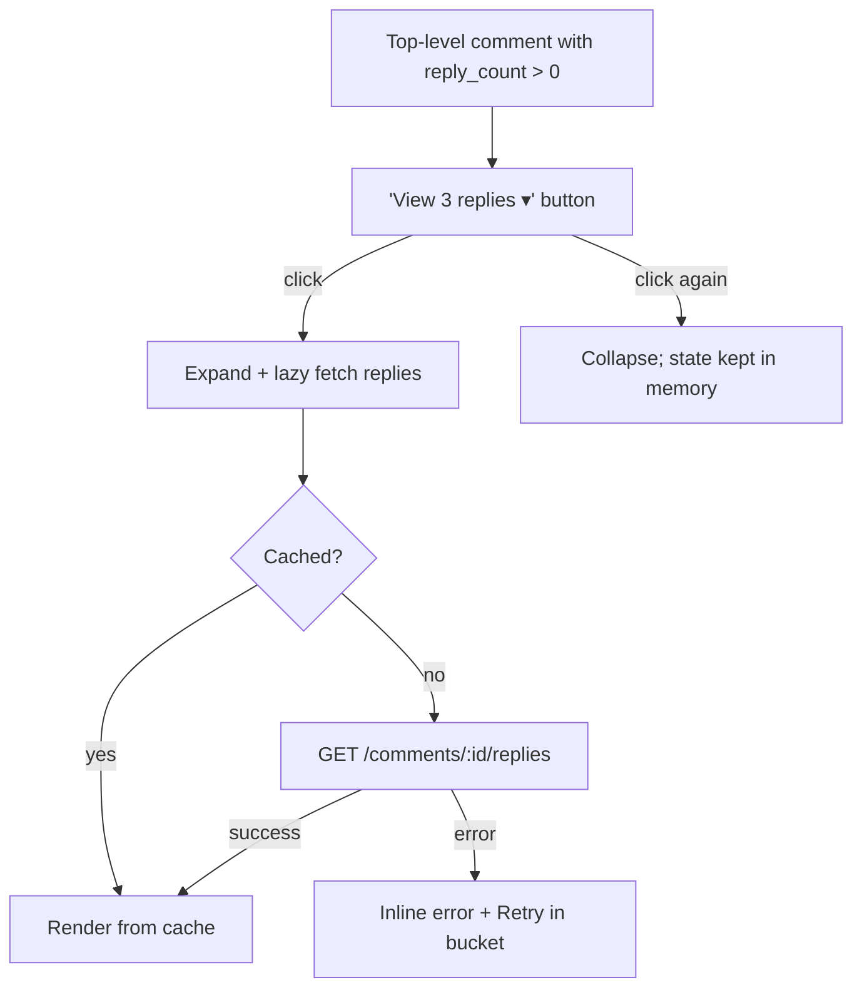
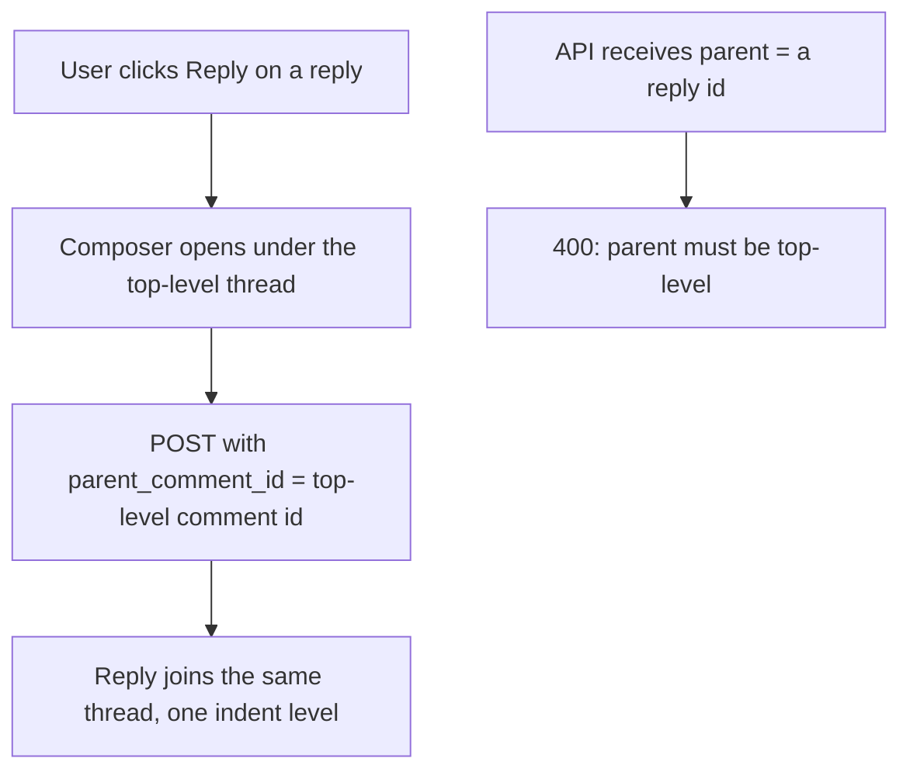
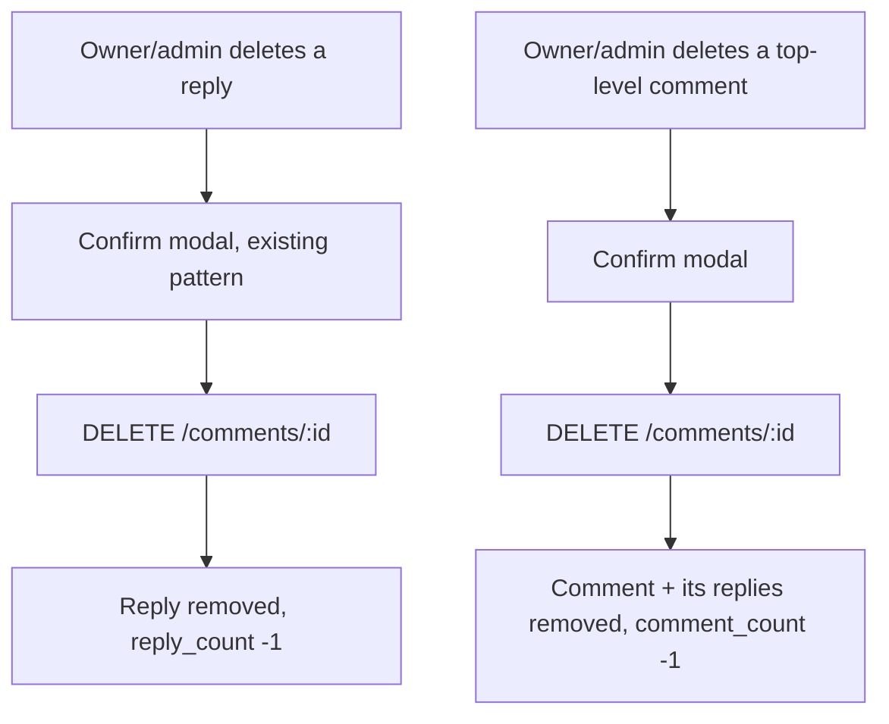

# Comment Replies & Threads — UI/UX Design

- **Feature ID:** comment-replies-threads
- **Version:** 1.0
- **Status:** Proposed (for architecture review)
- **Author:** ui-ux-agent
- **Date:** 2026-10-12
- **Companion doc:** `comment-replies-threads-requirements.md`

## 1. Design Principles

1. **One level, no deeper.** GitHub/YouTube-style single-level threading: replies indent once under their top-level comment; replies-to-replies join the same thread. No nesting rabbit holes.
2. **Scannable by default.** Reply buckets are collapsed with a count; readers expand only the threads they care about. The section's rhythm is unchanged from shipped comments.
3. **Aurora-native.** Reuse the shipped `CommentsSection`/`CommentItem`/`CommentComposer`/`CommentEditForm` components, tokens, Modal, toasts, skeletons, and both themes. The reply composer is the existing composer in a compact variant.
4. **Conversations notify.** A reply pings the parent author — the single change that turns a comment wall into a conversation.
5. **Graceful degradation.** Reply-list failures are contained to the bucket; the section and page are never affected.

## 2. Information Architecture

```mermaid
flowchart LR
    A[/templates/:id] --> B[Comments section]
    B --> C[Top-level comments, newest-first]
    C -->|Reply action| D[Inline reply composer]
    D -->|post| E[Reply appended to thread]
    C -->|View N replies| F[Replies bucket: oldest-first]
    F -->|edit/delete per existing rules| F
    G[Notification: comment_reply] -->|click| A
    H[/admin/comments] --> I[Parent column + delete with reason]
```

**Surfaces:**

| Surface | Access | Content |
|---|---|---|
| Comments section on `/templates/:id` | public read; auth to reply | Threads: top-level comments + collapsible reply buckets |
| Reply composer (inline) | auth | Compact composer under a comment |
| Notification (`comment_reply`) | parent author | Replier, snippet, link to template |
| `/admin/comments` | admin | Existing list + parent column |

## 3. User Flows

### 3.1 Reply to a comment



### 3.2 Read a thread



### 3.3 Reply to a reply



### 3.4 Moderation



## 4. Page Layouts

### 4.1 Comments section with threads

```text
┌──────────────────────────────────────────────────────────────┐
│ Comments (12)                                                │
├──────────────────────────────────────────────────────────────┤
│ [composer card — unchanged]                                  │
│ ┌──────────────────────────────────────────────────────────┐ │
│ │ [av] Alice · 2h ago                    [Edit] [Delete]   │ │
│ │      Does this work with GPT-4o mini?                    │ │
│ │                              [Reply]  ▾ View 2 replies   │ │
│ │   ┌──────────────────────────────────────────────────┐   │ │
│ │   │ [av] Bob [CREATOR] · 1h ago        [Delete]      │   │ │
│ │   │      Yes — v2 fixed the JSON output.             │   │ │
│ │   │                              [Reply]              │   │ │
│ │   ├──────────────────────────────────────────────────┤   │ │
│ │   │ [av] Alice · 55m ago             [Edit] [Delete] │   │ │
│ │   │      Perfect, thanks!  (edited)                   │   │ │
│ │   │                              [Reply]              │   │ │
│ │   └──────────────────────────────────────────────────┘   │ │
│ ├──────────────────────────────────────────────────────────┤ │
│ │ [av] Carol · 3d ago  [Answered]                          │ │
│ │      What model do you recommend?                        │ │
│ │                              [Reply]  ▾ View 1 reply     │ │
│ └──────────────────────────────────────────────────────────┘ │
│                   [ Load more comments ]                     │
└──────────────────────────────────────────────────────────────┘
```

- **Reply action:** text button on every comment row (auth only; anonymous see "Log in to reply" in its place). Opens the compact composer directly under the row; only one composer is open at a time (opening another closes the previous, draft preserved per-row in component state).
- **Replies bucket:** "View {N} replies ▾" under the top-level comment (singular "1 reply"); indented container with a left rule (existing border token); replies use the full `CommentItem` visuals minus the bucket (replies never nest further).
- **Answered chip:** small filled chip next to the timestamp when `has_creator_reply` is true.
- **Reply rows:** same hover actions (Edit/Delete) per existing permission rules; CREATOR badge on owner replies.

### 4.2 Inline reply composer (compact variant)

```text
│   ┌──────────────────────────────────────────────────┐   │
│   │ [av] ┌────────────────────────────────────┐      │   │
│   │      │ Reply to Alice…                    │      │   │
│   │      │ (textarea, autos 2 rows)           │      │   │
│   │      └────────────────────────────────────┘      │   │
│   │                          64 / 2000  [Cancel] [Reply] │   │
│   └──────────────────────────────────────────────────┘   │
```

- Same validation, counter, disabled logic, and states as the main composer; `Cancel` closes it (draft kept in memory for the session).

### 4.3 Admin console — parent column

```text
│ Content                    │ Parent             │ Author │ Posted │ ⋯│
├────────────────────────────┼────────────────────┼────────┼────────┼──┤
│ "Yes — v2 fixed the JSON…" │ in reply to Alice  │ Bob    │ 1h ago │ 🗑│
│ "Does this work with…"     │ —                  │ Alice  │ 2h ago │ 🗑│
```

- "—" for top-level; "in reply to {author}" for replies (author display name, not id). Delete flow unchanged (reason modal + audit log).

### 4.4 Notification row (notifications page, new type)

```text
┌──────────────────────────────────────────────────────────────┐
│ [av] Bob replied to your comment on "SQL Helper"             │
│      "Yes — v2 fixed the JSON output." · 1h ago              │
└──────────────────────────────────────────────────────────────┘
```

- Same row shape as existing notification types; click navigates to the template (comments section anchor).

## 5. Component Specs

| Component | Notes |
|---|---|
| `CommentsSection` (extended) | Unchanged data flow; passes thread props down |
| `CommentItem` (extended) | Adds Reply action, replies bucket toggle, Answered chip; renders replies recursively-free (one level) |
| `ReplyComposer` | Compact variant of `CommentComposer`; parent_comment_id; one-open-at-a-time coordination via section state |
| `RepliesBucket` | Collapsed count button; lazy fetch + cache; oldest-first list; inline error + Retry |
| `AdminCommentsPage` (extended) | Parent column added to the existing table |

All new i18n keys live under `comments.*` (replies) and reuse `admin.comments.*` for the new column label; notification strings under `notifications.*`.

## 6. Interaction Details

- **One composer at a time:** the section tracks the open composer's comment id; opening a new one closes the old (draft preserved per comment id in a map, cleared on successful post or page unload).
- **Bucket expansion:** first expansion fetches; subsequent expansions render from cache; posting a reply auto-expands the bucket and appends the reply (no manual refresh).
- **Counter sync:** `reply_count` updates locally on post/delete; `comment_count` (section title) is untouched by replies.
- **Order:** top-level newest-first (unchanged); replies oldest-first (conversational).
- **Keyboard:** Reply is a real button; bucket toggle is a button with `aria-expanded`; Esc closes the composer; focus moves into the composer textarea on open and returns to the Reply trigger on close.
- **Thread-full (400):** inline error under the composer with the localized message; draft preserved.
- **Rate limit (429):** existing inline error pattern with `Retry-After` seconds; draft preserved.

## 7. States Summary

| Context | Loading | Empty | Error |
|---|---|---|---|
| Top-level list | Existing skeleton | Existing empty state | Existing inline error + Retry |
| Replies bucket | 2-row shimmer inside bucket | n/a (bucket hidden at 0) | Inline error + Retry inside bucket |
| Reply post | Reply button spinner | n/a | Inline error, draft preserved |
| Thread full | n/a | n/a | Inline "thread is full" message |
| Admin list | Existing skeleton | Existing empty | Existing error banner |

## 8. i18n String Table (EN/ZH)

| Key (EN) | ZH |
|---|---|
| comments.reply / Reply | 回复 |
| comments.replyTo / Reply to {{name}}… | 回复 {{name}}… |
| comments.loginToReply / Log in to reply | 登录以回复 |
| comments.viewReplies / View {{count}} replies | 查看 {{count}} 条回复 |
| comments.viewOneReply / View 1 reply | 查看 1 条回复 |
| comments.hideReplies / Hide replies | 收起回复 |
| comments.answered / Answered | 已解答 |
| comments.threadFull / This thread is full — post a new comment instead. | 此话题已满 —— 请发表新评论。 |
| comments.repliesError / Couldn't load replies. | 无法加载回复。 |
| comments.replyPosted / Reply posted | 回复已发布 |
| admin.comments.parent / Parent | 所属评论 |
| admin.comments.inReplyTo / in reply to {{author}} | 回复 {{author}} |
| admin.comments.topLevel / — | — |
| notifications.comment_reply / {{actor}} replied to your comment on "{{title}}" | {{actor}} 回复了你在"{{title}}"下的评论 |
| notifications.comment_reply.snippet / "{{snippet}}" | "{{snippet}}" |

## 8a. Notification Preferences Entry

The notification-preferences page (data-driven type list) gains a `comment_reply` row automatically:

| Key (EN) | ZH |
|---|---|
| notifPrefs.type.comment_reply / Comment replies | 评论回复 |
| notifPrefs.type.comment_reply.desc / Someone replies to your comment. | 有人回复了你的评论。 |

## 9. Accessibility

- Threads are nested `<ul>`/`<li>`: top-level list contains reply sublists; depth conveyed semantically.
- Bucket toggle: real button, `aria-expanded`, `aria-controls` pointing at the replies list id.
- Reply composer: labeled textarea (`aria-label` "Reply to {name}"); char counter announced politely; disabled state conveyed.
- Answered chip has text (not color-only); CREATOR badge unchanged.
- Focus management: composer open moves focus to textarea; Esc/cancel returns focus to the Reply trigger; bucket expansion keeps focus on the toggle.
- All colors meet WCAG AA in both themes (token-based).

## 10. Responsive Behavior

- **Reply indentation:** 32px on desktop, 20px below 640px; avatar size in replies drops to 24px on mobile (existing small-avatar token).
- **Replies bucket:** full-width under the parent; the left rule remains as the thread's visual anchor.
- **Reply composer:** full-width inside the indented container; buttons wrap below the counter on narrow screens.
- **Admin parent column:** hidden below the admin tablet breakpoint (content + author + actions remain); full text in the row's expandable detail if the table supports it, else via tooltip.
- **Notification row:** snippet clamps to one line with ellipsis on mobile.

## 11. Analytics (optional, if analytics feature ships)

- `comment_reply_posted`, `thread_expanded`, `thread_collapsed`, `answered_chip_visible` — product usage only; no new instrumentation infrastructure in v1.

## 12. Out of Scope (mirrors requirements §8)

Multi-level nesting, @mentions, reply reactions, reply sorting options, "continue this thread" pagination, retargeting replies, collapsing individual replies, email digests, pinned replies, notifications to other thread participants, admin thread-view UI, and any monetization-adjacent surface.
