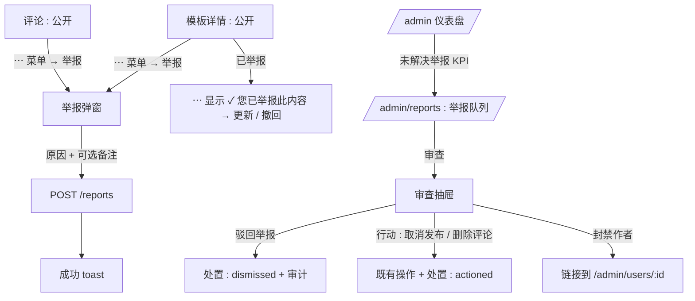
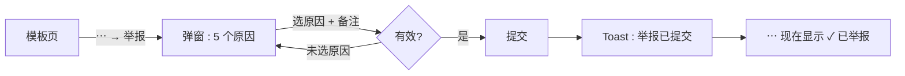
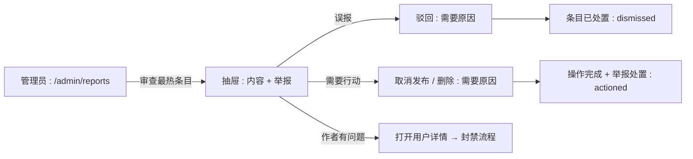

# 内容举报 — UI/UX 设计

- **功能 ID：** content-reporting
- **版本：** 1.0
- **状态：** 已提案（待架构评审）
- **作者：** ui-ux-agent
- **日期：** 2026-10-12
- **配套文档：** `content-reporting-requirements-zh-CN.md`

## 1. 设计原则

1. **举报只花用户一分钟。** 一个菜单项、五个固定原因、可选备注、完成 —— 摩擦会杀死举报量。
2. **队列是工作清单，不是数据库视图。** 按条目分组、按热度排序、一个抽屉包含决策所需的一切。
3. **判决之前不惩罚。** 举报绝不改变用户看到的内容；只有显式管理员操作才会。
4. **保护举报者。** 其身份保密；界面绝不向作者暗示谁举报了他们。

## 2. 信息架构



| 界面 | 路由 / 位置 | 受众 | 目的 |
|---|---|---|---|
| 举报操作 | 模板和评论的 ⋯ 菜单 | 登录用户 | 标记内容 |
| 举报弹窗 | 浮层 | 登录用户 | 原因 + 备注 |
| 已举报状态菜单 | ⋯ 菜单（对勾） | 举报者 | 更新 / 撤回 |
| 举报队列 | `/admin/reports` | 管理员 | 按优先级排序的工作清单 |
| 审查抽屉 | 队列上的浮层 | 管理员 | 上下文 + 处置 |
| 未解决举报 KPI | `/admin` 仪表盘 | 管理员 | 积压可见性 |

## 3. 用户流程

### 3.1 用户举报模板



### 3.2 管理员处理队列



## 4. 页面布局

### 4.1 举报弹窗（用户端）

```
+----------------------------------------------+
|  举报此模板                            [×]   |
+----------------------------------------------+
|  您为什么要举报？                              |
|  ( ) 垃圾信息或诈骗                            |
|      重复发布、广告、钓鱼                      |
|  (•) 冒犯或仇恨                                |
|      骚扰、仇恨言论、暴力                      |
|  ( ) 误导或有害                                |
|      虚假声明、危险建议                        |
|  ( ) 隐私侵犯                                  |
|      暴露个人或机密数据                        |
|  ( ) 其他                                      |
+----------------------------------------------+
|  补充说明（可选）                               |
|  [........................................]  |
|  [........................................]  |
|                    [取消]  [提交举报]           |
+----------------------------------------------+
```

带说明的单选组；备注 textarea 2 行；选择原因前提交禁用。评论场景标题为"举报此评论"。

### 4.2 已举报状态菜单项（⋯ 菜单）

```
  ⋯ 菜单
  ┌──────────────────────────┐
  │ ✓ 您已举报此内容          │
  │   ┌ 更新举报…            │  ← 重新打开预填的弹窗
  │   └ 撤回举报             │  ← 确认气泡
  └──────────────────────────┘
```

### 4.3 举报队列 — `/admin/reports`（桌面端）

```
+----------------------------------------------------------------------+
|  管理端侧边栏: 仪表盘 · 用户 · 模板 · 举报 · 审计日志                  |
+----------------------------------------------------------------------+
|  举报            [状态: 未解决 ▾] [类型: 全部 ▾] [原因: 全部 ▾]       |
|  | 类型     | 条目                | 作者   | 未解决 | 原因        | 最新     |      |
|  | 模板     | Support Reply v3    | alice  | 4     | 垃圾×3,其他 | 10 分钟 | [审查] |
|  | 评论     | "check my site…"    | bob    | 2     | 垃圾×2      | 1 小时  | [审查] |
|  | 模板     | Data Extractor      | carol  | 1     | 隐私        | 3 小时  | [审查] |
|  | 模板     | Code Review Prompt  | dave   | —     | (已解决)    | 2 天    | [查看] |
|  (分页 : 50/页)                                                      |
+----------------------------------------------------------------------+
```

未解决行优先（数量降序，再按新鲜度）；已解决行置灰并显示查看操作。原因标签是颜色中性的文本标签。

### 4.4 审查抽屉（管理端）

```
+------------------------------------------------------+
|  举报审查 · 模板                           [×]        |
+------------------------------------------------------+
|  ┌────────────────────────────────────────────────┐ |
|  | Support Reply v3          [打开模板 ↗]           │ |
|  | by alice · 客服支持 · 公开 · ★ 128               │ |
|  | ┌ 提示词预览（前 300 字符）┐                     │ |
|  └────────────────────────────────────────────────┘ |
|  举报（4 条未解决）                                    |
|  | eve     · 垃圾      · "发到了 5 个分类"           |
|  | frank   · 垃圾      · —                           |
|  | gina    · 垃圾      · —                           |
|  | henry   · 其他      · "标题不符"                  |
+------------------------------------------------------+
|  [ 驳回举报 ]   [ 取消发布模板 ]                      |
|  作者: alice → [打开用户详情]                         |
+------------------------------------------------------+
  （评论变体：评论文本 + [删除评论]）
```

两个操作按钮都打开需要原因的小确认气泡；驳回只处置不碰内容。

### 4.5 仪表盘 KPI 卡片（既有管理仪表盘）

```
+--------------+--------------+--------------+
| 用户 1,204   | 模板 8k      | 未解决举报   |
| 今日 +12     | 今日 +34     |     7  →     |  ← 链接到 /admin/reports
+--------------+--------------+--------------+
```

## 5. 组件规格

| 组件 | 行为 | 状态 |
|---|---|---|
| ReportModal | 单选组（5 个原因 + 说明）、可选备注（≤500）、取消/提交 | 空 / 提交中 / 错误（行内） |
| ReportedMenuItem | 带对勾的 ⋯ 条目；子菜单 更新 / 撤回（确认气泡） | 未举报 / 已举报 |
| ReportQueueTable | 分组行：类型徽章、条目、作者、未解决数、原因标签、最新时间、状态；审查/查看操作 | 加载 / 空 / 错误 |
| ReasonChip | 每个原因的小文本标签带计数（垃圾 ×3） | 5 种变体 |
| ReviewDrawer | 右侧抽屉：条目上下文卡、举报列表、带原因气泡的操作按钮 | 加载 / 已加载 / 操作中 |
| ReasonPopover | 需填 3–500 字原因才能继续的小确认框 | 默认 / 过短 |
| OpenReportsKPI | 带计数的仪表盘卡片，链接到队列 | 零（弱化）/ 非零 |

## 6. 交互细节

1. **打开举报弹窗**从 ⋯ → 举报；焦点落在单选组；Esc 取消；弹窗捕获焦点。
2. **提交**禁用并显示 spinner；成功关闭弹窗并显示 toast；⋯ 菜单项在下次打开时翻转为对勾状态。
3. **更新举报**重新打开预填上次原因/备注的弹窗；提交覆盖（FR-2）并显示"已更新"toast。
4. **撤回**显示确认气泡（"撤回您的举报？"）；确认删除该行；菜单项恢复为普通举报。
5. **队列默认视图**为未解决；刷新时更新计数和最新时间；最热条目的行有视觉强调（细微的左侧强调条）。
6. **审查抽屉**并行加载条目上下文和举报；条目卡片可外链（模板打开管理端模板详情；作者打开管理端用户详情）。
7. **驳回**需要原因（气泡）；处置后原位更新该行为已解决（不整页刷新）。
8. **行动（取消发布/删除）**需要原因；先执行操作，再自动处置举报；抽屉显示成功状态并关闭。
9. **封禁作者**是链接而非按钮 —— 封禁流程（带自己的原因弹窗）留在用户详情页。
10. **速率限制错误**（每小时第 21 次）显示友好 toast"您最近已提交多次举报 —— 请稍后再试。"

## 7. 状态汇总

| 界面 | 加载 | 空 | 错误 |
|---|---|---|---|
| 举报弹窗 | 不适用 | 选原因前提交禁用 | 行内错误 + 重试 |
| 队列 | 表格骨架 | "没有未解决举报 —— 一切正常" | Toast + 重试 |
| 审查抽屉 | 骨架分区 | 不适用（行意味着有举报） | Toast + 重试 |
| 仪表盘 KPI | 卡片骨架 | 0（弱化样式） | 卡片显示 "—" |

## 8. 国际化

| 键（英文） | 中文 |
|---|---|
| reports.action / Report | 举报 |
| reports.modal.title.template / Report this template | 举报此模板 |
| reports.modal.title.comment / Report this comment | 举报此评论 |
| reports.modal.question / Why are you reporting this? | 您为什么要举报？ |
| reports.reason.spam / Spam or scam | 垃圾信息或诈骗 |
| reports.reason.offensive / Offensive or hateful | 冒犯或仇恨 |
| reports.reason.misleading / Misleading or harmful | 误导或有害 |
| reports.reason.privacy / Privacy violation | 隐私侵犯 |
| reports.reason.other / Something else | 其他 |
| reports.note.label / Additional details (optional) | 补充说明（可选） |
| reports.submit / Submit report | 提交举报 |
| reports.toast.submitted / Report submitted — thank you. Our moderators will review it. | 举报已提交 —— 感谢。我们的审核员将进行审查。 |
| reports.toast.updated / Your report was updated. | 您的举报已更新。 |
| reports.reported / You reported this | 您已举报此内容 |
| reports.update / Update report… | 更新举报… |
| reports.withdraw / Withdraw report | 撤回举报 |
| reports.withdraw.confirm / Withdraw your report? | 撤回您的举报？ |
| reports.rateLimited / You've submitted several reports recently — please try again later. | 您最近已提交多次举报 —— 请稍后再试。 |
| admin.reports.title / Reports | 举报 |
| admin.reports.open / Open | 未解决 |
| admin.reports.resolved / Resolved | 已解决 |
| admin.reports.openCount / Open reports | 未解决举报 |
| admin.reports.review / Review | 审查 |
| admin.reports.dismiss / Dismiss reports | 驳回举报 |
| admin.reports.reasonRequired / A reason is required | 必须填写原因 |
| admin.reports.empty / No open reports — all clear | 没有未解决举报 —— 一切正常 |

原因代码（spam/offensive/misleading/privacy/other）是与语言无关的标识符。

## 9. 无障碍

- 举报弹窗：标准对话框，带 `role="radiogroup"`、标签与输入关联、焦点捕获、Esc 取消、焦点返回。
- 单选说明是每个标签的一部分（一起播报）；备注 textarea 有可见标签。
- 队列表格是真实表格，带 `<th scope>`；原因标签是文本（不依赖颜色）；未解决数是数字文本。
- 审查抽屉遵循管理端抽屉模式：带标签的区域、焦点捕获、操作按顺序可达（驳回 → 行动 → 作者链接）。
- 原因气泡是带必填 textarea 的小对话框；校验消息为 `aria-live="polite"`。
- 仪表盘 KPI 卡片计数是带无障碍名称的真实链接（"未解决举报：7"）。

## 10. 数据分析（可选）

- `report_submitted`（条目类型、原因）、`report_withdrawn`、`admin_report_reviewed`、`admin_report_dismissed`、`admin_report_actioned`（操作类型）—— 仅产品使用事件。

## 11. 范围之外

- 自动下架/隐藏阈值；举报者案件跟踪或通知。
- 举报用户/资料、链、合集、团队。
- 审核认领分配、SLA 计时器。
- 任何变现 —— 永久排除。
