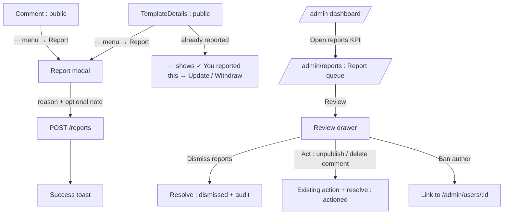
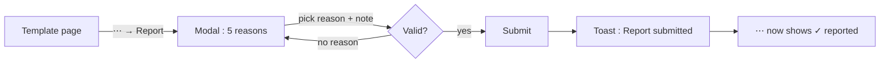
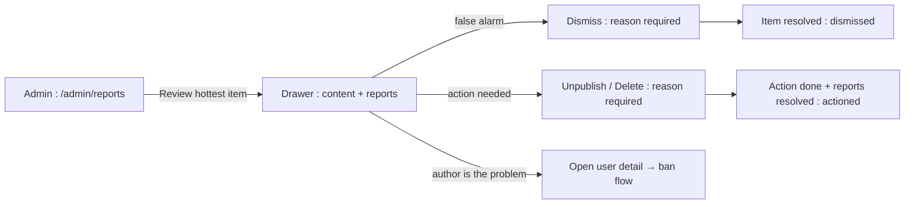

# Content Reporting — UI/UX Design

- **Feature ID:** content-reporting
- **Version:** 1.0
- **Status:** Proposed (for architecture review)
- **Author:** ui-ux-agent
- **Date:** 2026-10-12
- **Companion doc:** `content-reporting-requirements.md`

## 1. Design Principles

1. **Reporting is one minute of the user's time.** One menu item, five fixed reasons, optional note, done — friction kills reporting volume.
2. **The queue is a worklist, not a database view.** Grouped by item, sorted by heat, one drawer with everything needed to decide.
3. **No punishment before judgment.** Reports never change what users see; only explicit admin actions do.
4. **Reporters are protected.** Their identity is confidential; the UI never hints to authors who reported them.

## 2. Information Architecture



| Surface | Route / location | Audience | Purpose |
|---|---|---|---|
| Report action | ⋯ menu on templates & comments | Logged-in users | Flag content |
| Report modal | overlay | Logged-in users | Reason + note |
| Reported-state menu | ⋯ menu (checkmark) | Reporters | Update / withdraw |
| Report queue | `/admin/reports` | Admins | Prioritized worklist |
| Review drawer | overlay on queue | Admins | Context + resolution |
| Open reports KPI | `/admin` dashboard | Admins | Visibility of backlog |

## 3. User Flows

### 3.1 User reports a template



### 3.2 Admin works the queue



## 4. Page Layouts

### 4.1 Report modal (user side)

```
+----------------------------------------------+
|  Report this template                   [×]  |
+----------------------------------------------+
|  Why are you reporting this?                 |
|  ( ) Spam or scam                            |
|      Repeated posting, ads, phishing         |
|  (•) Offensive or hateful                    |
|      Harassment, hate speech, violence       |
|  ( ) Misleading or harmful                   |
|      False claims, dangerous advice          |
|  ( ) Privacy violation                       |
|      Exposes personal or confidential data   |
|  ( ) Something else                          |
+----------------------------------------------+
|  Additional details (optional)               |
|  [........................................]  |
|  [........................................]  |
|                    [Cancel]  [Submit report]  |
+----------------------------------------------+
```

Radio group with descriptors; note textarea 2 rows; Submit disabled until a reason is chosen. Title reads "Report this comment" on comments.

### 4.2 Reported-state menu item (⋯ menu)

```
  ⋯ menu
  ┌──────────────────────────┐
  │ ✓ You reported this      │
  │   ┌ Update report…     │  ← reopens modal prefilled
  │   └ Withdraw report    │  ← confirm popover
  └──────────────────────────┘
```

### 4.3 Report queue — `/admin/reports` (desktop)

```
+----------------------------------------------------------------------+
|  Admin sidebar: Dashboard · Users · Templates · Reports · Audit Log  |
+----------------------------------------------------------------------+
|  Reports            [status: Open ▾] [type: All ▾] [reason: All ▾]   |
|  | Type      | Item                | Author  | Open | Reasons     | Latest      |      |
|  | Template  | Support Reply v3    | alice   | 4    | spam ×3, other | 10 min  | [Review] |
|  | Comment   | "check my site…"    | bob     | 2    | spam ×2     | 1 h     | [Review] |
|  | Template  | Data Extractor      | carol   | 1    | privacy     | 3 h     | [Review] |
|  | Template  | Code Review Prompt  | dave    | —    | (resolved)  | 2 d     | [View]   |
|  (pagination : 50/page)                                              |
+----------------------------------------------------------------------+
```

Open rows first (count desc, then recency); resolved rows dimmed with a View action. Reason chips are color-neutral text chips.

### 4.4 Review drawer (admin)

```
+------------------------------------------------------+
|  Report review · Template                 [×]        |
+------------------------------------------------------+
|  ┌────────────────────────────────────────────────┐ |
|  | Support Reply v3          [Open template ↗]     │ |
|  | by alice · Customer Support · public · ★ 128    │ |
|  | ┌ prompt preview (first 300 chars) ┐            │ |
|  └────────────────────────────────────────────────┘ |
|  Reports (4 open)                                    |
|  | eve     · spam       · "posted in 5 categories" |
|  | frank   · spam       · —                         |
|  | gina    · spam       · —                         |
|  | henry   · other      · "title mismatch"         |
+------------------------------------------------------+
|  [ Dismiss reports ]   [ Unpublish template ]       |
|  author: alice → [Open user detail]                 |
+------------------------------------------------------+
  (comment variant: comment text + [Delete comment])
```

Both action buttons open a small reason-required confirm popover; Dismiss resolves without touching content.

### 4.5 Dashboard KPI card (existing admin dashboard)

```
+--------------+--------------+--------------+
| Users 1,204  | Templates 8k | Open reports |
| +12 today    | +34 today    |     7  →     |  ← links to /admin/reports
+--------------+--------------+--------------+
```

## 5. Component Specs

| Component | Behavior | States |
|---|---|---|
| ReportModal | Radio group (5 reasons + descriptors), optional note (≤500), Cancel/Submit | Empty / submitting / error (inline) |
| ReportedMenuItem | ⋯ entry with checkmark; submenu Update / Withdraw (confirm popover) | Not reported / reported |
| ReportQueueTable | Grouped rows: type badge, item, author, open count, reason chips, latest time, status; Review/View action | Loading / empty / error |
| ReasonChip | Small text chip per reason with count (spam ×3) | 5 variants |
| ReviewDrawer | Right drawer: item context card, reports list, action buttons with reason popovers | Loading / loaded / acting |
| ReasonPopover | Small confirm requiring 3–500 chars reason before action proceeds | Default / too-short |
| OpenReportsKPI | Dashboard card with count, links to queue | Zero (muted) / non-zero |

## 6. Interaction Details

1. **Open report modal** from ⋯ → Report; focus lands on the radio group; Esc cancels; the modal is focus-trapped.
2. **Submit** disables with a spinner; success closes the modal and shows the toast; the ⋯ menu item flips to the checkmark state on next open.
3. **Update report** reopens the modal prefilled with the previous reason/note; submitting overwrites (FR-2) and shows the "updated" toast.
4. **Withdraw** shows a confirm popover ("Withdraw your report?"); confirming deletes the row; the menu item reverts to plain Report.
5. **Queue default view** is Open; counts and latest-time update on refresh; the row for the hottest item is visually emphasized (subtle left accent bar).
6. **Review drawer** loads item context and reports in parallel; the item card links out (template opens admin template detail; author opens admin user detail).
7. **Dismiss** requires a reason (popover); resolving updates the row to resolved in place (no full-page reload).
8. **Act (unpublish/delete)** requires a reason; the action runs first, then reports auto-resolve; the drawer shows a success state and closes.
9. **Ban author** is a link, not a button — the ban flow (with its own reason modal) stays in the user detail page.
10. **Rate limit error** (21st report/hour) shows a friendly toast "You've submitted several reports recently — please try again later."

## 7. States Summary

| Surface | Loading | Empty | Error |
|---|---|---|---|
| Report modal | n/a | Submit disabled until reason | Inline error + retry |
| Queue | Table skeleton | "No open reports — all clear" | Toast + retry |
| Review drawer | Skeleton sections | n/a (row implies reports) | Toast + retry |
| Dashboard KPI | Card skeleton | 0 (muted style) | Card shows "—" |

## 8. i18n

| Key (EN) | ZH |
|---|---|
| reports.action / Report | 举报 |
| reports.modal.title.template / Report this template | 举报此模板 |
| reports.modal.title.comment / Report this comment | 举报此评论 |
| reports.modal.question / Why are you reporting this? | 您为什么要举报？ |
| reports.reason.spam / Spam or scam | 垃圾信息或诈骗 |
| reports.reason.offensive / Offensive or hateful | 冒犯或仇恨 |
| reports.reason.misleading / Misleading or harmful | 误导或有害 |
| reports.reason.privacy / Privacy violation | 隐私侵犯 |
| reports.reason.other / Something else | 其他 |
| reports.note.label / Additional details (optional) | 补充说明（可选） |
| reports.submit / Submit report | 提交举报 |
| reports.toast.submitted / Report submitted — thank you. Our moderators will review it. | 举报已提交 —— 感谢。我们的审核员将进行审查。 |
| reports.toast.updated / Your report was updated. | 您的举报已更新。 |
| reports.reported / You reported this | 您已举报此内容 |
| reports.update / Update report… | 更新举报… |
| reports.withdraw / Withdraw report | 撤回举报 |
| reports.withdraw.confirm / Withdraw your report? | 撤回您的举报？ |
| reports.rateLimited / You've submitted several reports recently — please try again later. | 您最近已提交多次举报 —— 请稍后再试。 |
| admin.reports.title / Reports | 举报 |
| admin.reports.open / Open | 未解决 |
| admin.reports.resolved / Resolved | 已解决 |
| admin.reports.openCount / Open reports | 未解决举报 |
| admin.reports.review / Review | 审查 |
| admin.reports.dismiss / Dismiss reports | 驳回举报 |
| admin.reports.reasonRequired / A reason is required | 必须填写原因 |
| admin.reports.empty / No open reports — all clear | 没有未解决举报 —— 一切正常 |

Reason codes (spam/offensive/misleading/privacy/other) are locale-independent identifiers.

## 9. Accessibility

- Report modal: standard dialog with `role="radiogroup"`, labels tied to inputs, focus trap, Esc cancel, focus return.
- Radio descriptors are part of each label (announced together); the note textarea has a visible label.
- Queue table is a real table with `<th scope>`; reason chips are text (not color-only); open counts are numeric text.
- Review drawer follows the admin drawer pattern: labelled region, focus trap, actions reachable in order (Dismiss → Act → author link).
- Reason popovers are small dialogs with required textarea; validation message is `aria-live="polite"`.
- The dashboard KPI card count is a real link with an accessible name ("Open reports: 7").

## 10. Analytics (optional)

- `report_submitted` (item type, reason), `report_withdrawn`, `admin_report_reviewed`, `admin_report_dismissed`, `admin_report_actioned` (action type) — product usage events only.

## 11. Out of Scope

- Auto-takedown/hide thresholds; reporter case tracking or notifications.
- Reporting users/profiles, chains, collections, teams.
- Moderation assignment/claiming, SLA timers.
- Any monetization — permanently excluded.
