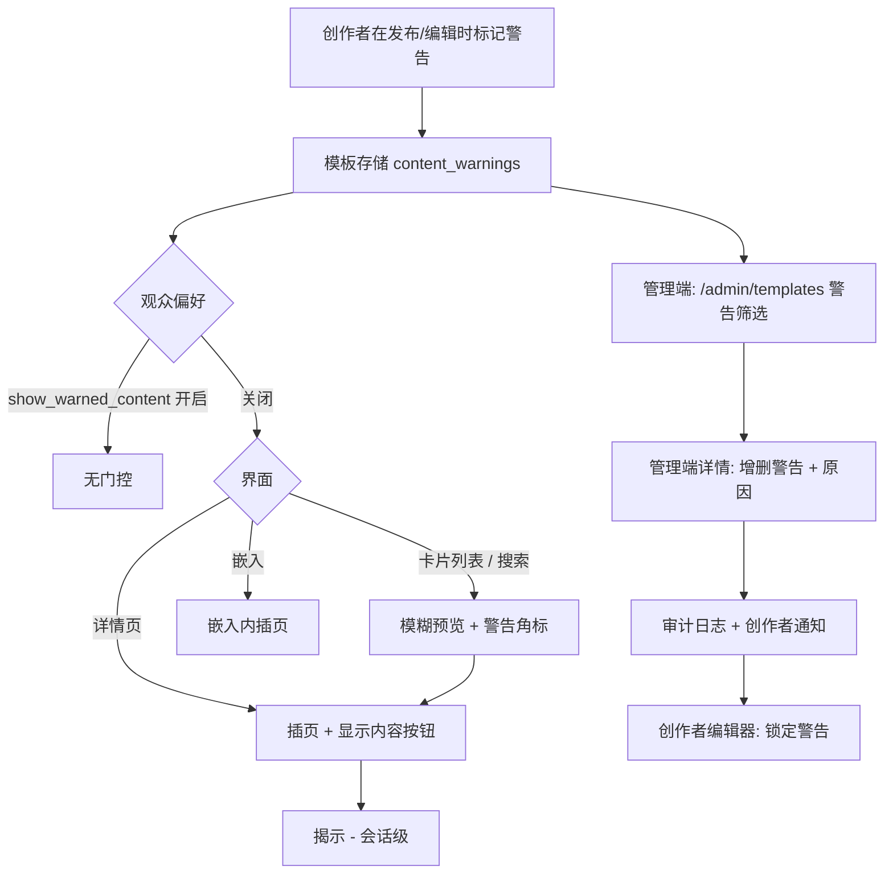
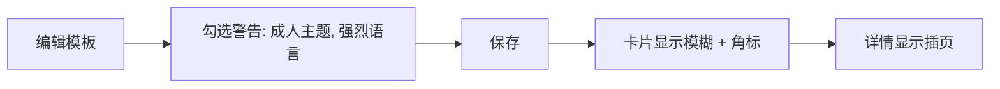
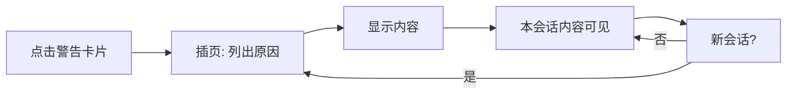
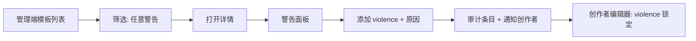

# 内容警告 — UI/UX 设计

- **功能 ID：** content-warnings
- **版本：** 1.0
- **状态：** Proposed（待架构评审）
- **作者：** ui-ux-agent
- **日期：** 2026-10-13
- **配套文档：** `content-warnings-requirements-zh-CN.md`

## 1. 设计原则

1. **先保护，绝不隐藏。** 带警告的内容保持可发现 —— 门控是减速带（模糊 + 一次点击），不是移除。
2. **打标，而非只模糊。** 每个门控界面都用文字指明警告原因；模糊是增强，绝不是唯一信号。
3. **创作者诚实零成本。** 自我申报就是发布时的复选框组 —— 无摩擦、无独立流程。
4. **观众主权。** 一个偏好为想要的用户彻底移除门控；一个筛选为不想要的用户彻底移除内容。
5. **执法可见。** 审核员施加的警告在创作者编辑器中锁定且始终带原因 —— 执法绝不静默。

## 2. 信息架构



| 界面 | 位置 | 受众 | 目的 |
|---|---|---|---|
| 警告复选框组 | 创建/编辑模板表单 | 创作者 | 自我申报警告 |
| 警告角标 + 模糊 | 模板卡片（首页、搜索、集合、相关） | 所有观众 | 一眼可见的信号 + 门控 |
| 内容插页 | 模板详情页 | 所有观众（偏好关闭） | 知情揭示 |
| "隐藏警告内容"筛选角标 | 浏览/搜索筛选行 | 观众 | 排除警告内容 |
| "始终显示"开关 | 设置 → 内容 | 观众 | 移除门控 |
| 锁定警告展示 | 创建/编辑表单（审核施加） | 创作者 | 看到执法、无法撤销 |
| 警告筛选 | `/admin/templates` | 审核员 | 全目录打标审计 |
| 警告操作面板 | `/admin/templates/:id` | 审核员 | 带原因增删 |

## 3. 用户流程

### 3.1 创作者自我申报



### 3.2 观众揭示



### 3.3 审核员执法



## 4. 页面布局

### 4.1 创建/编辑表单 — 警告区块

```
+--------------------------------------------------------------+
|  内容警告（可选）                                              |
|  帮助观众在打开前了解内容。                                     |
|  ┌────────────────────────────────────────────────────────┐  |
|  │ ☐ 成人主题              ☐ 血腥暴力                      │  |
|  │ ☐ 强烈语言              ☐ 敏感话题                      │  |
|  └────────────────────────────────────────────────────────┘  |
|  ⓘ 由审核施加: 血腥暴力（已锁定）                               |
+--------------------------------------------------------------+
```

### 4.2 模板卡片（带警告，观众偏好关闭）

```
+---------------------------+
|  [模糊预览]                |
|  ▨▨▨▨▨▨▨▨▨▨▨▨▨▨▨▨▨▨  |
|  ▨▨▨▨▨▨▨▨▨▨▨▨▨▨▨▨▨▨  |
|  ⚠ 成人主题 · 强烈语言      |
|  标题保持可读               |
|  by @creator · 2小时前     |
+---------------------------+
```

### 4.3 详情页插页

```
+--------------------------------------------------------------+
|  ⚠ 内容警告                                                  |
|  本模板涉及：成人主题、强烈语言                                 |
|                                                              |
|  你可以查看 —— 我们只是想让你先知情。                           |
|                                                              |
|  [ 显示内容 ]        [ 返回 ]                                 |
+--------------------------------------------------------------+
```

### 4.4 浏览筛选行新增

```
+--------------------------------------------------------------+
|  [全部] [趋势] ...   ⚠ [隐藏警告内容]        排序: [最新 ▾]     |
+--------------------------------------------------------------+
```

### 4.5 设置 → 内容

```
+--------------------------------------------------------------+
|  内容偏好                                                     |
|  ┌────────────────────────────────────────────────────────┐  |
|  │ ☐ 始终显示警告内容                                      │  |
|  │   跳过已标记模板的模糊与警告页。                          │  |
|  └────────────────────────────────────────────────────────┘  |
+--------------------------------------------------------------+
```

### 4.6 管理端模板列表 — 警告筛选

```
+----------------------------------------------------------------------+
|  模板   [搜索]   警告: [任意 ▾]   状态: [任意 ▾]                      |
+----------------------------------------------------------------------+
|  标题               作者       警告               状态      更新时间   |
|  "黑暗小说"         @writer    ⚠ 成人主题          public    2小时前  |
|  "SQL 优化器"       @dev       —                  public    3天前    |
|  "渗透测试工具箱"   @sec       ⚠ 敏感话题          public    1天前    |
+----------------------------------------------------------------------+
```

### 4.7 管理端模板详情 — 警告面板

```
+--------------------------------------------------------------+
|  内容警告                                                     |
|  当前: ⚠ 成人主题（创作者） · ⚠ 敏感话题（审核）                |
|                                                              |
|  [+ 添加警告 ▾]        [移除: 敏感话题 ✕]                      |
|                                                              |
|  原因（必填）                                                 |
|  [................................................]          |
|                                                              |
|  历史:                                                       |
|  2026-10-12 admin@x 添加 敏感话题 — "描述自伤行为"              |
+--------------------------------------------------------------+
```

### 4.8 移动端

卡片保持模糊且角标位于预览下方；插页为全宽面板、按钮堆叠；筛选角标加入横向可滚动筛选行；管理端警告面板将添加/移除控件纵向堆叠；设置开关为标准移动端开关。

## 5. 组件规格

| 组件 | 行为 | 状态 |
|---|---|---|
| WarningCheckboxGroup | 从分类法多选；帮助文案；单独展示锁定的审核警告并带锁图标 | 未触碰 / 已选部分 / 含锁定 |
| WarningChip | 带 ⚠ 图标 + 本地化原因名的小角标；多项时 tooltip 列出全部原因 | 单个 / 多个（堆叠） |
| BlurredPreview | 卡片预览区模糊（CSS `filter: blur(12px)`）；角标覆盖底部；标题在模糊外 | 模糊 / 已揭示（会话） / 偏好开启 |
| ContentInterstitial | 内容上方全宽面板：图标、原因列表、显示内容 / 返回 | 显示 / 已关闭（会话） / 偏好开启 |
| HideWarnedFilterChip | 筛选行中的切换角标；按用户持久；URL 同步 | 关 / 开 |
| ShowWarnedToggle | 带描述的设置开关 | 关 / 开 / 保存中 |
| AdminWarningFilter | 下拉：任意 / 无 / 成人主题 / 血腥暴力 / 强烈语言 / 敏感话题 | 已应用 / 已清除 |
| WarningActionsPanel | 管理端面板：带来源徽章的当前警告、添加下拉、移除按钮、原因输入、历史列表 | 空闲 / 缺原因（操作禁用） / 提交中 / 错误 |

## 6. 交互细节

1. **自我申报：** 编辑器中勾选警告随保存即时生效（无独立发布步骤）；卡片与详情页立即反映警告。
2. **卡片模糊：** 悬停模糊卡片不揭示（刻意为之 —— 悬停太易误触）；点击导航到详情插页。
3. **揭示：** "显示内容"在会话内揭示（按模板存 sessionStorage）；"返回"回到上一页；浏览器后退按钮行为一致。
4. **偏好：** 开启"始终显示"立即全局去模糊、无需刷新；关闭后下次导航重新门控。
5. **隐藏警告筛选：** 切换后带 `exclude_warned=true` 重新请求；状态按用户持久并同步到 URL（`?hideWarned=1`）以便分享。
6. **管理端添加：** 从下拉选择警告后启用原因输入；原因 ≥ 3 字符前应用按钮保持禁用；成功显示 toast 并刷新面板 + 历史。
7. **管理端移除：** 每个可移除警告带 ✕；审核施加的在创作者视图中显示锁徽章，但管理员可移除；同样必须填原因。
8. **锁定展示（创作者）：** 审核施加的警告在复选框组区域渲染为锁定角标，tooltip 为"由审核于 {date} 施加：{reason}"；对应复选框禁用且勾选。
9. **通知深链：** `template.warning_changed` 通知深链到模板详情页；创作者与其他人一样看到插页（适用其自己的揭示状态）。
10. **键盘：** 插页捕获焦点；"显示内容"为默认聚焦按钮；Escape 触发"返回"。角标为装饰性（aria-hidden）—— 可访问名称来自卡片文字。

## 7. 状态汇总

| 界面 | 加载中 | 空态 | 错误 |
|---|---|---|---|
| WarningCheckboxGroup | — | 未选警告（正常） | 保存错误 toast，选择保留 |
| BlurredPreview | 骨架 | — | — |
| ContentInterstitial | — | — | —（纯客户端） |
| HideWarnedFilterChip | — | — | 筛选错误 toast，角标回退 |
| ShowWarnedToggle | 保存中转圈 | — | 回退 + toast |
| AdminWarningFilter | — | "没有匹配的模板" | 重试 |
| WarningActionsPanel | 历史骨架 | "暂无警告历史" | 行内错误，面板保留 |

## 8. 国际化（i18n）

| Key | 中文 | 英文 |
|---|---|---|
| `warnings.group.title` | 内容警告（可选） | Content warnings (optional) |
| `warnings.group.help` | 帮助观众在打开前了解内容。 | Help viewers know what to expect before opening. |
| `warnings.type.mature` | 成人主题 | Mature themes |
| `warnings.type.violence` | 血腥暴力 | Graphic violence |
| `warnings.type.profanity` | 强烈语言 | Strong language |
| `warnings.type.sensitive` | 敏感话题 | Sensitive topics |
| `warnings.locked.appliedBy` | 由审核于 {{date}} 施加：{{reason}} | Applied by moderation on {{date}}: {{reason}} |
| `warnings.locked.label` | 由审核施加（已锁定） | Applied by moderation (locked) |
| `warnings.chip.multiple` | {{first}} 等 {{count}} 项 | {{first}} +{{count}} more |
| `warnings.interstitial.title` | 内容警告 | Content warning |
| `warnings.interstitial.body` | 本模板涉及：{{reasons}} | This template covers: {{reasons}} |
| `warnings.interstitial.subtext` | 你可以查看 —— 我们只是想让你先知情。 | You can view it — we just want you to know first. |
| `warnings.interstitial.show` | 显示内容 | Show content |
| `warnings.interstitial.back` | 返回 | Go back |
| `warnings.filter.hideWarned` | 隐藏警告内容 | Hide warned content |
| `warnings.settings.title` | 内容偏好 | Content preferences |
| `warnings.settings.showAlways` | 始终显示警告内容 | Always show warned content |
| `warnings.settings.showAlwaysHelp` | 跳过已标记模板的模糊与警告页。 | Skip the blur and warning screen for flagged templates. |
| `warnings.admin.filter.label` | 警告 | Warnings |
| `warnings.admin.filter.any` | 任意 | Any |
| `warnings.admin.filter.none` | 无 | None |
| `warnings.admin.panel.title` | 内容警告 | Content warnings |
| `warnings.admin.panel.current` | 当前 | Current |
| `warnings.admin.panel.origin.creator` | 创作者 | creator |
| `warnings.admin.panel.origin.moderation` | 审核 | moderation |
| `warnings.admin.panel.add` | 添加警告 | Add warning |
| `warnings.admin.panel.remove` | 移除 | Remove |
| `warnings.admin.panel.reason` | 原因（必填） | Reason (required) |
| `warnings.admin.panel.history` | 历史 | History |
| `warnings.admin.panel.historyEmpty` | 暂无警告历史 | No warning history |
| `warnings.notify.changed` | 你的模板"{{title}}"的内容警告已变更：{{change}} | Content warnings on "{{title}}" were changed: {{change}} |
| `warnings.notify.added` | 已添加 {{warning}} | added {{warning}} |
| `warnings.notify.removed` | 已移除 {{warning}} | removed {{warning}} |

## 9. 无障碍

- 模糊绝不是唯一信号：每张模糊卡片都带指明原因的文字角标（NFR-3）；读屏器在卡片聚焦时播报"内容警告：成人主题"。
- 插页为 `role="dialog"` 式区域（或 landmark 区块），捕获焦点、支持 Escape、揭示按钮为初始焦点；原因为真实列表（`ul`）而非文字串。
- 警告角标使用图标 + 文字；颜色绝不是唯一区分；角标在明暗两套主题下对比度满足 AA。
- 复选框组使用 `fieldset`/`legend` 语义；锁定警告为 `aria-disabled` 且原因在可访问 tooltip/描述中。
- 管理端必填原因错误经 live region 播报；应用按钮的禁用状态与原因输入框程序化关联。
- 减少动效：模糊过渡（如有）在 `prefers-reduced-motion` 下为瞬时。

## 10. 数据埋点（可选）

- `warning_self_declared`（类型）、`warning_reveal_clicked`（类型、界面）、`warning_pref_changed`（开/关）、`warning_filter_toggled`、`warning_admin_changed`（增/删、类型）—— 仅产品健康指标。

## 11. 不在范围内

- 年龄验证；对非模板实体施加警告；按警告类型的观众偏好；AI 警告建议；SDK 侧门控；邮件通知。
- 任何形式的变现 —— 本产品永久不做。
