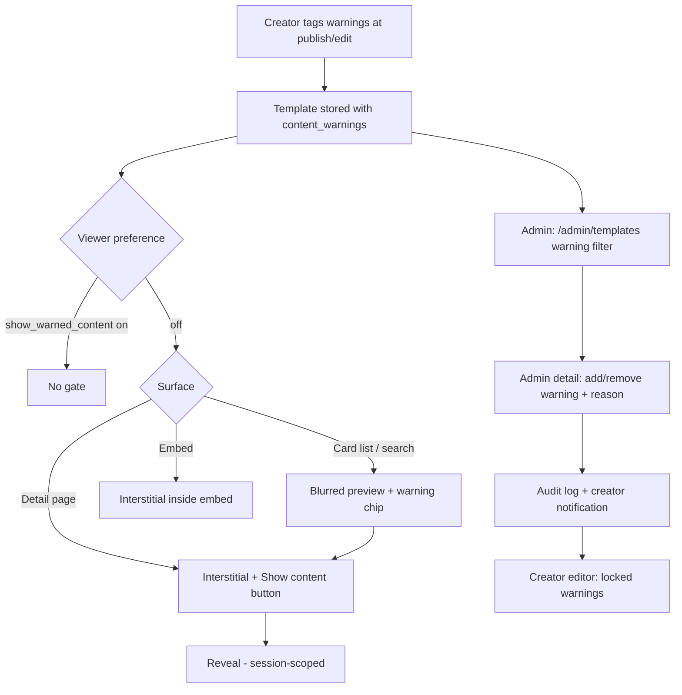
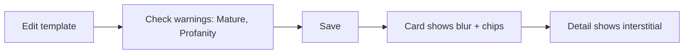
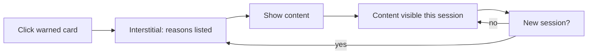
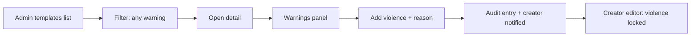

# Content Warnings — UI/UX Design

- **Feature ID:** content-warnings
- **Version:** 1.0
- **Status:** Proposed (for architecture review)
- **Author:** ui-ux-agent
- **Date:** 2026-10-13
- **Companion doc:** `content-warnings-requirements.md`

## 1. Design Principles

1. **Protect first, never hide.** Warned content stays discoverable — the gate is a speed bump (blur + one click), not removal.
2. **Label, don't just blur.** Every gated surface names the warning reasons in text; blur is an enhancement, never the only signal.
3. **Creator honesty is cheap.** Self-declaration is a checkbox group at publish time — no friction, no separate flow.
4. **Viewer sovereignty.** One preference removes the gate entirely for users who want it; one filter removes the content entirely for users who don't.
5. **Enforcement is visible.** Moderator-applied warnings are locked in the creator's editor and always carry a reason — enforcement is never silent.

## 2. Information Architecture



| Surface | Location | Audience | Purpose |
|---|---|---|---|
| Warning checkbox group | Create/edit template form | Creator | Self-declare warnings |
| Warning chip + blur | Template cards (home, search, collections, related) | All viewers | Signal + gate at a glance |
| Content interstitial | Template detail page | All viewers (pref off) | Informed reveal |
| "Hide warned" filter chip | Browse/search filter row | Viewers | Exclude warned content |
| "Always show" toggle | Settings → Content | Viewers | Remove the gate |
| Locked warnings display | Create/edit form (moderator-applied) | Creator | See enforcement, can't undo |
| Warning filter | `/admin/templates` | Moderator | Audit tagging catalog-wide |
| Warning actions panel | `/admin/templates/:id` | Moderator | Add/remove with reason |

## 3. User Flows

### 3.1 Creator self-declares



### 3.2 Viewer reveals



### 3.3 Moderator enforces



## 4. Page Layouts

### 4.1 Create/edit form — warnings section

```
+--------------------------------------------------------------+
|  Content warnings (optional)                                  |
|  Help viewers know what to expect before opening.             |
|  ┌────────────────────────────────────────────────────────┐  |
|  │ ☐ Mature themes        ☐ Graphic violence              │  |
|  │ ☐ Strong language      ☐ Sensitive topics              │  |
|  └────────────────────────────────────────────────────────┘  |
|  ⓘ Applied by moderation: Graphic violence (locked)           |
+--------------------------------------------------------------+
```

### 4.2 Template card (warned, viewer pref off)

```
+---------------------------+
|  [blurred preview]        |
|  ▨▨▨▨▨▨▨▨▨▨▨▨▨▨▨▨▨▨  |
|  ▨▨▨▨▨▨▨▨▨▨▨▨▨▨▨▨▨▨  |
|  ⚠ Mature · Strong lang   |
|  Title stays readable     |
|  by @creator · 2h ago     |
+---------------------------+
```

### 4.3 Detail page interstitial

```
+--------------------------------------------------------------+
|  ⚠ Content warning                                           |
|  This template covers: Mature themes, Strong language        |
|                                                              |
|  You can view it — we just want you to know first.           |
|                                                              |
|  [ Show content ]        [ Go back ]                         |
+--------------------------------------------------------------+
```

### 4.4 Browse filter row addition

```
+--------------------------------------------------------------+
|  [All] [Trending] ...   ⚠ [Hide warned content]   Sort: [New ▾]|
+--------------------------------------------------------------+
```

### 4.5 Settings → Content

```
+--------------------------------------------------------------+
|  Content preferences                                         |
|  ┌────────────────────────────────────────────────────────┐  |
|  │ ☐ Always show warned content                           │  |
|  │   Skip the blur and warning screen for flagged         │  |
|  │   templates.                                           │  |
|  └────────────────────────────────────────────────────────┘  |
+--------------------------------------------------------------+
```

### 4.6 Admin templates list — warning filter

```
+----------------------------------------------------------------------+
|  Templates   [Search]   Warnings: [Any ▾]   Status: [Any ▾]          |
+----------------------------------------------------------------------+
|  Title              Author     Warnings           Status    Updated   |
|  "Dark fiction"     @writer    ⚠ Mature           public    2h ago   |
|  "SQL optimizer"    @dev       —                  public    3d ago   |
|  "Pentest kit"      @sec       ⚠ Sensitive        public    1d ago   |
+----------------------------------------------------------------------+
```

### 4.7 Admin template detail — warnings panel

```
+--------------------------------------------------------------+
|  Content warnings                                            |
|  Current: ⚠ Mature (creator) · ⚠ Sensitive (moderation)      |
|                                                              |
|  [+ Add warning ▾]        [Remove: Sensitive ✕]              |
|                                                              |
|  Reason (required)                                           |
|  [................................................]          |
|                                                              |
|  History:                                                    |
|  2026-10-12 admin@x added Sensitive — "describes self-harm"  |
+--------------------------------------------------------------+
```

### 4.8 Mobile

Cards keep the blur with the chip below the preview; the interstitial is a full-width panel with stacked buttons; the filter chip joins the horizontal scrollable filter row; the admin warnings panel stacks the add/remove controls vertically; the settings toggle is a standard mobile switch.

## 5. Component Specs

| Component | Behavior | States |
|---|---|---|
| WarningCheckboxGroup | Multi-select from taxonomy; helper text; shows locked moderator warnings separately with lock icon | untouched / some selected / has locked |
| WarningChip | Small chip with ⚠ icon + localized reason name; tooltip lists all reasons when multiple | single / multiple (stacked) |
| BlurredPreview | Card preview area blurred (CSS `filter: blur(12px)`); chip overlays bottom; title outside blur | blurred / revealed (session) / pref-on |
| ContentInterstitial | Full-width panel above content: icon, reasons list, Show content / Go back | shown / dismissed (session) / pref-on |
| HideWarnedFilterChip | Toggle chip in filter row; persists per user; URL-synced | off / on |
| ShowWarnedToggle | Settings switch with description | off / on / saving |
| AdminWarningFilter | Dropdown: Any / None / Mature / Violence / Profanity / Sensitive | applied / cleared |
| WarningActionsPanel | Admin panel: current warnings with origin badges, add dropdown, remove buttons, reason input, history list | idle / reason-missing (action disabled) / submitting / error |

## 6. Interaction Details

1. **Self-declaration:** Checking warnings in the editor is instant-save on Save (no separate publish step); the card and detail page reflect warnings immediately.
2. **Card blur:** Hovering a blurred card does NOT reveal (deliberate — hover is too accidental); click navigates to the detail interstitial.
3. **Reveal:** "Show content" reveals for the session (sessionStorage per template); "Go back" returns to the previous page; the browser back button behaves identically.
4. **Preference:** Turning on "Always show" immediately unblurs everywhere without reload; turning it off re-gates on next navigation.
5. **Hide warned filter:** Toggling refetches with `exclude_warned=true`; state persists per user and syncs to the URL (`?hideWarned=1`) for shareability.
6. **Admin add:** Choosing a warning from the dropdown enables the reason field; the Apply button stays disabled until reason ≥ 3 chars; success shows a toast and refreshes the panel + history.
7. **Admin remove:** Each removable warning has an ✕; moderator-applied ones show a lock badge in the creator view but are removable by admins; reason required identically.
8. **Locked display (creator):** Moderator-applied warnings render in the checkbox group area as locked chips with a tooltip "Applied by moderation on {date}: {reason}"; the checkboxes for them are disabled and checked.
9. **Notification deep-link:** The `template.warning_changed` notification deep-links to the template detail page; the creator sees the interstitial like anyone else (their own reveal state applies).
10. **Keyboard:** The interstitial is focus-trapped; "Show content" is the default focused button; Escape triggers "Go back". Chips are decorative (aria-hidden) — the accessible name comes from the card's text.

## 7. States Summary

| Surface | Loading | Empty | Error |
|---|---|---|---|
| WarningCheckboxGroup | — | No warnings selected (normal) | Save error toast, selections kept |
| BlurredPreview | Skeleton | — | — |
| ContentInterstitial | — | — | — (client-side only) |
| HideWarnedFilterChip | — | — | Filter error toast, chip reverts |
| ShowWarnedToggle | Saving spinner | — | Revert + toast |
| AdminWarningFilter | — | "No templates match" | Retry |
| WarningActionsPanel | History skeleton | "No warning history" | Inline error, panel stays |

## 8. Internationalization (i18n)

| Key | English | 中文 |
|---|---|---|
| `warnings.group.title` | Content warnings (optional) | 内容警告（可选） |
| `warnings.group.help` | Help viewers know what to expect before opening. | 帮助观众在打开前了解内容。 |
| `warnings.type.mature` | Mature themes | 成人主题 |
| `warnings.type.violence` | Graphic violence | 血腥暴力 |
| `warnings.type.profanity` | Strong language | 强烈语言 |
| `warnings.type.sensitive` | Sensitive topics | 敏感话题 |
| `warnings.locked.appliedBy` | Applied by moderation on {{date}}: {{reason}} | 由审核于 {{date}} 施加：{{reason}} |
| `warnings.locked.label` | Applied by moderation (locked) | 由审核施加（已锁定） |
| `warnings.chip.multiple` | {{first}} +{{count}} more | {{first}} 等 {{count}} 项 |
| `warnings.interstitial.title` | Content warning | 内容警告 |
| `warnings.interstitial.body` | This template covers: {{reasons}} | 本模板涉及：{{reasons}} |
| `warnings.interstitial.subtext` | You can view it — we just want you to know first. | 你可以查看 —— 我们只是想让你先知情。 |
| `warnings.interstitial.show` | Show content | 显示内容 |
| `warnings.interstitial.back` | Go back | 返回 |
| `warnings.filter.hideWarned` | Hide warned content | 隐藏警告内容 |
| `warnings.settings.title` | Content preferences | 内容偏好 |
| `warnings.settings.showAlways` | Always show warned content | 始终显示警告内容 |
| `warnings.settings.showAlwaysHelp` | Skip the blur and warning screen for flagged templates. | 跳过已标记模板的模糊与警告页。 |
| `warnings.admin.filter.label` | Warnings | 警告 |
| `warnings.admin.filter.any` | Any | 任意 |
| `warnings.admin.filter.none` | None | 无 |
| `warnings.admin.panel.title` | Content warnings | 内容警告 |
| `warnings.admin.panel.current` | Current | 当前 |
| `warnings.admin.panel.origin.creator` | creator | 创作者 |
| `warnings.admin.panel.origin.moderation` | moderation | 审核 |
| `warnings.admin.panel.add` | Add warning | 添加警告 |
| `warnings.admin.panel.remove` | Remove | 移除 |
| `warnings.admin.panel.reason` | Reason (required) | 原因（必填） |
| `warnings.admin.panel.history` | History | 历史 |
| `warnings.admin.panel.historyEmpty` | No warning history | 暂无警告历史 |
| `warnings.notify.changed` | Content warnings on "{{title}}" were changed: {{change}} | 你的模板"{{title}}"的内容警告已变更：{{change}} |
| `warnings.notify.added` | added {{warning}} | 已添加 {{warning}} |
| `warnings.notify.removed` | removed {{warning}} | 已移除 {{warning}} |

## 9. Accessibility

- Blur is never the sole signal: every blurred card carries a text chip naming the reasons (NFR-3); screen readers announce "Content warning: Mature themes" on card focus.
- The interstitial is a `role="dialog"`-style region (or landmark section) with focus trap, Escape support, and the reveal button as initial focus; reasons are a real list (`ul`), not a text run.
- Warning chips use icon + text; color is never the only differentiator; chip contrast meets AA on light and dark themes.
- The checkbox group uses `fieldset`/`legend` semantics; locked warnings are `aria-disabled` with their reason in an accessible tooltip/description.
- Admin reason-required errors are announced via live region; the Apply button's disabled state is programmatically associated with the reason field.
- Reduced motion: the blur transition (if any) is instant under `prefers-reduced-motion`.

## 10. Analytics (optional)

- `warning_self_declared` (types), `warning_reveal_clicked` (type, surface), `warning_pref_changed` (on/off), `warning_filter_toggled`, `warning_admin_changed` (add/remove, type) — product health metrics only.

## 11. Out of Scope

- Age verification; warnings on non-template entities; per-warning viewer preferences; AI warning suggestions; SDK-side gating; email notifications.
- Monetization of any kind — permanently out of scope for this product.
