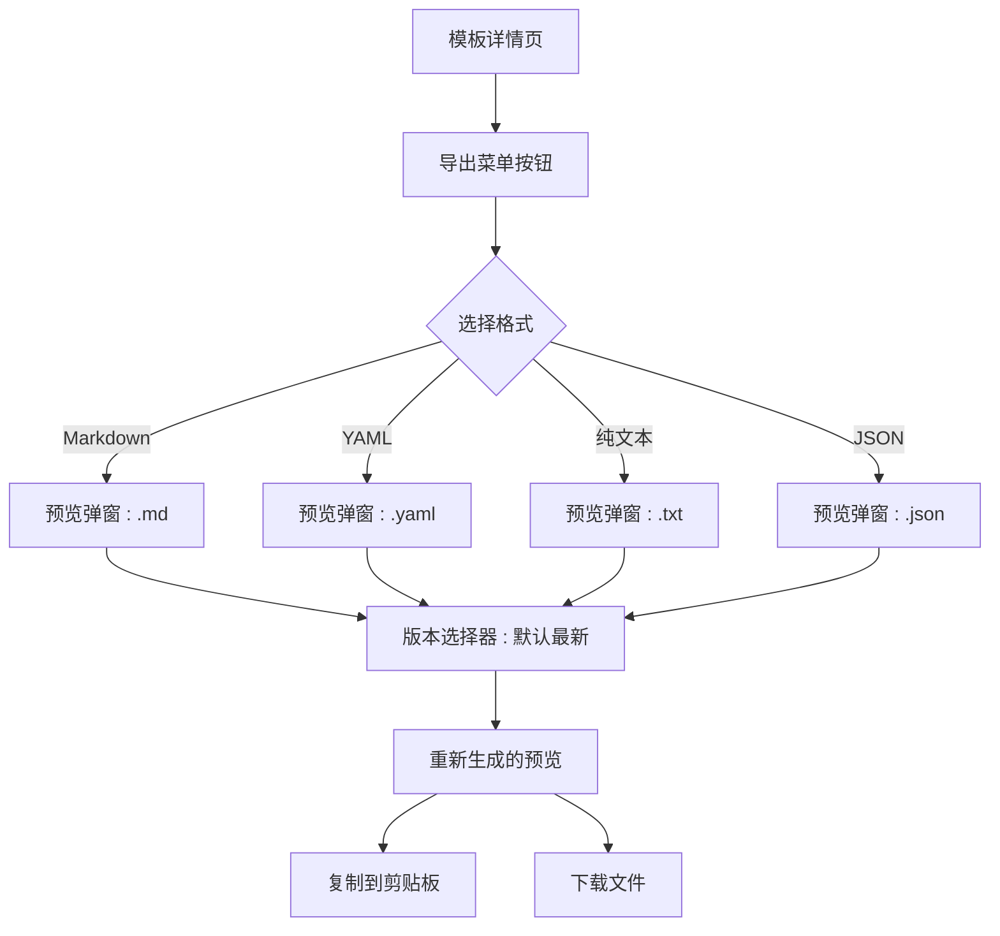
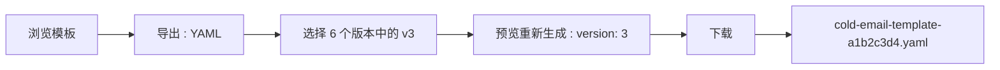

# 导出格式 — UI/UX 设计

- **功能 ID：** export-formats
- **版本：** 1.0
- **状态：** Proposed（待架构评审）
- **作者：** ui-ux-agent
- **日期：** 2026-10-13
- **配套文档：** `export-formats-requirements-zh-CN.md`

## 1. 设计原则

1. **就地，而非别处。** 导出菜单位于用户所在的模板详情页 —— 无需跳转设置页。
2. **先预览再提交。** 没人该复制或下载一个神秘文件。每种格式先展示确切输出。
3. **一个菜单，四种去向。** 聊天（纯文本）、文档（Markdown）、自动化（YAML）、可移植（JSON）—— 按使用场景标注，而非仅按扩展名。
4. **零后端仪式。** 一切在客户端完成；交互感受是即时的。

## 2. 信息架构



导出菜单取代模板详情页现有的独立复制操作（纯文本复制成为"纯文本"格式的复制按钮）。

## 3. 用户流程

### 3.1 为聊天复制

```mermaid
flowchart LR
    A[浏览模板] --> B[导出 : 纯文本]
    B --> C[预览显示内容 + Variables 行]
    C --> D[复制]
    D --> E["已复制 ✓ toast"]
    E --> F[粘贴进聊天 : 填写 {{变量}}]
```

### 3.2 下载 YAML 用于自动化



## 4. 页面布局

### 4.1 模板详情 — 导出菜单

```
+---------------------------------------------------------------+
|  Cold Email Template                          [导出 ▾] [⋯]      |
|  by Alice · v6 · public · ★128                                 |
+---------------------------------------------------------------+
|  （模板内容预览 …）                                              |
```

菜单展开：

```
+---------------------------+
|  导出模板                   |
|  ───────────────────────── |
|  📄 Markdown   用于文档     |
|  ⚙️ YAML       用于工具     |
|  💬 纯文本      用于聊天     |
|  📦 JSON       用于再导入   |
+---------------------------+
```

### 4.2 预览弹窗

```
+----------------------------------------------------------------------+
|  导出为 Markdown                                        [×]            |
|  版本：[v6（最新）▾]                                                   |
+----------------------------------------------------------------------+
|  1 | # Cold Email Template                                           |
|  2 | *A concise cold email for SaaS outreach.*                       |
|  3 | **Type:** text  **Category:** Business  **Language:** en        |
|  4 | - saas                                                         |
|  5 | ---                                                            |
|  6 | ```                                                            |
|  7 | Write a cold email for {{product}} targeting {{audience}}…      |
|  8 | ```                                                            |
|  9 | > Exported from open-prompts · 2026-10-13                       |
+----------------------------------------------------------------------+
|  [复制]  [下载 .md]                              约 0.4 KB            |
+----------------------------------------------------------------------+
```

### 4.3 移动端

导出按钮保留在头部行（小屏仅图标）。菜单变为底部抽屉；预览弹窗全屏，复制/下载为吸底按钮对。

## 5. 组件规格

| 组件 | 行为 | 状态 |
|---|---|---|
| ExportMenu | 含 4 个格式选项的下拉，每项含图标 + 名称 + 场景提示；点击或 `E` 打开 | 关闭 / 打开 |
| ExportPreviewModal | 带行号的只读代码视图、版本选择器、复制 + 下载操作、大小提示 | 加载中 / 就绪 / 复制错误 / 下载错误 |
| VersionSelector | 版本下拉（编号 + 变更说明摘录），默认最新 | 单版本（禁用）/ 多版本 |
| CopyButton | Clipboard API + execCommand 回退；"已复制 ✓" 状态持续 2 秒 | 空闲 / 已复制 / 错误 |
| DownloadButton | Blob + anchor 下载；文件名按 FR-8 | 空闲 / 错误 → 新标签页回退 |

## 6. 交互细节

1. **菜单打开：** 点击或 `E` 键；方向键移动，Enter 选择，Esc 关闭。关闭时焦点返回导出按钮。
2. **预览生成：** 即时（客户端）；弹窗打开时格式已渲染 —— 常规大小无中间 spinner。内容 > 100 KB 时显示短暂骨架。
3. **版本切换：** 更改选择器就地重新生成预览；大小提示更新；滚动重置到顶部。
4. **复制：** 写入与预览完全一致的文本；按钮翻转为"已复制 ✓"持续 2 秒。权限被拒时显示带重试的行内错误，文本保持可选中以便手动复制。
5. **下载：** 创建 Blob 并以 FR-8 文件名触发 anchor 下载。失败时通过 data URL 在新标签页打开内容。
6. **权限：** 仅当用户可查看模板时渲染导出菜单（公开 → 所有已认证用户；私有 → 所有者）。非所有者浏览私有模板永远看不到该页（既有 404）。
7. **管理员控制台：** `/admin/templates/:id` 头部显示相同导出菜单，输出一致（OQ-4 待定）。
8. **转义：** 内容含 ``` 时 Markdown 围栏扩展为四反引号；YAML 始终用块标量，任何内容都无法破坏结构。

## 7. 状态汇总

| 界面 | 加载中 | 空态 | 错误 |
|---|---|---|---|
| ExportMenu | — | — | — |
| ExportPreviewModal | 骨架（>100 KB） | — | 复制错误行内 + 重试；下载错误 → 新标签页 |
| VersionSelector | — | 单版本 → 禁用带提示 | — |
| CopyButton | — | — | 错误 + 重试 |

## 8. 国际化（i18n）

| Key | 中文 | 英文 |
|---|---|---|
| `export.menu.label` | 导出 | Export |
| `export.menu.title` | 导出模板 | Export template |
| `export.format.markdown` | Markdown | Markdown |
| `export.format.yaml` | YAML | YAML |
| `export.format.text` | 纯文本 | Plain text |
| `export.format.json` | JSON | JSON |
| `export.format.markdown.hint` | 用于文档 | for docs |
| `export.format.yaml.hint` | 用于工具 | for tools |
| `export.format.text.hint` | 用于聊天 | for chat |
| `export.format.json.hint` | 用于再导入 | to re-import |
| `export.modal.title` | 导出为 {{format}} | Export as {{format}} |
| `export.modal.version` | 版本 | Version |
| `export.modal.versionLatest` | v{{n}}（最新） | v{{n}} (latest) |
| `export.modal.copy` | 复制 | Copy |
| `export.modal.copied` | 已复制 ✓ | Copied ✓ |
| `export.modal.download` | 下载 {{ext}} | Download {{ext}} |
| `export.modal.size` | 约 {{size}} | ~{{size}} |
| `export.modal.copyError` | 自动复制失败。请手动选择文本复制，或重试。 | Couldn't copy automatically. Select the text and copy manually, or retry. |
| `export.modal.downloadError` | 下载失败。已改为在新标签页打开。 | Download failed. Opened in a new tab instead. |
| `export.modal.retry` | 重试 | Retry |
| `export.text.variables` | 变量：{{list}} | Variables: {{list}} |
| `export.md.exportedFrom` | 导出自 open-prompts · {{date}} | Exported from open-prompts · {{date}} |
| `export.shortcut.help` | 打开导出菜单 | Open export menu |

## 9. 无障碍

- 导出菜单是标准下拉：触发器带 `aria-haspopup="menu"`、`aria-expanded`，方向键漫游焦点，Esc 关闭并返回焦点。
- 预览是只读代码区域（`aria-readonly`）配带标签的版本选择器；行号为 `aria-hidden` 装饰。
- 复制/下载按钮通过 live region 播报结果（"已复制到剪贴板"），而非仅靠颜色。
- `E` 快捷键记录在 keyboard-shortcuts 帮助面板，仅在模板详情页聚焦且无弹窗/输入激活时触发。

## 10. 数据埋点（可选）

- `export_format_used`（格式、来源：菜单/快捷键）、`export_version_changed`、`export_copy_vs_download` —— 仅产品使用事件。

## 11. 不在范围内

- 从这些格式导入；批量导出；PDF/DOCX/图片；自定义输出模板。
- 格式的服务端渲染；渲染某种格式的分享链接。
- 任何形式的变现 —— 本产品永久不做。
