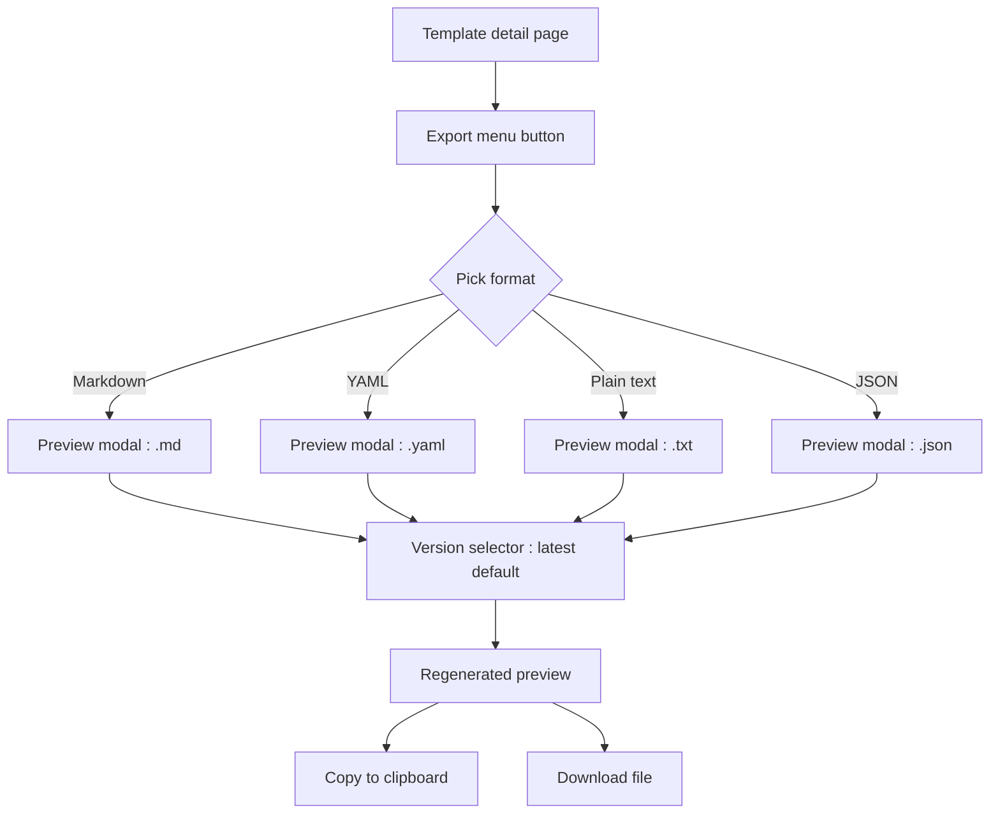
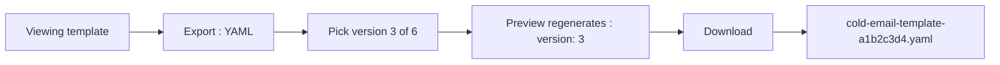

# Export Formats — UI/UX Design

- **Feature ID:** export-formats
- **Version:** 1.0
- **Status:** Proposed (for architecture review)
- **Author:** ui-ux-agent
- **Date:** 2026-10-13
- **Companion doc:** `export-formats-requirements.md`

## 1. Design Principles

1. **In-place, not elsewhere.** The Export menu lives on the template detail page where the user already is — no navigation to a settings page.
2. **Preview before commit.** Nobody should copy or download a mystery file. Every format shows its exact output first.
3. **One menu, four destinations.** Chat (plain text), docs (Markdown), automation (YAML), portability (JSON) — labeled by use case, not just extension.
4. **Zero backend ceremony.** Everything is client-side; the interaction feels instant.

## 2. Information Architecture



The Export menu replaces the existing standalone copy action on the template detail page (the plain-text copy becomes the "Plain text" format's Copy button).

## 3. User Flows

### 3.1 Copy for chat

```mermaid
flowchart LR
    A[Viewing template] --> B[Export : Plain text]
    B --> C[Preview shows content + Variables line]
    C --> D[Copy]
    D --> E["Copied ✓ toast"]
    E --> F[Paste into chat : fill {{variables}}]
```

### 3.2 Download YAML for automation



## 4. Page Layouts

### 4.1 Template detail — Export menu

```
+---------------------------------------------------------------+
|  Cold Email Template                          [Export ▾] [⋯]   |
|  by Alice · v6 · public · ★128                                 |
+---------------------------------------------------------------+
|  (template content preview …)                                  |
```

Menu open:

```
+---------------------------+
|  Export template           |
|  ───────────────────────── |
|  📄 Markdown   for docs    |
|  ⚙️ YAML       for tools   |
|  💬 Plain text for chat    |
|  📦 JSON       to re-import|
+---------------------------+
```

### 4.2 Preview modal

```
+----------------------------------------------------------------------+
|  Export as Markdown                                    [×]            |
|  Version: [v6 (latest) ▾]                                            |
+----------------------------------------------------------------------+
|  1 | # Cold Email Template                                           |
|  2 | *A concise cold email for SaaS outreach.*                       |
|  3 | **Type:** text  **Category:** Business  **Language:** en        |
|  4 | - saas                                                         |
|  5 | ---                                                            |
|  6 | ```                                                            |
|  7 | Write a cold email for {{product}} targeting {{audience}}…      |
|  8 | ```                                                            |
|  9 | > Exported from open-prompts · 2026-10-13                       |
+----------------------------------------------------------------------+
|  [Copy]  [Download .md]                        ~0.4 KB              |
+----------------------------------------------------------------------+
```

### 4.3 Mobile

The Export button stays in the header row (icon-only on small screens). The menu becomes a bottom sheet; the preview modal goes full-screen with Copy/Download as a sticky footer pair.

## 5. Component Specs

| Component | Behavior | States |
|---|---|---|
| ExportMenu | Dropdown with 4 format options, each with icon + name + use-case hint; opens via click or `E` | closed / open |
| ExportPreviewModal | Read-only code view with line numbers, version selector, Copy + Download actions, size hint | loading / ready / copy-error / download-error |
| VersionSelector | Dropdown of versions (number + change note excerpt), latest default | 1 version (disabled) / many |
| CopyButton | Clipboard API with execCommand fallback; "Copied ✓" state for 2 s | idle / copied / error |
| DownloadButton | Blob + anchor download; filename per FR-8 | idle / error → new-tab fallback |

## 6. Interaction Details

1. **Menu open:** click or `E` key; arrow keys move, Enter selects, Esc closes. Focus returns to the Export button on close.
2. **Preview generation:** instant (client-side); the modal opens with the format already rendered — no intermediate spinner for typical sizes. For > 100 KB content a brief skeleton shows.
3. **Version switch:** changing the selector regenerates the preview in place; the size hint updates; scroll resets to top.
4. **Copy:** writes the exact preview text; button flips to "Copied ✓" for 2 s. On permission denial, an inline error appears with a Retry and the text stays selectable for manual copy.
5. **Download:** creates a Blob and triggers the anchor download with the FR-8 filename. On failure, opens the content in a new tab via a data URL.
6. **Access:** the Export menu renders only when the user can view the template (public → all authenticated; private → owner). Non-owners on private templates never see the page (existing 404).
7. **Admin console:** `/admin/templates/:id` shows the same Export menu in its header, identical output (OQ-4 pending).
8. **Escaping:** if content contains ```, the Markdown fence extends to four backticks; YAML always uses block scalars so no content can break the structure.

## 7. States Summary

| Surface | Loading | Empty | Error |
|---|---|---|---|
| ExportMenu | — | — | — |
| ExportPreviewModal | Skeleton (>100 KB) | — | Copy error inline + retry; download error → new tab |
| VersionSelector | — | Single version → disabled with tooltip | — |
| CopyButton | — | — | Error + retry |

## 8. i18n

| Key | EN | ZH |
|---|---|---|
| `export.menu.label` | Export | 导出 |
| `export.menu.title` | Export template | 导出模板 |
| `export.format.markdown` | Markdown | Markdown |
| `export.format.yaml` | YAML | YAML |
| `export.format.text` | Plain text | 纯文本 |
| `export.format.json` | JSON | JSON |
| `export.format.markdown.hint` | for docs | 用于文档 |
| `export.format.yaml.hint` | for tools | 用于工具 |
| `export.format.text.hint` | for chat | 用于聊天 |
| `export.format.json.hint` | to re-import | 用于再导入 |
| `export.modal.title` | Export as {{format}} | 导出为 {{format}} |
| `export.modal.version` | Version | 版本 |
| `export.modal.versionLatest` | v{{n}} (latest) | v{{n}}（最新） |
| `export.modal.copy` | Copy | 复制 |
| `export.modal.copied` | Copied ✓ | 已复制 ✓ |
| `export.modal.download` | Download {{ext}} | 下载 {{ext}} |
| `export.modal.size` | ~{{size}} | 约 {{size}} |
| `export.modal.copyError` | Couldn't copy automatically. Select the text and copy manually, or retry. | 自动复制失败。请手动选择文本复制，或重试。 |
| `export.modal.downloadError` | Download failed. Opened in a new tab instead. | 下载失败。已改为在新标签页打开。 |
| `export.modal.retry` | Retry | 重试 |
| `export.text.variables` | Variables: {{list}} | 变量：{{list}} |
| `export.md.exportedFrom` | Exported from open-prompts · {{date}} | 导出自 open-prompts · {{date}} |
| `export.shortcut.help` | Open export menu | 打开导出菜单 |

## 9. Accessibility

- The Export menu is a standard dropdown: `aria-haspopup="menu"`, `aria-expanded` on the trigger, roving focus with arrow keys, Esc to close and return focus.
- The preview is a read-only code region (`aria-readonly`) with a labelled version selector; line numbers are `aria-hidden` decoration.
- Copy/Download buttons announce their result via live region ("Copied to clipboard"), not color alone.
- The `E` shortcut is documented in the keyboard-shortcuts help panel and only fires when the template detail page is focused and no modal/input is active.

## 10. Analytics (optional)

- `export_format_used` (format, source: menu/shortcut), `export_version_changed`, `export_copy_vs_download` — product usage events only.

## 11. Out of Scope

- Import from these formats; bulk export; PDF/DOCX/image; custom output templates.
- Server-side rendering of formats; share links rendering a format.
- Monetization of any kind — permanently out of scope for this product.
