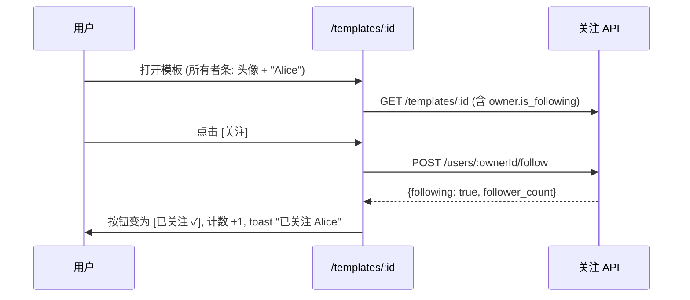
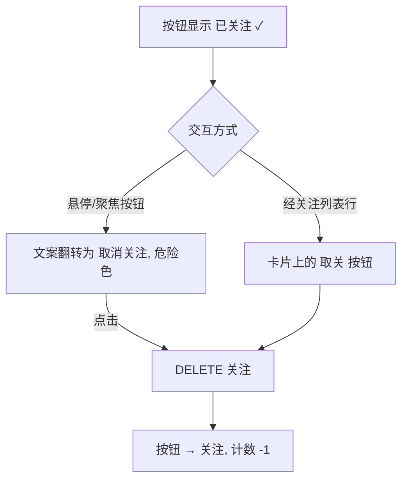
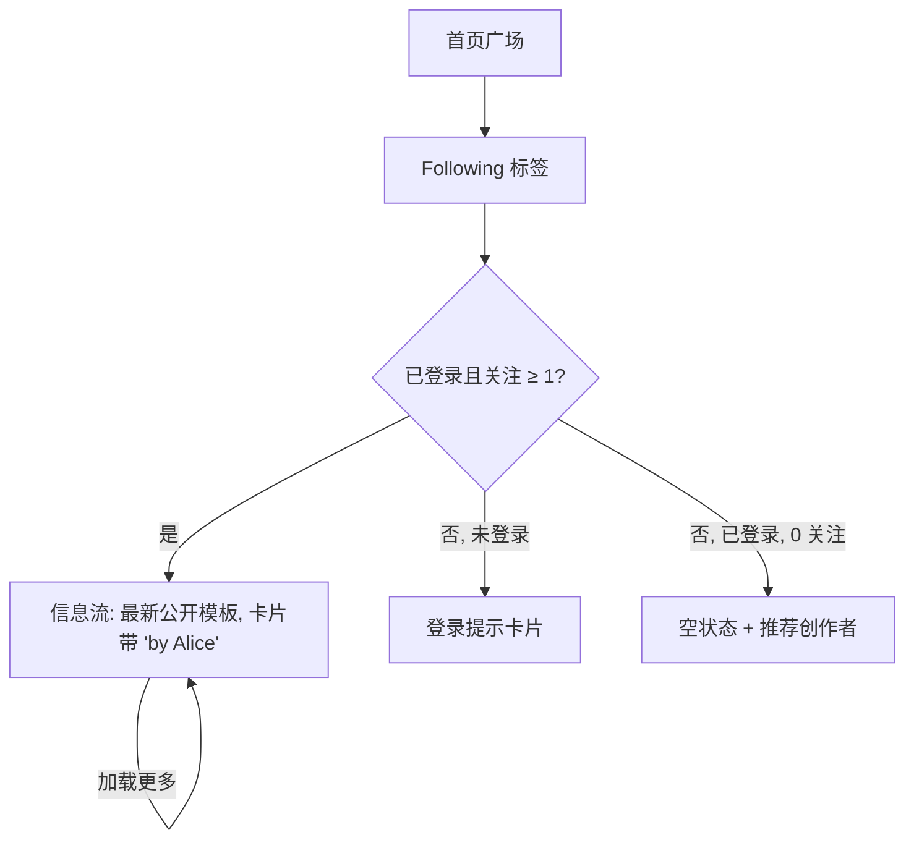

# 关注创作者 — UI/UX 设计

- **功能标识:** follow-creators
- **版本:** 1.0
- **状态:** 已提案（待架构评审）
- **作者:** ui-ux-agent
- **日期:** 2026-10-12
- **配套文档:** `follow-creators-requirements-zh-CN.md`

## 1. 设计原则

1. **从内容中关注。** 关注按钮位于发现发生的地方 —— 模板详情页与创作者主页 —— 绝不埋在设置里。一次点击，即时可逆。
2. **人是一等公民。** 创作者获得真正的身份界面（`/creators/:id`）：头像、名字、简介、计数及其公开作品。裸 `owner_id` 字符串从产品中消失。
3. **信息流是目的地。** "Following" 是首页广场的一等入口 —— 用户明天再来的理由。
4. **Aurora 原生。** 复用 PromptCard、徽章、按钮、Modal、Spinner、空状态、toast、token 与明暗主题。不引入新视觉语言。
5. **诚实的状态。** 关注/已关注始终是明确文字（绝非仅颜色）；计数使用一致缩写；失败时按钮回退并说明。

## 2. 信息架构

```mermaid
flowchart LR
    A[/templates/:id] -->|点击所有者条| C[/creators/:id]
    B[首页卡片 'by Alice'] -->|点击| C
    C --> D[关注 / 已关注 按钮]
    D -->|关注| E[(user_follows)]
    C --> F[公开模板网格]
    C --> G[粉丝列表]
    C --> H[关注列表]
    I[首页 'Following' 标签] --> J[Following 信息流: 最新公开模板]
    J -->|点击卡片| A
    G & H -->|点击用户卡片| C2[/creators/:otherId]
```

**界面清单:**

| 界面 | 访问 | 内容 |
|---|---|---|
| `/templates/:id` 所有者条 + 关注按钮 | 公开可看；登录可关注 | 创作者身份 + 关注切换 |
| `/creators/:id` | 公开 | 主页：身份、简介、计数、关注按钮、公开模板、粉丝/关注列表 |
| 首页广场 "Following" 标签 | 信息流需登录；页面公开 | 被关注创作者的最新公开模板 |
| 自己主页的 关注中/粉丝 列表 | 列表公开；取关需登录 | 带关注/取关按钮的用户卡片 |
| 管理员用户详情 | 仅管理员 | 只读粉丝/关注计数 |

## 3. 用户流程

### 3.1 从模板详情关注



### 3.2 取关（两条路径）



### 3.3 经创作者主页发现

```mermaid
flowchart TD
    A[点击所有者条 / 'by Alice'] --> B[/creators/:id]
    B --> C[身份头部: 头像, 名字, 简介, 加入日期]
    B --> D[计数: 粉丝 · 关注中]
    B --> E[公开模板网格: 最新在前]
    E -->|点击卡片| F[/templates/:id]
    B --> G[粉丝 / 关注中 列表链接]
    G --> H[分页用户卡片] -->|点击| I[/creators/:otherId]
```

### 3.4 消费 Following 信息流



## 4. 页面布局

### 4.1 模板详情 — 所有者身份区块（取代 "by {owner_id}"）

```text
┌──────────────────────────────────────────────────────────────┐
│ [头像 40px] Alice                          [＋ 关注]          │
│             128 粉丝 · 12 个模板                             │
└──────────────────────────────────────────────────────────────┘
```

- 头像 + 显示名链接到 `/creators/:id`（整条是链接；关注按钮在链接目标之外）。
- 计数缩写（128 / 1.2k）经共享工具；点击"粉丝"打开主页的粉丝列表。
- 匿名：按钮跳转 `/login`（既有回跳行为）。

### 4.2 首页广场 — "Following" 标签

```text
┌──────────────────────────────────────────────────────────────┐
│  [发现] [Following] [我的提示词]              [搜索…] [⚙]     │
├──────────────────────────────────────────────────────────────┤
│ ┌──────────┐ ┌──────────┐ ┌──────────┐ ┌──────────┐          │
│ │ 卡片     │ │ 卡片     │ │ 卡片     │ │ 卡片     │          │
│ │ by Alice │ │ by Bob   │ │ by Carol │ │ by Alice │          │
│ └──────────┘ └──────────┘ └──────────┘ └──────────┘          │
│                       [ 加载更多 ]                            │
└──────────────────────────────────────────────────────────────┘
```

- 标签位置镜像既有广场导航；匿名时"Following"显示登录提示卡片。
- 卡片为未改动的 `PromptCard` 加一行"by {display_name}"（链接到创作者主页）。

### 4.3 创作者主页 — `/creators/:id`

```text
┌──────────────────────────────────────────────────────────────┐
│ [头像 96px]  Alice                          [＋ 关注]         │
│              专注数据抽取的提示词工程师。                     │
│              [关注了你]                                      │
│              1.2万 粉丝 · 87 关注中 · 加入于 2025-03          │
├──────────────────────────────────────────────────────────────┤
│ [模板 (24)] [粉丝 (12,048)] [关注中 (87)]                    │
├──────────────────────────────────────────────────────────────┤
│ ┌──────────┐ ┌──────────┐ ┌──────────┐                       │
│ │ 卡片     │ │ 卡片     │ │ 卡片     │   (仅公开,            │
│ └──────────┘ └──────────┘ └──────────┘    最新在前)          │
│                       [ 加载更多 ]                            │
└──────────────────────────────────────────────────────────────┘
```

- 标签将网格切换为粉丝/关注中的用户卡片列表（头像、名字、粉丝数、关注/取关按钮）。
- 自己的主页：关注按钮变为"编辑资料"（链接到可编辑简介的 `/profile`）。

### 4.4 用户卡片（粉丝/关注列表）

```text
┌──────────────────────────────────────────────┐
│ [头像 32px] Alice           1.2万 粉丝        │
│               @alice                         │
│                                [已关注 ✓]    │
└──────────────────────────────────────────────┘
```

- 整卡链接到创作者主页；关注按钮是独立停靠点。

### 4.5 管理员用户详情 — 计数行（只读）

在 `/admin/users/:id` 既有统计行中加入"粉丝: N · 关注中: M"的只读纯文本。无任何操作。

## 5. 组件规格

| 组件 | 说明 |
|---|---|
| `FollowButton` | 三态：关注（主要）、已关注 ✓（默认）、取消关注（危险色，悬停/聚焦时）；乐观切换，出错回退；请求中禁用 |
| `OwnerChip` | 头像 + 显示名 + 计数；链接到创作者主页；用于模板详情 |
| `CreatorProfilePage` | 身份头部 + 标签式内容（模板 / 粉丝 / 关注中）；持有取数 |
| `UserCard` | 头像、名字、粉丝数、关注按钮；用于粉丝/关注列表 |
| `FollowingFeed` | 首页广场标签内容；复用 PromptCard 网格 + 加载更多 |
| `ProfileBioField` | 既有资料编辑表单中的简介 textarea（0–280 字符）带计数 |

所有新 i18n 键位于 `creators.*`、`follow.*` 与 `home.following.*` 命名空间，同时进入 `en` 与 `zh` 翻译文件。

## 6. 交互细节

- **乐观关注:** 按钮即时翻转；失败回退 + 错误 toast。计数以响应值更新（服务端为权威）。
- **取关入口:** 已关注按钮在悬停/聚焦时显现"取消关注"并带危险色 —— 用户早已熟悉的 Twitter 模式；无确认弹窗（取关低风险且可逆）。
- **"关注了你"徽章:** 名字旁的小描边 chip；仅在为真且仅对登录的被关注者可见。
- **计数:** 超过 1000 缩写（按 locale 规则 1.2k / 1.2万，经共享工具）；精确值在 `title` 提示中。
- **信息流新鲜度:** 标签激活时重新拉取（v1 不轮询）；"加载更多"追加分页。
- **空状态:** 0 关注 → 插图 + "关注创作者，在这里看到他们的最新模板" + "浏览热门创作者"兜底列表（简单实现：粉丝最多的创作者，上限 5，复用用户卡片列表）。
- **键盘:** 所有按钮为真实按钮；标签列表遵循既有标签模式；卡片链接是单一停靠点，关注按钮为独立停靠点。

## 7. 状态汇总

| 场景 | 加载 | 空 | 错误 |
|---|---|---|---|
| 创作者主页 | 页面骨架 | 无（主页存在或 404 页） | 错误页 + 重试 |
| 模板网格 | 卡片骨架 | "还没有公开模板" | 内联错误 + 重试 |
| 粉丝/关注列表 | 行骨架 | "还没有粉丝" / "还没有关注任何人" | 内联错误 + 重试 |
| Following 信息流 | 卡片骨架 | 空状态 + 推荐创作者 | 内联错误 + 重试 |
| 关注按钮 | 按钮内转圈 | 无 | 回退 + 错误 toast |
| 简介保存 | 按钮转圈 | 无 | 字段错误，文本保留 |

## 8. 国际化考量（中/英）

- 所有界面文案本地化：关注/已关注/取消关注（"Follow" / "Following" / "Unfollow"）、"关注了你"（"Follows you"）、标签名、空状态、toast、资料字段标签（"简介" / "Bio"）、加入日期（"加入于 {date}" / "Joined {date}"）。
- 显示名与简介是用户内容 —— 绝不翻译，按原样渲染（React 转义）。
- 计数缩写按 locale：英文 "1.2k"、中文 "1.2万"（共享工具，与点赞计数一致）。
- 复数：英文用 i18next 复数形式（"1 follower" / "128 followers"）；中文无复数形态 —— 相同字符串带计数。
- 模板详情的 "by {owner}" 键增加显示名参数；裸 ID 渲染退役。

## 9. 无障碍

- FollowButton 状态以文字传达（"关注" / "已关注" / "取消关注"），绝非仅颜色；`aria-pressed` 反映切换。
- 主页头部是 landmark 区域；标签使用既有标签无障碍模式（roving tabindex 或 aria-tabs）。
- 用户卡片与所有者条是带描述性可访问名称（创作者名）的单一链接；关注按钮是独立停靠点。
- 信息流与列表以 polite 方式播报加载更多结果；骨架 `aria-hidden`。
- 所有新状态在两套主题下满足 WCAG 2.1 AA 对比度（含取消关注的危险色）。

## 10. 数据分析（可选，若分析功能上线）

- `creator_profile_viewed`、`follow_clicked`、`unfollow_clicked`、`following_feed_viewed`、`following_feed_load_more` 事件。v1 不新增埋点基础设施 —— 仅当 prompt-analytics 功能的管道存在时。

## 11. 不做范围（与需求 §8 一致）

推荐算法、拉黑、屏蔽、关注申请、订阅模板、信息流排序、摘要邮件、粉丝分析、管理员关注管理、关注图谱导入/导出，以及任何与变现相关的界面。
