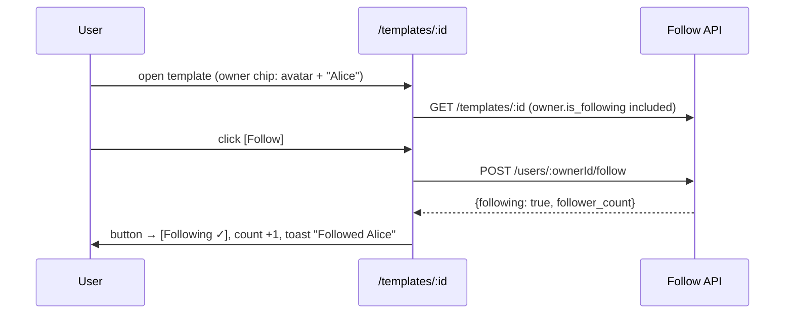
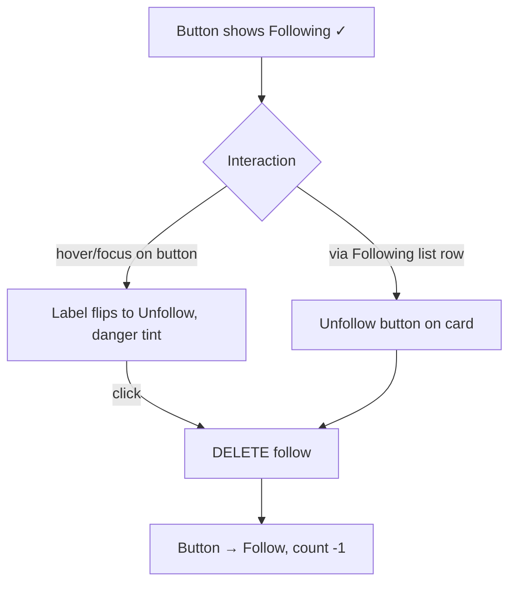
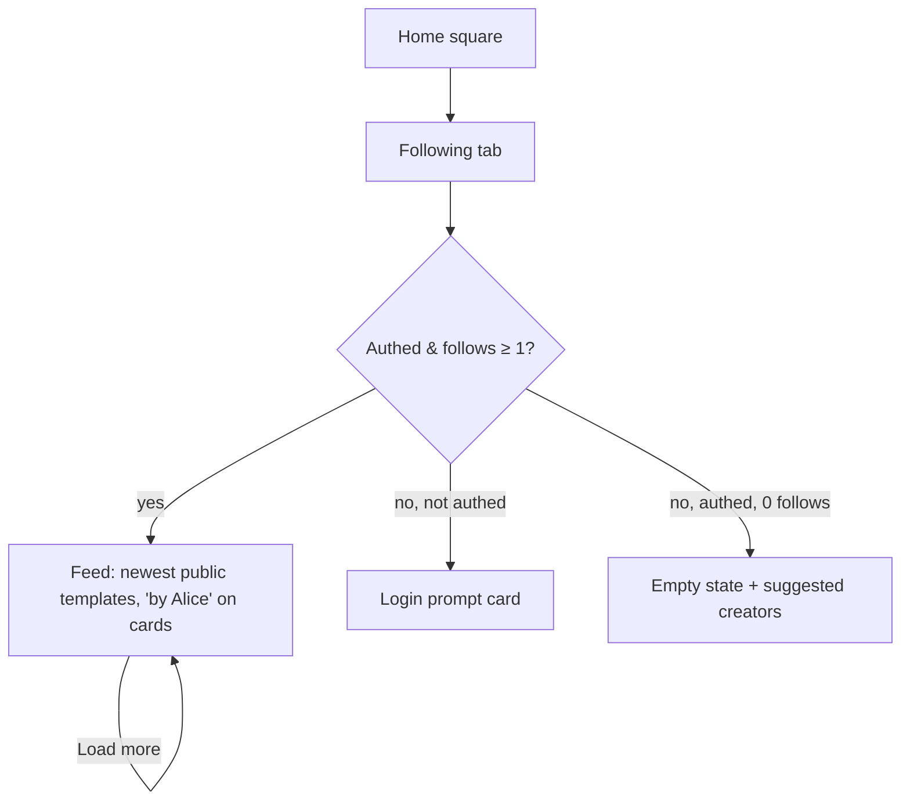

# Follow Creators — UI/UX Design

- **Feature ID:** follow-creators
- **Version:** 1.0
- **Status:** Proposed (for architecture review)
- **Author:** ui-ux-agent
- **Date:** 2026-10-12
- **Companion doc:** `follow-creators-requirements.md`

## 1. Design Principles

1. **Follow from content.** The follow button lives where discovery happens — template detail page and creator profile — never buried in settings. One click, instantly reversible.
2. **People are first-class.** Creators get a real identity surface (`/creators/:id`): avatar, name, bio, counts, and their public work. The raw `owner_id` string disappears from the product.
3. **The feed is a destination.** "Following" is a first-class entry point on the home square — the reason a user returns tomorrow.
4. **Aurora-native.** Reuse PromptCard, badges, buttons, Modal, Spinner, empty states, toasts, tokens, and light/dark themes. No new visual language.
5. **Honest states.** Follow/Following is always explicit text (never color-only); counts use consistent abbreviation; failures revert the button and say so.

## 2. Information Architecture

```mermaid
flowchart LR
    A[/templates/:id] -->|owner chip click| C[/creators/:id]
    B[Home square card 'by Alice'] -->|click| C
    C --> D[Follow / Following button]
    D -->|follow| E[(user_follows)]
    C --> F[Public templates grid]
    C --> G[Followers list]
    C --> H[Following list]
    I[Home 'Following' tab] --> J[Following feed: newest public templates]
    J -->|card click| A
    G & H -->|user card click| C2[/creators/:otherId]
```

**Surfaces:**

| Surface | Access | Content |
|---|---|---|
| Owner chip + Follow button on `/templates/:id` | public view; auth to follow | Creator identity + follow toggle |
| `/creators/:id` | public | Profile: identity, bio, counts, Follow button, public templates, followers/following lists |
| Home square "Following" tab | feed auth-only; page public | Newest public templates from followed creators |
| Own profile Following/Followers lists | public lists; unfollow needs auth | User cards with follow/unfollow |
| Admin user detail | admin only | Read-only follower/following counts |

## 3. User Flows

### 3.1 Follow from template detail



### 3.2 Unfollow (two paths)



### 3.3 Discover via creator profile

```mermaid
flowchart TD
    A[Click owner chip / 'by Alice'] --> B[/creators/:id]
    B --> C[Identity header: avatar, name, bio, joined date]
    B --> D[Counts: followers · following]
    B --> E[Public templates grid: newest first]
    E -->|card click| F[/templates/:id]
    B --> G[Followers / Following list links]
    G --> H[Paginated user cards] -->|click| I[/creators/:otherId]
```

### 3.4 Consume the Following feed



## 4. Page Layouts

### 4.1 Template detail — owner identity block (replaces "by {owner_id}")

```text
┌──────────────────────────────────────────────────────────────┐
│ [avatar 40px] Alice                     [＋ Follow]          │
│              128 followers · 12 templates                   │
└──────────────────────────────────────────────────────────────┘
```

- Avatar + display name link to `/creators/:id` (whole chip is a link; follow button is outside the link target).
- Counts abbreviated (128 / 1.2k) via shared util; clicking "followers" opens the profile's followers list.
- Anonymous: button routes to `/login` (existing redirect-back behavior).

### 4.2 Home square — "Following" tab

```text
┌──────────────────────────────────────────────────────────────┐
│  [Discover] [Following] [My Prompts]        [search…] [⚙]    │
├──────────────────────────────────────────────────────────────┤
│ ┌──────────┐ ┌──────────┐ ┌──────────┐ ┌──────────┐          │
│ │ card     │ │ card     │ │ card     │ │ card     │          │
│ │ by Alice │ │ by Bob   │ │ by Carol │ │ by Alice │          │
│ └──────────┘ └──────────┘ └──────────┘ └──────────┘          │
│                       [ Load more ]                          │
└──────────────────────────────────────────────────────────────┘
```

- Tab placement mirrors the existing square navigation; "Following" shows a login prompt card when anonymous.
- Cards are unchanged `PromptCard`s plus a "by {display_name}" line (links to the creator profile).

### 4.3 Creator profile — `/creators/:id`

```text
┌──────────────────────────────────────────────────────────────┐
│ [avatar 96px]  Alice                        [＋ Follow]      │
│               Prompt engineer focused on data extraction.   │
│               [Follows you]                                 │
│               1.2k followers · 87 following · Joined 2025-03 │
├──────────────────────────────────────────────────────────────┤
│ [Templates (24)] [Followers (1,204)] [Following (87)]        │
├──────────────────────────────────────────────────────────────┤
│ ┌──────────┐ ┌──────────┐ ┌──────────┐                       │
│ │ card     │ │ card     │ │ card     │   (public only,      │
│ └──────────┘ └──────────┘ └──────────┘    newest first)     │
│                       [ Load more ]                          │
└──────────────────────────────────────────────────────────────┘
```

- Tabs switch the grid to the followers/following user-card list (avatar, name, follower count, follow/unfollow button).
- Own profile view: Follow button becomes "Edit profile" (links to `/profile` where bio is editable).

### 4.4 User card (followers/following lists)

```text
┌──────────────────────────────────────────────┐
│ [avatar 32px] Alice          1.2k followers  │
│               @alice                         │
│                                [Following ✓] │
└──────────────────────────────────────────────┘
```

- Whole card links to the creator profile; the follow button is a separate stop target.

### 4.5 Admin user detail — counts row (read-only)

On `/admin/users/:id`, the existing stats row gains "Followers: N · Following: M" as plain read-only text. No actions.

## 5. Component Specs

| Component | Notes |
|---|---|
| `FollowButton` | Three states: Follow (primary), Following ✓ (default), Unfollow (danger, on hover/focus); optimistic toggle with revert on error; disabled while pending |
| `OwnerChip` | Avatar + display name + counts; links to creator profile; used on template detail |
| `CreatorProfilePage` | Identity header + tabbed content (templates / followers / following); owns data fetching |
| `UserCard` | Avatar, name, follower count, follow button; used in follower/following lists |
| `FollowingFeed` | Home square tab content; reuses PromptCard grid + Load more |
| `ProfileBioField` | Bio textarea (0–280 chars) with counter in the existing profile edit form |

All new i18n keys live under `creators.*`, `follow.*`, and `home.following.*` namespaces in both `en` and `zh` translation files.

## 6. Interaction Details

- **Optimistic follow:** button flips immediately; on failure reverts + error toast. Count updates from the response value (server is the source of truth).
- **Unfollow affordance:** the Following button reveals "Unfollow" with a danger tint on hover/focus — the Twitter pattern users already know; no confirmation modal (unfollow is low-stakes and reversible).
- **"Follows you" badge:** small outline chip next to the name; visible only when true and only to the logged-in recipient of that follow.
- **Counts:** abbreviated above 1,000 (1.2k / 1.2万 style per locale rules via the shared util); exact value in `title` tooltip.
- **Feed freshness:** feed refetches on tab activation (no polling in v1); "Load more" appends pages.
- **Empty states:** zero follows → illustration + "Follow creators to see their latest templates here" + a "Browse popular creators" fallback list (simple: creators with most followers, capped 5, reusing the user-card list).
- **Keyboard:** all buttons real buttons; tab lists follow the existing tab pattern; card links are single stop targets with the follow button as a separate stop.

## 7. States Summary

| Context | Loading | Empty | Error |
|---|---|---|---|
| Creator profile | Page skeleton | n/a (profile always exists or 404 page) | Error page + Retry |
| Templates grid | Card skeletons | "No public templates yet" | Inline error + Retry |
| Followers/Following lists | Row skeletons | "No followers yet" / "Not following anyone yet" | Inline error + Retry |
| Following feed | Card skeletons | Empty state + suggested creators | Inline error + Retry |
| Follow button | Spinner in button | n/a | Revert + error toast |
| Bio save | Button spinner | n/a | Field error, text preserved |

## 8. i18n Considerations (EN/ZH)

- All chrome strings localized: Follow/Following/Unfollow ("关注" / "已关注" / "取消关注"), "Follows you" ("关注了你"), tab labels, empty states, toasts, profile field labels ("Bio" / "简介"), joined date ("Joined {date}" / "加入于 {date}").
- Display names and bios are user content — never translated, rendered as typed (React escaping).
- Count abbreviation is locale-aware: EN "1.2k", ZH "1.2万" (shared util, consistent with like counts).
- Pluralization: EN uses i18next plural forms ("1 follower" / "128 followers"); ZH has no plural morphology — identical string with count.
- The template detail "by {owner}" key gains a display-name parameter; the raw-ID rendering is retired.

## 9. Accessibility

- FollowButton state is conveyed by text ("Follow" / "Following" / "Unfollow"), never color alone; `aria-pressed` reflects the toggle.
- Profile header is a landmark region; tabs use the existing tab a11y pattern (roving tabindex or aria-tabs).
- User cards and owner chips are single links with descriptive accessible names (creator name); the follow button is a separate stop target.
- Feed and lists announce load-more results politely; skeletons are `aria-hidden`.
- WCAG 2.1 AA contrast in both themes for all new states (danger tint on Unfollow included).

## 10. Analytics (optional, if analytics feature ships)

- `creator_profile_viewed`, `follow_clicked`, `unfollow_clicked`, `following_feed_viewed`, `following_feed_load_more` events. No new instrumentation infrastructure in v1 — only if the prompt-analytics feature's pipeline exists.

## 11. Out of Scope (mirrors requirements §8)

Recommendation algorithms, blocking, muting, follow requests, watch-template, feed ranking, digests, follower analytics, admin follow management, follow-graph import/export, and any monetization-adjacent surface.
