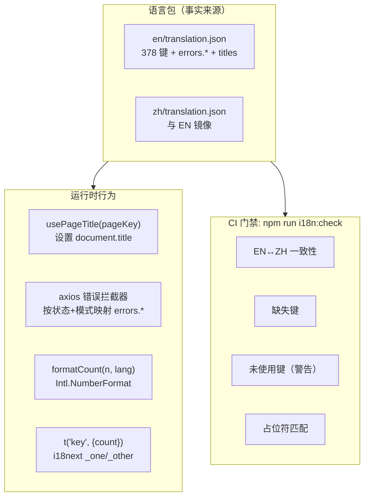
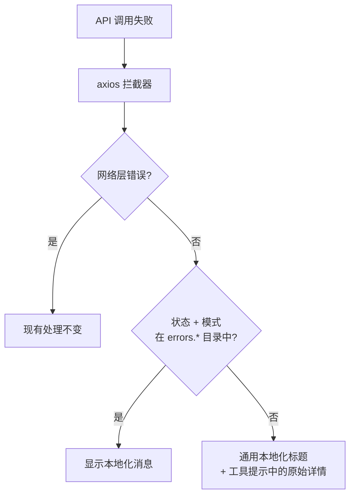

# 国际化完整性与质量 — UI/UX 设计

| | |
|---|---|
| **Feature ID** | FE-011 |
| **Version** | 1.0 |
| **Status** | Proposed（待架构评审） |
| **Author** | ui-ux-agent |
| **Date** | 2026-10-10 |

## 1. 设计原则

1. **正常工作时不可见。** 好的国际化从不被察觉——目标是 ZH 用户永远看不到英文，EN 用户永远看不到 "1 items"。
2. **保障优于覆盖。** CI 检查胜过良好意愿；今天的一致性没有强制就毫无意义。
3. **唯一事实来源。** 错误映射、标题、复数全部放在语言包中——译者永远不需要改代码。
4. **零新增界面。** 本功能不改变导航、不新增页面；只升级现有内容。

## 2. 信息架构



## 3. 用户流程

### 3.1 语言切换更新一切

```mermaid
flowchart LR
    A[用户点击语言切换] --> B[i18n.changeLanguage]
    B --> C[React 重新渲染所有 t() 文案]
    B --> D[usePageTitle effect 重新执行]
    D --> E[document.title 更新]
    B --> F[html lang 同步（无障碍功能）]
    B --> G[formatCount 重新渲染数字]
```

### 3.2 后端错误本地化呈现



## 4. 页面布局

无布局变化。可见触点如下：

### 4.1 浏览器标签标题（前 → 后）

```
之前（所有页面、两种语言）:
┌─────────────────────────────┐
│ Open Prompts                │  ← 静态
└─────────────────────────────┘

之后（按页面、按语言）:
┌─────────────────────────────┐
│ All Templates · Open Prompts │  ← EN 首页
└─────────────────────────────┘
┌─────────────────────────────┐
│ 全部模板 · Open Prompts      │  ← ZH 首页
└─────────────────────────────┘
┌─────────────────────────────┐
│ My Prompt Template · Open P… │  ← 模板详情
└─────────────────────────────┘
```

### 4.2 本地化错误 toast（ZH 示例）

```
┌───────────────────────────────┐
│ ⚠ 操作失败                     │
│ 该邮箱已被注册。 ⓘ             │  ← 本地化标题 + 详情入口
└───────────────────────────────┘
   悬停 ⓘ 显示后端原始消息
```

## 5. 组件规格

| 组件 | 位置 | Props / API | 说明 |
|---|---|---|---|
| `usePageTitle(pageKey, vars?)` | `hooks/usePageTitle.js` | `usePageTitle('home')` 或 `usePageTitle('template_details', { title })` | effect 设置 `document.title = t('titles.' + pageKey, vars) + ' · Open Prompts'`；在 `i18n.language` 变化时重新执行 |
| `formatCount(value, lang)` | `utils/format.js` | 返回分组字符串 | `Intl.NumberFormat(lang === 'zh' ? 'zh-CN' : 'en-US')`；由 `adminFormat.formatNumber` 提升 |
| `scripts/check-i18n.mjs` | 仓库根 `scripts/` | `node scripts/check-i18n.mjs` | 零依赖；实现 FR-1..4；`--report-unused` 标志打印警告 |
| axios 拦截器更新 | `services/api.js` | 响应错误时 | 映射到 `errors.*` 键；保留网络错误路径 |
| `titles.*` 目录命名空间 | 两个语言文件 | `titles.home`、`titles.login`、… `titles.template_details` | 详情页使用 `"{title}"` 插值 |
| `errors.*` 目录命名空间 | 两个语言文件 | `errors.409.email_taken`、`errors.400.validation`、`errors.generic`、… | 键为状态 + 模式；未知 → `errors.generic` |

### 复数迁移（目录差异）

```json
// EN 之前
"total_count": "{{count}} items"
// EN 之后
"total_count_one": "{{count}} item",
"total_count_other": "{{count}} items"

// ZH（无复数屈折——单一 _other 形式）
"total_count_other": "{{count}} 项"
```

## 6. 交互细节

1. **标题生命周期**：页面挂载 → hook 设置标题 → 路由变化替换 → 语言切换重新执行 effect（无刷新、无闪烁）。模板详情等待数据后设置 `{title}`——在此之前显示通用 `titles.template_details`（"模板"）。
2. **错误详情入口**：toast 标题始终本地化；ⓘ 图标（`.icon-btn`）切换显示原始后端消息的小字详情——便于报 bug，默认不可见。
3. **数字渲染**：`formatCount` 是现有计数渲染点（PromptCard 元信息行、列表总数）的直接替换；小于 1000 的值与今天渲染一致，无视觉回归。
4. **CI 输出**可操作：每个失败列出文件、键和方向（`zh missing: admin.users.title`）；未使用警告按命名空间分组，便于清理 PR。
5. **本地工作流**：`npm run i18n:check` 5 秒内完成；开发者提交前运行；CI 在每个 PR 上运行。
6. **复数调用点**向 `t()` 传 `{ count }` 不变——i18next 自动选择 `_one`/`_other`；目录之外无组件改动。

## 7. 状态汇总

| 状态 | 行为 |
|---|---|
| 标题加载中（详情页） | 数据到达前显示通用页面标题 |
| 错误已映射 | 本地化标题，按需查看详情 |
| 错误未映射 | 通用本地化标题 + 原始详情 |
| 网络错误 | 现有处理不变（不查目录） |
| CI 通过 | 静默 |
| CI 失败 | 非零退出码，逐键列出 |

## 8. 视觉风格（Aurora）

- 除错误 toast 中的 ⓘ 详情切换外无新视觉元素，样式为 `.icon-btn`、`--text-3` 图标色、`--radius-pill` 命中区。
- toast 样式不变（沿用 NotificationContext 模式）。
- 标签标题为纯文本——无样式问题；`·` 分隔符符合产品的排版语调。

## 9. 国际化

两个语言包新增命名空间（展示 EN；ZH 镜像）：

```json
{
  "titles": {
    "home": "All Templates",
    "login": "Sign In",
    "register": "Create Account",
    "profile": "Profile",
    "api_keys": "API Keys",
    "template_details": "Template",
    "admin_dashboard": "Admin Dashboard",
    "admin_users": "User Management",
    "admin_templates": "Template Management",
    "admin_audit_log": "Audit Log"
  },
  "errors": {
    "generic": "Something went wrong. Please try again.",
    "network": "Network error. Check your connection.",
    "401": "Your session has expired. Please sign in again.",
    "403": "You do not have permission to do that.",
    "404": "The requested resource was not found.",
    "409": "The request conflicts with existing data.",
    "429": "Too many requests. Please wait a moment.",
    "500": "Server error. Please try again later.",
    "detail_toggle": "Show technical details"
  }
}
```

```json
// ZH
{
  "titles": {
    "home": "全部模板",
    "login": "登录",
    "register": "注册",
    "profile": "个人资料",
    "api_keys": "API 密钥",
    "template_details": "模板",
    "admin_dashboard": "管理面板",
    "admin_users": "用户管理",
    "admin_templates": "模板管理",
    "admin_audit_log": "审计日志"
  },
  "errors": {
    "generic": "出错了，请重试。",
    "network": "网络错误，请检查连接。",
    "401": "会话已过期，请重新登录。",
    "403": "你没有执行该操作的权限。",
    "404": "请求的资源不存在。",
    "409": "请求与现有数据冲突。",
    "429": "请求过于频繁，请稍候。",
    "500": "服务器错误，请稍后重试。",
    "detail_toggle": "查看技术详情"
  }
}
```

## 10. 无障碍

- `document.title` 变化会被屏幕阅读器作为导航上下文播报；页面级标题改善非视觉用户的路径辨识。
- ⓘ 详情切换是真实的 `<button>`，带 `aria-label`（`errors.detail_toggle`）、可键盘聚焦、`aria-expanded` 反映状态。
- 本地化错误标题让 ZH 屏幕阅读器用户受益（`<html lang>` 同步落地后发音正确）。
- 复数正确性消除了令人困惑的 "1 items" 播报。

## 11. 实现说明

- **`scripts/check-i18n.mjs`**（零依赖）：扁平化两个目录 → 对比键集合（FR-1）；正则提取 `frontend/src` 中的 `t('...')` 字面量（FR-2）；与目录对比（缺失）及与代码对比（未使用，警告）（FR-3）；逐键对比 `{{var}}` 集合（FR-4）。在 `package.json` 中接入 `"i18n:check": "node scripts/check-i18n.mjs"` 并加入 CI。
- **复数迁移**：EN 中两个计数键重命名为 `_one`/`_other` 变体，ZH 用 `_other`；调用点不变。`char_count` 保持原样（计数器，非复数）。
- **`usePageTitle`**：`useEffect` 依赖 `[i18n.language, vars]`；读取 `t('titles.' + key, vars)`；追加 ` · Open Prompts`。每个页面组件一行。
- **错误拦截器**：在现有响应错误处理器中、toast 展示前，先查 `errors.{status}` 再查模式专属键；原始消息保留在错误对象中供详情切换。网络错误（`error.request` 无响应）绕过目录。
- **`formatCount`**：将 `formatNumber` 从 `utils/adminFormat.js` 移至 `utils/format.js`（旧路径 re-export 保持管理端兼容），然后在 PromptCard 和列表总数中采用。
- **目录清理**：删除约 54 个未使用键，为进行中功能（notifications、template-versioning、accessibility、onboarding、import-export 命名空间由各自功能添加并在落地时使用）白名单的键除外。
- **`welcome` 规范化**：`welcome: "Welcome..."` → `welcome: { title: "Welcome..." }`；更新唯一使用点。
