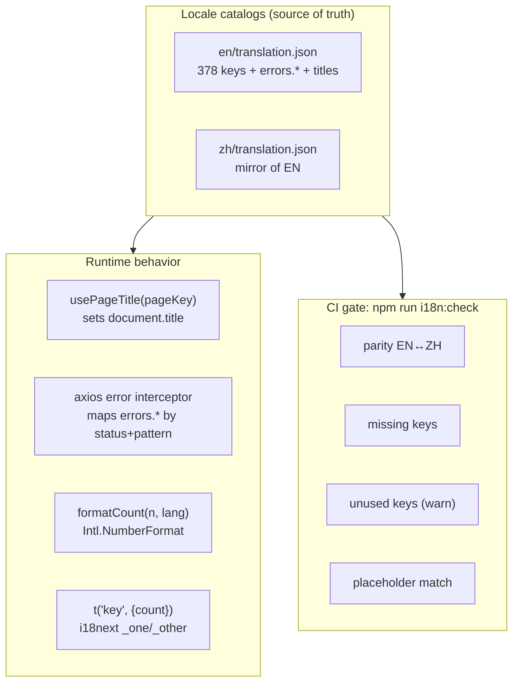
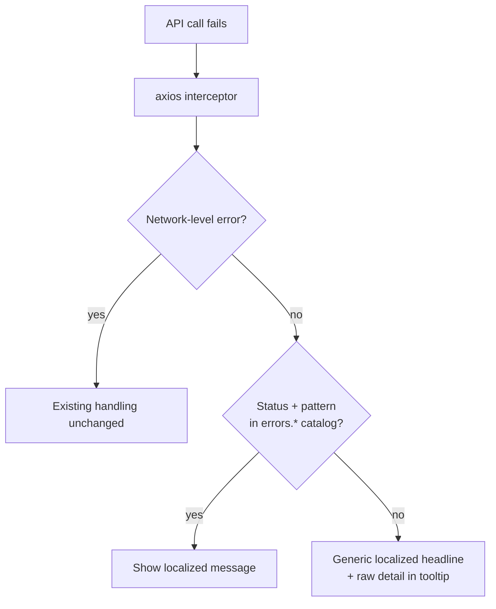

# i18n Completeness & Quality — UI/UX Design

| | |
|---|---|
| **Feature ID** | FE-011 |
| **Version** | 1.0 |
| **Status** | Proposed (for architecture review) |
| **Author** | ui-ux-agent |
| **Date** | 2026-10-10 |

## 1. Design Principles

1. **Invisible when working.** Good i18n is never noticed — the goal is that ZH users never see English and EN users never see "1 items".
2. **Guarantees over coverage.** CI checks beat good intentions; parity today means nothing without enforcement.
3. **One source of truth.** Error mappings, titles, and plurals all live in the locale catalogs — translators never touch code.
4. **No new surfaces.** This feature changes no navigation, adds no pages; it upgrades what exists.

## 2. Information Architecture



## 3. User Flows

### 3.1 Language switch updates everything

```mermaid
flowchart LR
    A[User clicks language toggle] --> B[i18n.changeLanguage]
    B --> C[React re-renders all t() strings]
    B --> D[usePageTitle effect re-runs]
    D --> E[document.title updates]
    B --> F[html lang sync (accessibility feature)]
    B --> G[formatCount re-renders numbers]
```

### 3.2 Backend error surfaces localized



## 4. Page Layouts

No layout changes. The visible touchpoints:

### 4.1 Browser tab title (before → after)

```
Before (all pages, both languages):
┌─────────────────────────────┐
│ Open Prompts                │  ← static
└─────────────────────────────┘

After (per page, per language):
┌─────────────────────────────┐
│ All Templates · Open Prompts │  ← EN home
└─────────────────────────────┘
┌─────────────────────────────┐
│ 全部模板 · Open Prompts      │  ← ZH home
└─────────────────────────────┘
┌─────────────────────────────┐
│ My Prompt Template · Open P… │  ← template details
└─────────────────────────────┘
```

### 4.2 Localized error toast (ZH example)

```
┌───────────────────────────────┐
│ ⚠ 操作失败                     │
│ 该邮箱已被注册。 ⓘ             │  ← localized headline + detail affordance
└───────────────────────────────┘
   hovering ⓘ shows raw backend message
```

## 5. Component Specifications

| Component | Location | Props / API | Notes |
|---|---|---|---|
| `usePageTitle(pageKey, vars?)` | `hooks/usePageTitle.js` | `usePageTitle('home')` or `usePageTitle('template_details', { title })` | effect sets `document.title = t('titles.' + pageKey, vars) + ' · Open Prompts'`; re-runs on `i18n.language` change |
| `formatCount(value, lang)` | `utils/format.js` | returns grouped string | `Intl.NumberFormat(lang === 'zh' ? 'zh-CN' : 'en-US')`; promoted from `adminFormat.formatNumber` |
| `scripts/check-i18n.mjs` | repo root `scripts/` | `node scripts/check-i18n.mjs` | zero-dependency; implements FR-1..4; `--report-unused` flag prints warnings |
| axios interceptor update | `services/api.js` | on response error | maps to `errors.*` keys; preserves network-error path |
| `titles.*` catalog namespace | both locale files | `titles.home`, `titles.login`, … `titles.template_details` | pattern `"{title}"` interpolation for details pages |
| `errors.*` catalog namespace | both locale files | `errors.409.email_taken`, `errors.400.validation`, `errors.generic`, … | keys are status + pattern; unknown → `errors.generic` |

### Plural migration (catalog diff)

```json
// EN before
"total_count": "{{count}} items"
// EN after
"total_count_one": "{{count}} item",
"total_count_other": "{{count}} items"

// ZH (no plural inflection — single _other form)
"total_count_other": "{{count}} 项"
```

## 6. Interaction Details

1. **Title lifecycle**: page mounts → hook sets title → route change replaces it → language toggle re-runs the effect (no reload, no flash). Template details waits for data, then sets `{title}` — until then the generic `titles.template_details` ("Template") shows.
2. **Error detail affordance**: the toast headline is always localized; an ⓘ icon (`.icon-btn`) toggles a small detail line with the raw backend message — useful for bug reports, invisible by default.
3. **Number rendering**: `formatCount` is a drop-in for existing count render sites (PromptCard meta row, list totals); values < 1000 render identically to today, so no visual regression.
4. **CI output** is actionable: each failure lists file, key, and direction (`zh missing: admin.users.title`); unused warnings group by namespace for easy cleanup PRs.
5. **Local workflow**: `npm run i18n:check` runs in < 5 s; developers run it before commit; CI runs it on every PR.
6. **Plural call sites** pass `{ count }` to `t()` unchanged — i18next selects `_one`/`_other` automatically; no component changes beyond the catalog.

## 7. States Summary

| State | Behavior |
|---|---|
| Title loading (details page) | Generic page title until data arrives |
| Error mapped | Localized headline, detail on demand |
| Error unmapped | Generic localized headline + raw detail |
| Network error | Existing handling unchanged (no catalog lookup) |
| CI pass | Silent |
| CI fail | Non-zero exit, per-key listing |

## 8. Visual Style (Aurora)

- No new visual elements except the ⓘ detail toggle in error toasts, styled as `.icon-btn` with `--text-3` icon color, `--radius-pill` hit area.
- Toast styling unchanged (existing NotificationContext patterns).
- Tab titles are plain text — no styling concerns; the `·` separator matches the product's typographic voice.

## 9. i18n

New namespaces added to both catalogs (EN shown; ZH mirrors):

```json
{
  "titles": {
    "home": "All Templates",
    "login": "Sign In",
    "register": "Create Account",
    "profile": "Profile",
    "api_keys": "API Keys",
    "template_details": "Template",
    "admin_dashboard": "Admin Dashboard",
    "admin_users": "User Management",
    "admin_templates": "Template Management",
    "admin_audit_log": "Audit Log"
  },
  "errors": {
    "generic": "Something went wrong. Please try again.",
    "network": "Network error. Check your connection.",
    "401": "Your session has expired. Please sign in again.",
    "403": "You do not have permission to do that.",
    "404": "The requested resource was not found.",
    "409": "The request conflicts with existing data.",
    "429": "Too many requests. Please wait a moment.",
    "500": "Server error. Please try again later.",
    "detail_toggle": "Show technical details"
  }
}
```

```json
// ZH
{
  "titles": {
    "home": "全部模板",
    "login": "登录",
    "register": "注册",
    "profile": "个人资料",
    "api_keys": "API 密钥",
    "template_details": "模板",
    "admin_dashboard": "管理面板",
    "admin_users": "用户管理",
    "admin_templates": "模板管理",
    "admin_audit_log": "审计日志"
  },
  "errors": {
    "generic": "出错了，请重试。",
    "network": "网络错误，请检查连接。",
    "401": "会话已过期，请重新登录。",
    "403": "你没有执行该操作的权限。",
    "404": "请求的资源不存在。",
    "409": "请求与现有数据冲突。",
    "429": "请求过于频繁，请稍候。",
    "500": "服务器错误，请稍后重试。",
    "detail_toggle": "查看技术详情"
  }
}
```

## 10. Accessibility

- `document.title` changes are announced by screen readers as navigational context; per-page titles improve wayfinding for non-visual users.
- The ⓘ detail toggle is a real `<button>` with `aria-label` (`errors.detail_toggle`), keyboard focusable, `aria-expanded` reflecting state.
- Localized error headlines benefit ZH screen reader users (correct pronunciation once `<html lang>` sync lands via the accessibility feature).
- Plural correctness removes confusing "1 items" announcements.

## 11. Implementation Notes

- **`scripts/check-i18n.mjs`** (zero deps): flatten both catalogs → compare key sets (FR-1); regex-extract `t('...')` literals from `frontend/src` (FR-2); diff against catalog (missing) and code (unused, warn) (FR-3); compare `{{var}}` sets per key (FR-4). Wire as `"i18n:check": "node scripts/check-i18n.mjs"` in `package.json` and add to CI.
- **Plural migration**: rename the two count keys to `_one`/`_other` variants in EN, `_other` in ZH; call sites unchanged. `char_count` stays as-is (counter, not a plural).
- **`usePageTitle`**: `useEffect` on `[i18n.language, vars]`; reads `t('titles.' + key, vars)`; appends ` · Open Prompts`. One line per page component.
- **Error interceptor**: in the existing response-error handler, before toast display, look up `errors.{status}` then pattern-specific keys; keep the raw message in the error object for the detail toggle. Network errors (`error.request` without response) bypass the catalog.
- **`formatCount`**: move `formatNumber` from `utils/adminFormat.js` to `utils/format.js` (re-export from old path for admin compatibility), then adopt in PromptCard and list totals.
- **Catalog cleanup**: remove the ~54 unused keys except those whitelisted for in-flight features (notifications, template-versioning, accessibility, onboarding, import-export namespaces are added by their own features and will be used on landing).
- **`welcome` normalization**: `welcome: "Welcome..."` → `welcome: { title: "Welcome..." }`; update the single usage site.
