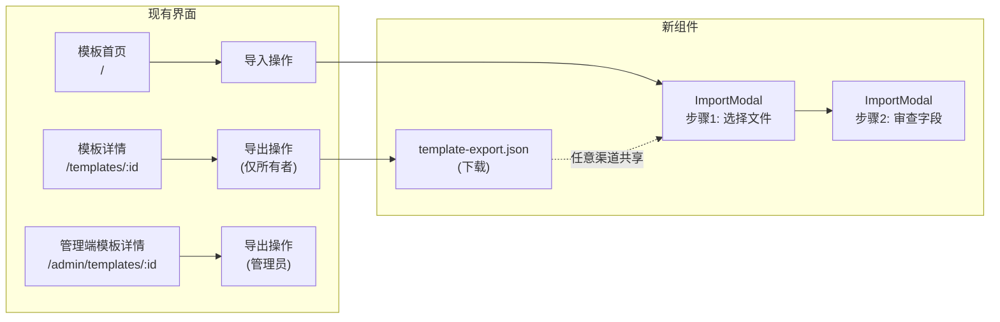
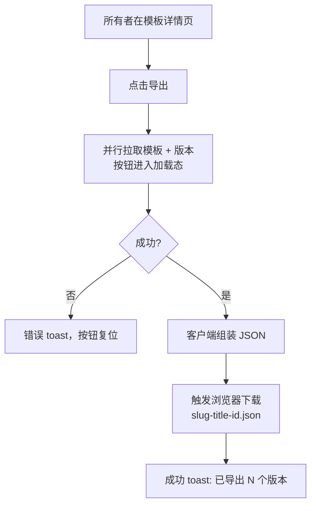
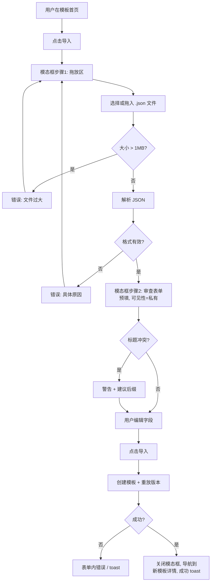

# 模板导入/导出 — UI/UX 设计

| | |
|---|---|
| **Feature ID** | FE-010 |
| **Version** | 1.0 |
| **Status** | Proposed（待架构评审） |
| **Author** | ui-ux-agent |
| **Date** | 2026-10-10 |

## 1. 设计原则

1. **零新增页面。** 导出位于现有模板详情页；导入位于现有模板首页。不新增路由。
2. **先验证再提交。** 导入数据在提交前始终展示供审查——用户清楚看到将要创建的内容。
3. **复用表单。** 导入审查步骤是预填的 CreateTemplateModal 字段集，校验、国际化、无障碍能力免费获得。
4. **默认安全。** 导入落地为私有；导出不携带个人数据。
5. **渐进披露。** 版本历史在审查步骤中以摘要呈现（"将导入 12 个版本"），而非倾倒为长文本。

## 2. 信息架构



## 3. 用户流程

### 3.1 导出流程



### 3.2 导入流程



## 4. 页面布局

### 4.1 模板详情页的导出操作（所有者）

```
┌──────────────────────────────────────────────────────────────┐
│  ← 返回       我的提示词模板                                   │
│               [system] [public]  · 12 个版本                   │
│                                                              │
│  ┌────────────────────────────────────────────────────────┐  │
│  │  模板内容（只读视图）                                    │  │
│  │  ...                                                   │  │
│  └────────────────────────────────────────────────────────┘  │
│                                                              │
│  ┌─ 操作 ────────────────────────────────────────────────┐  │
│  │  [ 编辑 ]  [ 复刻 ]  [ 导出 ⬇ ]                        │  │
│  │                      ↑ 新增, 仅所有者可见               │  │
│  └────────────────────────────────────────────────────────┘  │
└──────────────────────────────────────────────────────────────┘
```

### 4.2 模板首页的导入入口

```
┌──────────────────────────────────────────────────────────────┐
│  侧边栏    │  全部模板                        [ + 新建 ] [ ⬆ 导入 ]  │
│            │                                    ↑ 新增, 紧邻新建   │
│  筛选器    │  ┌─────────┐ ┌─────────┐ ┌─────────┐              │
│            │  │ 卡片    │ │ 卡片    │ │ 卡片    │              │
│            │  └─────────┘ └─────────┘ └─────────┘              │
└──────────────────────────────────────────────────────────────┘
```

### 4.3 导入模态框 — 步骤 1（选择文件）

```
┌──────────────────────────────────────────────┐
│  导入模板                                [×]  │
├──────────────────────────────────────────────┤
│                                              │
│  ┌────────────────────────────────────────┐  │
│  │                                        │  │
│  │      ⬆                                 │  │
│  │   将 .json 文件拖放到此处               │  │
│  │   或                                    │  │
│  │   [ 浏览文件 ]                          │  │
│  │                                        │  │
│  │   仅支持 open-prompts 模板导出文件      │  │
│  │   (.json, 最大 1 MB)。                  │  │
│  └────────────────────────────────────────┘  │
│                                              │
│  ⚠ 该文件不是有效的模板导出文件              │  ← 错误槽位
│                                              │
│                          [ 取消 ]            │
└──────────────────────────────────────────────┘
```

### 4.4 导入模态框 — 步骤 2（审查）

```
┌──────────────────────────────────────────────────────────┐
│  导入模板                                            [×]  │
├──────────────────────────────────────────────────────────┤
│  ✓ my-prompt-template.json — 将导入 12 个版本（按顺序     │
│    生成）。                                              │
│  ┌────────────────────────────────────────────────────┐  │
│  │ 标题 *        [ 我的提示词模板 (imported)         ]  │  │
│  │ ⚠ 你已存在同名模板。                                 │  │
│  │ 分类          [ 写作 ▾ ]                             │  │
│  │ 可见性        (•) 私有  ( ) 公开                     │  │
│  │ 语言          [ English ▾ ]                          │  │
│  │ 标签          [ prompt ] [ x ]  + 添加               │  │
│  │ 描述          [ ...                            ]     │  │
│  │ 内容 *        ┌──────────────────────────────┐      │  │
│  │               │ 最新版本内容                  │      │  │
│  │               └──────────────────────────────┘      │  │
│  └────────────────────────────────────────────────────┘  │
│                        [ 返回 ] [ 导入模板 ]               │
└──────────────────────────────────────────────────────────┘
```

## 5. 组件规格

| 组件 | 位置 | Props / API | 说明 |
|---|---|---|---|
| `ExportButton` | `components/ExportButton.js` | `{ template, onExported }` | `.btn-ghost .btn-sm`；`!isOwner` 时隐藏；拉取版本时显示加载图标 |
| `ImportButton` | `components/ImportButton.js` | 无 | 首页"+ 新建"旁的 `.btn-ghost .btn-sm`；图标 `⬆` |
| `ImportModal` | `components/ImportModal.js` | `{ open, onClose }` | 两步状态机（`step: 'pick' \| 'review'`）；审查步骤使用 Modal `lg` 尺寸 |
| `DropZone` | ImportModal 内部 | `{ onFile, error }` | 虚线 `--border-strong` 边框、`--radius-12`；拖入态使用 `--accent` 边框 + `--surface-2` 填充；隐藏 `<input type="file" accept=".json,application/json">` |
| `parseTemplateExport(file)` | `utils/templateExport.js` | 返回 `{ data, warnings }` 或抛出 `ImportValidationError` | 纯函数，可单元测试；执行 FR-11 规则 |
| `buildTemplateExport(template, versions)` | `utils/templateExport.js` | 返回 JSON 字符串 | 2 空格缩进，末尾换行 |
| `downloadJSON(filename, text)` | `utils/templateExport.js` | Blob + `URL.createObjectURL` + 锚点点击 | 点击后释放 object URL |
| `slugifyTitle(title, id)` | `utils/templateExport.js` | ASCII slug、60 字符上限、id 8 字符前缀兜底 | 例如 `my-prompt-template-a1b2c3d4` |

### 导出 JSON 模式（格式版本 1）

```json
{
  "format": "open-prompts-template",
  "format_version": 1,
  "exported_at": "2026-10-10T12:00:00Z",
  "source": "open-prompts",
  "template": {
    "title": "My Prompt Template",
    "description": "...",
    "visibility": "public",
    "type": "system",
    "tags": ["prompt", "writing"],
    "category": "Writing",
    "language": "en",
    "versions": [
      { "version": 1, "content": "...", "change_note": "initial", "created_at": "..." },
      { "version": 7, "content": "...", "change_note": null, "created_at": "..." }
    ]
  }
}
```

## 6. 交互细节

1. **点击导出**：按钮进入加载态（图标旋转 + 禁用），并行 `getTemplate` + `listTemplateVersions`，组装 JSON，触发下载，成功 toast `已导出"标题"（N 个版本）`。按钮恢复可用。
2. **拖入悬停**：拖放区边框变 `--accent`、背景 `--surface-2`、光标为复制。拖入非 `.json` 文件时：抖动动画（遵循 `prefers-reduced-motion`）+ 错误提示。
3. **解析错误**具体明确：`not_json`、`too_large`、`bad_format`、`unsupported_version`、`missing_field:title`——各自映射到本地化文案；绝不展示原始解析异常。
4. **步骤切换**：选择 → 审查时内容滑入；焦点移至模态框标题（遵循无障碍设计的焦点管理）。返回回到选择步骤，保留已解析数据，无需重新拖入。
5. **标题冲突**：进入审查时客户端检查 `getTemplates({ owner_id, page_size: 100 })`；冲突时在标题字段下方显示内联警告，并提供"使用建议标题"快捷操作。
6. **确认导入**：提交按钮显示加载图标；以最新内容调用 `createTemplate`，再按顺序（最旧 → 次新）更新应用更早版本，使最终历史顺序与文件一致；导航到 `/templates/:newId`。
7. **Escape/取消**：关闭模态框；若审查表单有未保存修改，弹出放弃确认提示。
8. **键盘**：拖放区可聚焦（`tabIndex=0`、role `button`），Enter/Space 打开文件选择器；整个模态框遵循无障碍设计的焦点圈定模式。

## 7. 状态汇总

| 状态 | 导出 | 导入 |
|---|---|---|
| 空闲 | 按钮可见（所有者） | 按钮可见（已登录） |
| 加载 | 拉取期间按钮内旋转图标 | 创建期间提交按钮内旋转图标 |
| 空 | 不适用 | 拖放区等待文件 |
| 错误 | toast: 拉取失败 | 内联: 校验错误 / toast: 创建失败 |
| 成功 | toast + 文件下载 | toast + 导航到新模板 |

## 8. 视觉风格（Aurora）

- 按钮：两个入口均为 `.btn-ghost .btn-sm`；导出图标 `⬇`（下载）、导入图标 `⬆`（上传）——与现有图标按钮语言一致。
- 拖放区：`--surface-2` 背景、`2px dashed --border-strong`、`--radius-12`；拖入态：`--accent` 边框、`--surface-3` 填充。
- 审查表单：与 CreateTemplateModal 完全一致——`Field` 组件、`.input`/`.textarea` 样式、`--text-2` 标签。
- 版本摘要徽章：`--surface-3` 药丸形、`--text-2` 文本、`--radius-pill`。
- 警告（标题冲突）：`--warning` 图标 + `--text-2` 文本，不用红色——它是提示性的，不阻断。
- 两种主题均已验证：拖放区虚线边框使用 `--border-strong`，在深色模式下对比度充足。

## 9. 国际化

命名空间 `import_export.*`（新增），审查表单复用 `create_template.*` 标签。

```json
// EN
{
  "import_export": {
    "export": "Export",
    "export_success": "Exported \"{{title}}\" ({{count}} versions)",
    "export_failed": "Export failed. Please try again.",
    "import": "Import",
    "import_title": "Import template",
    "drop_hint": "Drag and drop a .json file here, or",
    "browse": "Browse files",
    "drop_note": "Only open-prompts template exports (.json, max 1 MB) are supported.",
    "error_not_json": "This file is not a valid JSON file.",
    "error_too_large": "File is too large. Maximum size is 1 MB.",
    "error_bad_format": "This file is not an open-prompts template export.",
    "error_unsupported_version": "This export uses a newer format version ({{version}}) that this app cannot read.",
    "error_missing_field": "The file is missing a required field: {{field}}.",
    "review_summary": "{{file}} — {{count}} versions will be imported as sequential versions.",
    "title_collision": "You already have a template with this title.",
    "use_suggested": "Use suggested title",
    "confirm": "Import template",
    "import_success": "Template imported successfully."
  }
}
```

```json
// ZH
{
  "import_export": {
    "export": "导出",
    "export_success": "已导出“{{title}}”（{{count}} 个版本）",
    "export_failed": "导出失败，请重试。",
    "import": "导入",
    "import_title": "导入模板",
    "drop_hint": "将 .json 文件拖放到此处，或",
    "browse": "浏览文件",
    "drop_note": "仅支持 open-prompts 模板导出文件（.json，最大 1 MB）。",
    "error_not_json": "该文件不是有效的 JSON 文件。",
    "error_too_large": "文件过大，最大为 1 MB。",
    "error_bad_format": "该文件不是 open-prompts 模板导出文件。",
    "error_unsupported_version": "此导出文件使用了较新的格式版本（{{version}}），当前应用无法读取。",
    "error_missing_field": "文件缺少必填字段：{{field}}。",
    "review_summary": "{{file}} — 将导入 {{count}} 个版本（按顺序生成）。",
    "title_collision": "你已存在同名模板。",
    "use_suggested": "使用建议标题",
    "confirm": "导入模板",
    "import_success": "模板导入成功。"
  }
}
```

## 10. 无障碍

- 拖放区：`role="button"`、`tabIndex=0`、描述操作的 `aria-label`、Enter/Space 激活、可见 `:focus-visible` 焦点环（`--accent`）。
- 文件输入视觉隐藏，但与浏览按钮程序化关联（`aria-hidden` 输入 + 标签点击穿透）。
- 校验错误以 `role="alert"` 渲染在模态框内，屏幕阅读器立即播报（与无障碍设计的 live-region 模式一致）。
- 审查表单复用 `Field`（label/id 关联、`aria-invalid`、错误文本经 `aria-describedby` 关联）。
- 焦点圈定在模态框内（无障碍设计 FR），关闭时恢复到触发按钮。
- 加载态通过模态框主体的 `aria-busy` 播报。
- 拖放仅为增强——所有功能均可通过"浏览文件"按钮完成。

## 11. 实现说明

- **无后端改动。** 导出 = `getTemplate` + `listTemplateVersions` → 客户端 JSON。导入 = `createTemplate`（+ 按顺序更新以保留历史）。
- `utils/templateExport.js` 为纯函数并有单元测试覆盖：模式构建、slugify、以及 FR-11 的每个校验分支。
- 版本重放顺序：以**最新**内容创建（即使后续步骤失败模板也立即正确），再通过更新调用按最旧 → 次新插入更早版本；最终版本列表与文件一致。重放上限 50 个版本；超出时仅导入最新版本并警告。
- `change_note` 重放依赖版本管理功能的 `change_note` 字段；若该字段不存在，更新时省略。
- 管理员导出复用 `buildTemplateExport`，使用管理端拉取的模板 + 版本——文件输出完全一致。
- 1 MB 上限在 `FileReader`/`text()` 解析前通过 `file.size` 检查。
- object URL 在下载后立即释放，避免泄漏。
