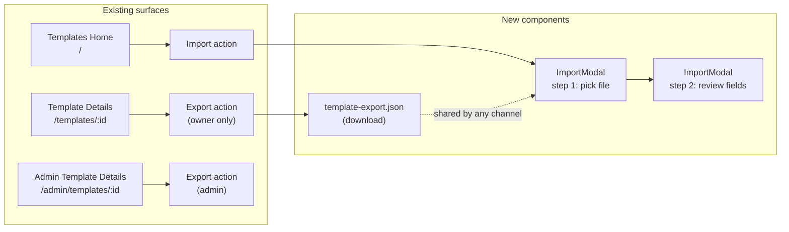
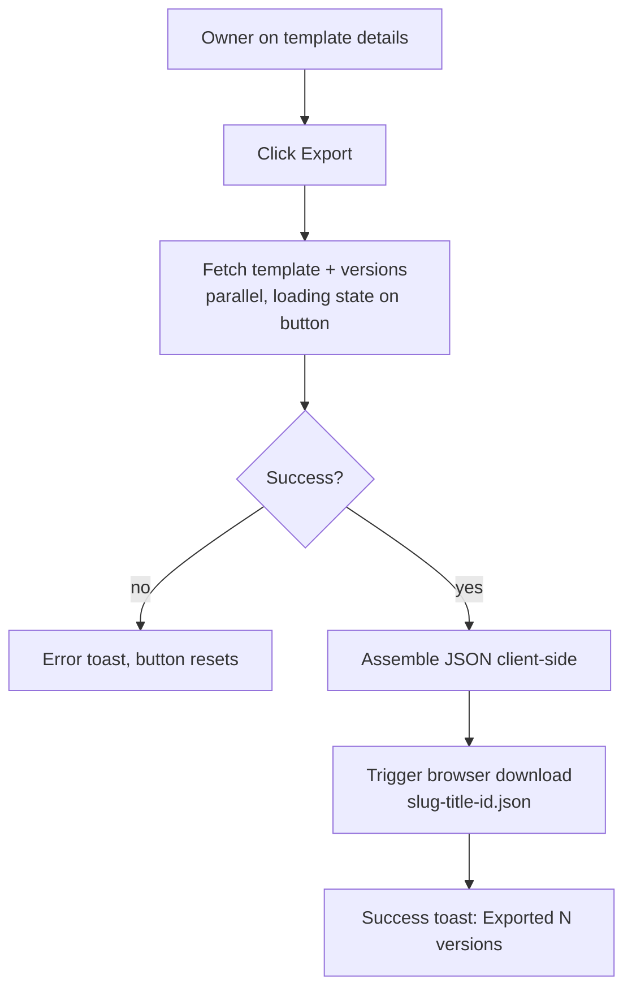
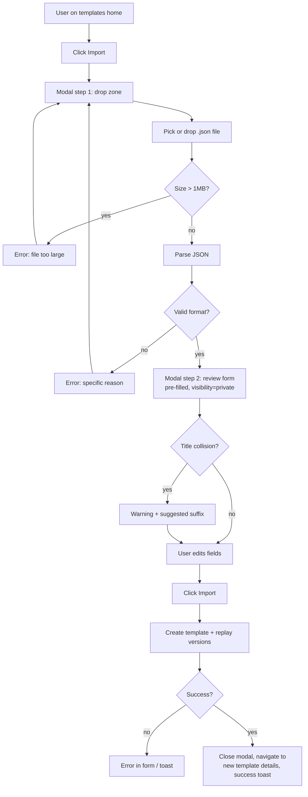

# Template Import/Export — UI/UX Design

| | |
|---|---|
| **Feature ID** | FE-010 |
| **Version** | 1.0 |
| **Status** | Proposed (for architecture review) |
| **Author** | ui-ux-agent |
| **Date** | 2026-10-10 |

## 1. Design Principles

1. **Zero new surfaces.** Export lives on the existing template details page; import lives on the existing templates home. No new routes.
2. **Trust but verify.** Imported data is always shown for review before commit — the user sees exactly what will be created.
3. **Reuse the form.** The import review step is the CreateTemplateModal field set pre-filled, so validation, i18n, and accessibility come for free.
4. **Safe by default.** Imports land private; exports carry no personal data.
5. **Progressive disclosure.** Version history is summarized in the review step ("12 versions will be imported"), not dumped as a wall of text.

## 2. Information Architecture



## 3. User Flows

### 3.1 Export flow



### 3.2 Import flow



## 4. Page Layouts

### 4.1 Export action on template details (owner)

```
┌──────────────────────────────────────────────────────────────┐
│  ← Back          My Prompt Template                          │
│                 [system] [public]  · 12 versions             │
│                                                              │
│  ┌────────────────────────────────────────────────────────┐  │
│  │  Template content (read-only view)                     │  │
│  │  ...                                                   │  │
│  └────────────────────────────────────────────────────────┘  │
│                                                              │
│  ┌─ Actions ──────────────────────────────────────────────┐  │
│  │  [ Edit ]  [ Fork ]  [ Export ⬇ ]                      │  │
│  │                        ↑ new, owner-only               │  │
│  └────────────────────────────────────────────────────────┘  │
└──────────────────────────────────────────────────────────────┘
```

### 4.2 Import entry on templates home

```
┌──────────────────────────────────────────────────────────────┐
│  Sidebar   │  All Templates                    [ + New ] [ ⬆ Import ]  │
│            │                                    ↑ new, next to New   │
│  Filters   │  ┌─────────┐ ┌─────────┐ ┌─────────┐              │
│            │  │ card    │ │ card    │ │ card    │              │
│            │  └─────────┘ └─────────┘ └─────────┘              │
└──────────────────────────────────────────────────────────────┘
```

### 4.3 Import modal — step 1 (file selection)

```
┌──────────────────────────────────────────────┐
│  Import template                        [×]  │
├──────────────────────────────────────────────┤
│                                              │
│  ┌────────────────────────────────────────┐  │
│  │                                        │  │
│  │      ⬆                                 │  │
│  │   Drag and drop a .json file here      │  │
│  │   or                                   │  │
│  │   [ Browse files ]                     │  │
│  │                                        │  │
│  │   Only open-prompts template exports   │  │
│  │   (.json, max 1 MB) are supported.     │  │
│  └────────────────────────────────────────┘  │
│                                              │
│  ⚠ File is not a valid template export      │  ← error slot
│                                              │
│                          [ Cancel ]          │
└──────────────────────────────────────────────┘
```

### 4.4 Import modal — step 2 (review)

```
┌──────────────────────────────────────────────────────────┐
│  Import template                                    [×]  │
├──────────────────────────────────────────────────────────┤
│  ✓ my-prompt-template.json — 12 versions will be         │
│    imported as sequential versions.                     │
│  ┌────────────────────────────────────────────────────┐  │
│  │ Title *        [ My Prompt Template (imported)   ]  │  │
│  │ ⚠ You already have a template with this title.     │  │
│  │ Category       [ Writing ▾ ]                        │  │
│  │ Visibility     (•) Private  ( ) Public              │  │
│  │ Language       [ English ▾ ]                        │  │
│  │ Tags           [ prompt ] [ x ]  + add              │  │
│  │ Description    [ ...                          ]     │  │
│  │ Content *      ┌──────────────────────────────┐     │  │
│  │                │ latest version content       │     │  │
│  │                └──────────────────────────────┘     │  │
│  └────────────────────────────────────────────────────┘  │
│                          [ Back ] [ Import template ]     │
└──────────────────────────────────────────────────────────┘
```

## 5. Component Specifications

| Component | Location | Props / API | Notes |
|---|---|---|---|
| `ExportButton` | `components/ExportButton.js` | `{ template, onExported }` | `.btn-ghost .btn-sm`; hidden when `!isOwner`; loading spinner while fetching versions |
| `ImportButton` | `components/ImportButton.js` | none | `.btn-ghost .btn-sm` next to "+ New" on home; icon `⬆` |
| `ImportModal` | `components/ImportModal.js` | `{ open, onClose }` | 2-step state machine (`step: 'pick' \| 'review'`); Modal size `lg` for review |
| `DropZone` | inside ImportModal | `{ onFile, error }` | dashed `--border-strong` border, `--radius-12`; drag-over state uses `--accent` border + `--surface-2` fill; hidden `<input type="file" accept=".json,application/json">` |
| `parseTemplateExport(file)` | `utils/templateExport.js` | returns `{ data, warnings }` or throws `ImportValidationError` | pure function, unit-testable; enforces FR-11 rules |
| `buildTemplateExport(template, versions)` | `utils/templateExport.js` | returns JSON string | 2-space indent, trailing newline |
| `downloadJSON(filename, text)` | `utils/templateExport.js` | Blob + `URL.createObjectURL` + anchor click | revoke object URL after click |
| `slugifyTitle(title, id)` | `utils/templateExport.js` | ASCII slug, 60-char cap, id 8-char prefix fallback | e.g. `my-prompt-template-a1b2c3d4` |

### Export JSON schema (format version 1)

```json
{
  "format": "open-prompts-template",
  "format_version": 1,
  "exported_at": "2026-10-10T12:00:00Z",
  "source": "open-prompts",
  "template": {
    "title": "My Prompt Template",
    "description": "...",
    "visibility": "public",
    "type": "system",
    "tags": ["prompt", "writing"],
    "category": "Writing",
    "language": "en",
    "versions": [
      { "version": 1, "content": "...", "change_note": "initial", "created_at": "..." },
      { "version": 7, "content": "...", "change_note": null, "created_at": "..." }
    ]
  }
}
```

## 6. Interaction Details

1. **Export click**: button enters loading state (spinner + disabled), parallel `getTemplate` + `listTemplateVersions`, JSON assembled, download triggered, success toast `Exported "title" (N versions)`. Button re-enables.
2. **Drag-over**: drop zone border turns `--accent`, background `--surface-2`, cursor copy. On drop of a non-`.json` file: shake animation (respects `prefers-reduced-motion`) + error message.
3. **Parse errors** are specific: `not_json`, `too_large`, `bad_format`, `unsupported_version`, `missing_field:title` — each mapped to a localized string; the raw parse exception is never shown.
4. **Step transition**: pick → review slides content in; focus moves to the modal title (focus management per accessibility design). Back returns to pick, keeping the file's parsed data so re-review needs no re-drop.
5. **Title collision**: on entering review, `getTemplates({ owner_id, page_size: 100 })` is checked client-side; collision shows inline warning under the title field with a "Use suggested title" quick action.
6. **Confirm import**: submit button shows spinner; `createTemplate` with latest content, then sequential updates for earlier versions (oldest → newest-1) so final history order matches the file; navigate to `/templates/:newId`.
7. **Escape/Cancel**: closes modal; a confirm-discard prompt appears if the review form is dirty (unsaved edits).
8. **Keyboard**: drop zone is focusable (`tabIndex=0`, role `button`), Enter/Space opens the file picker; the whole modal follows the focus-trap pattern from the accessibility design.

## 7. States Summary

| State | Export | Import |
|---|---|---|
| Idle | Button visible (owner) | Button visible (logged in) |
| Loading | Spinner in button during fetch | Spinner in submit during create |
| Empty | n/a | Drop zone awaiting file |
| Error | Toast: fetch failed | Inline: validation error / toast: create failed |
| Success | Toast + file download | Toast + navigation to new template |

## 8. Visual Style (Aurora)

- Buttons: `.btn-ghost .btn-sm` for both entry points; export icon `⬇` (download), import icon `⬆` (upload) — consistent with existing icon-button language.
- Drop zone: `--surface-2` background, `2px dashed --border-strong`, `--radius-12`; drag-over: `--accent` border, `--surface-3` fill.
- Review form: identical to CreateTemplateModal — `Field` components, `.input`/`.textarea` styles, `--text-2` labels.
- Version summary chip: `--surface-3` pill with `--text-2` text, `--radius-pill`.
- Warning (title collision): `--warning` icon + `--text-2` text, no red — it is advisory, not blocking.
- Both themes verified: drop zone dashed border uses `--border-strong` which has sufficient contrast in dark mode.

## 9. i18n

Namespace `import_export.*` (new), plus reuse of `create_template.*` labels in the review form.

```json
// EN
{
  "import_export": {
    "export": "Export",
    "export_success": "Exported \"{{title}}\" ({{count}} versions)",
    "export_failed": "Export failed. Please try again.",
    "import": "Import",
    "import_title": "Import template",
    "drop_hint": "Drag and drop a .json file here, or",
    "browse": "Browse files",
    "drop_note": "Only open-prompts template exports (.json, max 1 MB) are supported.",
    "error_not_json": "This file is not a valid JSON file.",
    "error_too_large": "File is too large. Maximum size is 1 MB.",
    "error_bad_format": "This file is not an open-prompts template export.",
    "error_unsupported_version": "This export uses a newer format version ({{version}}) that this app cannot read.",
    "error_missing_field": "The file is missing a required field: {{field}}.",
    "review_summary": "{{file}} — {{count}} versions will be imported as sequential versions.",
    "title_collision": "You already have a template with this title.",
    "use_suggested": "Use suggested title",
    "confirm": "Import template",
    "import_success": "Template imported successfully."
  }
}
```

```json
// ZH
{
  "import_export": {
    "export": "导出",
    "export_success": "已导出“{{title}}”（{{count}} 个版本）",
    "export_failed": "导出失败，请重试。",
    "import": "导入",
    "import_title": "导入模板",
    "drop_hint": "将 .json 文件拖放到此处，或",
    "browse": "浏览文件",
    "drop_note": "仅支持 open-prompts 模板导出文件（.json，最大 1 MB）。",
    "error_not_json": "该文件不是有效的 JSON 文件。",
    "error_too_large": "文件过大，最大为 1 MB。",
    "error_bad_format": "该文件不是 open-prompts 模板导出文件。",
    "error_unsupported_version": "此导出文件使用了较新的格式版本（{{version}}），当前应用无法读取。",
    "error_missing_field": "文件缺少必填字段：{{field}}。",
    "review_summary": "{{file}} — 将导入 {{count}} 个版本（按顺序生成）。",
    "title_collision": "你已存在同名模板。",
    "use_suggested": "使用建议标题",
    "confirm": "导入模板",
    "import_success": "模板导入成功。"
  }
}
```

## 10. Accessibility

- Drop zone: `role="button"`, `tabIndex=0`, `aria-label` describing the action, Enter/Space activation, visible `:focus-visible` ring (`--accent`).
- File input is visually hidden but programmatically associated with the browse button (`aria-hidden` input, label click-through).
- Validation errors render inside the modal with `role="alert"` so screen readers announce them immediately (consistent with the accessibility design's live-region pattern).
- Review form reuses `Field` (label/id association, `aria-invalid`, error text linked via `aria-describedby`).
- Focus is trapped in the modal (accessibility design FR) and restored to the invoking button on close.
- Loading states announce via `aria-busy` on the modal body.
- Drag-and-drop is an enhancement only — all functionality is available via the Browse button.

## 11. Implementation Notes

- **No backend changes.** Export = `getTemplate` + `listTemplateVersions` → client-side JSON. Import = `createTemplate` (+ sequential updates for history).
- `utils/templateExport.js` is pure and covered by unit tests: schema build, slugify, and every validation branch (FR-11).
- Version replay order: create with **latest** content (so the template is immediately correct if later steps fail), then insert earlier versions oldest→newest-1 via update calls; final version list matches the file. Cap replay at 50 versions; beyond that, import the latest only and warn.
- `change_note` replay depends on the template-versioning feature's `change_note` field; if absent, the field is omitted from updates.
- Admin export reuses `buildTemplateExport` with admin-fetched template + versions — identical file output.
- The 1 MB cap is checked via `file.size` before `FileReader`/`text()` parsing.
- Object URLs are revoked immediately after download to avoid leaks.
