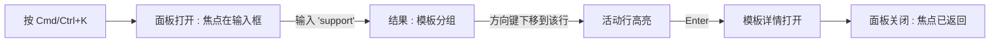
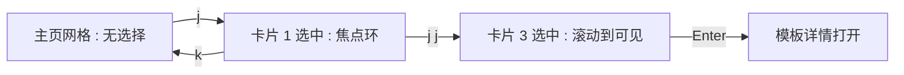
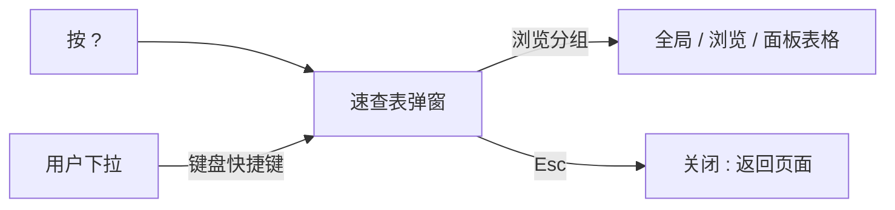

# 键盘快捷键与命令面板 — UI/UX 设计

- **功能 ID：** keyboard-shortcuts
- **版本：** 1.0
- **状态：** 已提案（待架构评审）
- **作者：** ui-ux-agent
- **日期：** 2026-10-12
- **配套文档：** `keyboard-shortcuts-requirements-zh-CN.md`

## 1. 设计原则

1. **在可操作性之上加速。** 无障碍设计让一切可键盘到达；本功能让它变快。任何控件都不失去 Tab 停靠点。
2. **每个快捷键都有可见孪生。** 没有仅限按键的功能；面板和单键是既有 UI 的加速器。
3. **绝不劫持输入。** 防护规则（FR-10）是绝对的：输入框聚焦时按键属于用户的文本。
4. **统一的浮层语言。** 面板、速查表、提示复用 Aurora 的弹窗、焦点环、按键标签习惯 —— 无需学习任何新视觉。

## 2. 信息架构

```mermaid
flowchart TD
    A[任意页面] -->|Cmd/Ctrl+K| B[命令面板弹窗]
    B -->|查询| B1[导航分组]
    B -->|查询| B2[模板搜索分组]
    B -->|查询| B3[操作分组]
    B1 -->|Enter| C[路由导航]
    B2 -->|Enter| D[模板详情]
    B3 -->|Enter| E[操作 : 创建 / 主题 / 语言]
    A -->|?| F[快捷键速查表弹窗]
    A -->|s 或 /| G[聚焦搜索输入框]
    A -->|j / k| H[网格选择光标]
    H -->|Enter 或 o| D
    A -->|c| I[创建模板弹窗]
    A -->|t| J[主题切换]
    A -->|Esc| K[关闭最上层浮层]
    L[/admin/*] -->|Cmd/Ctrl+K| M[管理范围面板]
```

| 界面 | 触发 | 受众 | 目的 |
|---|---|---|---|
| 命令面板 | `Cmd/Ctrl+K`、搜索框 `⌘K` 标签 | 所有用户 | 通用导航 + 搜索 + 操作 |
| 管理面板 | `/admin` 内的 `Cmd/Ctrl+K` | 管理员 | 管理范围的导航 + 用户/模板搜索 |
| 速查表 | `?`、用户下拉、面板 | 所有用户 | 发现并学习快捷键 |
| 网格选择光标 | `j`/`k` | 浏览用户 | 免鼠标网格浏览 |
| 快捷键 tooltip | 悬停搜索 / 主题 / 创建 | 所有用户 | 上下文中的可发现性 |
| 首次提示 toast | 第 3 次会话，主页 | 所有用户 | 一次性认知提示 |

## 3. 用户流程

### 3.1 通过面板打开模板



### 3.2 用 j/k 浏览网格



### 3.3 学习快捷键



## 4. 页面布局

### 4.1 命令面板（桌面端，居中弹窗）

```
                    +--------------------------------------+
                    |  [🔍 输入框......................]   |
                    |  (占位符: 搜索或跳转至…)              |
                    +--------------------------------------+
                    |  导航                                 |
                    |  ▸ 主页                     Home      |
                    |    个人资料                 ⇧P        |
                    |    我的团队                           |
                    |    API 密钥                          |
                    |  模板                                |
                    |  ▸ 客服回复 v3             客服       |
                    |    代码审查提示词           开发       |
                    |  操作                                 |
                    |    创建模板                 c         |
                    |    切换主题                t          |
                    +--------------------------------------+
                    |  ↑↓ 移动 · ↵ 选择 · esc 关闭          |
```

- 宽 560 px，最大高度 60 vh，超过 12 行后内部滚动。
- 活动行：Aurora 焦点环 + 轻微背景色；组标题为不可交互标签。
- 空查询状态："快速链接"（5 项）+ "最近模板"（最多 5 个）。

### 4.2 命令面板（移动端，≤ 640 px）

```
+--------------------------------+
|  [🔍 输入框..................]  |
+--------------------------------+
|  导航                           |
|  ▸ 主页                         |
|  ...                           |
+--------------------------------+
```

顶部锚定的通栏面板；分组相同；触控目标 44 px。

### 4.3 快捷键速查表弹窗

```
+--------------------------------------------------------------+
|  键盘快捷键                                             [×]   |
+--------------------------------------------------------------+
|  全局                                                        |
|  | Cmd/Ctrl K | 打开命令面板          |                       |
|  | s 或 /     | 聚焦搜索              |                       |
|  | t          | 切换主题              |                       |
|  | ?          | 快捷键速查表          |                       |
|  | Esc        | 关闭最上层浮层        |                       |
|  浏览                                                         |
|  | j / k      | 在网格中移动选择      |                       |
|  | Enter 或 o | 打开选中的模板        |                       |
|  | c          | 创建模板              |                       |
|  面板                                                         |
|  | ↑ ↓        | 移动活动行            |                       |
|  | ↵          | 执行命令              |                       |
+--------------------------------------------------------------+
|  查看文档：键盘快捷键指南                          [链接]      |
+--------------------------------------------------------------+
```

两列按键/操作行；按键渲染为 `key` 标签（Aurora 样式）；分组用节标题分隔。

### 4.4 网格选择光标（主页网格）

```
+----------+  +----------+  +----------+
|          |  ┌──────────┐  |          |
|  卡片    |  │ 卡片     │  |  卡片    |
|          |  │ (活动)   │  |          |
|          |  └──────────┘  |          |
+----------+  +----------+  +----------+
               焦点环 + 轻微抬升
```

活动卡片获得标准焦点环和 1 px 抬升；无其他视觉变化。

### 4.5 首次提示 toast（主页，底部居中）

```
+--------------------------------------------------+
|  ⌨  按 ? 查看键盘快捷键                    [×]    |
+--------------------------------------------------+
```

标准 toast 组件；8 秒自动关闭或手动 ×；关闭后不再显示。

## 5. 组件规格

| 组件 | 行为 | 状态 |
|---|---|---|
| CommandPalette | 居中弹窗、单输入框、分组结果、键盘优先（ARIA combobox/listbox） | 空（快速链接）/ 有结果 / 无结果 / 加载 |
| PaletteRow | 图标 + 标签 + 右对齐提示（路由名或按键标签）；活动状态通过 aria-activedescendant | 默认 / 活动 |
| CheatSheetModal | 分组两列快捷键表格；标准弹窗外观 | 默认 |
| KeyChip | 渲染按键的小边框标签（`⌘K`、`j`、`?`）；在 tooltip 和速查表中复用 | 默认 |
| GridSelectionCursor | 网格卡片上的逻辑索引；应用焦点环样式 + scrollIntoView | 隐藏 / 活动 |
| ShortcutTooltip | 既有 tooltip + KeyChip 后缀（如"搜索 (s)"） | 默认 |
| FirstRunToast | 一次性可关闭 toast；localStorage 标记 | 显示 / 已关闭 |

## 6. 交互细节

1. **打开面板：** `Cmd/Ctrl+K`（不绑定 `Cmd/Ctrl+P` —— 浏览器打印保留）。焦点落在输入框并全选文本；输入立即替换。
2. **查询行为：** 250 毫秒防抖；≤ 5 条模板结果 + 所有匹配的导航/操作；排序：精确导航匹配 > 模板名匹配 > 操作匹配。
3. **执行：** `Enter` 运行活动行；导航先关闭面板再路由；操作执行后关闭（主题切换给出简短 toast 确认新主题）。
4. **关闭：** `Esc` 或点击外部；焦点返回打开它的元素（按键打开则返回 body）。
5. **防护规则：** 焦点在输入框/textarea/contenteditable 中时，单键（`s`、`j`、`k`、`c`、`t`、`?`）不生效；`Cmd/Ctrl+K` 仍然有效（浏览器安全）；`Esc` 始终关闭最上层浮层。
6. **网格光标：** 第一次 `j` 选中第一张卡片；`j`/`k` 在网格边缘不循环（到头停止）；`Enter`/`o` 打开；任何点击或 Tab 将光标重置为隐藏。
7. **管理范围：** 在 `/admin` 内，面板切换导航来源并在模板搜索之上加入用户搜索（ID/邮箱）；速查表底部注明管理范围。
8. **Tooltip：** 悬停/聚焦 500 毫秒后出现；包含操作标签 + KeyChip；屏幕阅读器朗读标签（按键为装饰性）。
9. **首次提示 toast：** 第 3 次会话后（localStorage 计数器）在主页出现，8 秒自动关闭，可手动 ×；标记按浏览器配置持久化。
10. **面板中的主题/语言操作：** 立即执行并保持面板打开，在活动选项上显示对勾（让用户在关闭前看到结果）。

## 7. 状态汇总

| 界面 | 加载 | 空 | 错误 |
|---|---|---|---|
| 命令面板 | 模板搜索期间行骨架 | "没有匹配 '{q}' 的结果" + 浏览提示 | 搜索错误 → 仅显示导航 + toast |
| 速查表 | 不适用（静态） | 不适用 | 不适用 |
| 网格光标 | 不适用 | 页面无网格 → 按键无效 | 不适用 |
| 首次提示 toast | 不适用 | 不适用（关闭后不显示） | 不适用 |

## 8. 国际化

| 键（英文） | 中文 |
|---|---|
| palette.placeholder / Search or jump to… | 搜索或跳转至… |
| palette.groups.navigation / Navigation | 导航 |
| palette.groups.templates / Templates | 模板 |
| palette.groups.actions / Actions | 操作 |
| palette.noResults / No results for "{{query}}" | 没有匹配 "{{query}}" 的结果 |
| palette.quickLinks / Quick links | 快速链接 |
| palette.recent / Recent templates | 最近模板 |
| palette.footer / move · select · close | 移动 · 选择 · 关闭 |
| shortcuts.title / Keyboard shortcuts | 键盘快捷键 |
| shortcuts.groups.global / Global | 全局 |
| shortcuts.groups.browsing / Browsing | 浏览 |
| shortcuts.groups.palette / Palette | 面板 |
| shortcuts.action.search / Focus search | 聚焦搜索 |
| shortcuts.action.theme / Toggle theme | 切换主题 |
| shortcuts.action.create / Create template | 创建模板 |
| shortcuts.action.palette / Open command palette | 打开命令面板 |
| shortcuts.action.cheatsheet / Shortcut cheat sheet | 快捷键速查表 |
| shortcuts.action.close / Close topmost overlay | 关闭最上层浮层 |
| shortcuts.action.move / Move selection in grid | 在网格中移动选择 |
| shortcuts.action.open / Open selected template | 打开选中的模板 |
| shortcuts.toast.firstRun / Press ? for keyboard shortcuts | 按 ? 查看键盘快捷键 |
| shortcuts.seeDocs / See docs: keyboard shortcuts guide | 查看文档：键盘快捷键指南 |

快捷键按键本身（`⌘K`、`j`、`?`）与语言无关，绝不翻译。

## 9. 无障碍

- 面板实现 ARIA 1.2 对话框中的 combobox：`role="dialog"`、输入框带 `role="combobox"` + `aria-expanded`、listbox 用 `aria-activedescendant` 指向活动行。
- 所有行可通过方向键到达（而非 Tab），符合菜单模式；Tab 被捕获在输入框和底部之间。
- 速查表是标准带标签对话框；按键标签是装饰性的（`aria-hidden`）—— 操作文本承载含义。
- 网格光标使用相同的焦点环视觉但不抢占 DOM 焦点（卡片保持正常 Tab 停靠）；屏幕阅读器用户像今天一样用自己的光标导航。
- 没有快捷键使用浏览器/屏幕阅读器与修饰键组合的保留键（仅裸 `Cmd/Ctrl+K`，非保留键）。
- Tooltip 既可悬停也可聚焦触发；可通过 `Esc` 关闭。

## 10. 数据分析（可选）

- `palette_opened`、`palette_command_executed`（含命令类型）、`shortcut_used`（按键、界面）、`cheatsheet_opened`、`firstrun_toast_shown/dismissed` —— 仅产品使用事件。

## 11. 范围之外

- 可自定义/可重映射的快捷键；超出单键的快捷键组合。
- 面板插件或用户自定义命令。
- 移动端手势快捷键。
- 编辑器内快捷键分层（advanced-editor 设计拥有编辑器内的 Cmd/Ctrl+S 和 Esc）。
- 任何变现 —— 永久排除。
