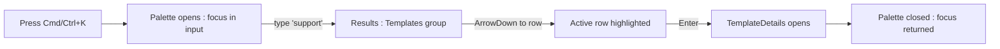
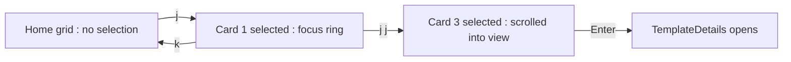
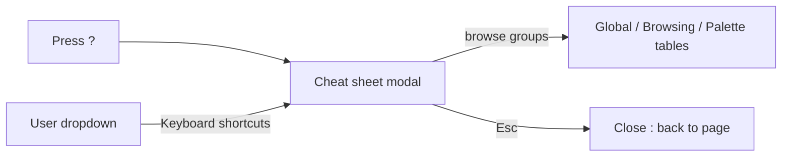

# Keyboard Shortcuts & Command Palette — UI/UX Design

- **Feature ID:** keyboard-shortcuts
- **Version:** 1.0
- **Status:** Proposed (for architecture review)
- **Author:** ui-ux-agent
- **Date:** 2026-10-12
- **Companion doc:** `keyboard-shortcuts-requirements.md`

## 1. Design Principles

1. **Speed on top of operability.** The accessibility design made everything reachable by keyboard; this feature makes it fast. No control loses its Tab stop.
2. **Every shortcut has a visible twin.** No key-only functionality; the palette and single keys are accelerators for existing UI.
3. **Never hijack typing.** The guard rule (FR-10) is absolute: focus in an input means keys belong to the user's text.
4. **One overlay language.** Palette, cheat sheet, and hints reuse the Aurora modal, focus-ring, and key-chip idioms — nothing visually new to learn.

## 2. Information Architecture

```mermaid
flowchart TD
    A[Any page] -->|Cmd/Ctrl+K| B[Command palette modal]
    B -->|query| B1[Navigation group]
    B -->|query| B2[Template search group]
    B -->|query| B3[Actions group]
    B1 -->|Enter| C[Route navigation]
    B2 -->|Enter| D[TemplateDetails]
    B3 -->|Enter| E[Action : create / theme / language]
    A -->|?| F[Shortcut cheat sheet modal]
    A -->|s or /| G[Focus search input]
    A -->|j / k| H[Grid selection cursor]
    H -->|Enter or o| D
    A -->|c| I[Create template modal]
    A -->|t| J[Theme toggle]
    A -->|Esc| K[Close topmost overlay]
    L[/admin/*] -->|Cmd/Ctrl+K| M[Admin-scoped palette]
```

| Surface | Trigger | Audience | Purpose |
|---|---|---|---|
| Command palette | `Cmd/Ctrl+K`, search-box `⌘K` chip | All users | Universal navigation + search + actions |
| Admin palette | `Cmd/Ctrl+K` inside `/admin` | Admins | Admin-scoped navigation + user/template search |
| Cheat sheet | `?`, user dropdown, palette | All users | Discover and learn shortcuts |
| Grid selection cursor | `j`/`k` | Browsing users | Mouse-free grid browsing |
| Shortcut tooltips | hover on search / theme / create | All users | In-context discoverability |
| First-run toast | 3rd session, home page | All users | One-time awareness hint |

## 3. User Flows

### 3.1 Open a template via palette



### 3.2 Browse grid with j/k



### 3.3 Learn shortcuts



## 4. Page Layouts

### 4.1 Command palette (desktop, centered modal)

```
                    +--------------------------------------+
                    |  [🔍 input........................]  |
                    |  (placeholder: Search or jump to…)   |
                    +--------------------------------------+
                    |  NAVIGATION                          |
                    |  ▸ Home                    Home      |
                    |    Profile                 ⇧P        |
                    |    My Teams                          |
                    |    API Keys                          |
                    |  TEMPLATES                           |
                    |  ▸ Support Reply v3       Customer   |
                    |    Code Review Prompt      Dev        |
                    |  ACTIONS                             |
                    |    Create template         c         |
                    |    Toggle theme           t          |
                    +--------------------------------------+
                    |  ↑↓ move · ↵ select · esc close      |
```

- Width 560 px, max-height 60 vh, internal scroll after 12 rows.
- Active row: Aurora focus ring + subtle background tint; group headers are non-interactive labels.
- Empty query state: "Quick links" (5 items) + "Recent templates" (up to 5).

### 4.2 Command palette (mobile, ≤ 640 px)

```
+--------------------------------+
|  [🔍 input..................]  |
+--------------------------------+
|  NAVIGATION                    |
|  ▸ Home                        |
|  ...                           |
+--------------------------------+
```

Full-width sheet anchored to the top; same grouping; touch targets 44 px.

### 4.3 Shortcut cheat sheet modal

```
+--------------------------------------------------------------+
|  Keyboard shortcuts                                     [×]  |
+--------------------------------------------------------------+
|  GLOBAL                                                      |
|  | Cmd/Ctrl K | Open command palette |                       |
|  | s or /     | Focus search          |                       |
|  | t          | Toggle theme          |                       |
|  | ?          | Shortcut cheat sheet  |                       |
|  | Esc        | Close topmost overlay |                       |
|  BROWSING                                                     |
|  | j / k      | Move selection in grid |                      |
|  | Enter or o | Open selected template |                     |
|  | c          | Create template        |                      |
|  PALETTE                                                      |
|  | ↑ ↓        | Move active row        |                      |
|  | ↵          | Execute command        |                      |
+--------------------------------------------------------------+
|  See docs: Keyboard shortcuts guide                    [link] |
+--------------------------------------------------------------+
```

Two-column key/action rows; keys rendered as `key` chips (Aurora style); groups separated by section headers.

### 4.4 Grid selection cursor (home grid)

```
+----------+  +----------+  +----------+
|          |  ┌──────────┐  |          |
|  card    |  │ card     │  |  card    |
|          |  │ (active) │  |          |
|          |  └──────────┘  |          |
+----------+  +----------+  +----------+
               focus ring + slight lift
```

The active card gets the standard focus ring and a 1 px lift; no other visual change.

### 4.5 First-run toast (home page, bottom center)

```
+--------------------------------------------------+
|  ⌨  Press ? for keyboard shortcuts        [×]    |
+--------------------------------------------------+
```

Standard toast component; auto-dismiss 8 s or manual ×; never shown again after dismissal.

## 5. Component Specs

| Component | Behavior | States |
|---|---|---|
| CommandPalette | Centered modal, single input, grouped results, keyboard-first (ARIA combobox/listbox) | Empty (quick links) / results / no-results / loading |
| PaletteRow | Icon + label + right-aligned hint (route name or key chip); active state via aria-activedescendant | Default / active |
| CheatSheetModal | Grouped two-column shortcut table; standard modal chrome | Default |
| KeyChip | Small bordered chip rendering a key (`⌘K`, `j`, `?`); reused in tooltips and cheat sheet | Default |
| GridSelectionCursor | Logical index over grid cards; applies focus-ring style + scrollIntoView | Hidden / active |
| ShortcutTooltip | Existing tooltip + KeyChip suffix (e.g. "Search (s)") | Default |
| FirstRunToast | One-time dismissible toast; localStorage flag | Shown / dismissed |

## 6. Interaction Details

1. **Open palette:** `Cmd/Ctrl+K` (also `Cmd/Ctrl+P` is NOT bound — browser print stays). Focus lands in the input with all text pre-selected; typing immediately replaces.
2. **Query behavior:** 250 ms debounce; ≤ 5 template results + all matching navigation/actions; ranking: exact navigation match > template name match > action match.
3. **Execute:** `Enter` runs the active row; navigation closes the palette first, then routes; actions run and close (theme toggle gives a brief toast confirming the new theme).
4. **Close:** `Esc` or click outside; focus returns to the element that opened it (or body if opened by key).
5. **Guard rule:** while focus is in input/textarea/contenteditable, single keys (`s`, `j`, `k`, `c`, `t`, `?`) do nothing; `Cmd/Ctrl+K` still works (browser-safe); `Esc` always closes the topmost overlay.
6. **Grid cursor:** first `j` selects the first card; `j`/`k` wrap at grid edges (no wrap — stop at ends); `Enter`/`o` open; any click or Tab resets the cursor to hidden.
7. **Admin scope:** inside `/admin`, the palette swaps its navigation source and adds user search (id/email) above template search; the cheat sheet footer notes the admin scope.
8. **Tooltips:** appear on hover/focus after 500 ms; contain the action label + KeyChip; screen readers announce the label (the key is decorative).
9. **First-run toast:** appears on the home page after the 3rd session (localStorage counter), auto-dismisses in 8 s, manual × dismiss; the flag persists per browser profile.
10. **Theme/language actions in palette:** execute immediately and keep the palette open with a checkmark on the active option (so users can see the result before closing).

## 7. States Summary

| Surface | Loading | Empty | Error |
|---|---|---|---|
| Command palette | Row skeletons during template search | "No results for '{q}'" + hint to browse | Search error → show navigation only + toast |
| Cheat sheet | n/a (static) | n/a | n/a |
| Grid cursor | n/a | No grid on page → keys inert | n/a |
| First-run toast | n/a | n/a (never shows if dismissed) | n/a |

## 8. i18n

| Key (EN) | ZH |
|---|---|
| palette.placeholder / Search or jump to… | 搜索或跳转至… |
| palette.groups.navigation / Navigation | 导航 |
| palette.groups.templates / Templates | 模板 |
| palette.groups.actions / Actions | 操作 |
| palette.noResults / No results for "{{query}}" | 没有匹配 "{{query}}" 的结果 |
| palette.quickLinks / Quick links | 快速链接 |
| palette.recent / Recent templates | 最近模板 |
| palette.footer / move · select · close | 移动 · 选择 · 关闭 |
| shortcuts.title / Keyboard shortcuts | 键盘快捷键 |
| shortcuts.groups.global / Global | 全局 |
| shortcuts.groups.browsing / Browsing | 浏览 |
| shortcuts.groups.palette / Palette | 面板 |
| shortcuts.action.search / Focus search | 聚焦搜索 |
| shortcuts.action.theme / Toggle theme | 切换主题 |
| shortcuts.action.create / Create template | 创建模板 |
| shortcuts.action.palette / Open command palette | 打开命令面板 |
| shortcuts.action.cheatsheet / Shortcut cheat sheet | 快捷键速查表 |
| shortcuts.action.close / Close topmost overlay | 关闭最上层浮层 |
| shortcuts.action.move / Move selection in grid | 在网格中移动选择 |
| shortcuts.action.open / Open selected template | 打开选中的模板 |
| shortcuts.toast.firstRun / Press ? for keyboard shortcuts | 按 ? 查看键盘快捷键 |
| shortcuts.seeDocs / See docs: keyboard shortcuts guide | 查看文档：键盘快捷键指南 |

Shortcut keys themselves (`⌘K`, `j`, `?`) are locale-independent and never translated.

## 9. Accessibility

- Palette implements ARIA 1.2 combobox in dialog: `role="dialog"`, input with `role="combobox"` + `aria-expanded`, listbox with `aria-activedescendant` pointing at the active row.
- All rows are reachable by Arrow keys (not Tab), matching the menu pattern; Tab is trapped between input and footer.
- Cheat sheet is a standard labelled dialog; the key chips are decorative (`aria-hidden`) — the action text carries the meaning.
- Grid cursor uses the same focus-ring visual but does NOT steal DOM focus (the card keeps its normal tab stop); screen-reader users navigate with their own cursor as today.
- No shortcut uses a key reserved by browsers/screen readers with modifiers (only bare `Cmd/Ctrl+K`, which is not reserved).
- Tooltips are focus-triggered as well as hover-triggered; dismissible via `Esc`.

## 10. Analytics (optional)

- `palette_opened`, `palette_command_executed` (with command type), `shortcut_used` (key, surface), `cheatsheet_opened`, `firstrun_toast_shown/dismissed` — product usage events only.

## 11. Out of Scope

- Customizable/remappable shortcuts; shortcut chords beyond single keys.
- Palette plugins or user-defined commands.
- Mobile gesture shortcuts.
- In-editor shortcut layering (the advanced-editor design owns Cmd/Ctrl+S and Esc inside the editor).
- Any monetization — permanently excluded.
