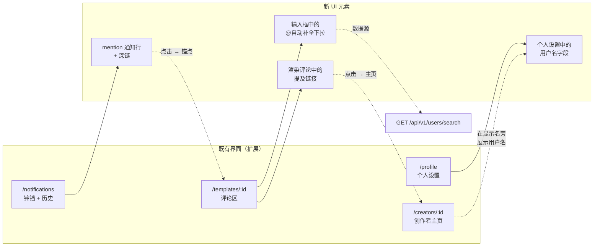
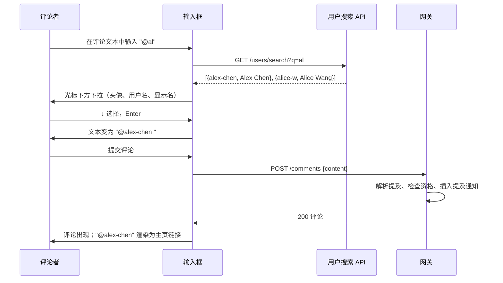
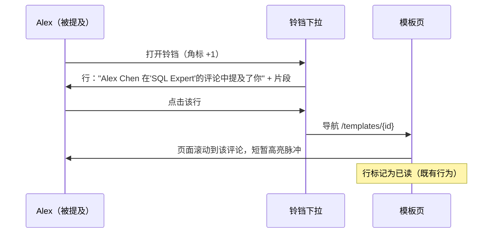
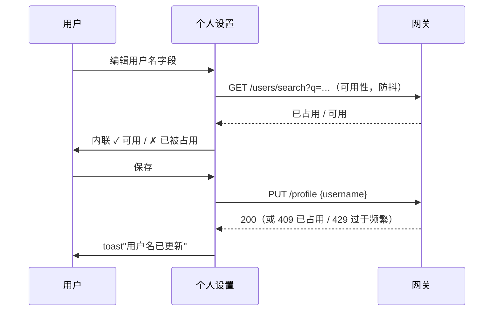

# 提及通知（Mention Notifications）— UI/UX 设计

- **Feature ID:** mention-notifications
- **Version:** 1.0
- **Status:** Proposed（待架构评审）
- **Author:** ui-ux-agent
- **Date:** 2026-10-12
- **相关文档：** [需求](./mention-notifications-requirements-zh-CN.md) · [需求 (EN)](./mention-notifications-requirements.md) · [UI/UX (EN)](./mention-notifications-ui-ux-design.md)

## 1. 设计原则

1. **零摩擦点名。** 只需输入 `@`，其余交给自动补全（GitHub/Slack 标准）。
2. **点击前先有上下文。** 通知携带行为者、模板与片段，让用户在走进去之前就知道发生了什么。
3. **精确落地。** 深链锚点滚动到确切评论 —— 绝不把用户丢在页面顶部。
4. **输入免费，通知需同意。** 任何人都可以输入 @你；是否打扰你由你的偏好决定（Discourse 模型）。
5. **不新增界面。** 提及存在于既有的输入框、评论、通知与个人资料中 —— 没有新页面。

## 2. 信息架构



## 3. 用户流程

### 3.1 通过自动补全提及（主流程）



### 3.2 被提及用户的体验



### 3.3 用户名设置 / 修改



## 4. 页面布局（线框图）

### 4.1 带自动补全下拉的输入框

```
┌──────────────────────────────────────────────────────┐
│  添加评论…                                            │
│  ┌────────────────────────────────────────────────┐  │
│  │ 很棒的模板！@al▏                                  │  │
│  └────────────────────────────────────────────────┘  │
│        ┌────────────────────────────────────────┐    │
│        │ ◯ alex-chen   Alex Chen          ↑↓    │    │
│        │ ◯ alice-w     Alice Wang                │    │
│        │ ◯ alina-k     Alina Kim          Enter  │    │
│        └────────────────────────────────────────┘    │
│  2000                                        [发布]  │
└──────────────────────────────────────────────────────┘
```

- 下拉锚定在光标行下方；最多 10 行；需要时滚动。
- 每行：头像（24px）、`username`（等宽字体，主色）、`display name`（次色）。
- 底部提示：↑↓ 选择 · Enter 确认 · Esc 关闭。

### 4.2 渲染后的带提及链接评论

```
┌──────────────────────────────────────────────────────┐
│ ◯ Alex Chen · 2026年10月12日                   ⋮      │
│                                                      │
│   很棒的模板！@alex-chen —— 这正好解决了你上次        │
│   提到的那个问题。                                     │
│        ▲                                              │
│        └─ 渲染为：<a href="/creators/{id}"            │
│           class="mention-link">@alex-chen</a>         │
│                                                      │
│   ♥ 3   回复                                          │
└──────────────────────────────────────────────────────┘
```

- `.mention-link`：主色，悬停前无下划线，链接文本包含 `@`。
- 未知用户名（打错或已改名）渲染为纯文本 —— 绝不出现死链。

### 4.3 通知行（铃铛下拉 + 历史页）

```
┌──────────────────────────────────────────────────────┐
│ ● ◯ Alex Chen                                        │
│   在"SQL Expert Prompt"的评论中                       │
│   提及了你                                            │
│   "…@alex-chen —— 这正好解决了…"                       │
│   2 分钟前                                   [标记 ✓] │
└──────────────────────────────────────────────────────┘
```

- 与既有通知行结构相同（头像、行为者、文本、时间、未读点）。
- 点击 → 带锚点深链；目标评论获得 2 秒高亮脉冲（`outline` 动画）。

### 4.4 个人设置 — 用户名字段

```
┌──────────────────────────────────────────────────────┐
│  个人设置                                             │
│  ────────────────────────────────────────────────────│
│  显示名           [ Alex Chen            ]             │
│                                                      │
│  用户名           [ alex-chen            ]  ✓ 可用     │
│  3–30 个字符，小写字母、数字、连字符。                    │
│  你的主页：/creators/{id} · 其他人可以用此用户名          │
│  @提及你。上次修改：2026年9月2日。                       │
│                                                      │
│  [ 保存 ]                                            │
└──────────────────────────────────────────────────────┘
```

- 输入时内联可用性检查（防抖 400ms）；✓ 绿色 / ✗ "已被占用" 红色。
- 若 7 天内改过：字段禁用并提示"你可以在 {{date}} 再次修改用户名。"

### 4.5 创作者主页 — 用户名展示

```
┌──────────────────────────────────────────────────────┐
│  ◯  Alex Chen                                        │
│     @alex-chen · 128 关注者 · 42 个模板                │
└──────────────────────────────────────────────────────┘
```

### 4.6 通知偏好 — 提及开关（扩展已设计面板）

```
┌──────────────────────────────────────────────────────┐
│  通知偏好                                     ⚙       │
│  ────────────────────────────────────────────────────│
│  ⏸ 暂停所有通知                        [ 关 ]          │
│  ────────────────────────────────────────────────────│
│  你的模板被点赞                         [ 开 ]         │
│  你的模板被收藏                         [ 开 ]         │
│  你的模板被 fork                        [ 开 ]         │
│  你的模板收到评论                       [ 开 ]         │
│  你的评论收到回复                       [ 开 ]         │
│  提及（@你）                            [ 开 ]         │  ← 新增行
│    有人在评论中提及了你。                              │
└──────────────────────────────────────────────────────┘
```

## 5. 组件规格

| 组件 | 基于 | Props / 行为 |
|---|---|---|
| `MentionAutocomplete` | 新建 | `{query, onSelect, onClose}`；渲染 `{id, username, displayName, avatar}` 的 listbox；键盘：↑/↓ 移动激活项、Enter 选择、Esc 关闭、Tab 关闭不选择；通过 `aria-activedescendant` 跟踪激活项；绝对定位于光标下方；失焦关闭（延迟 150ms 以便点击）、输入空格或 query < 2 字符时关闭。 |
| `useMentionSearch` | 新建 hook | 防抖（250ms）请求 `GET /api/v1/users/search?q=`；缓存上次查询；新输入时中止在途请求；返回 `{results, loading}`。 |
| `renderCommentContent` | 扩展既有 转义后渲染 工具 | 转义后将 `(^|[^\w])@([a-z0-9-]{3,30})` 替换为 `$1<a href="/creators/{id}" class="mention-link">@$2</a>`（仅当用户名可解析，客户端映射来自评论的 `mentioned_users` 字段）；未解析 → 纯文本。 |
| `CommentComposer`（扩展） | 既有 | 通过对 textarea 的光标位置解析检测 `@` + query；挂载 MentionAutocomplete；选中时将已输入前缀替换拼接为 `@username `。 |
| `MentionNotificationRow` | 扩展既有通知行 | 类型 `mention`：图标 `@`、按 i18n 的文本、片段行、点击 → 锚点深链。 |
| `UsernameField` | 新建（个人设置） | 输入框 + 防抖可用性检查 + 校验提示 + 7 天冷却说明；通过既有个人资料更新保存。 |
| `CommentHighlight` | 新建（CSS） | `#comment-{id}:target` + JS 滚动到视图；2 秒 `box-shadow` 脉冲动画；遵循 `prefers-reduced-motion`。 |

## 6. 交互细节

1. **触发：** 输入 `@` + ≥2 个字符时打开自动补全，仅当光标位于提及 token 内；输入空格或再次 `@` 关闭。
2. **选择：** Enter/点击插入 `@username `（尾随空格，用户可继续正常输入）。Esc 关闭；已输入文本保持不变。
3. **渲染：** 仅当用户名存在于评论的 `mentioned_users` 映射（由 API 返回）时才链接化；否则纯文本 —— 无死链、无 404。
4. **深链：** 通知点击导航到 `/templates/{id}#comment-{cid}`；页面将评论滚动到视图（尽可能居中）并脉冲高亮。若评论此后被删除，锚点静默无操作（页面正常加载）。
5. **片段：** 评论前 100 字符，单行，截断时省略号；提及本身在片段中加粗（非链接 —— 整行已是链接）。
6. **用户名编辑：** 可用性检查在保存前仅供参考；服务端重新校验（409 → 内联错误）。冷却（7 天）禁用字段并显示解锁日期。
7. **偏好：** 提及开关与其他类型开关行为完全一致（自动保存、立即生效、发送时抑制）。
8. **上限静默：** 超过 10 个提及/条 或 20 个/小时 不产生任何 UI 错误 —— 评论照常发布、链接照常渲染，只是多余的通知不会发生（GitHub 行为）。
9. **匿名查看者：** 未登录用户也能看到提及链接（公开主页）；未登录点击主页显示公开主页页（既有行为）。
10. **RTL/输入法：** `@` 触发兼容 IME 组合输入（下拉仅在组合结束后打开）；用户名为 ASCII，无 RTL 问题。

## 7. 状态汇总

| 状态 | 触发 | UI |
|---|---|---|
| 自动补全加载中 | 已输入 query，请求在途 | 下拉中的加载行"搜索中…" |
| 自动补全为空 | 无匹配 | 下拉行"未找到用户"（保持打开直到 Esc/空格） |
| 自动补全错误 | 搜索失败 | 下拉行"搜索暂不可用"；输入不受影响 |
| 提及链接已解析 | 用户名在 `mentioned_users` 中 | 指向 `/creators/{id}` 的锚点 |
| 提及未解析 | 打错/已改名/已删除用户 | 纯文本 `@foo` |
| 通知未读 | 新提及 | 未读点 + 加粗行（既有模式） |
| 深链目标缺失 | 评论被删除 | 页面正常加载；无错误 |
| 用户名可用 | 检查通过 | ✓ 绿色内联 |
| 用户名被占用 | 409 | ✗ "已被占用" 红色内联 |
| 用户名冷却中 | 7 天内改过 | 字段禁用 + 解锁日期说明 |
| 用户名非法 | 字符/长度不符 | 内联校验消息 |
| 搜索被限流 | 429 | 静默退避；下拉显示缓存结果 |

## 8. i18n 字符串表

命名空间：`mentions`（新增）+ `notifications`（扩展）+ `profile`（扩展）。

| 键 / 中文 | 英文 |
|---|---|
| `mentions.autocomplete_hint` / ↑↓ 选择 · Enter 确认 · Esc 关闭 | ↑↓ to navigate · Enter to select · Esc to dismiss |
| `mentions.searching` / 搜索中… | Searching… |
| `mentions.no_results` / 未找到用户 | No users found |
| `mentions.search_unavailable` / 搜索暂不可用 | Search unavailable |
| `notifications.mention` / 在"{{template}}"的评论中提及了你 | mentioned you in a comment on "{{template}}" |
| `notifications.mention_desc` / 有人在评论中提及了你。 | Someone mentions you in a comment. |
| `notifications.type.mention` / 提及 | Mention |
| `profile.username` / 用户名 | Username |
| `profile.username_rules` / 3–30 个字符，小写字母、数字、连字符。 | 3–30 chars, lowercase letters, numbers, hyphens. |
| `profile.username_hint` / 其他人可以用此用户名 @提及你。 | Others can @mention you with this username. |
| `profile.username_available` / 可用 | Available |
| `profile.username_taken` / 已被占用 | Already taken |
| `profile.username_invalid` / 请使用 3–30 个小写字母、数字或连字符。 | Use 3–30 lowercase letters, numbers, or hyphens. |
| `profile.username_cooldown` / 你可以在 {{date}} 再次修改用户名。 | You can change your username again on {{date}}. |
| `profile.username_changed` / 用户名已更新 | Username updated |
| `profile.username_last_changed` / 上次修改：{{date}} | Last changed: {{date}} |
| `profile.creator_handle` / @{{username}} | @{{username}} |
| `mentions.comment_highlight_label` / 被提及的评论 | Mentioned comment |

## 8a. 通知偏好交互

`mention` 类型注册到偏好面板的数据驱动类型列表（按 notification-preferences 设计 FR-3）：标签 `notifications.type.mention`、描述 `notifications.mention_desc`、默认开启、开关自动保存、发送时抑制。除新增列表项外面板无需任何改动；`paused_all` 像覆盖所有其他类型一样覆盖提及。

## 9. 无障碍说明

- MentionAutocomplete 实现 ARIA 1.2 combobox 模式：textarea 保持 `role="combobox"` + `aria-expanded` + `aria-controls`；listbox 为 `role="listbox"`，子项为 `role="option"`；激活项通过 `aria-activedescendant` 跟踪；屏幕阅读器播报"有 N 个结果"。
- 下拉的所有操作均可纯键盘完成；导航期间焦点永不离开 textarea（标准 combobox 行为）。
- 提及链接是带可辨识文本（`@username`）的普通锚点；不使用仅靠 title 属性的交互。
- 评论高亮脉冲在 `prefers-reduced-motion` 下禁用（滚动仍发生，动画不发生）。
- 通知行复用已上线通知的无障碍实现（列表语义、带标签的已读按钮）。
- 用户名字段有可见标签、通过 `aria-describedby` 绑定的内联错误文本，可用性状态使用 `aria-live="polite"`。

## 10. 响应式行为

- **桌面（≥1024px）：** 自动补全下拉宽 320px，锚定在光标下方；评论布局不变。
- **平板（768–1023px）：** 下拉占满输入框宽度减去内边距；行仅显示头像 + 用户名（显示名截断）。
- **手机（<768px）：** 下拉变为键盘上方的底部 sheet（最大高度 40vh，可滚动）；行为 48px 触控目标；移动键盘的 Enter 键选择激活项。
- 通知行、偏好面板与个人设置继承各自页面既有的响应式规则；用户名字段在手机上占满宽度。

## 11. 分析事件（可选，若 analytics 已上线）

- `mention_autocomplete_opened` / `mention_autocomplete_selected` `{result_index}`
- `mention_inserted` `{via: 'autocomplete' | 'manual'}`
- `mention_notification_clicked` `{template_id}`
- `username_changed` `{had_previous}`

## 12. 不做范围（UI）

- 提及链接的悬停个人资料卡片。
- 输入框之外的提及建议（如"建议提及的人"）。
- 通知历史中专用的"提及"筛选标签页（类型筛选是未来通知增强）。
- 用户名修改历史 UI。
