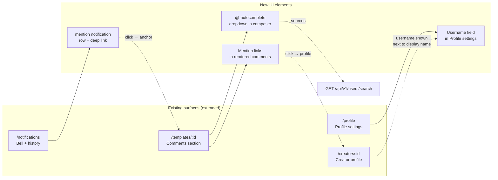
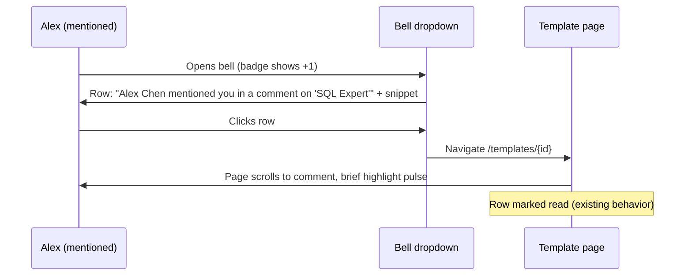
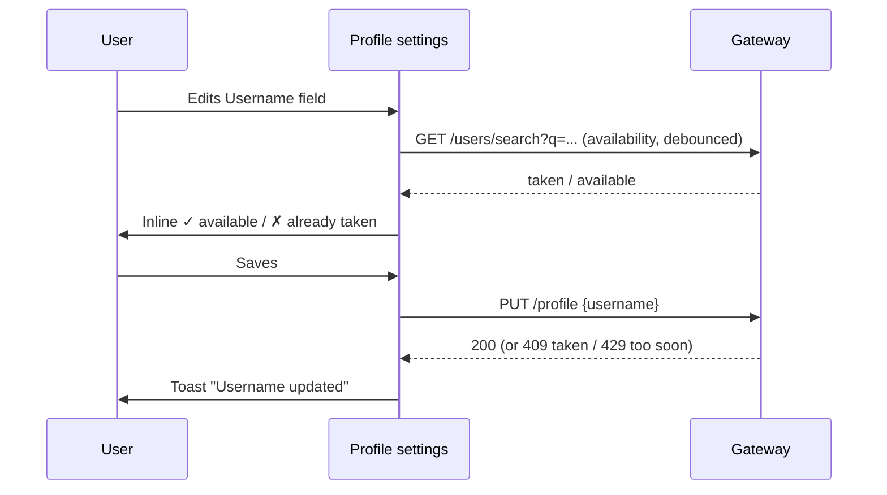

# Mention Notifications — UI/UX Design

- **Feature ID:** mention-notifications
- **Version:** 1.0
- **Status:** Proposed (for architecture review)
- **Author:** ui-ux-agent
- **Date:** 2026-10-12
- **Related docs:** [Requirements](./mention-notifications-requirements.md) · [Requirements (ZH)](./mention-notifications-requirements-zh-CN.md) · [UI/UX (ZH)](./mention-notifications-ui-ux-design-zh-CN.md)

## 1. Design Principles

1. **Zero-friction addressing.** Typing `@` is the only gesture needed; autocomplete does the rest (GitHub/Slack standard).
2. **Context before click.** The notification carries actor, template, and snippet so the user knows what they're walking into.
3. **Land exactly right.** Deep-link anchors scroll to the exact comment — never dump the user at the page top.
4. **Typing is free, notifying is consented.** Anyone can type @you; whether that pings you is your preference (Discourse model).
5. **No new surfaces.** Mentions live inside the existing composer, comments, notifications, and profile — no new pages.

## 2. Information Architecture



## 3. User Flows

### 3.1 Mention via autocomplete (primary flow)

```mermaid
sequenceDiagram
    participant U as Commenter
    participant C as Composer
    participant S as User Search API
    participant API as Gateway
    U->>C: Types "@al" in comment text
    C->>S: GET /users/search?q=al
    S-->>C: [{alex-chen, Alex Chen}, {alice-w, Alice Wang}]
    C->>U: Dropdown below caret (avatar, username, display name)
    U->>C: ↓ to select, Enter
    C->>U: Text now contains "@alex-chen "
    U->>C: Submits comment
    C->>API: POST /comments {content}
    API->>API: Parse mentions, check eligibility, insert mention notifications
    API-->>C: 200 comment
    C->>U: Comment appears; "@alex-chen" renders as profile link
```

### 3.2 Mentioned user experience



### 3.3 Username setup / change



## 4. Page Layouts (Wireframes)

### 4.1 Composer with autocomplete dropdown

```
┌──────────────────────────────────────────────────────┐
│  Add a comment…                                      │
│  ┌────────────────────────────────────────────────┐  │
│  │ Great template! @al▏                            │  │
│  └────────────────────────────────────────────────┘  │
│        ┌────────────────────────────────────────┐    │
│        │ ◯ alex-chen   Alex Chen          ↑↓    │    │
│        │ ◯ alice-w     Alice Wang                │    │
│        │ ◯ alina-k     Alina Kim          Enter  │    │
│        └────────────────────────────────────────┘    │
│  2000                                        [Post]  │
└──────────────────────────────────────────────────────┘
```

- Dropdown appears anchored under the caret line; max 10 rows; scrolls if needed.
- Each row: avatar (24px), `username` (mono, primary), `display name` (secondary).
- Footer hint: ↑↓ to navigate · Enter to select · Esc to dismiss.

### 4.2 Rendered comment with mention link

```
┌──────────────────────────────────────────────────────┐
│ ◯ Alex Chen · Oct 12, 2026                    ⋮      │
│                                                      │
│   Great template! @alex-chen — this solves the       │
│   exact problem from your last question.             │
│        ▲                                              │
│        └─ rendered as: <a href="/creators/{id}"      │
│           class="mention-link">@alex-chen</a>         │
│                                                      │
│   ♥ 3   Reply                                        │
└──────────────────────────────────────────────────────┘
```

- `.mention-link`: primary color, no underline until hover, `@` included in the link text.
- Unknown usernames (typo'd or renamed) render as plain text — never a dead link.

### 4.3 Notification row (bell dropdown + history page)

```
┌──────────────────────────────────────────────────────┐
│ ● ◯ Alex Chen                                        │
│   mentioned you in a comment on                      │
│   "SQL Expert Prompt"                                │
│   "…@alex-chen — this solves the exact problem…"     │
│   2 minutes ago                              [mark ✓]│
└──────────────────────────────────────────────────────┘
```

- Same anatomy as existing notification rows (avatar, actor, text, time, unread dot).
- Click → deep link with anchor; the target comment gets a 2s highlight pulse (`outline` animation).

### 4.4 Profile settings — username field

```
┌──────────────────────────────────────────────────────┐
│  Profile Settings                                    │
│  ────────────────────────────────────────────────────│
│  Display name     [ Alex Chen            ]            │
│                                                      │
│  Username         [ alex-chen            ]  ✓ avail.  │
│  3–30 chars, lowercase letters, numbers, hyphens.    │
│  Your profile: /creators/{id} · others can @mention  │
│  you with this username. Last changed: Sep 2, 2026.  │
│                                                      │
│  [ Save ]                                           │
└──────────────────────────────────────────────────────┘
```

- Inline availability check (debounced 400ms) while typing; ✓ green / ✗ "Already taken" red.
- If changed within 7 days: field disabled with note "You can change your username again on {{date}}."

### 4.5 Creator profile — username display

```
┌──────────────────────────────────────────────────────┐
│  ◯  Alex Chen                                        │
│     @alex-chen · 128 followers · 42 templates        │
└──────────────────────────────────────────────────────┘
```

### 4.6 Notification preferences — mention toggle (extends designed panel)

```
┌──────────────────────────────────────────────────────┐
│  Notification preferences                    ⚙       │
│  ────────────────────────────────────────────────────│
│  ⏸ Pause all notifications            [ off ]        │
│  ────────────────────────────────────────────────────│
│  Likes on your templates               [ on  ]       │
│  Favorites on your templates           [ on  ]       │
│  Forks of your templates               [ on  ]       │
│  Comments on your templates            [ on  ]       │
│  Replies to your comments              [ on  ]       │
│  Mentions (@you)                       [ on  ]       │  ← new row
│    Someone mentions you in a comment.                │
└──────────────────────────────────────────────────────┘
```

## 5. Component Specifications

| Component | Based on | Props / behavior |
|---|---|---|
| `MentionAutocomplete` | new | `{query, onSelect, onClose}`; renders listbox of `{id, username, displayName, avatar}`; keyboard: ↑/↓ move active, Enter select, Esc close, Tab closes without select; active option via `aria-activedescendant`; positioned absolutely under the caret; closes on blur (with 150ms delay for click), on space, or when query < 2 chars. |
| `useMentionSearch` | new hook | Debounced (250ms) fetch to `GET /api/v1/users/search?q=`; caches last query; aborts in-flight on new input; returns `{results, loading}`. |
| `renderCommentContent` | extends existing escape-then-render util | After escaping, replace `(^|[^\w])@([a-z0-9-]{3,30})` with `$1<a href="/creators/{id}" class="mention-link">@$2</a>` when the username resolves (client-side map from the comment's `mentioned_users` field); unresolved → plain text. |
| `CommentComposer` (extend) | existing | Detect `@` + query via caret-position parsing on the textarea; mount MentionAutocomplete; on select, splice `@username ` replacing the typed prefix. |
| `MentionNotificationRow` | extends existing notification row | Type `mention`: icon `@`, text per i18n, snippet line, click → anchor deep link. |
| `UsernameField` | new (Profile settings) | Input + debounced availability + validation hints + 7-day cooldown note; save via existing profile update. |
| `CommentHighlight` | new (CSS) | `#comment-{id}:target` + JS scroll-into-view; 2s `box-shadow` pulse animation; respects `prefers-reduced-motion`. |

## 6. Interaction Details

1. **Trigger:** autocomplete opens on `@` followed by ≥2 typed chars, only while the caret is inside the mention token; typing a space or `@` again closes it.
2. **Selection:** Enter/click inserts `@username ` (trailing space so the user keeps typing normally). Esc dismisses; the typed text stays untouched.
3. **Rendering:** mentions linkify only when the username exists in the comment's `mentioned_users` map (returned by the API); otherwise plain text — no dead links, no 404s.
4. **Deep link:** notification click navigates to `/templates/{id}#comment-{cid}`; the page scrolls the comment into view (centered if possible) and pulses it. If the comment was deleted meanwhile, the anchor silently no-ops (page loads normally).
5. **Snippet:** first 100 chars of the comment, single line, ellipsis when truncated; the mention itself is highlighted in the snippet (bold, not a link — the row is already the link).
6. **Username edit:** availability check is advisory pre-save; the server re-validates (409 → inline error). Cooldown (7 days) disables the field with the unlock date.
7. **Preferences:** the mention toggle behaves exactly like the other type toggles (auto-save, immediate effect, suppression at emission).
8. **Caps are silent:** exceeding 10 mentions/comment or 20/hour produces no UI error — the comment posts, links render, extra notifications just don't happen (GitHub behavior).
9. **Anonymous viewers:** mention links render for logged-out users (public profiles); clicking a profile when logged-out shows the public profile page (existing behavior).
10. **RTL/IME:** the `@` trigger works with IME composition (dropdown only opens after composition ends); usernames are ASCII so no RTL complications.

## 7. States Summary

| State | Trigger | UI |
|---|---|---|
| Autocomplete loading | query typed, fetch in flight | Dropdown with spinner row "Searching…" |
| Autocomplete empty | no matches | Dropdown row "No users found" (stays open until Esc/space) |
| Autocomplete error | search fails | Dropdown row "Search unavailable"; typing continues unaffected |
| Mention link resolved | username in `mentioned_users` | Anchor to `/creators/{id}` |
| Mention unresolved | typo/renamed/deleted user | Plain text `@foo` |
| Notification unread | new mention | Unread dot + bold row (existing pattern) |
| Deep-link target missing | comment deleted | Page loads normally; no error |
| Username available | check passes | ✓ green inline |
| Username taken | 409 | ✗ "Already taken" red inline |
| Username cooldown | changed < 7 days ago | Field disabled + unlock date note |
| Username invalid | bad chars/length | Inline validation message |
| Rate-limited search | 429 | Silent backoff; dropdown shows cached results |

## 8. i18n String Table

Namespace: `mentions` (new) + `notifications` (extends) + `profile` (extends).

| Key | English | 中文 |
|---|---|---|
| `mentions.autocomplete_hint` | ↑↓ to navigate · Enter to select · Esc to dismiss | ↑↓ 选择 · Enter 确认 · Esc 关闭 |
| `mentions.searching` | Searching… | 搜索中… |
| `mentions.no_results` | No users found | 未找到用户 |
| `mentions.search_unavailable` | Search unavailable | 搜索暂不可用 |
| `notifications.mention` | mentioned you in a comment on "{{template}}" | 在"{{template}}"的评论中提及了你 |
| `notifications.mention_desc` | Someone mentions you in a comment. | 有人在评论中提及了你。 |
| `notifications.type.mention` | Mention | 提及 |
| `profile.username` | Username | 用户名 |
| `profile.username_rules` | 3–30 chars, lowercase letters, numbers, hyphens. | 3–30 个字符，小写字母、数字、连字符。 |
| `profile.username_hint` | Others can @mention you with this username. | 其他人可以用此用户名 @提及你。 |
| `profile.username_available` | Available | 可用 |
| `profile.username_taken` | Already taken | 已被占用 |
| `profile.username_invalid` | Use 3–30 lowercase letters, numbers, or hyphens. | 请使用 3–30 个小写字母、数字或连字符。 |
| `profile.username_cooldown` | You can change your username again on {{date}}. | 你可以在 {{date}} 再次修改用户名。 |
| `profile.username_changed` | Username updated | 用户名已更新 |
| `profile.username_last_changed` | Last changed: {{date}} | 上次修改：{{date}} |
| `profile.creator_handle` | @{{username}} | @{{username}} |
| `mentions.comment_highlight_label` | Mentioned comment | 被提及的评论 |

## 8a. Notification-Preferences Interaction

The `mention` type registers in the preferences panel's data-driven type list (per notification-preferences design FR-3): label `notifications.type.mention`, description `notifications.mention_desc`, default on, toggle auto-saves, suppression at emission. No panel changes are needed beyond the new list entry; `paused_all` covers mentions like every other type.

## 9. Accessibility Notes

- MentionAutocomplete implements the ARIA 1.2 combobox pattern: the textarea keeps `role="combobox"` + `aria-expanded` + `aria-controls`; the listbox has `role="listbox"` with `role="option"` children; the active option is tracked via `aria-activedescendant`; screen readers announce "N results available".
- All dropdown operations are keyboard-only reachable; focus never leaves the textarea while navigating (standard combobox behavior).
- Mention links are ordinary anchors with discernible text (`@username`); no title-attribute-only affordances.
- The comment highlight pulse is disabled under `prefers-reduced-motion` (the scroll still happens, the animation doesn't).
- Notification rows reuse the shipped notifications a11y (list semantics, mark-read buttons with labels).
- The username field has a visible label, inline error text bound via `aria-describedby`, and the availability status uses `aria-live="polite"`.

## 10. Responsive Behavior

- **Desktop (≥1024px):** autocomplete dropdown is 320px wide, anchored under the caret; comment layout unchanged.
- **Tablet (768–1023px):** dropdown spans the composer width minus padding; rows show avatar + username only (display name truncates).
- **Mobile (<768px):** dropdown becomes a bottom sheet above the keyboard (max-height 40vh, scrollable); rows are 48px touch targets; Enter key on mobile keyboards selects the active option.
- Notification rows, preferences panel, and profile settings inherit their pages' existing responsive rules; the username field is full-width on mobile.

## 11. Analytics Events (optional, if analytics shipped)

- `mention_autocomplete_opened` / `mention_autocomplete_selected` `{result_index}`
- `mention_inserted` `{via: 'autocomplete' | 'manual'}`
- `mention_notification_clicked` `{template_id}`
- `username_changed` `{had_previous}`

## 12. Out of Scope (UI)

- Hover profile cards on mention links.
- Mention suggestions beyond the composer (e.g., "suggest people to mention").
- A dedicated "Mentions" filter tab in notifications history (type filter is a future notifications enhancement).
- Username change history UI.
