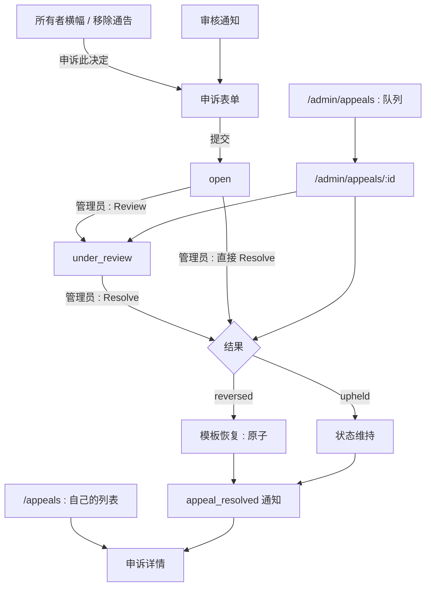
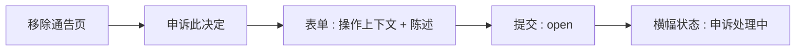
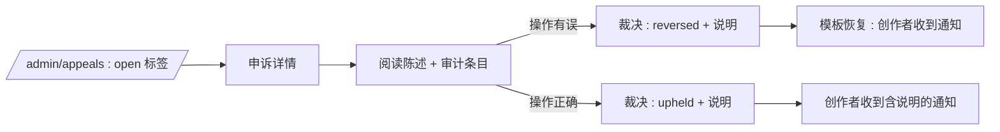

# 审核申诉 — UI/UX 设计

- **功能 ID：** moderation-appeals
- **版本：** 1.0
- **状态：** Proposed（待架构评审）
- **作者：** ui-ux-agent
- **日期：** 2026-10-13
- **配套文档：** `moderation-appeals-requirements-zh-CN.md`

## 1. 设计原则

1. **伤口在哪里，申诉就在哪里。** CTA 位于解释操作的所有者横幅/移除通告上 —— 无需寻找表单。
2. **一次机会，瞄准要害。** 每操作一次申诉；表单只要一段清晰的陈述，不要卷宗。
3. **状态始终可见。** 创作者无需询问任何人即可看到 open → 审核中 → 已裁决。
4. **案情旁边摆事实。** 管理员并排看到申诉与原审计条目 —— 在上下文中裁决。

## 2. 信息架构



| 界面 | 位置 | 受众 | 目的 |
|---|---|---|---|
| 申诉 CTA / 状态槽位 | 所有者横幅、移除通告 | 所有者 | 入口 / 实时状态 |
| 申诉表单（弹窗） | 来自横幅/通知 | 所有者 | 陈述案情 |
| /appeals | 用户路由 | 所有者 | 自己的申诉列表 + 详情 |
| /admin/appeals | 管理控制台 | 管理员 | 带状态标签的队列 |
| /admin/appeals/:id | 管理控制台 | 管理员 | 审查 + 裁决 |
| appeal_resolved 通知 | 通知中心 | 所有者 | 结果 + 说明摘录 |

## 3. 用户流程

### 3.1 创作者申诉移除



### 3.2 管理员裁决



## 4. 页面布局

### 4.1 申诉表单（弹窗）

```
+----------------------------------------------------------------------+
|  申诉此决定                                                            |
|  ─────────────────────────────────────────────────────────────────── |
|  操作：删除（软）· "spam — off-platform links"                         |
|  由 admin2 · 2026年10月13日 14:02                                     |
|  模板：Cold Email Template                                            |
|                                                                      |
|  该决定为何应被反转？（50–2000）                                        |
|  [                                                            ]      |
|  [                                                            ]      |
|                                                                      |
|  每次操作仅一次申诉。请具体、基于事实。                                   |
|                                    [取消]  [提交申诉]                   |
+----------------------------------------------------------------------+
```

### 4.2 /appeals（用户列表）

```
+----------------------------------------------------------------------+
|  我的申诉                                                              |
+----------------------------------------------------------------------+
|  [处理中]    删除 · Cold Email Template          10月13日 · 2小时前    |
|  [已反转]    取消发布 · Logo Prompt              10月10日 · 已裁决      |
|     ↳ 已恢复。"已复核 —— 链接是合法的。"（admin1）                      |
|                                              [加载更多]                |
```

### 4.3 申诉详情（用户）

```
+----------------------------------------------------------------------+
|  ← 我的申诉 / 申诉 #482                                                |
|  [审核中]                                                              |
|  操作：删除（软）· "spam — off-platform links"                         |
|  由 admin2 · 10月13日 · 模板：Cold Email Template                      |
+----------------------------------------------------------------------+
|  你的陈述                                                              |
|  链接指向我公司的产品文档，并非站外推广。                                |
|  模板符合社区准则…                                                     |
+----------------------------------------------------------------------+
|  裁决                                           （待裁决）              |
+----------------------------------------------------------------------+
```

### 4.4 /admin/appeals（队列）

```
+----------------------------------------------------------------------+
|  申诉          处理中 (3) | 审核中 (1) | 已裁决 (47)                    |
+----------------------------------------------------------------------+
|  时长   模板                  操作        陈述摘录          状态       |
|  2天    Cold Email Template   delete      "链接指向…"       处理中     |
|  1天    Logo Prompt           unpublish   "这是误判…"       处理中     |
|  4小时  SaaS Intro            lock        "无争议…"         处理中     |
+----------------------------------------------------------------------+
```

### 4.5 /admin/appeals/:id（详情）

```
+----------------------------------------------------------------------+
|  申诉 #482 · Cold Email Template                       [审核中]        |
+----------------------------------------------------------------------+
|  申诉                                          原操作                  |
|  陈述：                                  |  删除（软）                 |
|  "链接指向我公司的产品文档，             |  原因："spam — 站外          |
|  并非站外推广…"                          |   links"                    |
|  10月13日由 Alice 提交                  |  由 admin2 · 10月13日 14:02  |
|                                          |  审计 #9931                 |
+----------------------------------------------------------------------+
|  裁决                                                                  |
|  结果：( ) 维持   ( ) 反转                                             |
|  说明（20–1000，必填，对创作者可见）：                                    |
|  [                                                            ]      |
|                                    [返回]  [裁决申诉]                   |
+----------------------------------------------------------------------+
```

### 4.6 移动端

申诉表单变为全屏 sheet；管理详情将申诉与操作面板垂直堆叠，裁决表单吸底。队列行折叠为两行（模板 + 状态）。

## 5. 组件规格

| 组件 | 行为 | 状态 |
|---|---|---|
| AppealCtaSlot | 所有者横幅上：CTA（无申诉）、状态 chip（open/审核中）、或结果 chip + 说明摘录（已裁决） | cta / open / under_review / resolved |
| AppealFormModal | 只读操作上下文 + 陈述 textarea（50–2000）+ 提交 | 空闲 / 无效 / 提交中 / 冲突-409 |
| UserAppealList | 带状态 chip、操作、模板、时长的卡片；已裁决时含说明摘录 | 加载中 / 空态 / 已加载 / 错误 |
| AppealDetail | 陈述 + 操作上下文 + 裁决块 | open / under_review / resolved_upheld / resolved_reversed |
| AdminAppealQueue | 带计数的状态标签；最旧在前；陈述摘录 | 加载中 / 空态 / 已加载 / 错误 |
| AdminAppealDetail | 双栏申诉 + 审计条目；Review 按钮；裁决表单（结果单选 + 说明） | open / under_review / 裁决中 / 自我防护-403 |
| AppealStateChip | open / 审核中 / 维持 / 反转，带文字标签 | 4 种状态 |

## 6. 交互细节

1. **入口：** 横幅 CTA、审核通知的"申诉"操作、`/appeals` 上的"新建申诉"入口（操作选择器限于用户自己被操作的模板）打开同一表单。
2. **409 处理：** 操作已被申诉时，表单被既有申诉的状态卡取代，附深链到其详情。
3. **陈述校验：** 实时计数；低于 50 或超过 2000 字符时提交禁用并内联显示规则。
4. **Review：** 即时移至 `under_review`；创作者横幅槽位与详情在下次获取时更新（v1 无推送）。
5. **Resolve：** 结果单选 + 说明（20–1000）必填；Resolve 显示总结影响的确认步骤（"反转将把模板恢复为正常状态"）。成功后 toast 陈述结果；队列标签计数更新。
6. **自我防护：** 当前管理员为原操作者时，裁决表单禁用并显示解释（403 是 API 兜底）。
7. **反转救济：** 恢复在服务端原子完成；裁决后管理详情显示模板新状态（`normal`）并附管理模板页链接。
8. **已取代操作：** 被管理员直接恢复撤销的操作在用户可申诉列表中显示"已取代"标签且无申诉入口（FR-14）。
9. **通知：** `appeal_resolved` 渲染结果 + 说明摘录（140 字符）并深链申诉详情。

## 7. 状态汇总

| 界面 | 加载中 | 空态 | 错误 |
|---|---|---|---|
| AppealCtaSlot | 隐藏 | CTA（无申诉） | — |
| AppealFormModal | — | — | 行内字段错误；409 → 状态卡 |
| UserAppealList | 卡片骨架 | "暂无申诉 —— 无可争议事项" | 重试 |
| AppealDetail | 骨架 | — | 重试 |
| AdminAppealQueue | 表格骨架 | 按标签"该状态下暂无申诉" | toast + 重试 |
| AdminAppealDetail | 骨架 | — | 裁决错误行内，保留输入 |

## 8. 国际化（i18n）

| Key | 中文 | 英文 |
|---|---|---|
| `appeal.cta.appeal` | 申诉此决定 | Appeal this decision |
| `appeal.cta.onePerAction` | 每次操作仅一次申诉 | One appeal per action |
| `appeal.cta.status.open` | 申诉处理中 | Appeal open |
| `appeal.cta.status.underReview` | 申诉审核中 | Appeal under review |
| `appeal.cta.status.reversed` | 申诉反转 —— 模板已恢复 | Appeal reversed — template restored |
| `appeal.cta.status.upheld` | 申诉维持 | Appeal upheld |
| `appeal.form.title` | 申诉此决定 | Appeal this decision |
| `appeal.form.actionContext` | 操作 | Action |
| `appeal.form.statement` | 该决定为何应被反转？ | Why should this decision be reversed? |
| `appeal.form.statementHint` | 每次操作仅一次申诉。请具体、基于事实。 | One appeal per action. Be specific and factual. |
| `appeal.form.submit` | 提交申诉 | Submit appeal |
| `appeal.form.conflict` | 该操作已被申诉 | This action has already been appealed |
| `appeal.form.tooShort` | 陈述至少 50 字符 | Statement must be at least 50 characters |
| `appeal.form.tooLong` | 陈述最多 2000 字符 | Statement must be at most 2000 characters |
| `appeal.list.title` | 我的申诉 | My appeals |
| `appeal.list.empty` | 暂无申诉 —— 无可争议事项 | No appeals — nothing to contest |
| `appeal.detail.statement` | 你的陈述 | Your statement |
| `appeal.detail.resolution` | 裁决 | Resolution |
| `appeal.detail.pending` | 待裁决 | Pending |
| `appeal.state.open` | 处理中 | Open |
| `appeal.state.under_review` | 审核中 | Under review |
| `appeal.state.upheld` | 维持 | Upheld |
| `appeal.state.reversed` | 反转 | Reversed |
| `appeal.superseded` | 已取代 | Superseded |
| `appeal.admin.queue.title` | 申诉 | Appeals |
| `appeal.admin.queue.empty` | 该状态下暂无申诉 | No appeals in this state |
| `appeal.admin.detail.originalAction` | 原操作 | Original action |
| `appeal.admin.detail.review` | 开始审查 | Review |
| `appeal.admin.detail.resolve` | 裁决申诉 | Resolve appeal |
| `appeal.admin.detail.outcome` | 结果 | Outcome |
| `appeal.admin.detail.upheld` | 维持 | Upheld |
| `appeal.admin.detail.reversed` | 反转 | Reversed |
| `appeal.admin.detail.note` | 说明（必填，对创作者可见） | Note (required, shown to the creator) |
| `appeal.admin.detail.noteRule` | 20–1000 字符 | 20–1000 characters |
| `appeal.admin.detail.selfGuard` | 原操作操作者不能裁决此申诉 | The original action's actor cannot resolve this appeal |
| `appeal.admin.confirm.reversed` | 反转将把模板恢复为正常状态 | Reversing will restore the template to normal |
| `appeal.admin.toast.resolved` | 申诉已裁决 | Appeal resolved |
| `appeal.notif.resolved` | 你的申诉已{{outcome}}：{{note}} | Your appeal was {{outcome}}: {{note}} |
| `appeal.rateLimit` | 你最多可有 5 个处理中的申诉 | You can have at most 5 open appeals |

## 9. 无障碍

- 申诉表单弹窗焦点陷阱、Esc 取消；陈述 textarea 有可见标签与实时字符计数（`aria-describedby`）。
- 状态 chip 颜色配文字标签；横幅状态槽位通过 `role=status` 播报变化。
- 管理队列是语义表格，状态标签为 tablist（方向键导航）；行操作是带描述性名称的链接。
- 结果单选组有 fieldset legend；说明 textarea 的规则被播报；Resolve 的确认对话框为屏幕阅读器重述影响。
- 通知使用标准通知中心条目语义，附描述性深链。

## 10. 数据埋点（可选）

- `appeal_created`、`appeal_reviewed`、`appeal_resolved`（结果）、`appeal_entry_point`（横幅/通知/页面）—— 仅产品使用事件。

## 11. 不在范围内

- 多轮对话；附件；SLA 计时器；账号操作申诉；评论删除申诉。
- 任何形式的变现 —— 本产品永久不做。
