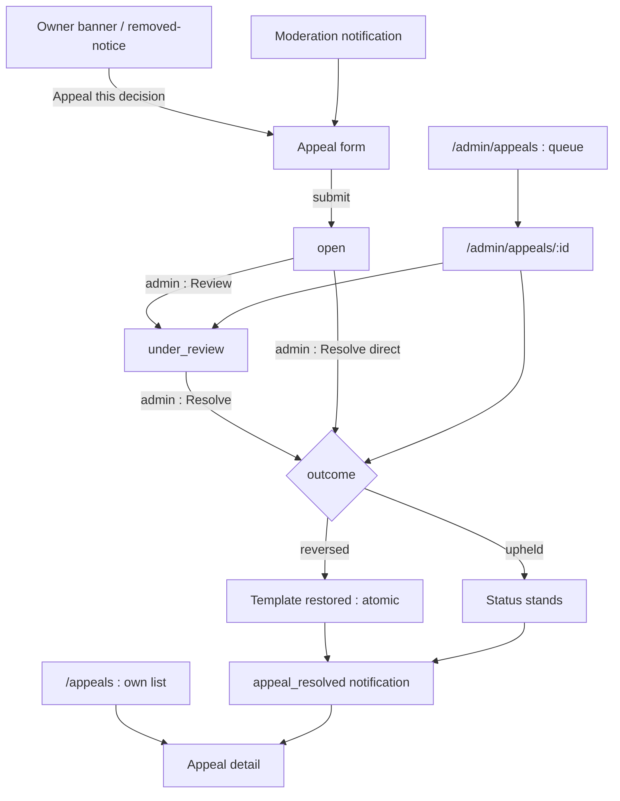
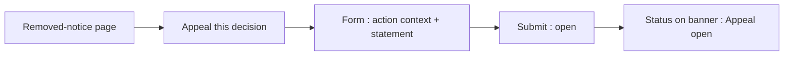
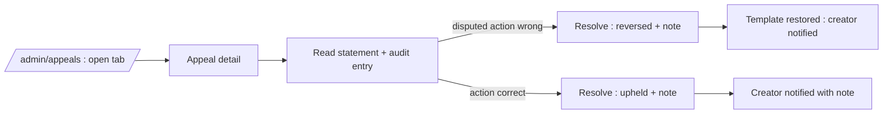

# Moderation Appeals — UI/UX Design

- **Feature ID:** moderation-appeals
- **Version:** 1.0
- **Status:** Proposed (for architecture review)
- **Author:** ui-ux-agent
- **Date:** 2026-10-13
- **Companion doc:** `moderation-appeals-requirements.md`

## 1. Design Principles

1. **Appeal where the wound is.** The CTA lives on the owner banner/removed-notice that explains the action — no hunting for a form.
2. **One shot, well aimed.** One appeal per action; the form asks for a single clear statement, not a dossier.
3. **Status is always visible.** The creator sees open → under review → resolved without asking anyone.
4. **Facts beside the case.** The admin sees the appeal and the original audit entry side by side — judgment in context.

## 2. Information Architecture



| Surface | Location | Audience | Purpose |
|---|---|---|---|
| Appeal CTA / status slot | Owner banner, removed-notice | Owner | Entry point / live status |
| Appeal form (modal) | From banner/notification | Owner | State the case |
| /appeals | User route | Owner | Own appeals list + detail |
| /admin/appeals | Admin console | Admins | Queue with state tabs |
| /admin/appeals/:id | Admin console | Admins | Review + resolve |
| appeal_resolved notification | Notification center | Owner | Outcome + note excerpt |

## 3. User Flows

### 3.1 Creator appeals a removal



### 3.2 Admin resolves



## 4. Page Layouts

### 4.1 Appeal form (modal)

```
+----------------------------------------------------------------------+
|  Appeal this decision                                                 |
|  ─────────────────────────────────────────────────────────────────── |
|  Action: Deleted (soft) · "spam — off-platform links"                 |
|  By admin2 · Oct 13, 2026 14:02                                       |
|  Template: Cold Email Template                                        |
|                                                                      |
|  Why should this decision be reversed? (50–2000)                      |
|  [                                                            ]      |
|  [                                                            ]      |
|                                                                      |
|  One appeal per action. Be specific and factual.                      |
|                                    [Cancel]  [Submit appeal]          |
+----------------------------------------------------------------------+
```

### 4.2 /appeals (user list)

```
+----------------------------------------------------------------------+
|  My appeals                                                           |
+----------------------------------------------------------------------+
|  [OPEN]      Deleted · Cold Email Template        Oct 13 · 2h ago    |
|  [REVERSED]  Unpublished · Logo Prompt            Oct 10 · resolved   |
|     ↳ Restored. "Reviewed — links are legitimate." (admin1)          |
|                                              [Load more]              |
```

### 4.3 Appeal detail (user)

```
+----------------------------------------------------------------------+
|  ← My appeals / Appeal #482                                           |
|  [UNDER REVIEW]                                                       |
|  Action: Deleted (soft) · "spam — off-platform links"                 |
|  By admin2 · Oct 13 · Template: Cold Email Template                   |
+----------------------------------------------------------------------+
|  Your statement                                                       |
|  The links point to my company's product docs, not off-platform      |
|  promotion. The template follows the community guidelines…            |
+----------------------------------------------------------------------+
|  Resolution                                     (pending)             |
+----------------------------------------------------------------------+
```

### 4.4 /admin/appeals (queue)

```
+----------------------------------------------------------------------+
|  Appeals        Open (3) | Under review (1) | Resolved (47)           |
+----------------------------------------------------------------------+
|  Age    Template              Action      Statement excerpt   State  |
|  2d     Cold Email Template   delete      "The links point…"  open   |
|  1d     Logo Prompt           unpublish   "This is a false…"  open   |
|  4h     SaaS Intro            lock        "No dispute here…"  open   |
+----------------------------------------------------------------------+
```

### 4.5 /admin/appeals/:id (detail)

```
+----------------------------------------------------------------------+
|  Appeal #482 · Cold Email Template                     [UNDER REVIEW] |
+----------------------------------------------------------------------+
|  Appeal                                        Original action        |
|  Statement:                            |  Deleted (soft)             |
|  "The links point to my company's     |  Reason: "spam — off-        |
|  product docs, not off-platform       |   platform links"            |
|  promotion…"                          |  By admin2 · Oct 13 14:02   |
|  Filed Oct 13 by Alice                |  Audit #9931                |
+----------------------------------------------------------------------+
|  Resolution                                                           |
|  Outcome: ( ) Upheld   ( ) Reversed                                   |
|  Note (20–1000, required, shown to the creator):                      |
|  [                                                            ]      |
|                                    [Back]  [Resolve appeal]           |
+----------------------------------------------------------------------+
```

### 4.6 Mobile

The appeal form becomes a full-screen sheet; the admin detail stacks the appeal and action panels vertically with the resolution form pinned at the bottom. Queue rows collapse to two lines (template + state).

## 5. Component Specs

| Component | Behavior | States |
|---|---|---|
| AppealCtaSlot | On owner banner: CTA (no appeal), status chip (open/under review), or outcome chip + note excerpt (resolved) | cta / open / under_review / resolved |
| AppealFormModal | Read-only action context + statement textarea (50–2000) + submit | idle / invalid / submitting / conflict-409 |
| UserAppealList | Cards with state chip, action, template, age; resolution note excerpt when resolved | loading / empty / loaded / error |
| AppealDetail | Statement + action context + resolution block | open / under_review / resolved_upheld / resolved_reversed |
| AdminAppealQueue | State tabs with counts; oldest-first rows; statement excerpt | loading / empty / loaded / error |
| AdminAppealDetail | Two-pane appeal + audit entry; Review button; Resolve form (outcome radio + note) | open / under_review / resolving / self-guard-403 |
| AppealStateChip | open / under review / upheld / reversed with text labels | 4 states |

## 6. Interaction Details

1. **Entry points:** the banner CTA, the moderation notification's "Appeal" action, and a "New appeal" affordance on `/appeals` (action picker limited to the user's own actioned templates) all open the same form.
2. **409 handling:** if the action was already appealed, the form is replaced by the existing appeal's status card with a deep link to its detail.
3. **Statement validation:** live counter; submit disabled under 50 or over 2000 chars with the rule shown inline.
4. **Review:** moves to `under_review` instantly; the creator's banner slot and detail update on next fetch (no push in v1).
5. **Resolve:** outcome radio + note (20–1000) required; Resolve shows a confirm step summarizing the effect ("Reversing will restore the template to normal"). On success, a toast states the outcome; the queue tab counts update.
6. **Self-guard:** if the current admin is the original actor, the Resolve form renders disabled with the explanation (403 is the API backstop).
7. **Reversed remedy:** the restore happens server-side atomically; the admin detail shows the template's new status (`normal`) after resolution with a link to the admin template page.
8. **Superseded actions:** actions undone by a direct admin restore show an "superseded" tag in the user's appeal-eligible list and no appeal entry point (FR-14).
9. **Notification:** `appeal_resolved` renders outcome + note excerpt (140 chars) with a deep link to the appeal detail.

## 7. States Summary

| Surface | Loading | Empty | Error |
|---|---|---|---|
| AppealCtaSlot | Hidden | CTA (no appeal) | — |
| AppealFormModal | — | — | Inline field errors; 409 → status card |
| UserAppealList | Card skeletons | "No appeals — nothing to contest" | Retry |
| AppealDetail | Skeleton | — | Retry |
| AdminAppealQueue | Table skeleton | Per-tab "No appeals in this state" | Toast + retry |
| AdminAppealDetail | Skeleton | — | Resolve error inline, keep input |

## 8. i18n

| Key | EN | ZH |
|---|---|---|
| `appeal.cta.appeal` | Appeal this decision | 申诉此决定 |
| `appeal.cta.onePerAction` | One appeal per action | 每次操作仅一次申诉 |
| `appeal.cta.status.open` | Appeal open | 申诉处理中 |
| `appeal.cta.status.underReview` | Appeal under review | 申诉审核中 |
| `appeal.cta.status.reversed` | Appeal reversed — template restored | 申诉反转 —— 模板已恢复 |
| `appeal.cta.status.upheld` | Appeal upheld | 申诉维持 |
| `appeal.form.title` | Appeal this decision | 申诉此决定 |
| `appeal.form.actionContext` | Action | 操作 |
| `appeal.form.statement` | Why should this decision be reversed? | 该决定为何应被反转？ |
| `appeal.form.statementHint` | One appeal per action. Be specific and factual. | 每次操作仅一次申诉。请具体、基于事实。 |
| `appeal.form.submit` | Submit appeal | 提交申诉 |
| `appeal.form.conflict` | This action has already been appealed | 该操作已被申诉 |
| `appeal.form.tooShort` | Statement must be at least 50 characters | 陈述至少 50 字符 |
| `appeal.form.tooLong` | Statement must be at most 2000 characters | 陈述最多 2000 字符 |
| `appeal.list.title` | My appeals | 我的申诉 |
| `appeal.list.empty` | No appeals — nothing to contest | 暂无申诉 —— 无可争议事项 |
| `appeal.detail.statement` | Your statement | 你的陈述 |
| `appeal.detail.resolution` | Resolution | 裁决 |
| `appeal.detail.pending` | Pending | 待裁决 |
| `appeal.state.open` | Open | 处理中 |
| `appeal.state.under_review` | Under review | 审核中 |
| `appeal.state.upheld` | Upheld | 维持 |
| `appeal.state.reversed` | Reversed | 反转 |
| `appeal.superseded` | Superseded | 已取代 |
| `appeal.admin.queue.title` | Appeals | 申诉 |
| `appeal.admin.queue.empty` | No appeals in this state | 该状态下暂无申诉 |
| `appeal.admin.detail.originalAction` | Original action | 原操作 |
| `appeal.admin.detail.review` | Review | 开始审查 |
| `appeal.admin.detail.resolve` | Resolve appeal | 裁决申诉 |
| `appeal.admin.detail.outcome` | Outcome | 结果 |
| `appeal.admin.detail.upheld` | Upheld | 维持 |
| `appeal.admin.detail.reversed` | Reversed | 反转 |
| `appeal.admin.detail.note` | Note (required, shown to the creator) | 说明（必填，对创作者可见） |
| `appeal.admin.detail.noteRule` | 20–1000 characters | 20–1000 字符 |
| `appeal.admin.detail.selfGuard` | The original action's actor cannot resolve this appeal | 原操作操作者不能裁决此申诉 |
| `appeal.admin.confirm.reversed` | Reversing will restore the template to normal | 反转将把模板恢复为正常状态 |
| `appeal.admin.toast.resolved` | Appeal resolved | 申诉已裁决 |
| `appeal.notif.resolved` | Your appeal was {{outcome}}: {{note}} | 你的申诉已{{outcome}}：{{note}} |
| `appeal.rateLimit` | You can have at most 5 open appeals | 你最多可有 5 个处理中的申诉 |

## 9. Accessibility

- The appeal form modal is focus-trapped with Esc to cancel; the statement textarea has a visible label and live character count (`aria-describedby`).
- State chips pair color with text labels; the banner status slot announces changes via `role=status`.
- The admin queue is a semantic table with state tabs as a tablist (arrow-key navigation); row actions are links with descriptive names.
- The outcome radio group has a fieldset legend; the note textarea's rule is announced; Resolve's confirm dialog restates the effect for screen readers.
- The notification uses the standard notification-center item semantics with a descriptive deep link.

## 10. Analytics (optional)

- `appeal_created`, `appeal_reviewed`, `appeal_resolved` (outcome), `appeal_entry_point` (banner/notification/page) — product usage events only.

## 11. Out of Scope

- Multi-round dialogue; attachments; SLA timers; account-action appeals; comment-deletion appeals.
- Monetization of any kind — permanently out of scope for this product.
