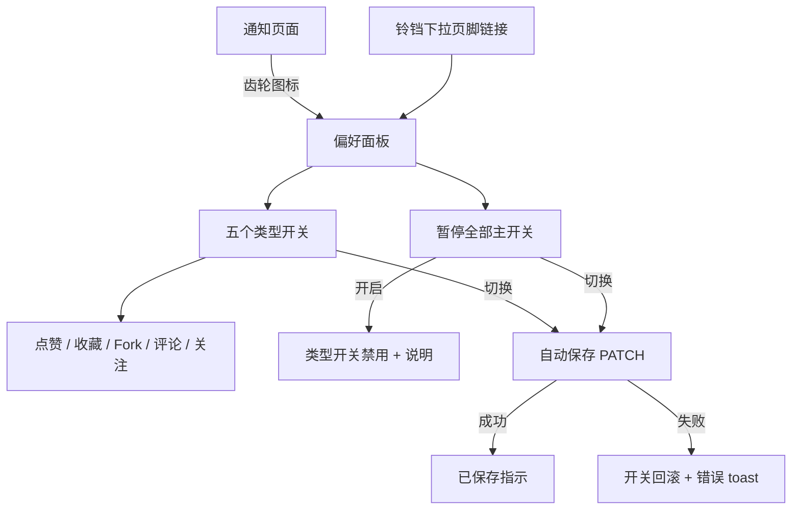
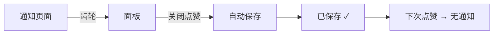
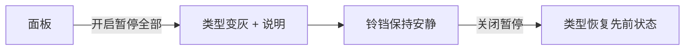

# 通知偏好（Notification Preferences）— UI/UX 设计

- **功能 ID：** notification-preferences
- **版本：** 1.0
- **状态：** 已提案（待架构评审）
- **作者：** ui-ux-agent
- **日期：** 2026-10-12
- **配套文档：** `notification-preferences-requirements-zh-CN.md`

## 1. 设计原则

1. **控制位于噪音所在之处。** 齿轮位于通知页面，而不是埋在全局设置中。
2. **立即而诚实。** 每个开关自动保存并带可见的"已保存"勾号；面板始终反映真实的有效状态（包括暂停）。
3. **白话。** 每个开关带一行描述说明类型覆盖什么 —— 无术语、无事件类型代码。
4. **默认零界面。** 从不打开面板的用户在任何地方都看不到新东西。

## 2. 信息架构



| 界面 | 位置 | 受众 | 目的 |
|---|---|---|---|
| 偏好面板 | 通知页面（齿轮）/ 铃铛下拉链接 | 所有用户 | 按类型退出 + 暂停全部 |
| 已保存指示 | 面板内 | 所有用户 | 确认自动保存 |
| 暂停说明 | 面板内（暂停时） | 所有用户 | 解释禁用的开关 |

## 3. 用户流程

### 3.1 让点赞噪音安静



### 3.2 暂停一切



## 4. 页面布局

### 4.1 偏好面板（桌面）

```
+--------------------------------------------------+
|  通知偏好                                 [×]     |
+--------------------------------------------------+
|  ⏸ 暂停所有通知                          [ ●/○ ]  |
|  停止所有类型的通知。                              |
+--------------------------------------------------+
|  点赞                                    [ ●/○ ]  |
|  有人点赞了你的模板。                              |
+--------------------------------------------------+
|  收藏                                    [ ●/○ ]  |
|  有人收藏了你的模板。                              |
+--------------------------------------------------+
|  Fork                                    [ ●/○ ]  |
|  有人 fork 了你的模板。                            |
+--------------------------------------------------+
|  评论                                    [ ●/○ ]  |
|  有人评论了你的模板。                              |
+--------------------------------------------------+
|  关注                                    [ ●/○ ]  |
|  有人关注了你。                                    |
+--------------------------------------------------+
|  ⓘ 更改自动保存。                                  |
+--------------------------------------------------+
```

### 4.2 暂停状态

```
+--------------------------------------------------+
|  ⏸ 暂停所有通知                          [ ●● ]   |
+--------------------------------------------------+
|  点赞                          (灰色)     [ ○ ]   |
|  收藏                          (灰色)     [ ○ ]   |
|  ...                                             |
|  ⓘ 暂停全部已开启 —— 关闭后可调整单个类型。        |
+--------------------------------------------------+
```

### 4.3 入口

```
通知页面顶栏：
+--------------------------------------------------+
|  通知                                    [ ⚙ ]     |
+--------------------------------------------------+

铃铛下拉页脚：
+---------------------------+
|  ...                      |
|  [ 全部标为已读 ]          |
|  通知偏好                  |
+---------------------------+
```

### 4.4 移动端

面板变成全屏 sheet（既有移动弹窗模式）；开关是全宽行（标签 + 描述堆叠，开关右对齐）；齿轮图标保留在页面顶栏。

## 5. 组件规格

| 组件 | 行为 | 状态 |
|---|---|---|
| PreferencesPanel | 带主开关 + 5 个类型行的弹窗/内联区 | 默认 / 暂停 |
| TypeToggleRow | 标签 + 描述 + 开关；更改时自动保存 | 开 / 关 / 禁用（暂停）/ 保存中 / 错误（回滚） |
| PauseAllSwitch | 主开关；禁用时类型行变灰并带说明 | 开 / 关 |
| SavedIndicator | 变更行旁的瞬态"已保存 ✓"（1.5 秒） | 可见 / 隐藏 |
| GearIconButton | 打开面板的顶栏图标按钮 | 默认 |

## 6. 交互细节

1. **自动保存：** 每个开关立即触发 PATCH；开关乐观动画，然后确认（已保存 ✓）或回滚并显示错误 toast。
2. **暂停优先：** 暂停时类型开关视觉禁用且不可交互；说明解释原因；关闭暂停恢复每个类型的持久状态。
3. **已保存指示：** 在变更行旁显示 1.5 秒；屏幕阅读器礼貌播报（`aria-live="polite"`）。
4. **面板关闭：** × 或 Esc 关闭；无未保存更改提示（一切都已保存）。
5. **铃铛下拉链接：** 打开同一面板（UI 的单一事实来源）。
6. **类型标签：** 复用通知功能的事件类型显示标签，使面板和历史页面说同样的语言。
7. **空历史 + 偏好：** 面板无论历史状态如何都相同工作；无耦合。
8. **首次打开：** 打开时 GET 偏好；缺失行渲染为全开默认（无闪烁）。

## 7. 状态汇总

| 界面 | 加载中 | 空状态 | 错误 |
|---|---|---|---|
| 偏好面板 | 打开时骨架行 | —（始终 5 行） | 错误横幅 + 重试 |
| 类型开关 | 切换时保存图标 | — | 回滚 + 错误 toast |
| 暂停开关 | 保存图标 | — | 回滚 + 错误 toast |

## 8. 国际化

| 键（EN） | ZH |
|---|---|
| notifPrefs.title / Notification preferences | 通知偏好 |
| notifPrefs.pauseAll / Pause all notifications | 暂停所有通知 |
| notifPrefs.pauseAllDesc / Stop all notifications of every type. | 停止所有类型的通知。 |
| notifPrefs.type.like / Likes | 点赞 |
| notifPrefs.type.like.desc / Someone likes your template. | 有人点赞了你的模板。 |
| notifPrefs.type.favorite / Favorites | 收藏 |
| notifPrefs.type.favorite.desc / Someone favorites your template. | 有人收藏了你的模板。 |
| notifPrefs.type.fork / Forks | Fork |
| notifPrefs.type.fork.desc / Someone forks your template. | 有人 fork 了你的模板。 |
| notifPrefs.type.comment / Comments | 评论 |
| notifPrefs.type.comment.desc / Someone comments on your template. | 有人评论了你的模板。 |
| notifPrefs.type.follow / Follows | 关注 |
| notifPrefs.type.follow.desc / Someone follows you. | 有人关注了你。 |
| notifPrefs.pausedNote / Paused all is on — turn it off to adjust individual types. | 暂停全部已开启 —— 关闭后可调整单个类型。 |
| notifPrefs.autoSave / Changes save automatically. | 更改自动保存。 |
| notifPrefs.saved / Saved | 已保存 |
| notifPrefs.error / Couldn't save. Try again. | 保存失败。请重试。 |
| notifPrefs.open / Notification preferences | 通知偏好 |

## 9. 无障碍

- 开关使用 `role="switch"` 和 `aria-checked`；每行是带标签的组（`aria-labelledby`）。
- 面板是无障碍弹窗（焦点陷阱、Esc 关闭、初始焦点在主开关）或带标题的内联区。
- 已保存指示和错误 toast 分别使用礼貌/紧急 live region。
- 禁用的开关带 `aria-disabled`，解释性说明与组关联。
- 完整键盘可操作：Tab 逐行移动；空格切换；齿轮是带无障碍标签的标准图标按钮。

## 10. 分析（可选）

- `notif_prefs_opened`、`notif_prefs_toggled`（类型、状态）、`notif_prefs_paused`（状态）—— 仅产品使用。

## 11. 范围之外

- 邮件/推送渠道、按来源细粒度、摘要、按条静音、管理员可见性。
- 任何形式的变现 —— 本产品永久排除。
