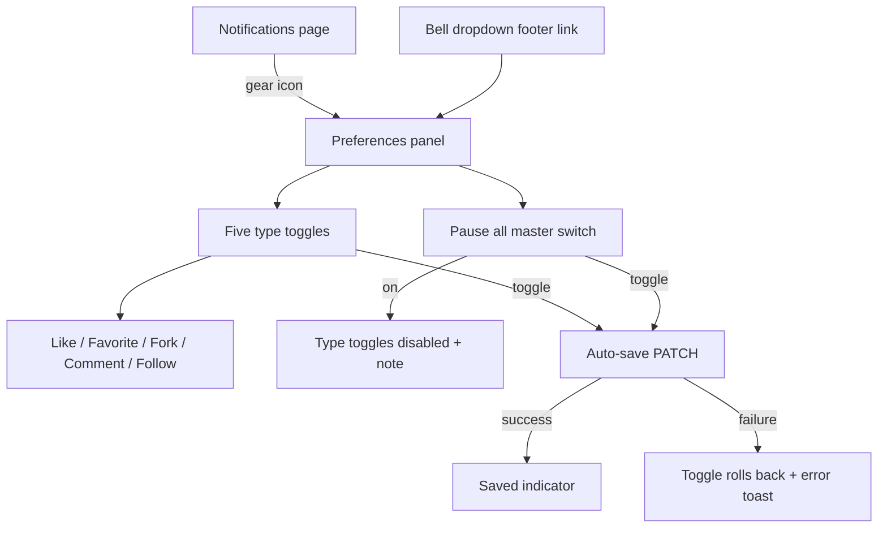
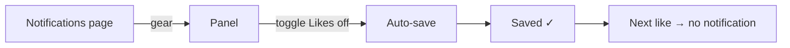
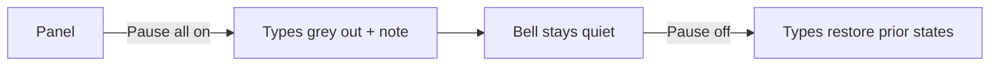

# Notification Preferences — UI/UX Design

- **Feature ID:** notification-preferences
- **Version:** 1.0
- **Status:** Proposed (for architecture review)
- **Author:** ui-ux-agent
- **Date:** 2026-10-12
- **Companion doc:** `notification-preferences-requirements.md`

## 1. Design Principles

1. **Control lives where the noise lives.** The gear sits on the notifications page, not buried in global settings.
2. **Immediate and honest.** Auto-save per toggle with a visible "Saved" tick; the panel always reflects the true effective state (including pause).
3. **Plain language.** Each toggle carries a one-line description of what the type covers — no jargon, no event-type codes.
4. **Default-zero surface.** Users who never open the panel see nothing new anywhere.

## 2. Information Architecture



| Surface | Location | Audience | Purpose |
|---|---|---|---|
| Preferences panel | Notifications page (gear) / bell dropdown link | All users | Per-type opt-out + pause all |
| Saved indicator | Inside panel | All users | Confirm auto-save |
| Paused note | Inside panel (when paused) | All users | Explain disabled toggles |

## 3. User Flows

### 3.1 Quiet the like noise



### 3.2 Pause everything



## 4. Page Layouts

### 4.1 Preferences panel (desktop)

```
+--------------------------------------------------+
|  Notification preferences                    [×] |
+--------------------------------------------------+
|  ⏸ Pause all notifications              [ ●/○ ]  |
|  Stop all notifications of every type.           |
+--------------------------------------------------+
|  Likes                                   [ ●/○ ]  |
|  Someone likes your template.                    |
+--------------------------------------------------+
|  Favorites                               [ ●/○ ]  |
|  Someone favorites your template.                |
+--------------------------------------------------+
|  Forks                                   [ ●/○ ]  |
|  Someone forks your template.                    |
+--------------------------------------------------+
|  Comments                                [ ●/○ ]  |
|  Someone comments on your template.              |
+--------------------------------------------------+
|  Follows                                 [ ●/○ ]  |
|  Someone follows you.                            |
+--------------------------------------------------+
|  ⓘ Changes save automatically.                   |
+--------------------------------------------------+
```

### 4.2 Paused state

```
+--------------------------------------------------+
|  ⏸ Pause all notifications              [ ●● ]  |
+--------------------------------------------------+
|  Likes                            (greyed) [ ○ ]  |
|  Favorites                        (greyed) [ ○ ]  |
|  ...                                             |
|  ⓘ Paused all is on — turn it off to adjust      |
|    individual types.                             |
+--------------------------------------------------+
```

### 4.3 Entry points

```
Notifications page header:
+--------------------------------------------------+
|  Notifications                        [ ⚙ ]      |
+--------------------------------------------------+

Bell dropdown footer:
+---------------------------+
|  ...                      |
|  [ Mark all read ]        |
|  Notification preferences |
+---------------------------+
```

### 4.4 Mobile

The panel becomes a full-screen sheet (existing mobile modal pattern); toggles are full-width rows (label + description stacked, switch right-aligned); the gear icon remains in the page header.

## 5. Component Specs

| Component | Behavior | States |
|---|---|---|
| PreferencesPanel | Modal/inline section with master switch + 5 type rows | Default / paused |
| TypeToggleRow | Label + description + switch; auto-saves on change | On / off / disabled (paused) / saving / error (rolled back) |
| PauseAllSwitch | Master switch; disabling greys type rows with note | On / off |
| SavedIndicator | Transient "Saved ✓" near the toggled row (1.5 s) | Visible / hidden |
| GearIconButton | Header icon button opening the panel | Default |

## 6. Interaction Details

1. **Auto-save:** each toggle fires a PATCH immediately; the switch animates optimistically, then either confirms (Saved ✓) or rolls back with an error toast.
2. **Pause precedence:** while paused, type toggles are visually disabled and non-interactive; the note explains why; switching pause off restores each type's persisted state.
3. **Saved indicator:** appears adjacent to the changed row for 1.5 s; screen readers announce it politely (`aria-live="polite"`).
4. **Panel dismissal:** × or Esc closes; no unsaved-changes prompt (everything already saved).
5. **Bell dropdown link:** opens the same panel (single source of truth for the UI).
6. **Type labels:** reuse the notifications feature's event-type display labels so the panel and history page speak the same language.
7. **Empty history + preferences:** the panel works identically regardless of history state; no coupling.
8. **First open:** GET preferences on open; absent row renders all-on defaults (no flicker).

## 7. States Summary

| Surface | Loading | Empty | Error |
|---|---|---|---|
| Preferences panel | Skeleton rows on open | — (always 5 rows) | Error banner + retry |
| Type toggle | Saving spinner on switch | — | Rollback + error toast |
| Pause switch | Saving spinner | — | Rollback + error toast |

## 8. i18n

| Key (EN) | ZH |
|---|---|
| notifPrefs.title / Notification preferences | 通知偏好 |
| notifPrefs.pauseAll / Pause all notifications | 暂停所有通知 |
| notifPrefs.pauseAllDesc / Stop all notifications of every type. | 停止所有类型的通知。 |
| notifPrefs.type.like / Likes | 点赞 |
| notifPrefs.type.like.desc / Someone likes your template. | 有人点赞了你的模板。 |
| notifPrefs.type.favorite / Favorites | 收藏 |
| notifPrefs.type.favorite.desc / Someone favorites your template. | 有人收藏了你的模板。 |
| notifPrefs.type.fork / Forks | Fork |
| notifPrefs.type.fork.desc / Someone forks your template. | 有人 fork 了你的模板。 |
| notifPrefs.type.comment / Comments | 评论 |
| notifPrefs.type.comment.desc / Someone comments on your template. | 有人评论了你的模板。 |
| notifPrefs.type.follow / Follows | 关注 |
| notifPrefs.type.follow.desc / Someone follows you. | 有人关注了你。 |
| notifPrefs.pausedNote / Paused all is on — turn it off to adjust individual types. | 暂停全部已开启 —— 关闭后可调整单个类型。 |
| notifPrefs.autoSave / Changes save automatically. | 更改自动保存。 |
| notifPrefs.saved / Saved | 已保存 |
| notifPrefs.error / Couldn't save. Try again. | 保存失败。请重试。 |
| notifPrefs.open / Notification preferences | 通知偏好 |

## 9. Accessibility

- Switches use `role="switch"` with `aria-checked`; each row is a labeled group (`aria-labelledby`).
- The panel is an accessible modal (focus trap, Esc close, initial focus on the master switch) or an inline section with a heading.
- The Saved indicator and error toast use polite/assertive live regions respectively.
- Disabled toggles carry `aria-disabled` and the explanatory note is associated with the group.
- Full keyboard operability: Tab moves row to row; Space toggles; the gear is a standard icon button with an accessible label.

## 10. Analytics (optional)

- `notif_prefs_opened`, `notif_prefs_toggled` (type, state), `notif_prefs_paused` (state) — product usage only.

## 11. Out of Scope

- Email/push channels, per-source granularity, digests, per-item muting, admin visibility.
- Monetization of any kind — permanently out of scope for this product.
