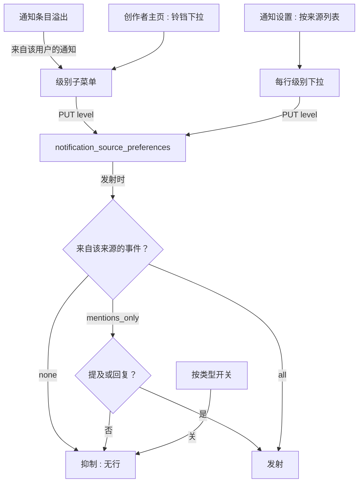
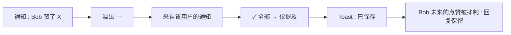
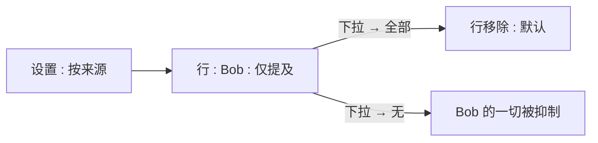

# 通知来源偏好 — UI/UX 设计

- **功能 ID：** notification-source-preferences
- **版本：** 1.0
- **状态：** Proposed（待架构评审）
- **作者：** ui-ux-agent
- **日期：** 2026-10-13
- **配套文档：** `notification-source-preferences-requirements-zh-CN.md`

## 1. 设计原则

1. **噪音在哪里，静音就在哪里。** 主入口是通知条目的溢出菜单 —— 距离滋扰事件一步之遥。
2. **三个诚实的档位。** 全部 / 仅提及 / 无 —— 没有不透明的"个性化"。
3. **最严者胜，且可见。** 与按类型开关的组合规则在设置面板中明示。
4. **对来源静默。** 关于静音的任何信息绝不对被静音创作者可见。

## 2. 信息架构



| 界面 | 位置 | 受众 | 目的 |
|---|---|---|---|
| 通知溢出子菜单 | 通知条目 | 接收者 | 快速静音 |
| 主页铃铛下拉 | 创作者主页 | 接收者 | 预先控制 |
| 按来源列表 | 通知设置 | 接收者 | 审阅 + 编辑全部 |
| 级别下拉 | 列表行 | 接收者 | 更改级别 |

## 3. 用户流程

### 3.1 从通知静音



### 3.2 在设置中审阅



## 4. 页面布局

### 4.1 通知条目溢出

```
+--------------------------------------+
|  ⋯（通知条目上）                       |
|  ──────────────────────────────────── |
|  标记为已读                            |
|  删除                                  |
|  ──────────────────────────────────── |
|  来自 Bob 的通知                       |
|   ✓ 全部                               |
|    ○ 仅提及                            |
|    ○ 无                                |
+--------------------------------------+
```

### 4.2 主页铃铛下拉

```
+--------------------------------------+
|  🔔（创作者主页头部）                   |
|  ──────────────────────────────────── |
|  来自 Alice 的通知                     |
|   ✓ 全部                               |
|    ○ 仅提及                            |
|    ○ 无                                |
+--------------------------------------+
```

### 4.3 设置 — 按来源列表

```
+----------------------------------------------------------------------+
|  通知偏好                                                              |
|  [按类型开关 …]                                                       |
|  ─────────────────────────────────────────────────────────────────── |
|  按来源偏好                                                            |
|  按来源级别仅覆盖该创作者的类型设置。两者中更严格的一方始终胜出。           |
+----------------------------------------------------------------------+
|  创作者                     级别                 更新时间              |
|  🧑 Bob                    [仅提及 ▾]            10月13日             |
|  🧑 Carol                  [无 ▾]                10月10日             |
|                                              [加载更多]                |
+----------------------------------------------------------------------+
```

空态："你尚未自定义任何人的通知。请使用通知的 ⋯ 菜单或主页上的铃铛。"

### 4.4 移动端

溢出子菜单与铃铛下拉变为带单选行的底部抽屉。按来源列表变为单列行（头像 + 名称、级别下拉、更新时间堆叠）。

## 5. 组件规格

| 组件 | 行为 | 状态 |
|---|---|---|
| SourceLevelSubmenu | 三个单选行，当前项勾选；选择即自动保存 | all / mentions_only / none / 保存中 |
| ProfileBellDropdown | 主页头部同样三档；勾选显示当前 | 默认 / 打开 / 保存中 |
| PerSourceList | 行：头像、名称、级别下拉、更新时间；分页 50/页 | 加载中 / 空态 / 已加载 / 错误 |
| LevelDropdown | 内联选择：全部 / 仅提及 / 无；"全部"移除该行 | 空闲 / 保存中 / 错误 |
| SavedToast | 简短"已保存"确认 | 显示 2 秒 |

## 6. 交互细节

1. **溢出子菜单：** 出现在"来自 {name} 的通知"下，含三档；选择立即保存（自动保存、无确认）并显示 toast；菜单关闭。
2. **主页铃铛：** 渲染于任何创作者主页（自己的除外）；打开下拉；当前级别勾选；选择行为一致。
3. **列表中改级别：** 内联下拉；选"全部"乐观移除该行（服务端删除）；选其他更新该行级别与时间戳。
4. **组合说明：** 按来源区头部带一句话规则（"两者中更严格的一方始终胜出"），使行为可预测。
5. **不追溯：** 静音绝不触碰历史 —— 变更仅影响未来发射；不提供"清除其通知"入口（数据丢失风险）。
6. **自我防护：** 自己的主页绝不渲染铃铛；API 拒绝对自己的 PUT（400）。
7. **被屏蔽用户：** 来源被屏蔽时铃铛下拉仍渲染，但说明文字指出屏蔽已抑制一切（级别无意义）。
8. **限额错误：** 创建第 501 行显示友好的行内错误并建议清理列表。

## 7. 状态汇总

| 界面 | 加载中 | 空态 | 错误 |
|---|---|---|---|
| SourceLevelSubmenu | — | — | Toast，菜单保留 |
| ProfileBellDropdown | — | — | Toast，保持打开 |
| PerSourceList | 行骨架 | 解释性空态 | 重试 |
| LevelDropdown | — | — | 行内错误，回退 |

## 8. 国际化（i18n）

| Key | 中文 | 英文 |
|---|---|---|
| `srcpref.overflow.title` | 来自 {{name}} 的通知 | Notifications from {{name}} |
| `srcpref.level.all` | 全部 | All |
| `srcpref.level.mentions_only` | 仅提及 | Mentions only |
| `srcpref.level.none` | 无 | None |
| `srcpref.bell.title` | 来自 {{name}} 的通知 | Notifications from {{name}} |
| `srcpref.list.title` | 按来源偏好 | Per-source preferences |
| `srcpref.list.caption` | 按来源级别仅覆盖该创作者的类型设置。两者中更严格的一方始终胜出。 | A per-source level overrides your type settings for that creator only. The stricter of the two always wins. |
| `srcpref.list.empty` | 你尚未自定义任何人的通知。请使用通知的 ⋯ 菜单或主页上的铃铛。 | You haven't customized notifications from anyone. Use the ⋯ menu on a notification or the bell on a profile. |
| `srcpref.list.updated` | 更新于 {{time}} | Updated {{time}} |
| `srcpref.list.loadMore` | 加载更多 | Load more |
| `srcpref.toast.saved` | 已保存 | Saved |
| `srcpref.toast.error` | 保存失败。请重试。 | Couldn't save. Try again. |
| `srcpref.blockedNote` | 你已屏蔽该用户 —— 其通知已被抑制。 | You've blocked this user — their notifications are already suppressed. |
| `srcpref.limit` | 你最多可设置 500 条按来源偏好。请先移除一些。 | You can set at most 500 per-source preferences. Remove some first. |
| `srcpref.levelHint.mentions_only` | 提及与回复仍会到达 | Mentions and replies still arrive |
| `srcpref.levelHint.none` | 不接收该创作者的任何通知 | Nothing from this creator |

## 9. 无障碍

- 溢出子菜单与铃铛下拉是标准菜单：`aria-haspopup`、漫游焦点、Esc 关闭、焦点返回触发器。
- 级别是带 `role=menuitemradio` 与 `aria-checked` 的单选组；当前级别以勾选加文字传达，绝不仅靠颜色。
- 按来源列表是语义表格/列表；级别下拉是带描述性名称的带标签 select（"来自 Bob 的通知 —— 级别"）。
- 自动保存结果通过 polite live region 播报（"已保存"）；错误播报并保持焦点。
- 组合说明通过 `aria-describedby` 绑定到区域，屏幕阅读器能听到规则。

## 10. 数据埋点（可选）

- `srcpref_level_set`（级别、入口：溢出/主页/列表）、`srcpref_level_reverted` —— 仅产品使用事件。

## 11. 不在范围内

- 按模板粒度；自定义级别；限时静音；关键词过滤；批量静音；向来源透露静音状态。
- 任何形式的变现 —— 本产品永久不做。
