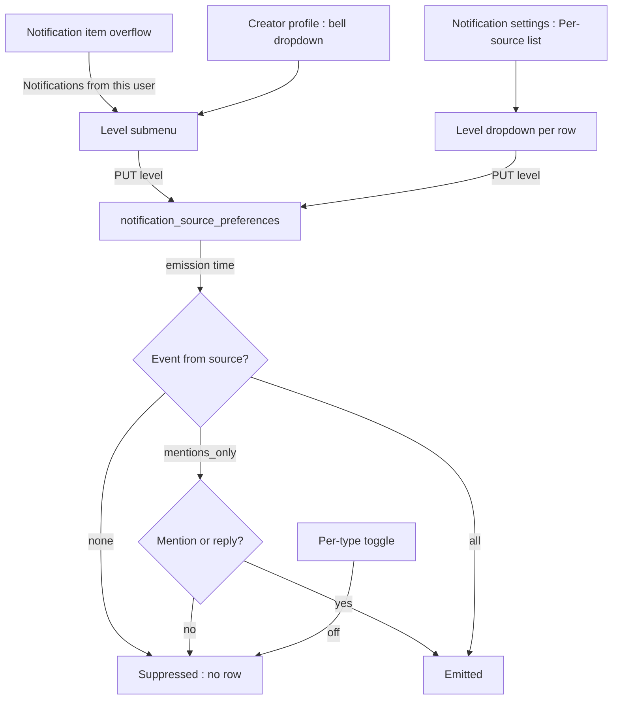
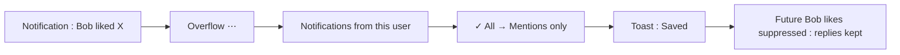
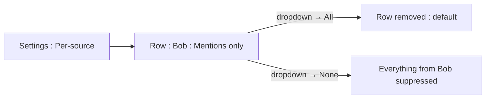

# Notification Source Preferences — UI/UX Design

- **Feature ID:** notification-source-preferences
- **Version:** 1.0
- **Status:** Proposed (for architecture review)
- **Author:** ui-ux-agent
- **Date:** 2026-10-13
- **Companion doc:** `notification-source-preferences-requirements.md`

## 1. Design Principles

1. **Mute where the noise is.** The primary entry point is the notification item's overflow — one click from the offending event.
2. **Three honest levels.** All / mentions only / none — no opaque "personalized".
3. **Most restrictive wins, visibly.** The composition rule with per-type toggles is stated in the settings panel.
4. **Silent for the source.** Nothing about a mute is ever visible to the muted creator.

## 2. Information Architecture



| Surface | Location | Audience | Purpose |
|---|---|---|---|
| Notification overflow submenu | Notification item | Recipient | Quick mute |
| Profile bell dropdown | Creator profile | Recipient | Pre-emptive control |
| Per-source list | Notification settings | Recipient | Review + edit all |
| Level dropdown | List rows | Recipient | Change level |

## 3. User Flows

### 3.1 Mute from a notification



### 3.2 Review in settings



## 4. Page Layouts

### 4.1 Notification item overflow

```
+--------------------------------------+
|  ⋯ (on notification item)             |
|  ──────────────────────────────────── |
|  Mark as read                         |
|  Delete                               |
|  ──────────────────────────────────── |
|  Notifications from Bob               |
|   ✓ All                               |
|    ○ Mentions only                    |
|    ○ None                             |
+--------------------------------------+
```

### 4.2 Profile bell dropdown

```
+--------------------------------------+
|  🔔 (on creator profile header)       |
|  ──────────────────────────────────── |
|  Notifications from Alice             |
|   ✓ All                               |
|    ○ Mentions only                    |
|    ○ None                             |
+--------------------------------------+
```

### 4.3 Settings — per-source list

```
+----------------------------------------------------------------------+
|  Notification preferences                                             |
|  [Per-type toggles …]                                                |
|  ─────────────────────────────────────────────────────────────────── |
|  Per-source preferences                                               |
|  A per-source level overrides your type settings for that creator     |
|  only. The stricter of the two always wins.                           |
+----------------------------------------------------------------------+
|  Creator                    Level                Updated              |
|  🧑 Bob                     [Mentions only ▾]    Oct 13               |
|  🧑 Carol                   [None ▾]             Oct 10               |
|                                              [Load more]              |
+----------------------------------------------------------------------+
```

Empty state: "You haven't customized notifications from anyone. Use the ⋯ menu on a notification or the bell on a profile."

### 4.4 Mobile

The overflow submenu and bell dropdown become bottom sheets with radio rows. The per-source list becomes single-column rows (avatar + name, level dropdown, updated time stacked).

## 5. Component Specs

| Component | Behavior | States |
|---|---|---|
| SourceLevelSubmenu | Three radio rows with checkmark on current; auto-save on select | all / mentions_only / none / saving |
| ProfileBellDropdown | Same three levels on the profile header; shows current with checkmark | default / open / saving |
| PerSourceList | Rows: avatar, name, level dropdown, updated; paginated 50/page | loading / empty / loaded / error |
| LevelDropdown | Inline select: All / Mentions only / None; "All" removes the row | idle / saving / error |
| SavedToast | Brief "Saved" confirmation | shown 2 s |

## 6. Interaction Details

1. **Overflow submenu:** appears under "Notifications from {name}" with the three levels; selecting saves immediately (auto-save, no confirm) and shows the toast; the menu closes.
2. **Profile bell:** rendered on any creator profile (not one's own); opens the dropdown; current level checkmarked; selection behaves identically.
3. **Level change in list:** dropdown inline; choosing "All" optimistically removes the row (server deletes it); choosing others updates the row's level and timestamp.
4. **Composition caption:** the per-source section header carries the one-sentence rule ("The stricter of the two always wins") so behavior is predictable.
5. **No retroactivity:** muting never touches history — the change affects future emissions only; no "clear their notifications" affordance is offered (data loss risk).
6. **Self-guard:** the bell never renders on one's own profile; the API rejects self-PUT (400).
7. **Blocked users:** if a source is blocked, the bell dropdown still renders but a caption notes the block already suppresses everything (level is moot).
8. **Limit errors:** creating the 501st row shows a friendly inline error suggesting cleanup of the list.

## 7. States Summary

| Surface | Loading | Empty | Error |
|---|---|---|---|
| SourceLevelSubmenu | — | — | Toast, menu stays |
| ProfileBellDropdown | — | — | Toast, keep open |
| PerSourceList | Row skeletons | Explainer empty state | Retry |
| LevelDropdown | — | — | Inline error, revert |

## 8. i18n

| Key | EN | ZH |
|---|---|---|
| `srcpref.overflow.title` | Notifications from {{name}} | 来自 {{name}} 的通知 |
| `srcpref.level.all` | All | 全部 |
| `srcpref.level.mentions_only` | Mentions only | 仅提及 |
| `srcpref.level.none` | None | 无 |
| `srcpref.bell.title` | Notifications from {{name}} | 来自 {{name}} 的通知 |
| `srcpref.list.title` | Per-source preferences | 按来源偏好 |
| `srcpref.list.caption` | A per-source level overrides your type settings for that creator only. The stricter of the two always wins. | 按来源级别仅覆盖该创作者的类型设置。两者中更严格的一方始终胜出。 |
| `srcpref.list.empty` | You haven't customized notifications from anyone. Use the ⋯ menu on a notification or the bell on a profile. | 你尚未自定义任何人的通知。请使用通知的 ⋯ 菜单或主页上的铃铛。 |
| `srcpref.list.updated` | Updated {{time}} | 更新于 {{time}} |
| `srcpref.list.loadMore` | Load more | 加载更多 |
| `srcpref.toast.saved` | Saved | 已保存 |
| `srcpref.toast.error` | Couldn't save. Try again. | 保存失败。请重试。 |
| `srcpref.blockedNote` | You've blocked this user — their notifications are already suppressed. | 你已屏蔽该用户 —— 其通知已被抑制。 |
| `srcpref.limit` | You can set at most 500 per-source preferences. Remove some first. | 你最多可设置 500 条按来源偏好。请先移除一些。 |
| `srcpref.levelHint.mentions_only` | Mentions and replies still arrive | 提及与回复仍会到达 |
| `srcpref.levelHint.none` | Nothing from this creator | 不接收该创作者的任何通知 |

## 9. Accessibility

- The overflow submenu and bell dropdown are standard menus: `aria-haspopup`, roving focus, Esc to close, focus return to the trigger.
- Levels are radio groups with `role=menuitemradio` and `aria-checked`; the current level is conveyed by the checkmark plus text, never color alone.
- The per-source list is a semantic table/list; level dropdowns are labelled selects with descriptive names ("Notifications from Bob — level").
- Auto-save results are announced via a polite live region ("Saved"); errors announce and keep focus.
- The composition caption is tied to the section via `aria-describedby` so screen readers hear the rule.

## 10. Analytics (optional)

- `srcpref_level_set` (level, entry point: overflow/profile/list), `srcpref_level_reverted` — product usage events only.

## 11. Out of Scope

- Per-template granularity; custom levels; time-boxed mutes; keyword filters; bulk mute; revealing mute status to sources.
- Monetization of any kind — permanently out of scope for this product.
