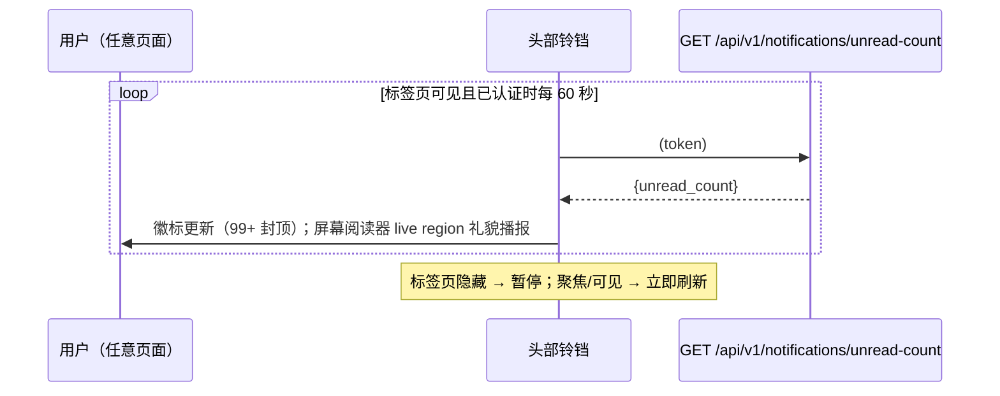

# 通知 — UI/UX 设计

- **功能标识:** notifications
- **版本:** 1.0
- **状态:** 已提案（待架构评审）
- **作者:** ui-ux-agent
- **日期:** 2026-10-10
- **配套文档:** `notifications-requirements-zh-CN.md`

## 1. 设计原则

1. **无意义时保持安静。** 在存在参与之前，铃铛是安静的界面元素：未读为零 = 无徽标、无颜色、无动效。绝不通知用户自己的操作。
2. **就地分诊，深度管理。** 下拉一次点击即可回答"有什么新的？"而无需离开当前页面；筛选、标记与删除在历史页完成。
3. **Aurora 原生。** 复用头部图标按钮模式、个人资料下拉的打开/关闭模式、既有 Modal、Spinner、徽标、toast（NotificationContext）、设计令牌与明暗主题。不引入新的视觉语言。
4. **轮询而非推送。** 60 秒轮询 + 可见性暂停 + 退避 —— 无新基础设施，界面不跳动。
5. **文案是数据而非标记。** 通知语句由客户端基于类型化字段（类型、操作者、标题）组装，因此可干净地翻译，且绝不可能注入 HTML。

## 2. 信息架构

```mermaid
flowchart LR
    A[头部] --> B[铃铛图标 + 未读徽标]
    B -->|点击| C[下拉：最近 10 条]
    C -->|条目点击| D[/templates/:id]
    C -->|查看全部| E[/notifications]
    C -->|全部已读| F[POST read-all]
    E --> G[筛选：全部 / 未读]
    E --> H[行操作：标为已读 / 删除]
    E -->|行点击| D
    E -->|全部已读| F
    E -->|加载更多| E
```

**界面：**

| 界面 | 访问 | 内容 |
|---|---|---|
| 头部铃铛 + 徽标 | 仅认证 | 未读计数（轮询） |
| 铃铛下拉 | 仅认证 | 最近 10 条通知、全部已读、查看全部 |
| `/notifications` | 需认证（重定向 /login） | 完整历史：筛选、分页、标为已读、删除 |

无管理员控制台界面（需求 FR-29/30：按用户的功能，无需审核）。

## 3. 用户流程

### 3.1 被动发现（轮询）



### 3.2 通过下拉分诊

```mermaid
flowchart TD
    A[点击铃铛] --> B[下拉打开，获取最近 10 条]
    B --> C{用户操作}
    C -- 点击条目 --> D[乐观标为已读] --> E[关闭下拉] --> F[/templates/:id]
    C -- 全部已读 --> G[POST read-all] --> H[徽标 → 0，列表重绘为已读]
    C -- 查看全部 --> E2[关闭下拉] --> I[/notifications]
    C -- 外部点击 / Esc / 路由变化 --> E2
```

### 3.3 管理历史

```mermaid
flowchart TD
    A[/notifications] --> B[筛选标签：全部 · 未读]
    B --> C{行操作}
    C -- 行点击 --> D[标为已读 + 导航到模板]
    C -- 标为已读按钮 --> E[乐观已读；徽标递减]
    C -- 删除按钮 --> F[确认弹窗] --> G[DELETE；行动画移出]
    H[全部已读按钮] --> I[POST read-all；徽标 → 0]
    J[加载更多按钮] --> K[通过 page_token 追加下 20 条]
```

## 4. 页面布局

### 4.1 头部铃铛（所有页面，已认证）

```text
┌──────────────────────────────────────────────────────────────────────┐
│ [☰] [logo Open Prompts] [Prompt Square]      [🌙] [文A] [🔔³] [👤 ▾] │
└──────────────────────────────────────────────────────────────────────┘
                                                    ↑ icon-btn，徽标 ③
```

- 铃铛位于语言切换与个人资料按钮之间，使用既有 `.icon-btn.header-icon-btn` 样式。
- 徽标：最小 16px 圆形，位于图标右下角，`--danger` 背景、白色 10px 文字；超过 99 显示"99+"；为 0 时隐藏。

### 4.2 铃铛下拉

```text
┌──────────────────────────────────────────────┐
│ 通知                              全部已读    │
├──────────────────────────────────────────────┤
│ ● ❤ Alice 赞了你的模板                       │
│     "Email writer" · 2小时前                  │
├──────────────────────────────────────────────┤
│ ● ★ Bob 收藏了你的模板                       │
│     "SQL helper" · 5小时前                    │
├──────────────────────────────────────────────┤
│   ⎇ Carol fork 了你的模板                    │
│     "Code review" · 1天前                     │
├──────────────────────────────────────────────┤
│ ❤ Dave 赞了你的模板                          │
│     "Logo brief" · 3天前                      │
├──────────────────────────────────────────────┤
│                     查看全部 →                │
└──────────────────────────────────────────────┘
```

- 宽 360px（视口 < 480px 时 280px），最大高 480px，内部滚动。
- 左侧 `●` 未读圆点；未读行有 `--surface-3` 底色。
- 加载中：3 行骨架屏。错误：内联消息 + 重试。空： "还没有通知" + 简短提示。

### 4.3 历史页（`/notifications`）

```text
┌──────────────────────────────────────────────────────────────────────┐
│ Header（既有，含铃铛）                                                │
├────────────┬─────────────────────────────────────────────────────────┤
│ Sidebar    │  通知                                                     │
│ (既有)     │  ┌──────────────┬──────────────────┐ ┌────────────────┐ │
│            │  │ 全部 (24)    │ 未读 (3)          │ │  全部已读       │ │
│            │  └──────────────┴──────────────────┘ └────────────────┘ │
│            │  ┌────────────────────────────────────────────────────┐ │
│            │  │ ● ❤ Alice 赞了你的模板 "Email writer"               │ │
│            │  │    2小时前                          [标为已读][删除] │ │
│            │  ├────────────────────────────────────────────────────┤ │
│            │  │   ★ Bob 收藏了你的模板 "SQL helper"                 │ │
│            │  │    5小时前                                  [删除]   │ │
│            │  ├────────────────────────────────────────────────────┤ │
│            │  │   ⎇ Carol fork 了你的模板 "Code review"             │ │
│            │  │    1天前                                    [删除]   │ │
│            │  └────────────────────────────────────────────────────┘ │
│            │  [ 加载更多 ]                                             │
└────────────┴─────────────────────────────────────────────────────────┘
```

- 行与仪表盘管理行是同一视觉模式：`--surface-2` 卡片、`--border` 分隔线、hover `--surface-3`。
- 筛选标签与仪表盘 DashboardNav 样式一致（文字 + 激活时 2px `--accent` 下划线），括号内为实时计数。

## 5. 组件规格

### 5.1 NotificationBell（头部）

| 方面 | 规格 |
|---|---|
| 位置 | 头部右侧组合，位于语言切换与个人资料之间；仅在已认证时渲染 |
| 触发器 | `.icon-btn.header-icon-btn` + `BellIcon`（新图标，19px，描边 `currentColor`） |
| 徽标 | 绝对定位，右下角；最小宽 16px、高 16px，`--radius-pill`，`--danger` 背景，`#fff` 10px/600 文字，1px `--surface-1` 描边保证对比度；内容上限"99+"；为 0 时 `display:none` |
| 数据 | 来自 `notificationsSlice` 的 `unreadCount`；按 FR-10 轮询 |
| 无障碍 | `aria-label` = "通知，{{n}} 条未读"（为 0 时"通知"）；`aria-haspopup="true" aria-expanded` 切换；徽标计数同时推送到 polite live region |

### 5.2 NotificationDropdown

| 方面 | 规格 |
|---|---|
| 开/关 | 与个人资料下拉相同模式：点击切换；外部 `mousedown`、Escape 与路由变化关闭；打开时焦点移入下拉，关闭时返回铃铛 |
| 头部行 | 标题"通知"（`--text-1` 14px/600）+ "全部已读"文字按钮（`--accent`，未读为 0 时隐藏） |
| 列表 | 最近 10 条（已读/未读混合），打开时获取；每行：未读圆点（6px `--accent`）、事件图标、句子、带引号的模板标题、相对时间（`--text-3` 12px） |
| 行点击 | 乐观标为已读 → 关闭 → 导航 `/templates/:id` |
| 底部 | "查看全部"整宽文字按钮 → `/notifications` |
| 样式 | `--surface-2`、`--border`、`--radius-12`、`--shadow-lg`；宽 360px（视口 < 480px 时 280px）；行高 56–72px，`--border` 分隔 |
| 状态 | 加载中：3 行骨架屏（既有骨架模式）；错误：消息 + 重试；空：图标 + "还没有通知" + 提示文字 |

### 5.3 NotificationRow（历史页）

| 方面 | 规格 |
|---|---|
| 内容 | 未读圆点 · 事件图标 · 句子（"{{actor}} 赞了你的模板\"{{title}}\""）· 相对时间（`title` 中有绝对时间）· 操作 |
| 事件图标 | like → `HeartIcon` `--danger`；favorite → `StarIcon` `--warning`；fork → `ForkIcon` `--secondary`；16px，`aria-hidden` |
| 操作 | "标为已读"（图标+文字，仅未读行）与"删除"（`TrashIcon`，hover `--danger`） |
| 行点击 | 与下拉行相同：标为已读 + 导航到模板 |
| 删除 | 确认弹窗（既有 Modal，回显句子）→ DELETE → 行动画移出；若被删行未读，徽标递减 |
| 样式 | 未读行：`--surface-3` 底色 + 圆点；已读行：`--surface-2`、`--text-2`；hover `--surface-3` |

### 5.4 FilterTabs（全部 / 未读）

| 方面 | 规格 |
|---|---|
| 内容 | "全部（{{n}}）" · "未读（{{n}}）" —— 计数来自最近一次列表响应 |
| 行为 | 切换会重置分页并重新获取；激活标签 `--text-1` + 2px `--accent` 下划线 |
| 无障碍 | `<nav aria-label="通知筛选">`；标签是带 `aria-current` 的链接 |

### 5.5 MarkAllRead 按钮

| 方面 | 规格 |
|---|---|
| 位置 | 历史页头部行（`.btn-ghost btn-sm`）与下拉头部（文字按钮） |
| 行为 | POST read-all → 徽标乐观置 0、行重绘为已读；请求进行中禁用；未读为 0 时隐藏/禁用 |
| 反馈 | 成功 toast（既有 NotificationContext）："全部通知已标为已读" |

## 6. 交互细节

1. **轮询生命周期:** 登录/恢复会话时启动，60 秒间隔；`document.visibilitychange`/`focus` → 恢复可见时立即刷新；隐藏标签页暂停；失败退避 60→120→300 秒，成功后重置；登出停止计时并清零状态。所有时间常量集中在一个模块（`POLL_INTERVAL_MS` 等）。
2. **乐观已读:** 标为已读/全部已读立即更新 `notificationsSlice.unreadCount` 与行；服务端出错则回滚并显示错误 toast。
3. **下拉获取:** 打开时 `GET /notifications?page_size=10`（filter=all）；响应中的 `unread_count` 与徽标对账（唯一事实来源：slice）。
4. **历史分页:** "加载更多"通过 `next_page_token` 追加；token 不存在时隐藏；切换筛选重置列表。
5. **从行导航:** 行是指向 `/templates/:id` 的链接；若模板在事件与点击之间被删除（404），由既有模板详情错误状态处理 —— 无需特例。
6. **相对时间:** 共享工具（仪表盘 D-4/D-6）：<60 秒"刚刚"、<60 分"X 分钟前"、<24 小时"X 小时前"、<7 天"X 天前"、否则本地化日期；`title` 中有绝对时间戳。
7. **句子组装:** `t('notifications.event.like', {actor, title})` 等 —— 操作者名与标题是插值值，绝不翻译；由 React 转义（NFR-9）。
8. **toast 与通知:** toast（既有 `NotificationContext`）继续用于操作结果（"已标为已读"）；铃铛/下拉/历史是新的持久渠道。视觉上无重叠：toast 仍是右上角瞬态，通知是徽标 + 界面。

## 7. 状态汇总

| 状态 | 触发 | UI |
|---|---|---|
| 徽标 = 0 | 无未读 | 无徽标的铃铛 |
| 徽标 > 0 | 存在未读 | 铃铛 + 计数徽标（99+ 封顶） |
| 下拉加载中 | 打开 | 3 行骨架屏 |
| 下拉为空 | 完全没有通知 | 图标 + "还没有通知" + 提示 |
| 下拉错误 | 获取失败 | 消息 + 重试（徽标保留最后值） |
| 页面加载中 | 路由挂载 | 骨架行（6 行） |
| 页面为空（全部） | 零通知 | 空状态 + 提示（列出参与动作） |
| 页面为空（未读） | 全部已读 | "你已全部看完。" |
| 页面错误 | 获取失败 | 错误横幅 + 重试 |
| 匿名 | 无 token | 无铃铛；`/notifications` → /login |
| 确认弹窗打开 | 删除 | 既有 Modal 模式 |
| 离线/降级 | 轮询失败 | 徽标冻结在最后值；退避；页面不破坏 |

## 8. 视觉风格（Aurora 合规）

- **铃铛:** 继承 `.icon-btn` hover（`--surface-3`）；徽标 `--danger` 背景 + 白色文字、`--radius-pill`、1px `--surface-1` 描边。
- **下拉:** `--surface-2` + `--border` + `--radius-12` + `--shadow-lg`；行间 `--border` 分隔；未读底色 `--surface-3`。
- **事件图标:** like `--danger`、favorite `--warning`、fork `--secondary` —— 与仪表盘活动流相同的颜色映射，保证跨功能一致性。
- **历史行:** `--surface-2` 卡片、`--border` 分隔线、hover `--surface-3`；未读圆点 6px `--accent`；时间 `--text-3` 12px。
- **筛选标签:** 空闲 `--text-2`，激活 `--text-1` + 2px `--accent` 下划线 —— 与 DashboardNav 完全一致。
- **按钮:** 全部已读 `.btn-ghost btn-sm`；标为已读图标+文字；删除 `TrashIcon` hover `--danger`。
- **明暗主题:** 仅用设计令牌；两个主题自动适配；徽标描边保证两主题下的对比度。

## 9. 国际化考量（中/英）

新命名空间 `notifications.*`（与既有 toast 相关键及 `NotificationContext` 区分）：

```json
{
  "notifications": {
    "bell_aria": "通知，{{count}} 条未读",
    "bell_aria_zero": "通知",
    "title": "通知",
    "mark_all_read": "全部已读",
    "view_all": "查看全部",
    "mark_read": "标为已读",
    "delete": "删除",
    "load_more": "加载更多",
    "filter": { "all": "全部（{{count}}）", "unread": "未读（{{count}}）" },
    "event": {
      "like": "{{actor}} 赞了你的模板\"{{title}}\"",
      "favorite": "{{actor}} 收藏了你的模板\"{{title}}\"",
      "fork": "{{actor}} fork 了你的模板\"{{title}}\""
    },
    "empty": {
      "all": "还没有通知 —— 当有人点赞、收藏或 fork 你的模板时，会显示在这里。",
      "unread": "你已全部看完。",
      "dropdown": "还没有通知"
    },
    "toast": { "marked_read": "通知已标为已读", "all_marked_read": "全部通知已标为已读", "deleted": "通知已删除" },
    "confirm": { "delete": "删除这条通知？此操作不可撤销。" },
    "error": { "fetch": "加载通知失败。", "mark": "标记已读失败。", "delete": "删除通知失败。", "retry": "重试" }
  }
}
```

英文镜像：

```json
{
  "notifications": {
    "bell_aria": "Notifications, {{count}} unread",
    "bell_aria_zero": "Notifications",
    "title": "Notifications",
    "mark_all_read": "Mark all read",
    "view_all": "View all",
    "mark_read": "Mark read",
    "delete": "Delete",
    "load_more": "Load more",
    "filter": { "all": "All ({{count}})", "unread": "Unread ({{count}})" },
    "event": {
      "like": "{{actor}} liked your template \"{{title}}\"",
      "favorite": "{{actor}} favorited your template \"{{title}}\"",
      "fork": "{{actor}} forked your template \"{{title}}\""
    },
    "empty": {
      "all": "No notifications yet — when someone likes, favorites, or forks your templates, you'll see it here.",
      "unread": "You're all caught up.",
      "dropdown": "No notifications yet"
    },
    "toast": { "marked_read": "Notification marked as read", "all_marked_read": "All notifications marked as read", "deleted": "Notification deleted" },
    "confirm": { "delete": "Delete this notification? This cannot be undone." },
    "error": { "fetch": "Failed to load notifications.", "mark": "Failed to mark as read.", "delete": "Failed to delete notification.", "retry": "Retry" }
  }
}
```

说明: 中文筛选计数使用全角括号。"fork" 保留借词"fork"（与既有 UI 一致，如 `template_details.fork_template`）。相对时间字符串来自共享的 `time.*` 工具键。操作者名与模板标题是插值的用户内容，绝不翻译。

## 10. 无障碍

- **铃铛:** 真实 `<button>`，动态 `aria-label`（含未读计数）；`aria-haspopup="true"` + `aria-expanded`；可键盘聚焦且有可见焦点环。
- **Live region:** `aria-live="polite"` 区域在轮询计数增加时播报"N 条未读通知"；减少不播报（控制噪音）。
- **徽标:** 计数是标签内的真实文本 —— 屏幕阅读器随按钮名称一起听到；颜色绝不是唯一信号（圆点 + 底色同样标记未读）。
- **下拉:** 打开时焦点移入、关闭时返回铃铛；列表是链接组成的语义 `<ul>`；Escape 关闭；外部点击关闭；与既有个人资料下拉相同的简单模式（不使用 `role="menu"`）。
- **历史行:** 每行是一个链接（标题包含在可访问名称中）；操作是独立的可聚焦按钮，带 `aria-label`；删除标注为破坏性。
- **筛选标签:** nav 地标 + `aria-current="page"`；计数是文本。
- **对比度:** 徽标白字配 `--danger` 在两个主题中均 ≥ 4.5:1；所有文字满足 AA。

## 11. 给开发者的实现说明

1. **Redux:** 新增 `notificationsSlice`（`unreadCount`、`lastFetchedAt`、`error`）；thunk `fetchUnreadCount`；铃铛、下拉与历史页消费同一选择器（D-8）。
2. **头部:** 在 `Header.js` 的语言切换与个人资料组合之间加入 `NotificationBell`；仅当 `user` 为真时渲染；在 `ui/Icons.jsx` 中新增 `BellIcon`（描边图标，默认 19px）。
3. **轮询 hook:** `useNotificationPolling()` —— interval + visibilitychange + focus 处理 + 指数退避；在 `Layout`（或 Header）中认证检查通过后挂载一次；卸载/登出时清理。
4. **路由:** `/notifications`（懒加载）+ 认证守卫，与仪表盘功能的守卫模式一致。
5. **API 客户端:** 在 `services/api.js` 中新增 `listNotifications({filter, page_size, page_token})`、`getUnreadNotificationCount()`、`markNotificationRead(id)`、`markAllNotificationsRead()`、`deleteNotification(id)`。
6. **下拉:** 将个人资料下拉的外部点击/Escape 关闭逻辑抽取为小型 `useDismissable` hook，两处复用（保持行为一致）。
7. **共享工具:** 相对时间（与仪表盘功能共享）、其他地方已在用的乐观更新助手模式（可见性切换）。
8. **测试:** 轮询 hook（假计时器：间隔、可见性暂停、退避）与 slice reducer 的单元测试；NotificationBell（徽标状态、aria-label）、NotificationDropdown（开/关、条目点击导航、全部已读）、NotificationRow（操作、乐观状态）、FilterTabs 的组件测试；`/notifications` 页面测试（加载/空/错误/认证重定向/分页）；i18n 键一致性测试。
9. **后端:** 新 `notifications` 表 + `NotificationService`（或扩展 PromptService —— 由架构师定夺，需求 §10）+ 5 条 REST 路由；在 `ToggleLikeTemplate`（开启时）、`ToggleFavoriteTemplate`（开启时）与 `ForkTemplate` 中插入事件；为计数建部分索引 `(recipient_id) WHERE read_at IS NULL`；外键级联按 FR-6。
