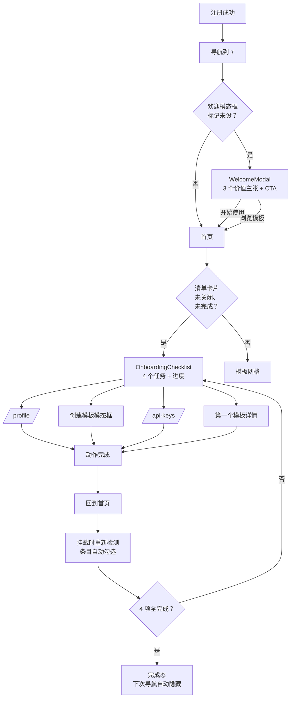
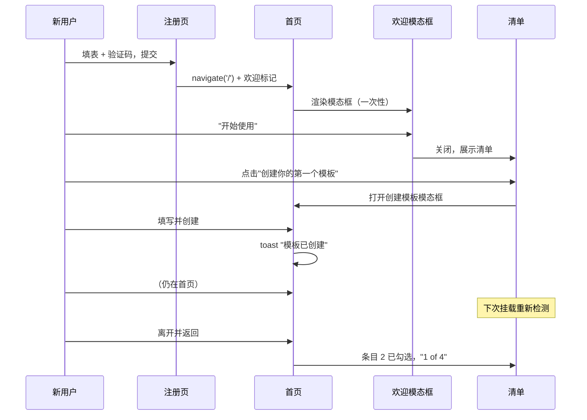
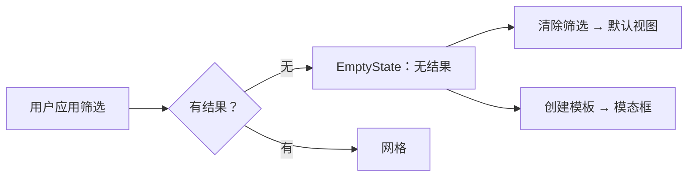

# 新手引导体验 — UI/UX 设计

- **Feature ID:** onboarding
- **Version:** 1.0
- **Status:** Proposed（待架构评审）
- **Author:** ui-ux-agent
- **Date:** 2026-10-10

## 1. 设计原则

1. **绝不阻断。** 引导是环境式的：一键可关的欢迎模态框、可关闭的清单、会教人的空状态。没有向导挡住产品。
2. **每个空屏幕都在教学。** 死胡同变成下一步提示；空状态是新用户看得最多的屏幕。
3. **进度自动化。** 用户从不管理清单；它根据真实数据自行勾选。手动"标记完成"按钮是反模式。
4. **Aurora 原生。** 清单卡片就是一个侧栏 section；欢迎模态框是标准 `Modal`；不引入新视觉语言、不搞插图系统 —— 只用现有图标。
5. **默认无障碍。** 模态框焦点圈定、语义化清单、播报进度 —— 遵循无障碍特性基线。

## 2. 信息架构



## 3. 用户流程

### 3.1 首次运行（注册 → 激活）



### 3.2 空状态恢复（筛选无结果）



## 4. 页面布局

### 4.1 欢迎模态框（注册后）

```text
┌──────────────────────────────────────────────────┐
│  （模态框，size md，遮罩变暗）                     │
│  ┌────────────────────────────────────────────┐  │
│  │        [Logo 标识]                          │  │
│  │   欢迎，{displayName}！             [×]     │  │
│  │   一切就绪，开始构建你的提示词吧。            │  │
│  │                                            │  │
│  │   ┌────────────────────────────────────┐   │  │
│  │   │ 🔍 浏览并使用社区模板              │   │  │
│  │   │    找到好用的提示词并 Fork。        │   │  │
│  │   ├────────────────────────────────────┤   │  │
│  │   │ ✏️ 创建并版本化你的模板            │   │  │
│  │   │    每次保存都会保留版本。           │   │  │
│  │   ├────────────────────────────────────┤   │  │
│  │   │ 🔑 通过 API + SDK 集成            │   │  │
│  │   │    生成密钥，在代码中调用。         │   │  │
│  │   └────────────────────────────────────┘   │  │
│  │                                            │  │
│  │   [ 浏览模板 ]        [ 开始使用 ]          │  │
│  └────────────────────────────────────────────┘  │
└──────────────────────────────────────────────────┘
```

### 4.2 带引导清单的首页（桌面）

```text
┌─────────────────────────────────────────────────────────────┐
│ header                                                      │
├──────────────┬──────────────────────────────────────────────┤
│ sidebar      │ main content                                 │
│ ┌──────────┐ │  ┌────────────────────────────────────────┐  │
│ │探索      │ │  │ 模板网格（不变）                         │  │
│ │模板      │ │  │ ┌─────┐ ┌─────┐ ┌─────┐                │  │
│ │ · 分类   │ │  │ │     │ │     │ │     │                │  │
│ │ · 分类   │ │  │ └─────┘ └─────┘ └─────┘                │  │
│ ├──────────┤ │  │ ┌─────┐ ┌─────┐ ┌─────┐                │  │
│ │我的      │ │  │ │     │ │     │ │     │                │  │
│ │模板      │ │  │ └─────┘ └─────┘ └─────┘                │  │
│ ├──────────┤ │  └────────────────────────────────────────┘  │
│ │新手入门  │ │                                              │
│ │  ×      │ │                                              │
│ │ ▓▓▓░░ 2/4│ │                                             │
│ │ ✓ 资料   │ │                                              │
│ │ ✓ 第一个 │ │                                              │
│ │   模板   │ │                                              │
│ │ ○ API密钥│ │                                              │
│ │ ○ 使用   │ │                                              │
│ │   提示词 │ │                                              │
│ └──────────┘ │                                              │
└──────────────┴──────────────────────────────────────────────┘
```

### 4.3 引导清单卡片（组件细节）

```text
┌────────────────────────────┐
│ 新手入门               [×] │  ← section 标题样式，可关闭
│ ┌────────────────────────┐ │
│ │ ▓▓▓▓▓▓░░░░░░░░  2 / 4  │ │  ← 进度条 + 计数
│ └────────────────────────┘ │
│ ✓ 完善你的资料             │  ← 完成：勾选图标，无链接
│ ✓ 创建你的第一个           │
│   模板                     │
│ ○ → 生成 API 密钥          │  ← 待办：链接，悬停变强调色
│ ○ → 使用一个提示词         │
└────────────────────────────┘
```

### 4.4 完成态

```text
┌────────────────────────────┐
│ 新手入门               [×] │
│      ✓ （成功图标）         │
│      一切就绪！             │
│   你的工作区已准备好。       │
│    [ 浏览模板 ]             │
└────────────────────────────┘
```

### 4.5 空状态

```text
a) 首页无结果：                    b) 我的模板为空：
┌──────────────────────────┐          ┌──────────────────────────┐
│        （🔍 图标）        │          │        （✏️ 图标）       │
│     未找到模板            │          │     还没有模板            │
│   试试其他筛选。           │          │   创建你的第一个模板。     │
│  [ 清除筛选 ]             │          │ [ + 创建模板 ]           │
│  [ + 创建模板 ]           │          └──────────────────────────┘
└──────────────────────────┘

c) API 密钥为空：                   d) 点赞/收藏为空：
┌──────────────────────────┐          ┌──────────────────────────┐
│        （🔑 图标）        │          │        （♥ 图标）         │
│     还没有 API 密钥       │          │     这里还空空如也        │
│  生成密钥，在你的代码中    │          │  你点赞的模板会出现在     │
│  调用 API。               │          │  这里。                   │
│  [ 生成新密钥 ]           │          │  [ 浏览模板 ]             │
└──────────────────────────┘          └──────────────────────────┘
```

## 5. 组件规格

### 5.1 WelcomeModal（新）

| 属性 | 值 |
|---|---|
| 基于 | 现有 `Modal`（size `md`），按无障碍特性加焦点圈定 |
| 触发 | `onboarding.welcome_dismissed` 标记未设 且 从注册页导航而来（查询参数 `?welcome=1` 或会话标记） |
| 头部 | Logo 标识（24px）+ `h3` "欢迎，{displayName}！" |
| 价值行 | 3 行：图标（16px，`--secondary`）+ 粗体标题 + 一行描述（`--text-2`） |
| 按钮 | 次要 `btn-ghost` "浏览模板" / 主 `btn-primary` "开始使用" |
| 关闭 | Escape / 遮罩 / × / 任一按钮 → 设标记并关闭 |
| i18n | `onboarding.welcome.*` |

### 5.2 OnboardingChecklist（新）

| 属性 | 值 |
|---|---|
| 位置 | 侧栏列（桌面，"我的模板" section 之后），网格上方（移动端） |
| 容器 | `.sidebar-section.onboarding-card` — 与相邻 section 相同的 padding/边框 |
| 关闭 | 右上 `icon-btn` ×，`aria-label` = "关闭新手入门" |
| 进度 | 条：6px 高，`--accent` 填充于 `--surface-3` 轨道，`--radius-pill`；文本 "2 / 4"（`--text-2`，13px） |
| 条目（待办） | `<a>`，`○` 圆点（或箭头），标签 `--text-1`，悬停：`--accent` 文字 + 下划线 |
| 条目（完成） | 勾选图标（`--success`），标签 `--text-3`，无链接，`aria-checked="true"` |
| 条目（检测中） | 同待办但圆点处为 `Spinner`（14px）— 无布局抖动 |
| 列表语义 | `<ul>`，每项 `<li>`；进度文本在 `aria-live="polite"` span 中 |
| 完成 | 成功图标 32px `--success`、标题、描述、"浏览模板"链接；设置 `checklist_completed` |

### 5.3 EmptyState（新共享组件，普通应用）

| 属性 | 值 |
|---|---|
| Props | `icon`（组件）、`title`、`description`、`actions: [{label, onClick, primary}]` |
| 容器 | 居中列，`padding: 48px 24px`，`text-align: center` |
| 图标 | 40px，`--text-3`（装饰性，`aria-hidden`） |
| 标题 | 16px semibold `--text-1` |
| 描述 | 14px `--text-2`，max-width 320px |
| 动作 | 按钮行：主 `btn-primary btn-sm`，次 `btn-ghost btn-sm` |
| 区域 | `role="region"` + `aria-label`，使状态被播报 |
| 复用 | 管理控制台已有自己的 `EmptyState`；这个放在 `components/` 供普通应用使用（样式不同：admin 用自己的 token） |

### 5.4 检测 hook — `useOnboardingStatus`（新，`utils/`）

| 属性 | 值 |
|---|---|
| 签名 | `useOnboardingStatus(enabled)` → `{ checks: { profile, template, apiKey, prompt }, loading }` |
| 行为 | `enabled`（卡片可见 + 已认证）时：并行发起 4 个 GET（Promise.allSettled）；各自解析为布尔值；拒绝 → `false` |
| 不缓存 | 每次挂载全新（NFR-2）；无轮询 |
| 守卫 | `enabled=false` → 完全不发请求（AC-11） |

## 6. 交互细节

1. **欢迎模态框打开：** 首页挂载时，若 `?welcome=1`（注册处理函数附加）或"刚注册"会话标记存在且关闭标记未设 → 打开模态框。读取后剥离 URL 参数（history.replaceState），刷新不再触发。
2. **"开始使用"：** 关闭模态框 → 清单卡片（若在移动端被滚动遮挡）滚动进入视野；焦点移到卡片标题。
3. **"浏览模板"：** 关闭模态框 → 焦点移到网格第一张卡（按无障碍焦点模式）。
4. **清单条目点击：** 导航（或通过与浮动 + 按钮相同的路径打开创建模板模态框）。卡片保持状态；返回导航重新挂载首页 → 重新检测 → 条目显示已勾选。
5. **关闭（×）：** 设置 `onboarding.checklist_dismissed`，卡片以 150ms 淡出（尊重 reduced-motion），焦点移到下一个侧栏 section 标题。
6. **进度播报：** 当某项检测完成并翻转为已完成，"n / 4" span（在 `aria-live="polite"` 中）更新 → 读屏器播报新进度。
7. **完成：** 第 4 项检测完成 → 卡片切换到完成态；下次导航时设置标记（确保用户至少看到一次庆祝）。
8. **空状态 CTA：** "清除筛选"把首页筛选状态重置为默认（公开可见性、无分类/标签）—— 与侧栏"全部公开"点击相同的处理函数；"创建模板"打开创建模板模态框（仅已认证 —— 匿名用户看到"登录" CTA）。
9. **匿名用户：** 清单和欢迎模态框从不渲染（认证门控）；空状态在相关处仍可用（带登录 CTA）。

## 7. 状态汇总

| 状态 | 欢迎模态框 | 清单卡片 |
|---|---|---|
| 加载（检测中） | 无 | 条目显示 spinner 圆点；进度条显示不确定态微光 |
| 部分（1–3 / 4） | 无 | 已勾选 + 未勾选项；"n / 4" |
| 完成（4 / 4） | 无 | 庆祝态；下次导航自动隐藏 |
| 已关闭 | 不再出现 | 不再出现 |
| 检测错误 | 无 | 条目保持未勾选；无错误 UI |
| 匿名 | 不出现 | 不出现 |
| 回访用户（全完成） | 不出现（登录 ≠ 注册） | 不出现（FR-15） |

## 8. 视觉风格（Aurora 合规）

- **清单卡片** = 侧栏 section：`--surface` 背景、`--border` 上分隔线、相同标题样式（13px 大写 `--text-3` → "新手入门"）。
- **进度条**：`--accent` 填充（Aurora 紫）、`--surface-3` 轨道、`--radius-pill` — 与 admin 的 KPI/加载语言一致但不引入 admin 样式。
- **已完成条目**：`--success` 勾选图标 + `--text-3` 标签（弱化，明确"已过去"）。
- **待办条目**：`--text-1` 标签，悬停/聚焦 `--accent` — 与侧栏链接相同的可供性。
- **欢迎模态框**：标准 `Modal` 外观；价值行图标用 `--secondary`（青色）作为独特但 Aurora 内的强调；不新增颜色。
- **空状态**：`--text-3` 图标、`--text-1`/`--text-2` 文本层级、标准 `btn-primary`/`btn-ghost` — 与 admin EmptyState 基调一致但使用普通应用 token。
- **明暗两主题**对每个元素验证（进度条对比度、两种表面上的成功图标）。

## 9. i18n 考量（中/英）

新命名空间 `onboarding`（两个文件同次变更）：

```json
{
  "onboarding": {
    "welcome": {
      "title": "Welcome, {{name}}!",
      "subtitle": "You're all set to build with prompts.",
      "row_browse_title": "Browse & use community templates",
      "row_browse_desc": "Find proven prompts, fork them, make them yours.",
      "row_create_title": "Create & version your own",
      "row_create_desc": "Every save keeps a version you can restore.",
      "row_integrate_title": "Integrate via API + SDK",
      "row_integrate_desc": "Generate a key and call prompts from your code.",
      "explore": "Explore templates",
      "get_started": "Get started"
    },
    "checklist": {
      "title": "Getting started",
      "progress": "{{done}} of {{total}}",
      "task_profile": "Complete your profile",
      "task_template": "Create your first template",
      "task_api_key": "Generate an API key",
      "task_prompt": "Use a prompt",
      "dismiss": "Dismiss getting started",
      "done_title": "You're all set!",
      "done_desc": "Your workspace is ready.",
      "done_cta": "Explore templates"
    },
    "empty": {
      "no_results_title": "No templates found",
      "no_results_desc": "Try different filters or create your own.",
      "clear_filters": "Clear filters",
      "my_templates_title": "No templates yet",
      "my_templates_desc": "Create your first template to get started.",
      "create_template": "Create a template",
      "api_keys_title": "No API keys yet",
      "api_keys_desc": "Generate a key to call the API from your code.",
      "likes_title": "Nothing here yet",
      "likes_desc": "Templates you like will appear here.",
      "favorites_title": "Nothing here yet",
      "favorites_desc": "Templates you favorite will appear here.",
      "browse": "Browse templates",
      "sign_in": "Sign in"
    }
  }
}
```

```json
{
  "onboarding": {
    "welcome": {
      "title": "欢迎，{{name}}！",
      "subtitle": "一切就绪，开始构建你的提示词吧。",
      "row_browse_title": "浏览并使用社区模板",
      "row_browse_desc": "找到好用的提示词，Fork 后变成你的。",
      "row_create_title": "创建并版本化你的模板",
      "row_create_desc": "每次保存都会保留一个可恢复的版本。",
      "row_integrate_title": "通过 API + SDK 集成",
      "row_integrate_desc": "生成密钥，在代码中调用提示词。",
      "explore": "浏览模板",
      "get_started": "开始使用"
    },
    "checklist": {
      "title": "新手入门",
      "progress": "{{done}} / {{total}}",
      "task_profile": "完善你的资料",
      "task_template": "创建你的第一个模板",
      "task_api_key": "生成 API 密钥",
      "task_prompt": "使用一个提示词",
      "dismiss": "关闭新手入门",
      "done_title": "一切就绪！",
      "done_desc": "你的工作区已准备好。",
      "done_cta": "浏览模板"
    },
    "empty": {
      "no_results_title": "未找到模板",
      "no_results_desc": "试试其他筛选，或创建你自己的模板。",
      "clear_filters": "清除筛选",
      "my_templates_title": "还没有模板",
      "my_templates_desc": "创建你的第一个模板开始使用。",
      "create_template": "创建模板",
      "api_keys_title": "还没有 API 密钥",
      "api_keys_desc": "生成密钥，在你的代码中调用 API。",
      "likes_title": "这里还空空如也",
      "likes_desc": "你点赞的模板会出现在这里。",
      "favorites_title": "这里还空空如也",
      "favorites_desc": "你收藏的模板会出现在这里。",
      "browse": "浏览模板",
      "sign_in": "登录"
    }
  }
}
```

- 插值 `{{name}}` 使用注册表单中的显示名称（`loginSuccess` 后已在 Redux 中）。
- "n / 4" 使用 `{{done}}`/`{{total}}`，中文可自然格式化为 "2 / 4"。
- 文案尽量 ≤60 字符，避免窄侧栏卡片中布局破裂。

## 10. 无障碍

- **欢迎模态框：** 复用无障碍 `Modal` — 焦点圈定、Escape 关闭、焦点归还、`aria-labelledby` 标题。
- **清单：** `<ul>`/`<li>` 结构；每个待办条目是可聚焦链接，可访问名称 = 任务标签；已完成条目是纯文本 + 勾选图标（`aria-hidden`）— 状态由图标 + 弱化样式 + 进度文本传达。
- **进度：** "n / 4" 文本位于 `aria-live="polite"` 中，勾选完成时被播报。
- **关闭按钮：** `aria-label` 来自 `onboarding.checklist.dismiss`；关闭后焦点移到侧栏标题（绝不丢失）。
- **空状态：** `role="region"` + `aria-label`；CTA 是真正的按钮；图标装饰性 + `aria-hidden`。
- **键盘流程（AC-10）：** Tab 到达模态框按钮 → Enter 激活 → 清单条目可达 → Enter 导航。无拖拽/仅悬停交互。
- **对比度：** 所有文本使用现有 AA 合规 token（按无障碍特性的 token 修复）；进度条 `--accent` 于 `--surface-3` ≥3:1（非文本）。

## 11. 给开发者的实现说明

1. **新文件：** `frontend/src/components/WelcomeModal.jsx(+scss)`、`frontend/src/components/OnboardingChecklist.jsx(+scss)`、`frontend/src/components/EmptyState.jsx(+scss)`、`frontend/src/utils/useOnboardingStatus.js`。
2. **修改文件：** `frontend/src/pages/Home.js`（渲染清单 + 欢迎触发 + 空状态）、`frontend/src/pages/Register.js`（navigate 时附加 `?welcome=1`）、`frontend/src/pages/APIKeys.js`（空状态）、`frontend/src/components/Sidebar.js`（把清单挂进侧栏列，或作为兄弟 section 渲染 — 建议 Home 通过 Layout prop 在侧栏槽位渲染）、两个 `translation.json`。
3. **检测接线：** `useOnboardingStatus(enabled)`，其中 `enabled = isAuthenticated && !dismissed && !completed`；调用 `getProfile`、`getTemplates({owner_id, page_size:1})`、`listAPIKeys({page_size:1})`、`listPrompts({owner_id, page_size:1})` — 支持处用 `page_size:1` 最小化载荷（只做存在性检查）。
4. **标记（localStorage）：** `onboarding.welcome_dismissed`、`onboarding.checklist_dismissed`、`onboarding.checklist_completed` — 均为字符串 `'1'`。
5. **创建模板模态框打开：** 清单 CTA 应调用与浮动 + 按钮相同的打开路径；若 `Layout` 持有模态框状态，通过 context 暴露 `openCreateModal` 或上提触发器 — 与 developer-agent 协调最干净的 prop/回调路径。
6. **空状态集成点：** 首页无结果（替换裸 `no-results` div）、我的模板为空（检测 `filters.owner_id === user.id && templates.length === 0`）、APIKeys（包裹 `APIKeyManager` 空分支）、点赞/收藏（检测 `my_likes`/`my_favorites` 筛选 + 为空）。
7. **测试：** `useOnboardingStatus`（mock api）单元测试、`OnboardingChecklist` 状态（待办/完成/全部完成/已关闭）、`EmptyState` 渲染；e2e：注册 → 模态框 → 关闭 → 清单 → 创建模板 → 条目勾选。
8. **注意事项：** (a) 卡片关闭时不发起检测（AC-11 — hook 内守卫）；(b) `?welcome=1` 读取后必须剥离；(c) 移动端侧栏是抽屉 — 清单须在主列渲染（CSS 媒体查询，同一组件）；(d) 存在性检查保持 `page_size:1`，避免拉取完整列表。
