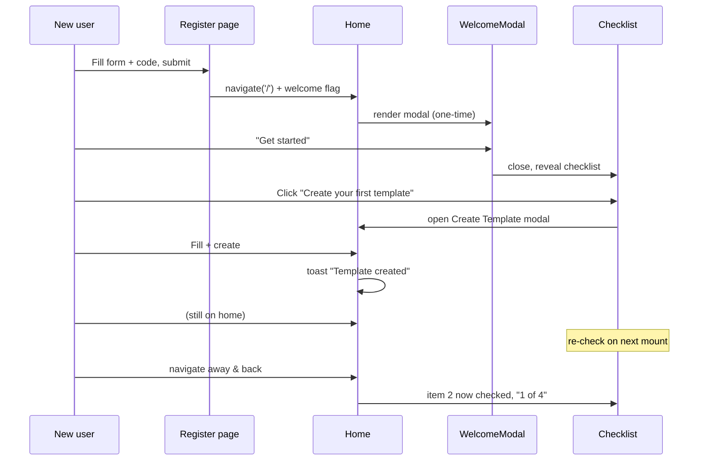
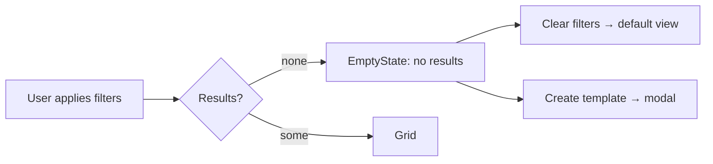

# Onboarding Experience — UI/UX Design

- **Feature ID:** onboarding
- **Version:** 1.0
- **Status:** Proposed (for architecture review)
- **Author:** ui-ux-agent
- **Date:** 2026-10-10

## 1. Design Principles

1. **Never block.** Onboarding is ambient: a welcome modal that dismisses in one click, a checklist that can be closed, empty states that teach. No wizard gates the product.
2. **Every empty screen teaches.** Dead ends become next-step prompts; the empty state is the most-read screen a new user sees.
3. **Auto-magic progress.** The user never manages the checklist; it checks itself from real data. Manual "mark done" buttons are an anti-pattern.
4. **Aurora-native.** The checklist card is a sidebar section; the welcome modal is a standard `Modal`; no new visual language, no illustration system — existing icons only.
5. **Accessible by default.** Modal focus trap, semantic checklist, announced progress — per the accessibility feature baseline.

## 2. Information Architecture

```mermaid
flowchart TD
    REG[Register success] --> NAV[Navigate to '/']
    NAV --> WM{Welcome modal<br/>flag not set?}
    WM -- yes --> MODAL[WelcomeModal<br/>3 value props + CTAs]
    WM -- no --> HOME[Home page]
    MODAL -- Get started --> HOME
    MODAL -- Explore templates --> HOME
    HOME --> CL{Checklist card<br/>not dismissed,<br/>not complete?}
    CL -- yes --> CARD[OnboardingChecklist<br/>4 tasks + progress]
    CL -- no --> GRID[Template grid]
    CARD --> T1[/profile/ 
    CARD --> T2[Create Template modal]
    CARD --> T3[/api-keys/]
    CARD --> T4[First template detail]
    T1 & T2 & T3 & T4 --> ACT[Action completed]
    ACT --> RET[Return to home]
    RET --> CARD2[Checklist re-checks on mount<br/>item auto-checks]
    CARD2 --> DONE{All 4 done?}
    DONE -- yes --> CELEBRATE[Completion state<br/>auto-hides next nav]
    DONE -- no --> CARD
```

## 3. User Flows

### 3.1 First-run (registration → activated)



### 3.2 Empty-state recovery (filtered no-results)



## 4. Page Layouts

### 4.1 Welcome modal (post-registration)

```text
┌──────────────────────────────────────────────────┐
│  (modal, size md, overlay dim)                   │
│  ┌────────────────────────────────────────────┐  │
│  │        [Logo mark]                         │  │
│  │   Welcome, {displayName}!          [×]     │  │
│  │   You're all set to build with prompts.    │  │
│  │                                            │  │
│  │   ┌────────────────────────────────────┐   │  │
│  │   │ 🔍 Browse & use community templates│   │  │
│  │   │    Find proven prompts, fork them. │   │  │
│  │   ├────────────────────────────────────┤   │  │
│  │   │ ✏️ Create & version your own       │   │  │
│  │   │    Every save keeps a version.     │   │  │
│  │   ├────────────────────────────────────┤   │  │
│  │   │ 🔑 Integrate via API + SDK        │   │  │
│  │   │    Generate a key, call from code. │   │  │
│  │   └────────────────────────────────────┘   │  │
│  │                                            │  │
│  │   [ Explore templates ]  [ Get started ]   │  │
│  └────────────────────────────────────────────┘  │
└──────────────────────────────────────────────────┘
```

### 4.2 Home with onboarding checklist (desktop)

```text
┌─────────────────────────────────────────────────────────────┐
│ header                                                      │
├──────────────┬──────────────────────────────────────────────┤
│ sidebar      │ main content                                 │
│ ┌──────────┐ │  ┌────────────────────────────────────────┐  │
│ │Explore   │ │  │ template grid (unchanged)              │  │
│ │Templates │ │  │ ┌─────┐ ┌─────┐ ┌─────┐                │  │
│ │ · cat    │ │  │ │     │ │     │ │     │                │  │
│ │ · cat    │ │  │ └─────┘ └─────┘ └─────┘                │  │
│ ├──────────┤ │  │ ┌─────┐ ┌─────┐ ┌─────┐                │  │
│ │My        │ │  │ │     │ │     │ │     │                │  │
│ │Templates │ │  │ └─────┘ └─────┘ └─────┘                │  │
│ ├──────────┤ │  └────────────────────────────────────────┘  │
│ │ONBOARDING│ │                                              │
│ │  ×      │ │                                              │
│ │ ▓▓▓░░ 2/4│ │                                              │
│ │ ✓ Profile│ │                                              │
│ │ ✓ First  │ │                                              │
│ │   template│ │                                             │
│ │ ○ API key│ │                                              │
│ │ ○ Use a  │ │                                              │
│ │   prompt │ │                                              │
│ └──────────┘ │                                              │
└──────────────┴──────────────────────────────────────────────┘
```

### 4.3 Onboarding checklist card (component detail)

```text
┌────────────────────────────┐
│ GETTING STARTED        [×] │  ← section title style, dismiss
│ ┌────────────────────────┐ │
│ │ ▓▓▓▓▓▓░░░░░░░░  2 of 4 │ │  ← progress bar + count
│ └────────────────────────┘ │
│ ✓ Complete your profile    │  ← done: check icon, no link
│ ✓ Create your first        │
│   template                 │
│ ○ → Generate an API key    │  ← todo: link, accent on hover
│ ○ → Use a prompt           │
└────────────────────────────┘
```

### 4.4 Completion state

```text
┌────────────────────────────┐
│ GETTING STARTED        [×] │
│      ✓ (success icon)      │
│    You're all set!         │
│  Your workspace is ready.  │
│   [ Explore templates ]    │
└────────────────────────────┘
```

### 4.5 Empty states

```text
a) Home no-results:                    b) My templates empty:
┌──────────────────────────┐          ┌──────────────────────────┐
│        (🔍 icon)         │          │        (✏️ icon)         │
│   No templates found.    │          │  No templates yet.       │
│  Try different filters.  │          │  Create your first one.  │
│  [ Clear filters ]       │          │ [ + Create a template ]  │
│  [ + Create a template ] │          └──────────────────────────┘
└──────────────────────────┘

c) API keys empty:                     d) Likes/Favorites empty:
┌──────────────────────────┐          ┌──────────────────────────┐
│        (🔑 icon)         │          │        (♥ icon)          │
│      No API keys yet.    │          │  Nothing here yet.       │
│  Call the API from your  │          │ Templates you like will  │
│  code with a key.        │          │  appear here.            │
│  [ Generate New Key ]    │          │  [ Browse templates ]    │
└──────────────────────────┘          └──────────────────────────┘
```

## 5. Component Specifications

### 5.1 WelcomeModal (new)

| Property | Value |
|---|---|
| Built on | Existing `Modal` (size `md`), focus trap per accessibility feature |
| Trigger | `onboarding.welcome_dismissed` flag unset AND navigated from register (query param `?welcome=1` or session flag) |
| Header | Logo mark (24px) + `h3` "Welcome, {displayName}!" |
| Value rows | 3 rows: icon (16px, `--secondary`) + bold title + one-line description (`--text-2`) |
| Buttons | Secondary `btn-ghost` "Explore templates" / Primary `btn-primary` "Get started" |
| Dismissal | Escape / overlay / × / either button → set flag, close |
| i18n | `onboarding.welcome.*` |

### 5.2 OnboardingChecklist (new)

| Property | Value |
|---|---|
| Placement | Sidebar column (desktop, after "My Templates" section), above grid (mobile) |
| Container | `.sidebar-section.onboarding-card` — same padding/border as sibling sections |
| Dismiss | `icon-btn` × top-right, `aria-label` = "Dismiss getting started" |
| Progress | Bar: 6px height, `--accent` fill on `--surface-3` track, `--radius-pill`; text "2 of 4" (`--text-2`, 13px) |
| Item (todo) | `<a>` with `○` bullet (or chevron), label `--text-1`, hover: `--accent` text + underline |
| Item (done) | Check icon (`--success`), label `--text-3`, no link, `aria-checked="true"` |
| Item (pending check) | Same as todo but with `Spinner` (14px) replacing bullet — no layout shift |
| List semantics | `<ul>` with each item `<li>`; progress text in `aria-live="polite"` span |
| Completion | Success icon 32px `--success`, title, description, "Explore templates" link; sets `checklist_completed` |

### 5.3 EmptyState (new shared component, regular app)

| Property | Value |
|---|---|
| Props | `icon` (component), `title`, `description`, `actions: [{label, onClick, primary}]` |
| Container | Centered column, `padding: 48px 24px`, `text-align: center` |
| Icon | 40px, `--text-3` (decorative, `aria-hidden`) |
| Title | 16px semibold `--text-1` |
| Description | 14px `--text-2`, max-width 320px |
| Actions | Row of buttons: primary `btn-primary btn-sm`, secondary `btn-ghost btn-sm` |
| Region | `role="region"` + `aria-label` so the state is announced |
| Reuse | Admin console already has its own `EmptyState`; this one lives in `components/` for the regular app (styling differs: admin uses its own tokens) |

### 5.4 Detection hook — `useOnboardingStatus` (new, `utils/`)

| Property | Value |
|---|---|
| Signature | `useOnboardingStatus(enabled)` → `{ checks: { profile, template, apiKey, prompt }, loading }` |
| Behavior | When `enabled` (card visible + authenticated): fires the 4 GETs in parallel (Promise.allSettled); each resolves to boolean; rejected → `false` |
| No caching | Fresh per mount (NFR-2); no polling |
| Guard | `enabled=false` → no calls at all (AC-11) |

## 6. Interaction Details

1. **Welcome modal open:** on Home mount, if `?welcome=1` (appended by register handler) or the just-registered session flag exists and the dismissal flag is unset → open modal. The URL param is stripped after read (history.replaceState) so refresh doesn't re-trigger.
2. **"Get started":** closes modal → the checklist card (if hidden by scroll on mobile) scrolls into view; focus moves to the card heading.
3. **"Explore templates":** closes modal → focus moves to the grid's first card (per accessibility focus patterns).
4. **Checklist item click:** navigates (or opens Create Template modal via the same path as the floating + button). The card keeps its state; back-navigation re-mounts home → re-check runs → item shows checked.
5. **Dismiss (×):** sets `onboarding.checklist_dismissed`, card unmounts with a 150ms fade (respects reduced-motion), focus moves to the next sidebar section heading.
6. **Progress announcement:** when a check resolves and flips an item to done, the "n of 4" span (in `aria-live="polite"`) updates → screen reader announces new progress.
7. **Completion:** when the 4th check resolves done → card switches to completion state; flag set on next navigation (so the user sees the celebration at least once).
8. **Empty-state CTAs:** "Clear filters" resets the Home filter state to defaults (public visibility, no category/tags) — same handler as the sidebar "All public" click; "Create a template" opens the Create Template modal (authenticated only — anonymous users see a "Sign in" CTA instead).
9. **Anonymous users:** checklist and welcome modal never render (auth-gated); empty states still work with sign-in CTAs where relevant.

## 7. States Summary

| State | Welcome modal | Checklist card |
|---|---|---|
| Loading (checks pending) | n/a | Items show spinner bullets; progress bar shows indeterminate shimmer |
| Partial (1–3 of 4) | n/a | Checked + unchecked items; "n of 4" |
| Complete (4 of 4) | n/a | Celebration state; auto-hide next nav |
| Dismissed | Never shows again | Never shows again |
| Detection error | n/a | Item stays unchecked; no error UI |
| Anonymous | Never shows | Never shows |
| Returning user (all done) | Never (login ≠ registration) | Never (FR-15) |

## 8. Visual Style (Aurora compliance)

- **Checklist card** = sidebar section: `--surface` background, `--border` top divider, same heading style (13px uppercase `--text-3` → "GETTING STARTED").
- **Progress bar**: `--accent` fill (the Aurora purple), `--surface-3` track, `--radius-pill` — matches the admin KPI/loading language without importing admin styles.
- **Done items**: `--success` check icon + `--text-3` label (muted, clearly "past").
- **Todo items**: `--text-1` label, `--accent` on hover/focus — same affordance as sidebar links.
- **Welcome modal**: standard `Modal` chrome; value-row icons in `--secondary` (teal) for a distinct-but-Aurora accent; no new colors.
- **Empty states**: `--text-3` icon, `--text-1`/`--text-2` text hierarchy, standard `btn-primary`/`btn-ghost` — identical to admin EmptyState's tone but with regular-app tokens.
- **Dark & light themes** verified for every element (progress bar contrast, success icon on both surfaces).

## 9. i18n Considerations (EN/ZH)

New namespace `onboarding` (both files, same change):

```json
{
  "onboarding": {
    "welcome": {
      "title": "Welcome, {{name}}!",
      "subtitle": "You're all set to build with prompts.",
      "row_browse_title": "Browse & use community templates",
      "row_browse_desc": "Find proven prompts, fork them, make them yours.",
      "row_create_title": "Create & version your own",
      "row_create_desc": "Every save keeps a version you can restore.",
      "row_integrate_title": "Integrate via API + SDK",
      "row_integrate_desc": "Generate a key and call prompts from your code.",
      "explore": "Explore templates",
      "get_started": "Get started"
    },
    "checklist": {
      "title": "Getting started",
      "progress": "{{done}} of {{total}}",
      "task_profile": "Complete your profile",
      "task_template": "Create your first template",
      "task_api_key": "Generate an API key",
      "task_prompt": "Use a prompt",
      "dismiss": "Dismiss getting started",
      "done_title": "You're all set!",
      "done_desc": "Your workspace is ready.",
      "done_cta": "Explore templates"
    },
    "empty": {
      "no_results_title": "No templates found",
      "no_results_desc": "Try different filters or create your own.",
      "clear_filters": "Clear filters",
      "my_templates_title": "No templates yet",
      "my_templates_desc": "Create your first template to get started.",
      "create_template": "Create a template",
      "api_keys_title": "No API keys yet",
      "api_keys_desc": "Generate a key to call the API from your code.",
      "likes_title": "Nothing here yet",
      "likes_desc": "Templates you like will appear here.",
      "favorites_title": "Nothing here yet",
      "favorites_desc": "Templates you favorite will appear here.",
      "browse": "Browse templates",
      "sign_in": "Sign in"
    }
  }
}
```

```json
{
  "onboarding": {
    "welcome": {
      "title": "欢迎，{{name}}！",
      "subtitle": "一切就绪，开始构建你的提示词吧。",
      "row_browse_title": "浏览并使用社区模板",
      "row_browse_desc": "找到好用的提示词，Fork 后变成你的。",
      "row_create_title": "创建并版本化你的模板",
      "row_create_desc": "每次保存都会保留一个可恢复的版本。",
      "row_integrate_title": "通过 API + SDK 集成",
      "row_integrate_desc": "生成密钥，在代码中调用提示词。",
      "explore": "浏览模板",
      "get_started": "开始使用"
    },
    "checklist": {
      "title": "新手入门",
      "progress": "{{done}} / {{total}}",
      "task_profile": "完善你的资料",
      "task_template": "创建你的第一个模板",
      "task_api_key": "生成 API 密钥",
      "task_prompt": "使用一个提示词",
      "dismiss": "关闭新手入门",
      "done_title": "一切就绪！",
      "done_desc": "你的工作区已准备好。",
      "done_cta": "浏览模板"
    },
    "empty": {
      "no_results_title": "未找到模板",
      "no_results_desc": "试试其他筛选，或创建你自己的模板。",
      "clear_filters": "清除筛选",
      "my_templates_title": "还没有模板",
      "my_templates_desc": "创建你的第一个模板开始使用。",
      "create_template": "创建模板",
      "api_keys_title": "还没有 API 密钥",
      "api_keys_desc": "生成密钥，在你的代码中调用 API。",
      "likes_title": "这里还空空如也",
      "likes_desc": "你点赞的模板会出现在这里。",
      "favorites_title": "这里还空空如也",
      "favorites_desc": "你收藏的模板会出现在这里。",
      "browse": "浏览模板",
      "sign_in": "登录"
    }
  }
}
```

- Interpolation `{{name}}` uses the display name from the register form (already in Redux after `loginSuccess`).
- "n of 4" uses `{{done}}`/`{{total}}` so ZH can format "2 / 4" naturally.
- All strings ≤ 60 chars where possible to avoid layout breaks in the narrow sidebar card.

## 10. Accessibility

- **Welcome modal:** reuses accessible `Modal` — focus trap, Escape close, focus restore, `aria-labelledby` title.
- **Checklist:** `<ul>`/`<li>` structure; each todo item is a focusable link with accessible name = task label; done items are plain text with check icon (`aria-hidden`) — the state is conveyed by the icon + muted style + progress text.
- **Progress:** the "n of 4" text sits in `aria-live="polite"` so check-offs are announced.
- **Dismiss button:** `aria-label` from `onboarding.checklist.dismiss`; focus moves to the sidebar heading after dismissal (never lost).
- **Empty states:** `role="region"` + `aria-label`; CTAs are real buttons; icons decorative + `aria-hidden`.
- **Keyboard flow (AC-10):** Tab reaches modal buttons → Enter activates → checklist items reachable → Enter navigates. No drag/hover-only interactions.
- **Contrast:** all text uses existing AA-compliant tokens (per accessibility feature's token fix); progress bar `--accent` on `--surface-3` ≥3:1 (non-text).

## 11. Implementation Notes for Developer

1. **New files:** `frontend/src/components/WelcomeModal.jsx(+scss)`, `frontend/src/components/OnboardingChecklist.jsx(+scss)`, `frontend/src/components/EmptyState.jsx(+scss)`, `frontend/src/utils/useOnboardingStatus.js`.
2. **Modified files:** `frontend/src/pages/Home.js` (render checklist + welcome trigger + empty states), `frontend/src/pages/Register.js` (append `?welcome=1` on navigate), `frontend/src/pages/APIKeys.js` (empty state), `frontend/src/components/Sidebar.js` (mount checklist into sidebar column OR render as sibling section — recommend Home renders it inside the sidebar slot via Layout prop), both `translation.json` files.
3. **Detection wiring:** `useOnboardingStatus(enabled)` where `enabled = isAuthenticated && !dismissed && !completed`; calls `getProfile`, `getTemplates({owner_id, page_size:1})`, `listAPIKeys({page_size:1})`, `listPrompts({owner_id, page_size:1})` — use `page_size:1` where supported to minimize payloads (existence check only).
4. **Flags (localStorage):** `onboarding.welcome_dismissed`, `onboarding.checklist_dismissed`, `onboarding.checklist_completed` — all strings `'1'`.
5. **Create Template modal opening:** the checklist CTA should call the same open path as the floating + button; if `Layout` owns the modal state, expose an `openCreateModal` via context or lift the trigger — coordinate with developer-agent on the cleanest prop/callback path.
6. **Empty-state integration points:** Home no-results (replace bare `no-results` div), My-templates empty (detect `filters.owner_id === user.id && templates.length === 0`), APIKeys (wrap `APIKeyManager` empty branch), Likes/Favorites (detect `my_likes`/`my_favorites` filter + empty).
7. **Testing:** unit tests for `useOnboardingStatus` (mocked api), `OnboardingChecklist` states (todo/done/complete/dismissed), `EmptyState` rendering; e2e: register → modal → dismiss → checklist → create template → item checks.
8. **Watch-outs:** (a) don't fire detection when card is dismissed (AC-11 — guard in the hook); (b) `?welcome=1` must be stripped after read; (c) the sidebar on mobile is a drawer — the checklist must render in the main column there (CSS media query, same component); (d) keep `page_size:1` on existence checks to avoid pulling full lists.
