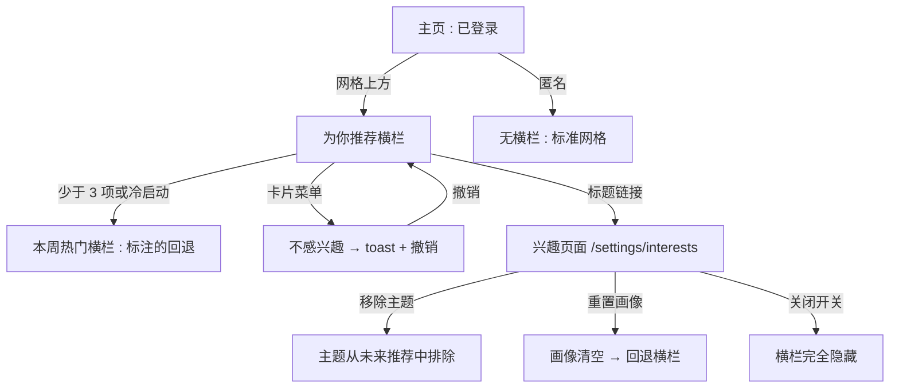
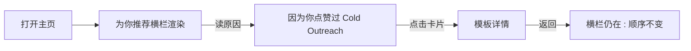
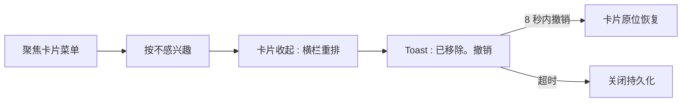
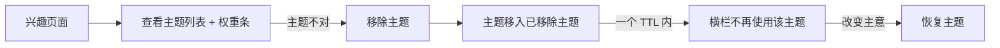

# 个性化推荐 — UI/UX 设计

- **功能 ID：** personalized-recommendations
- **版本：** 1.0
- **状态：** 已提案（待架构评审）
- **作者：** ui-ux-agent
- **日期：** 2026-10-13
- **配套文档：** `personalized-recommendations-requirements-zh-CN.md`

## 1. 设计原则

1. **透明，绝不惊悚。** 每张卡片都说明出现的原因；兴趣页面准确展示系统所知。不出现"它怎么知道的？"时刻。
2. **个性化可退出、可控、可逆。** 带撤销的关闭、移除主题、全部重置或整体关闭 —— 都在一键之内。
3. **横栏是开胃菜，不是正餐。** 网格上方一个安静的横栏；用户自己的搜索/过滤/排序控件仍是主要浏览体验。
4. **复用一切。** TemplateCard、横向横栏惯例、toast 模式和设置页布局遵循现有设计（related-templates、notifications、notification-preferences）；零新视觉习惯。

## 2. 信息架构



| 界面 | 位置 | 受众 | 目的 |
|---|---|---|---|
| 为你推荐横栏 | 主页，网格上方（搜索栏下方） | 有信号的登录用户 | 即时呈现兴趣匹配的模板 |
| 本周热门横栏 | 同一位置 | 冷启动用户（信号 <3） | 标注的回退；绝不空白 |
| 卡片原因标签 | 每张横栏卡片上 | 所有人 | 解释推荐 |
| 不感兴趣操作 | 卡片悬停/聚焦菜单 | 所有横栏查看者 | 带撤销地关闭卡片 |
| 兴趣页面 | `/settings/interests` | 登录用户 | 查看/编辑兴趣画像、开关、重置 |
| 撤销 toast | 底部居中 | 所有横栏查看者 | 逆转一次关闭 |

## 3. 用户流程

### 3.1 被动发现



### 3.2 关闭与撤销



### 3.3 兴趣修正



## 4. 页面布局

### 4.1 带为你推荐横栏的主页（桌面）

```
+----------------------------------------------------------------------+
|  Header（现有）                                                       |
+----------------------------------------------------------------------+
|  [ 搜索栏 ......................... ]  [排序 ▾]                       |
+----------------------------------------------------------------------+
|  为你推荐                                  [暂时隐藏] [ ⓘ ]           |
|  +----------+  +----------+  +----------+  +----------+  +------    |
|  | card     |  | card     |  | card     |  | card     |  | card →   |
|  | ★ 96     |  | ★ 71     |  | ★ 54     |  | ★ 48     |  | (scroll) |
|  | 因为你   |  | 营销中的 |  | 因为你   |  | 写作中的 |  |          |
|  | 点赞过 X |  | 更多     |  | 使用过 Y |  | 更多     |  |          |
|  +----------+  +----------+  +----------+  +----------+  +------    |
+----------------------------------------------------------------------+
|  模板网格（现有，不变）                                                 |
+----------------------------------------------------------------------+
```

- `[ ⓘ ]` 链接打开兴趣页面（"管理你的推荐"）。
- 原因标签位于每张卡片标题下方，为次要文本，单行，省略号截断。
- 回退横栏完全相同，只是标题为"本周热门"，无原因标签、无关闭操作。

### 4.2 横栏卡片解剖

```
+---------------------------+
|  模板标题                  |  ← 现有 TemplateCard 内容
|  分类 · ★ 点赞             |
|  ─────────────────────    |
|  ✓ 因为你点赞过            |  ← 原因标签（次要文本）
|    Cold Outreach          |
|                    [ ⋯ ]  |  ← 卡片菜单（悬停/聚焦），
+---------------------------+     含"不感兴趣"
```

### 4.3 兴趣页面（桌面）

```
+----------------------------------------------------------------------+
|  ← 设置    你的兴趣                                                    |
+----------------------------------------------------------------------+
|  推荐                                        [ 开 ●——○ 关 ]           |
+----------------------------------------------------------------------+
|  基于你最近的活动（近 90 天）                                           |
|  +----------------------------------------------------------------+  |
|  | 营销            ████████████████████░░░░  （12 次交互）          |  |
|  | 冷外联          ████████████░░░░░░░░░░░░  （7）          [ ✕ ]   |  |
|  | 写作            ████████░░░░░░░░░░░░░░░░  （4）          [ ✕ ]   |  |
|  | 代码评审        ████░░░░░░░░░░░░░░░░░░░░  （2）          [ ✕ ]   |  |
|  +----------------------------------------------------------------+  |
|  已移除主题：SEO [ 恢复 ]                                              |
+----------------------------------------------------------------------+
|  我们使用的信号：收藏 12 · 点赞 34 · 使用 8 · 浏览 210                  |
|              [ 重置画像 ]          [ 重置关闭记录 ]                     |
+----------------------------------------------------------------------+
```

### 4.4 移动端（单列）

```
+---------------------------+
|  Header（现有）            |
+---------------------------+
|  [ 搜索 ............ ]    |
+---------------------------+
|  为你推荐        [ ⓘ ]    |
|  → [card] [card] [card]→ |  （scroll-snap，72% 宽度）
+---------------------------+
|  模板网格                  |
+---------------------------+
```

兴趣页面垂直堆叠：开关 → 主题列表（权重条全宽，✕ 在右）→ 已移除主题 → 信号摘要 → 重置操作（全宽按钮）。

## 5. 组件规格

| 组件 | 行为 | 状态 |
|---|---|---|
| ForYouRail | 带标题、"暂时隐藏"、ⓘ 链接的横向卡片横栏；在网格查询后非阻塞获取 `/recommendations` | 加载中（骨架卡片）/ 已加载 / 回退（本周热门）/ 隐藏（少于 3 项、已关闭、匿名、会话内隐藏）/ 错误（静默隐藏） |
| ReasonLabel | 来自服务端 `reason` 字段的单行次要文本；专有名词标题不翻译 | 4 种变体（because_you_liked/used/favorited、topic） |
| RailCardMenu | 卡片悬停/聚焦时的 `⋯` 按钮；打开含"不感兴趣"的菜单 | 关闭 / 打开 / 可键盘聚焦 |
| DismissToast | 底部居中 toast"已从推荐中移除"+ 撤销按钮；8 秒自动消失 | 可见 / 撤销中 / 已过期 |
| InterestsPage | 带权重条的主题列表、移除 ✕、已移除主题恢复、开关、重置 | 加载中 / 已加载 / 空（冷启动文案）/ 错误（重试） |
| WeightBar | 相对条（主题分数 / 最高分），带交互次数 | 0–100% |
| RecommendationToggle | 绑定 `recommendations_enabled` 的开/关开关 | 开 / 关 / 保存中 |

## 6. 交互细节

1. **非阻塞加载：** 横栏请求在主网格查询完成后发起；骨架通常显示 < 400ms。横栏失败是静默的（区块隐藏）—— 横栏是增强，绝不是失败界面。
2. **卡片菜单：** `⋯` 在桌面悬停时出现，且始终在 Tab 序列中；键盘（Enter/Space）打开并选择"不感兴趣"完成关闭。触屏：长按或 `⋯` 点击目标（最小 44×44px）。
3. **关闭动画：** 卡片收起（宽度 → 0，200ms 缓动）；相邻卡片重排；toast 出现。撤销以反向动画将卡片恢复到原位置。
4. **原因标签截断：** 单行，`text-overflow: ellipsis`；完整原因放在卡片 `title` 属性中供悬停查看。
5. **暂时隐藏：** 设置会话级标志（仅内存）；下次页面加载时横栏返回。不服务端持久化（FR-15）。
6. **兴趣页面移除：** 点击 ✕ 立即将主题移到"已移除主题"（乐观更新），API 失败时内联报错并回滚。
7. **关闭开关：** 主页上的横栏立即卸载；开关状态持久化。重新开启会重新获取。
8. **重置确认：** 两个重置操作都打开确认对话框（"这将清空你的兴趣画像。继续吗？"）—— 破坏性操作绝不单击完成。
9. **缓存新鲜度：** 任何兴趣变更后，客户端使其缓存的横栏响应失效，下次访问主页在一个 TTL 内反映变更。

## 7. 状态汇总

| 界面 | 加载中 | 空 | 错误 |
|---|---|---|---|
| 为你推荐横栏 | 4 张骨架卡片 | 少于 3 项 → 隐藏；冷启动 → 回退横栏 | 静默隐藏（无错误 UI） |
| 回退横栏 | 骨架卡片 | 少于 3 个热门 → 隐藏 | 静默隐藏 |
| 卡片菜单 | — | — | 关闭失败 → toast 报错，卡片保留 |
| 撤销 toast | — | — | 撤销失败 → 卡片保持移除，toast 报错 |
| 兴趣页面 | 骨架列表 | 冷启动文案（"使用、收藏或点赞模板后，你的兴趣会显示在这里。"）+ 信号说明 | 错误横幅 + 重试 |
| 开关 | 开关上保存中转圈 | — | 回滚 + 错误 toast |

## 8. 国际化

| 键 | EN | ZH |
|---|---|---|
| `recs.rail.title` | For You | 为你推荐 |
| `recs.rail.fallbackTitle` | Popular this week | 本周热门 |
| `recs.rail.hideForNow` | Hide for now | 暂时隐藏 |
| `recs.rail.manage` | Manage your recommendations | 管理你的推荐 |
| `recs.reason.becauseLiked` | Because you liked {{title}} | 因为你点赞过 {{title}} |
| `recs.reason.becauseUsed` | Because you used {{title}} | 因为你使用过 {{title}} |
| `recs.reason.becauseFavorited` | Because you favorited {{title}} | 因为你收藏过 {{title}} |
| `recs.reason.topicCategory` | More in {{value}} | {{value}} 中的更多 |
| `recs.reason.topicTag` | More about {{value}} | 更多关于 {{value}} |
| `recs.card.notInterested` | Not interested | 不感兴趣 |
| `recs.toast.removed` | Removed from recommendations | 已从推荐中移除 |
| `recs.toast.undo` | Undo | 撤销 |
| `recs.toast.dismissFailed` | Couldn't remove. Please try again. | 移除失败，请重试。 |
| `interests.title` | Your interests | 你的兴趣 |
| `interests.subtitle` | Based on your recent activity (last 90 days) | 基于你最近的活动（近 90 天） |
| `interests.toggle.label` | Recommendations | 推荐 |
| `interests.signals` | Signals we use: {{favorites}} favorites · {{likes}} likes · {{uses}} uses · {{views}} views | 我们使用的信号：{{favorites}} 收藏 · {{likes}} 点赞 · {{uses}} 使用 · {{views}} 浏览 |
| `interests.removedTopics` | Removed topics | 已移除主题 |
| `interests.restore` | Restore | 恢复 |
| `interests.resetProfile` | Reset profile | 重置画像 |
| `interests.resetDismissals` | Reset dismissals | 重置关闭记录 |
| `interests.empty.title` | No interests yet | 还没有兴趣 |
| `interests.empty.body` | Use, favorite, or like templates and your interests will appear here. | 使用、收藏或点赞模板后，你的兴趣会显示在这里。 |
| `interests.confirm.resetProfile` | This will clear your interest profile. Continue? | 这将清空你的兴趣画像。继续吗？ |
| `interests.confirm.resetDismissals` | This will restore all dismissed recommendations. Continue? | 这将恢复所有已关闭的推荐。继续吗？ |
| `interests.aria.topicRow` | Topic {{value}}, weight {{count}} interactions | 主题 {{value}}，权重 {{count}} 次交互 |

分类和标签值为专有名词，不翻译。

## 9. 无障碍

- 横栏是带 `h2` 标题的 `<section aria-label>`，遵循 related-templates 横栏模式。
- 卡片是 DOM 序列中可聚焦的链接；`⋯` 菜单按钮可用 Tab 触达并用 Enter/Space 打开；菜单项遵循 ARIA 菜单语义（`role=menuitem`、方向键导航、Esc 关闭）。
- 关闭 toast 使用 `role=status`（polite）；撤销按钮是 toast 中第一个可聚焦元素。
- 权重条有文本替代（交互次数）—— 条本身是装饰性的（`aria-hidden`）；行本身携带 `interests.aria.topicRow`。
- 开关是带 `aria-checked` 的原生 `switch` 角色；状态变化会被播报。
- 骨架状态为 `aria-hidden`；区块在加载完成前不播报任何内容。
- 关闭时焦点绝不丢失：焦点移到下一张卡片（若被关闭的是最后一张则移到横栏标题）。
- 所有触控目标 ≥ 44×44px；无仅悬停可见的操作（菜单按钮有 focus-visible 且在 Tab 序列中）。

## 10. 分析（可选）

- `for_you_rail_viewed`（fallback: bool）、`for_you_card_clicked`（position、reason_type）、`not_interested_clicked`、`not_interested_undone`、`interests_page_viewed`、`topic_removed`、`recommendations_toggled`（state）—— 仅产品使用事件，与 prompt-analytics 的隐私立场一致。

## 11. 范围之外

- 主网格的个性化排序；详情页个性化横栏（related-templates 拥有该界面）。
- 按主题的"减少此类"反馈；超出原因标签的推荐解释。
- 匿名个性化；跨用户信号；ML/嵌入模型。
- 推荐表现的管理员控制台界面。
- 任何形式的变现（赞助卡片、推广位）—— 本产品永久超出范围。
