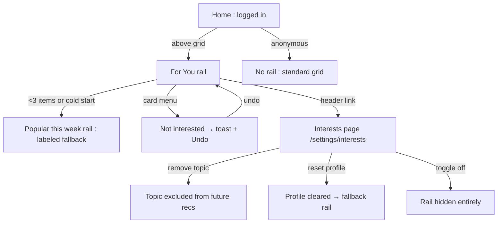
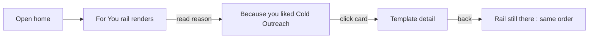
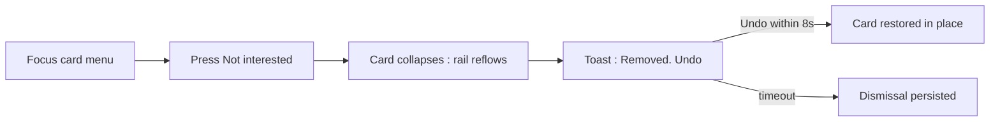
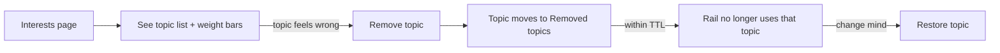

# Personalized Recommendations — UI/UX Design

- **Feature ID:** personalized-recommendations
- **Version:** 1.0
- **Status:** Proposed (for architecture review)
- **Author:** ui-ux-agent
- **Date:** 2026-10-13
- **Companion doc:** `personalized-recommendations-requirements.md`

## 1. Design Principles

1. **Transparent, never spooky.** Every card says why it's there; the Interests page shows exactly what the system knows. No "how did it know that?" moments.
2. **Personalization is opt-out, controllable, and reversible.** Dismiss with undo, remove topics, reset everything, or turn it all off — all one click away.
3. **The rail is an appetizer, not the meal.** One calm rail above the grid; the user's own search/filter/sort controls remain the primary browsing experience.
4. **Reuse everything.** TemplateCard, horizontal-rail conventions, toast patterns, and settings-page layout follow existing designs (related-templates, notifications, notification-preferences); zero new visual idioms.

## 2. Information Architecture



| Surface | Location | Audience | Purpose |
|---|---|---|---|
| For You rail | Home, above grid (below search bar) | Logged-in users with signals | Surface interest-matched templates instantly |
| Popular this week rail | Same slot | Cold-start users (<3 signals) | Labeled fallback; never empty |
| Card reason label | On each rail card | All | Explain the recommendation |
| Not interested action | Card hover/focus menu | All rail viewers | Dismiss a card with undo |
| Interests page | `/settings/interests` | Logged-in users | View/edit interest profile, toggles, resets |
| Undo toast | Bottom center | All rail viewers | Reverse a dismissal |

## 3. User Flows

### 3.1 Passive discovery



### 3.2 Dismiss and undo



### 3.3 Interest correction



## 4. Page Layouts

### 4.1 Home with For You rail (desktop)

```
+----------------------------------------------------------------------+
|  Header (existing)                                                   |
+----------------------------------------------------------------------+
|  [ Search bar ......................... ]  [Sort ▾]                  |
+----------------------------------------------------------------------+
|  For You                                    [Hide for now] [ ⓘ ]     |
|  +----------+  +----------+  +----------+  +----------+  +------    |
|  | card     |  | card     |  | card     |  | card     |  | card →   |
|  | ★ 96     |  | ★ 71     |  | ★ 54     |  | ★ 48     |  | (scroll) |
|  | b/c you  |  | More in  |  | b/c you  |  | More in  |  |          |
|  | liked X  |  | Marketing|  | used Y   |  | Writing  |  |          |
|  +----------+  +----------+  +----------+  +----------+  +------    |
+----------------------------------------------------------------------+
|  Template grid (existing, unchanged)                                 |
+----------------------------------------------------------------------+
```

- The `[ ⓘ ]` link opens the Interests page ("Manage your recommendations").
- Reason labels sit under each card title in secondary text, one line, truncated with ellipsis.
- Fallback rail is identical except the header reads "Popular this week" with no reason labels and no dismiss action.

### 4.2 Rail card anatomy

```
+---------------------------+
|  Template title           |  ← existing TemplateCard content
|  category · ★ likes       |
|  ─────────────────────    |
|  ✓ Because you liked      |  ← reason label (secondary text)
|    Cold Outreach          |
|                    [ ⋯ ]  |  ← card menu (hover/focus), contains
+---------------------------+     "Not interested"
```

### 4.3 Interests page (desktop)

```
+----------------------------------------------------------------------+
|  ← Settings    Your interests                                        |
+----------------------------------------------------------------------+
|  Recommendations                                [ On ●——○ Off ]     |
+----------------------------------------------------------------------+
|  Based on your recent activity (last 90 days)                        |
|  +----------------------------------------------------------------+  |
|  | Marketing        ████████████████████░░░░  (12 interactions)   |  |
|  | Cold Outreach    ████████████░░░░░░░░░░░░  (7)          [ ✕ ]  |  |
|  | Writing          ████████░░░░░░░░░░░░░░░░  (4)          [ ✕ ]  |  |
|  | Code Review      ████░░░░░░░░░░░░░░░░░░░░  (2)          [ ✕ ]  |  |
|  +----------------------------------------------------------------+  |
|  Removed topics:  SEO  [ Restore ]                                   |
+----------------------------------------------------------------------+
|  Signals we use:   favorites 12 · likes 34 · uses 8 · views 210      |
|                     [ Reset profile ]      [ Reset dismissals ]      |
+----------------------------------------------------------------------+
```

### 4.4 Mobile (single column)

```
+---------------------------+
|  Header (existing)        |
+---------------------------+
|  [ Search ............ ]  |
+---------------------------+
|  For You        [ ⓘ ]    |
|  → [card] [card] [card]→ |  (scroll-snap, 72% width)
+---------------------------+
|  Template grid            |
+---------------------------+
```

Interests page stacks vertically: toggle → topic list (bars full-width, ✕ at right) → removed topics → signal summary → reset actions (full-width buttons).

## 5. Component Specs

| Component | Behavior | States |
|---|---|---|
| ForYouRail | Horizontal card rail with header, "Hide for now", ⓘ link; fetches `/recommendations` non-blocking after grid query | Loading (skeleton cards) / loaded / fallback (Popular) / hidden (<3 items, off, anonymous, session-hidden) / error (silent hide) |
| ReasonLabel | One-line secondary text from server `reason` field; proper-noun titles untranslated | 4 variants (because_you_liked/used/favorited, topic) |
| RailCardMenu | `⋯` button on card hover/focus; opens menu with "Not interested" | Closed / open / keyboard-focusable |
| DismissToast | Bottom-center toast "Removed from recommendations" + Undo button; auto-dismiss 8s | Visible / undoing / expired |
| InterestsPage | Topic list with weight bars, remove ✕, removed-topics restore, toggle, resets | Loading / loaded / empty (cold start copy) / error (retry) |
| WeightBar | Relative bar (topic score / top score), with interaction count | 0–100% |
| RecommendationToggle | On/off switch bound to `recommendations_enabled` | On / off / saving |

## 6. Interaction Details

1. **Non-blocking load:** the rail request fires after the main grid query resolves; skeletons show for < 400 ms typically. Rail failure is silent (section hidden) — the rail is an enhancement, never a failure surface.
2. **Card menu:** `⋯` appears on card hover (desktop) and is always in the tab order; opening it with keyboard (Enter/Space) and selecting "Not interested" dismisses. Touch: long-press or the `⋯` tap target (min 44×44px).
3. **Dismiss animation:** card collapses (width → 0, 200ms ease); neighbors reflow; toast appears. Undo restores the card at its original position with a reverse animation.
4. **Reason label truncation:** one line, `text-overflow: ellipsis`; full reason in the card's `title` attribute for hover.
5. **Hide for now:** sets a session-scoped flag (memory only); rail returns on next page load. Not persisted server-side (FR-15).
6. **Interests page remove:** clicking ✕ moves the topic to "Removed topics" immediately (optimistic) with an inline error + revert on API failure.
7. **Toggle off:** rail unmounts on the home page immediately; toggle state persists. Turning back on re-fetches.
8. **Reset confirmations:** both reset actions open a confirm dialog ("This will clear your interest profile. Continue?") — destructive actions are never single-click.
9. **Cache freshness:** after any interest change, the client invalidates its cached rail response so the next home visit reflects the change within one TTL.

## 7. States Summary

| Surface | Loading | Empty | Error |
|---|---|---|---|
| For You rail | 4 skeleton cards | <3 items → hidden; cold start → fallback rail | Silent hide (no error UI) |
| Fallback rail | Skeleton cards | <3 trending → hidden | Silent hide |
| Card menu | — | — | Dismiss failure → toast error, card stays |
| Undo toast | — | — | Undo failure → card stays removed, toast error |
| Interests page | Skeleton list | Cold-start copy ("Use, favorite, or like templates and your interests will appear here") + signal explainer | Error banner + retry |
| Toggle | Saving spinner on switch | — | Revert + error toast |

## 8. i18n

| Key | EN | ZH |
|---|---|---|
| `recs.rail.title` | For You | 为你推荐 |
| `recs.rail.fallbackTitle` | Popular this week | 本周热门 |
| `recs.rail.hideForNow` | Hide for now | 暂时隐藏 |
| `recs.rail.manage` | Manage your recommendations | 管理你的推荐 |
| `recs.reason.becauseLiked` | Because you liked {{title}} | 因为你点赞过 {{title}} |
| `recs.reason.becauseUsed` | Because you used {{title}} | 因为你使用过 {{title}} |
| `recs.reason.becauseFavorited` | Because you favorited {{title}} | 因为你收藏过 {{title}} |
| `recs.reason.topicCategory` | More in {{value}} | {{value}} 中的更多 |
| `recs.reason.topicTag` | More about {{value}} | 更多关于 {{value}} |
| `recs.card.notInterested` | Not interested | 不感兴趣 |
| `recs.toast.removed` | Removed from recommendations | 已从推荐中移除 |
| `recs.toast.undo` | Undo | 撤销 |
| `recs.toast.dismissFailed` | Couldn't remove. Please try again. | 移除失败，请重试。 |
| `interests.title` | Your interests | 你的兴趣 |
| `interests.subtitle` | Based on your recent activity (last 90 days) | 基于你最近的活动（近 90 天） |
| `interests.toggle.label` | Recommendations | 推荐 |
| `interests.signals` | Signals we use: {{favorites}} favorites · {{likes}} likes · {{uses}} uses · {{views}} views | 我们使用的信号：{{favorites}} 收藏 · {{likes}} 点赞 · {{uses}} 使用 · {{views}} 浏览 |
| `interests.removedTopics` | Removed topics | 已移除主题 |
| `interests.restore` | Restore | 恢复 |
| `interests.resetProfile` | Reset profile | 重置画像 |
| `interests.resetDismissals` | Reset dismissals | 重置关闭记录 |
| `interests.empty.title` | No interests yet | 还没有兴趣 |
| `interests.empty.body` | Use, favorite, or like templates and your interests will appear here. | 使用、收藏或点赞模板后，你的兴趣会显示在这里。 |
| `interests.confirm.resetProfile` | This will clear your interest profile. Continue? | 这将清空你的兴趣画像。继续吗？ |
| `interests.confirm.resetDismissals` | This will restore all dismissed recommendations. Continue? | 这将恢复所有已关闭的推荐。继续吗？ |
| `interests.aria.topicRow` | Topic {{value}}, weight {{count}} interactions | 主题 {{value}}，权重 {{count}} 次交互 |

Category and tag values are proper nouns and are not translated.

## 9. Accessibility

- The rail is a `<section aria-label="For you recommendations">` with an `h2` header, following the related-templates rail pattern.
- Cards are focusable links in DOM order; the `⋯` menu button is reachable with Tab and opens with Enter/Space; menu items follow ARIA menu semantics (`role=menuitem`, arrow-key navigation, Esc closes).
- The dismiss toast uses `role=status` (polite); the Undo button is the first focusable element in the toast.
- Weight bars have a text alternative (interaction count) — the bar is decorative (`aria-hidden`); the row itself carries `interests.aria.topicRow`.
- The toggle is a native `switch` role with `aria-checked`; state changes are announced.
- Skeleton states are `aria-hidden`; the section announces nothing until loaded.
- Focus is never lost on dismiss: focus moves to the next card (or the rail header if the dismissed card was last).
- All touch targets ≥ 44×44px; no hover-only affordances (menu button is focus-visible and in tab order).

## 10. Analytics (optional)

- `for_you_rail_viewed` (fallback: bool), `for_you_card_clicked` (position, reason_type), `not_interested_clicked`, `not_interested_undone`, `interests_page_viewed`, `topic_removed`, `recommendations_toggled` (state) — product usage events only, consistent with prompt-analytics' privacy stance.

## 11. Out of Scope

- Personalized sorting of the main grid; detail-page personalized rails (related-templates owns that surface).
- "Fewer like this" per-topic feedback; recommendation explanations beyond the reason label.
- Anonymous personalization; cross-user signals; ML/embedding models.
- Admin console surfaces for recommendation performance.
- Monetization of any kind (sponsored cards, promoted placements) — permanently out of scope for this product.
