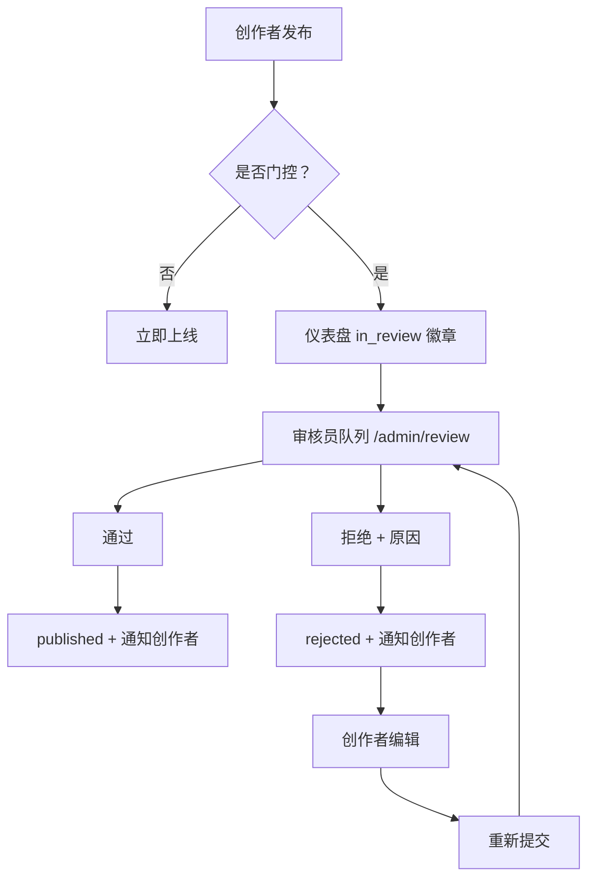
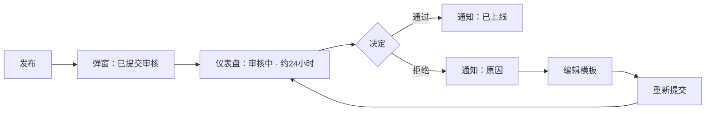
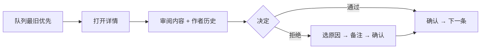

# 发布前审核 — UI/UX 设计

- **功能 ID：** pre-publication-review
- **版本：** 1.0
- **状态：** Proposed（待架构评审）
- **作者：** ui-ux-agent
- **日期：** 2026-10-13
- **配套文档：** `pre-publication-review-requirements-zh-CN.md`

## 1. 设计原则

1. **状态永远诚实。** 创作者清楚知道模板处于流程哪一步；不会有东西被悄悄卡住。
2. **摩擦只出现在风险处。** 成熟创作者完全感知不到此功能；新创作者看到明确、有时限的等待。
3. **审核员速度。** 队列为一分钟内决策而建：内容、上下文与操作同屏。
4. **拒绝即反馈。** 每次拒绝都带具体原因；重新提交只需一步。

## 2. 信息架构



| 界面 | 位置 | 受众 | 目的 |
|---|---|---|---|
| 审核状态卡片 | 创作者仪表盘 | 创作者 | 跟踪审核中模板 |
| 拒绝提示 | 通知 + 模板页 | 创作者 | 原因 + 重新提交路径 |
| 审核队列 | `/admin/review` | 审核员 | 处理提交 |
| 队列详情 | `/admin/review/:id` | 审核员 | 完整内容 + 上下文 + 操作 |
| 队列指标 | `/admin/review` 头部 | 审核员 | 一眼看清健康度 |

## 3. 用户流程

### 3.1 新创作者发布



### 3.2 审核员决策



## 4. 页面布局

### 4.1 创作者仪表盘 — 审核状态

```
+--------------------------------------------------------------+
|  你的模板                                                      |
|  ┌────────────────────────────────────────────────────────┐  |
|  │ 🕐 审核中 · "SQL 查询优化器" · 提交于 2 小时前              │  |
|  │    预计 24 小时内出结果 · [查看] [编辑]                     │  |
|  └────────────────────────────────────────────────────────┘  |
|  ┌────────────────────────────────────────────────────────┐  |
|  │ ✖ 已拒绝 · "群发冷邮件" · 垃圾内容                          │  |
|  │    [修改并重新提交]                                        │  |
|  └────────────────────────────────────────────────────────┘  |
+--------------------------------------------------------------+
```

### 4.2 发布确认弹窗（被门控创作者）

```
+--------------------------------------+
|  已提交审核                            |
|  你的模板将在快速审核后上线 ——          |
|  通常在 24 小时内。无论结果如何          |
|  你都会收到通知。                       |
|  [查看状态]            [完成]           |
+--------------------------------------+
```

### 4.3 管理端审核队列

```
+----------------------------------------------------------------------+
|  审核队列                未决：14 · 中位等待：6小时 · 今日：38 个决定     |
|  [全部] [超时 >48小时] [重新提交]      分类：[任意 ▾]                    |
+----------------------------------------------------------------------+
|  ⏳ 4天  "API 提示词合集"   @newbie99   已通过 0      [审核]           |
|  ⏳ 2天  "SQL 查询优化器"   @firstpost  已通过 0      [审核]           |
|  ⏳ 6小时 "群发冷邮件"（第2次）@retryuser 既往拒绝 1   [审核]           |
+----------------------------------------------------------------------+
```

### 4.4 队列详情

```
+----------------------------------------------------------------------+
|  ← 队列      "SQL 查询优化器"  @firstpost · 提交于 2 天前               |
+----------------------------------------------------------------------+
|  模板（完整内容预览）                                                  |
|  ...                                                                 |
+----------------------------------------------------------------------+
|  作者        注册于 3 天前 · 已发布 0 · 既往拒绝 0                     |
+----------------------------------------------------------------------+
|  重新提交    （无）                                                    |
+----------------------------------------------------------------------+
|  [✓ 通过]   [✖ 拒绝…]                                                 |
+----------------------------------------------------------------------+
```

### 4.5 拒绝对话框

```
+--------------------------------------+
|  拒绝模板                              |
|  原因（必选）                          |
|   ○ 垃圾内容                          |
|   ○ 抄袭                              |
|   ○ 有害内容                          |
|   ○ 质量低下                          |
|   ○ 其他                              |
|  给创作者的备注（可选）                 |
|  [................................]  |
|  [取消]  [拒绝]                       |
+--------------------------------------+
```

### 4.6 移动端

队列变为卡片列表（时长徽章、标题、作者、重新提交角标）；详情将内容堆叠在作者上下文之上；通过/拒绝变为底部固定操作栏。创作者仪表盘卡片堆叠；发布弹窗为底部抽屉式。

## 5. 组件规格

| 组件 | 行为 | 状态 |
|---|---|---|
| ReviewStatusCard | 仪表盘卡片：状态图标、标题、提交时间、预期窗口、操作 | in_review / rejected / approved（过渡） |
| PublishReviewModal | 被门控创作者发布时显示的确认 | 显示 / 关闭 |
| QueueTable | 行：时长徽章、标题、作者、上下文统计、审核按钮；最旧优先排序 | 加载中 / 空态 / 已加载 / 错误 |
| QueueFilters | 标签页（全部、超时、重新提交）+ 分类选择 | 当前筛选高亮 |
| SubmissionDetail | 内容预览、作者摘要、重新提交链、操作 | 加载中 / 已加载 / 错误 |
| RejectDialog | 固定原因列表（单选、必选）、可选备注、确认 | 未选原因（拒绝禁用）/ 就绪 / 提交中 |
| MetricsBar | 未决数、中位等待、当日决定数 | 加载中 / 已加载 |

## 6. 交互细节

1. **发布（被门控）：** 保存后，发布动作显示审核弹窗而非"已上线"反馈；仪表盘卡片立即出现并带审核中徽章。
2. **超时升级：** 超过 48 小时的行浮到顶部并带琥珀色 ⏳ 徽章显示时长；"超时"标签页仅筛选这些。
3. **重新提交链：** 详情展示每次此前尝试及其拒绝原因；队列行显示"（第 2 次）"角标，打开前即可见重复提交。
4. **拒绝流程：** 选择原因前拒绝按钮保持禁用；备注可选；确认提交后自动前进到下一条队列项。
5. **通过流程：** 单次确认（无需原因）；toast"已通过 —— 已通知创作者"；自动前进到下一条。
6. **创作者拒绝提示：** 通知深链到模板页，显示原因横幅与"修改并重新提交"CTA；编辑功能完全可用。
7. **重新提交：** 编辑后的模板发布重新进入队列；创作者看到同样的审核中卡片；链增长。
8. **免审创作者：** UI 零变化 —— 发布行为与今天完全一致；无徽章、无弹窗。
9. **直接 URL 防护：** 非管理员打开审核中或已拒绝模板的 URL 看到标准未找到页（不泄露状态）。
10. **键盘：** 队列详情中 `A` 通过、`R` 打开拒绝、`→` 前进；队列列表支持 `j`/`k` 导航。

## 7. 状态汇总

| 界面 | 加载中 | 空态 | 错误 |
|---|---|---|---|
| ReviewStatusCard | 骨架 | （无卡片 = 无被门控模板） | 仪表盘重试 |
| QueueTable | 行骨架 | "队列已清空" + 指标 | 重试 |
| SubmissionDetail | 骨架 | — | 重试，返回队列 |
| RejectDialog | — | — | 行内错误，对话框保留 |

## 8. 国际化（i18n）

| Key | 中文 | 英文 |
|---|---|---|
| `review.status.inReview` | 审核中 | In review |
| `review.status.rejected` | 已拒绝 | Rejected |
| `review.status.approved` | 已上线 | Live now |
| `review.card.submitted` | 提交于 {{time}} | Submitted {{time}} |
| `review.card.expected` | 预计 24 小时内出结果 | Expected decision within 24 hours |
| `review.modal.title` | 已提交审核 | Submitted for review |
| `review.modal.body` | 你的模板将在快速审核后上线 —— 通常在 24 小时内。无论结果如何你都会收到通知。 | Your template will go live after a quick review — usually within 24 hours. You'll get a notification either way. |
| `review.queue.title` | 审核队列 | Review queue |
| `review.queue.open` | 未决：{{count}} | Open: {{count}} |
| `review.queue.median` | 中位等待：{{duration}} | Median wait: {{duration}} |
| `review.queue.today` | 今日：{{count}} 个决定 | Today: {{count}} decisions |
| `review.queue.aging` | 超时 >48小时 | Aging >48h |
| `review.queue.resubmissions` | 重新提交 | Resubmissions |
| `review.queue.empty` | 队列已清空 | Queue is clear |
| `review.row.resubmission` | （第 {{n}} 次） | ({{n}}th) |
| `review.detail.author` | 注册于 {{date}} · 已发布 {{published}} · 既往拒绝 {{rejections}} | Joined {{date}} · {{published}} published · {{rejections}} prior rejections |
| `review.detail.chain` | 重新提交历史 | Resubmission history |
| `review.action.approve` | 通过 | Approve |
| `review.action.reject` | 拒绝… | Reject… |
| `review.reject.title` | 拒绝模板 | Reject template |
| `review.reject.reasonRequired` | 请选择原因后继续 | Pick a reason to continue |
| `review.reject.note` | 给创作者的备注（可选） | Note to creator (optional) |
| `review.reject.reason.spam` | 垃圾内容 | Spam |
| `review.reject.reason.plagiarism` | 抄袭 | Plagiarism |
| `review.reject.reason.harmful` | 有害内容 | Harmful content |
| `review.reject.reason.lowQuality` | 质量低下 | Low quality |
| `review.reject.reason.other` | 其他 | Other |
| `review.notify.approved` | 你的模板"{{title}}"已上线 | Your template "{{title}}" is live |
| `review.notify.rejected` | 你的模板"{{title}}"被拒绝：{{reason}} | Your template "{{title}}" was rejected: {{reason}} |
| `review.cta.resubmit` | 修改并重新提交 | Fix and resubmit |
| `review.notFound` | 页面不存在 | This page doesn't exist |

## 9. 无障碍

- 状态为图标 + 文字，绝不只靠颜色；审核中徽章带 aria-label（"审核中，提交于 2 小时前"）。
- 队列表格是带可排序表头的语义表格并播报；行操作是带描述性名称的真实按钮（"审核提交：SQL 查询优化器"）。
- 拒绝对话框捕获焦点、要求原因（错误经 live region 播报）、关闭时焦点返回拒绝按钮。
- 键盘快捷键（A/R/→/j/k）记录在管理端快捷键帮助中，对话框打开或焦点在输入框时绝不触发。
- 超时徽章在两套主题下对比度满足 AA；动效仅限行重排，并尊重减少动效设置。

## 10. 数据埋点（可选）

- `review_submission_created`、`review_decision_made`（动作、原因、在审时长）、`review_resubmitted` —— 仅产品健康指标。

## 11. 不在范围内

- 审核免审创作者已发布模板的编辑；AI 预筛；加急审核请求；年龄限制门控；邮件通知。
- 任何形式的变现 —— 本产品永久不做。
