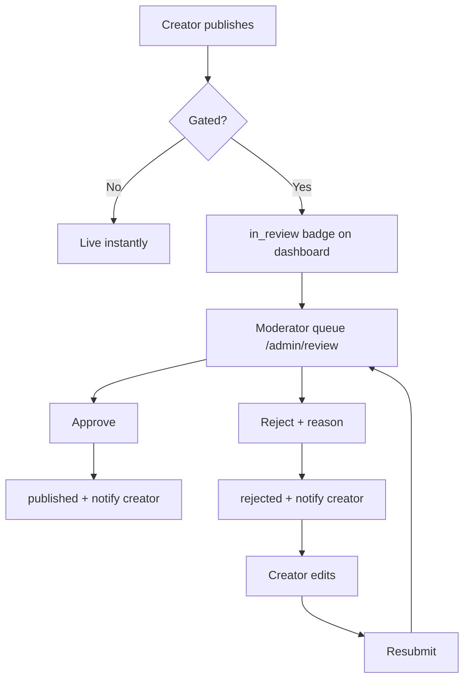
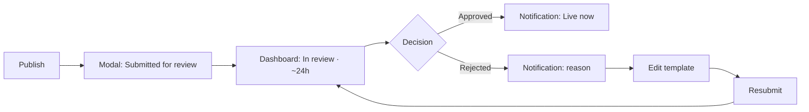
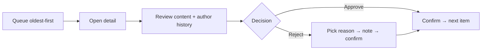

# Pre-Publication Review — UI/UX Design

- **Feature ID:** pre-publication-review
- **Version:** 1.0
- **Status:** Proposed (for architecture review)
- **Author:** ui-ux-agent
- **Date:** 2026-10-13
- **Companion doc:** `pre-publication-review-requirements.md`

## 1. Design Principles

1. **Honest status, always.** Creators see exactly where their template is in the pipeline; nothing is silently stuck.
2. **Friction only where risk is.** Established creators never see this feature; new creators see a clear, time-boxed wait.
3. **Reviewer speed.** The queue is built for decisions in under a minute: content, context, and actions in one screen.
4. **Rejection is feedback.** Every rejection carries a specific reason; resubmission is one click away.

## 2. Information Architecture



| Surface | Location | Audience | Purpose |
|---|---|---|---|
| Review status badge | Creator dashboard | Creator | Track in-review templates |
| Rejection notice | Notification + template page | Creator | Reason + resubmit path |
| Review queue | `/admin/review` | Moderator | Decide submissions |
| Queue detail | `/admin/review/:id` | Moderator | Full content + context + actions |
| Queue metrics | `/admin/review` header | Moderator | Health at a glance |

## 3. User Flows

### 3.1 New creator publishes



### 3.2 Moderator decides



## 4. Page Layouts

### 4.1 Creator dashboard — review status

```
+--------------------------------------------------------------+
|  Your templates                                               |
|  ┌────────────────────────────────────────────────────────┐  |
|  │ 🕐 In review · "SQL query optimizer" · submitted 2h ago │  |
|  │    Expected decision within 24 hours · [View] [Edit]    │  |
|  └────────────────────────────────────────────────────────┘  |
|  ┌────────────────────────────────────────────────────────┐  |
|  │ ✖ Rejected · "Cold email blast" · Spam                  │  |
|  │    [Fix and resubmit]                                   │  |
|  └────────────────────────────────────────────────────────┘  |
+--------------------------------------------------------------+
```

### 4.2 Publish confirmation modal (gated creator)

```
+--------------------------------------+
|  Submitted for review                 |
|  Your template will go live after a  |
|  quick review — usually within 24     |
|  hours. You'll get a notification     |
|  either way.                          |
|  [View status]        [Done]          |
+--------------------------------------+
```

### 4.3 Admin review queue

```
+----------------------------------------------------------------------+
|  Review queue                    Open: 14 · Median wait: 6h · Today: 38|
|  [All] [Aging >48h] [Resubmissions]   Category: [Any ▾]              |
+----------------------------------------------------------------------+
|  ⏳ 4d  "API prompt collection"  @newbie99   0 approved   [Review]    |
|  ⏳ 2d  "SQL query optimizer"   @firstpost  0 approved   [Review]    |
|  ⏳ 6h  "Cold email blast" (2nd)@retryuser  1 rejection  [Review]    |
+----------------------------------------------------------------------+
```

### 4.4 Queue detail

```
+----------------------------------------------------------------------+
|  ← Queue        "SQL query optimizer"  @firstpost · submitted 2d ago  |
+----------------------------------------------------------------------+
|  TEMPLATE (full content preview)                                     |
|  ...                                                                 |
+----------------------------------------------------------------------+
|  AUTHOR        Joined 3d ago · 0 published · 0 prior rejections      |
+----------------------------------------------------------------------+
|  RESUBMISSION  (none)                                                 |
+----------------------------------------------------------------------+
|  [✓ Approve]   [✖ Reject…]                                            |
+----------------------------------------------------------------------+
```

### 4.5 Reject dialog

```
+--------------------------------------+
|  Reject template                      |
|  Reason (required)                    |
|   ○ Spam                              |
|   ○ Plagiarism                        |
|   ○ Harmful content                   |
|   ○ Low quality                       |
|   ○ Other                             |
|  Note to creator (optional)           |
|  [................................]  |
|  [Cancel]  [Reject]                   |
+--------------------------------------+
```

### 4.6 Mobile

Queue becomes a card list (age badge, title, author, resubmission chip); detail stacks content above author context; approve/reject become a sticky bottom bar. Creator dashboard cards stack; the publish modal is bottom-sheet style.

## 5. Component Specs

| Component | Behavior | States |
|---|---|---|
| ReviewStatusCard | Dashboard card: status icon, title, submitted time, expected window, actions | in_review / rejected / approved (transient) |
| PublishReviewModal | Confirmation shown to gated creators at publish | shown / dismissed |
| QueueTable | Rows: aging badge, title, author, context stat, Review button; sortable oldest-first | loading / empty / loaded / error |
| QueueFilters | Tabs (All, Aging, Resubmissions) + category select | active filter highlighted |
| SubmissionDetail | Content preview, author summary, resubmission chain, actions | loading / loaded / error |
| RejectDialog | Fixed reason list (radio, required), optional note, confirm | reason-unselected (Reject disabled) / ready / submitting |
| MetricsBar | Open count, median wait, decisions today | loading / loaded |

## 6. Interaction Details

1. **Publish (gated):** After save, the publish action shows the review modal instead of "Live" feedback; the dashboard card appears immediately with the in-review badge.
2. **Aging escalation:** Rows older than 48h float to the top with an amber ⏳ badge showing age; the Aging tab filters to only these.
3. **Resubmission chain:** Detail shows each prior attempt with its rejection reason; the queue row shows a "(2nd)" chip so repeat submissions are visible before opening.
4. **Reject flow:** Reject button stays disabled until a reason radio is chosen; note is optional; confirm submits and advances to the next queue item automatically.
5. **Approve flow:** Single confirm (no reason needed); toast "Approved — creator notified"; auto-advance to next item.
6. **Creator rejection notice:** Notification deep-links to the template page showing the reason banner with "Fix and resubmit" CTA; editing is fully available.
7. **Resubmit:** The edited template's publish re-enters the queue; the creator sees the same in-review card; the chain grows.
8. **Exempt creators:** Zero UI changes — publish behaves exactly as today; no badge, no modal.
9. **Direct URL guard:** Non-admins opening an in-review or rejected template URL see the standard not-found page (no status leak).
10. **Keyboard:** In queue detail, `A` approves, `R` opens reject, `→` advances; queue list supports `j`/`k` navigation.

## 7. States Summary

| Surface | Loading | Empty | Error |
|---|---|---|---|
| ReviewStatusCard | Skeleton | (no cards = no gated templates) | Retry on dashboard |
| QueueTable | Row skeletons | "Queue is clear" + metrics | Retry |
| SubmissionDetail | Skeleton | — | Retry, back to queue |
| RejectDialog | — | — | Inline error, dialog stays |

## 8. Internationalization (i18n)

| Key | English | 中文 |
|---|---|---|
| `review.status.inReview` | In review | 审核中 |
| `review.status.rejected` | Rejected | 已拒绝 |
| `review.status.approved` | Live now | 已上线 |
| `review.card.submitted` | Submitted {{time}} | 提交于 {{time}} |
| `review.card.expected` | Expected decision within 24 hours | 预计 24 小时内出结果 |
| `review.modal.title` | Submitted for review | 已提交审核 |
| `review.modal.body` | Your template will go live after a quick review — usually within 24 hours. You'll get a notification either way. | 你的模板将在快速审核后上线 —— 通常在 24 小时内。无论结果如何你都会收到通知。 |
| `review.queue.title` | Review queue | 审核队列 |
| `review.queue.open` | Open: {{count}} | 未决：{{count}} |
| `review.queue.median` | Median wait: {{duration}} | 中位等待：{{duration}} |
| `review.queue.today` | Today: {{count}} decisions | 今日：{{count}} 个决定 |
| `review.queue.aging` | Aging >48h | 超时 >48小时 |
| `review.queue.resubmissions` | Resubmissions | 重新提交 |
| `review.queue.empty` | Queue is clear | 队列已清空 |
| `review.row.resubmission` | ({{n}}th) | （第 {{n}} 次） |
| `review.detail.author` | Joined {{date}} · {{published}} published · {{rejections}} prior rejections | 注册于 {{date}} · 已发布 {{published}} · 既往拒绝 {{rejections}} |
| `review.detail.chain` | Resubmission history | 重新提交历史 |
| `review.action.approve` | Approve | 通过 |
| `review.action.reject` | Reject… | 拒绝… |
| `review.reject.title` | Reject template | 拒绝模板 |
| `review.reject.reasonRequired` | Pick a reason to continue | 请选择原因后继续 |
| `review.reject.note` | Note to creator (optional) | 给创作者的备注（可选） |
| `review.reject.reason.spam` | Spam | 垃圾内容 |
| `review.reject.reason.plagiarism` | Plagiarism | 抄袭 |
| `review.reject.reason.harmful` | Harmful content | 有害内容 |
| `review.reject.reason.lowQuality` | Low quality | 质量低下 |
| `review.reject.reason.other` | Other | 其他 |
| `review.notify.approved` | Your template "{{title}}" is live | 你的模板"{{title}}"已上线 |
| `review.notify.rejected` | Your template "{{title}}" was rejected: {{reason}} | 你的模板"{{title}}"被拒绝：{{reason}} |
| `review.cta.resubmit` | Fix and resubmit | 修改并重新提交 |
| `review.notFound` | This page doesn't exist | 页面不存在 |

## 9. Accessibility

- Status is icon + text, never color alone; the in-review badge uses an aria-label ("In review, submitted 2 hours ago").
- Queue table is a semantic table with sortable headers announced; row actions are real buttons with descriptive names ("Review submission: SQL query optimizer").
- Reject dialog traps focus, requires a reason (error announced via live region), and returns focus to the Reject button on close.
- Keyboard shortcuts (A/R/→/j/k) are documented in the admin shortcuts help and never fire while a dialog is open or focus is in an input.
- Aging badge contrast meets AA on both themes; motion is limited to row reordering, which respects reduced-motion.

## 10. Analytics (optional)

- `review_submission_created`, `review_decision_made` (action, reason, time_in_review), `review_resubmitted` — product health metrics only.

## 11. Out of Scope

- Reviewing edits of published templates for exempt creators; AI pre-screening; expedited review requests; age-restriction gating; email notifications.
- Monetization of any kind — permanently out of scope for this product.
