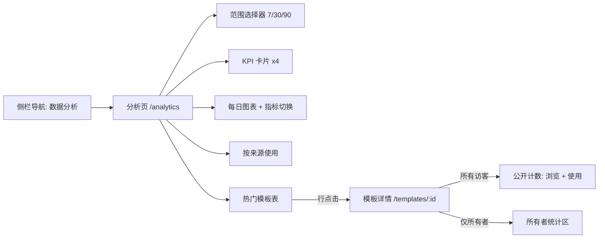
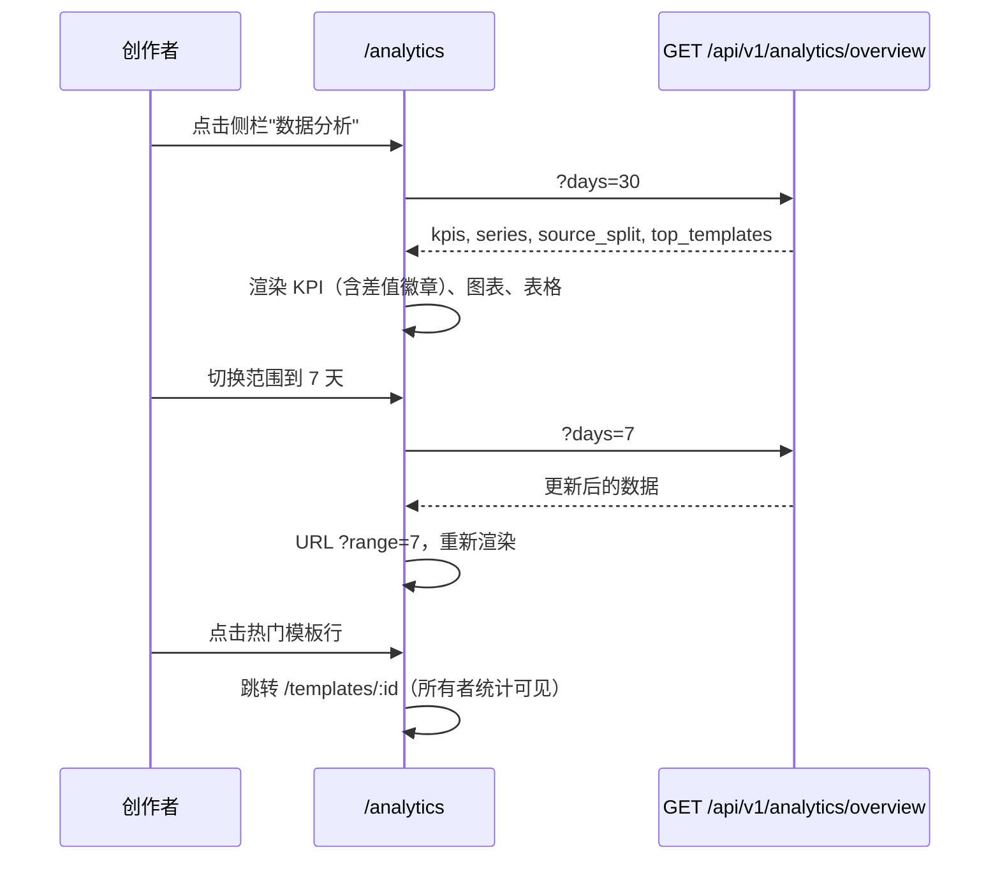
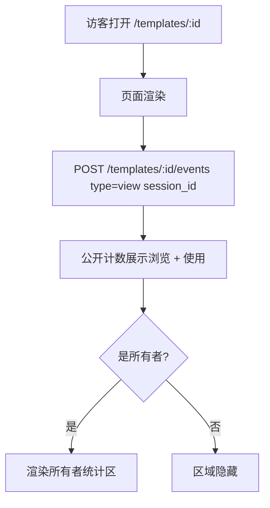

# 提示词分析 — UI/UX 设计

- **功能标识:** prompt-analytics
- **版本:** 1.0
- **状态:** 已提案（待架构评审）
- **作者:** ui-ux-agent
- **日期:** 2025-06-25
- **配套文档:** `prompt-analytics-requirements-zh-CN.md`

## 1. 设计原则

1. **创作者优先。** 分析页快速回答三个问题：我表现如何、什么在增长、哪些模板重要。KPI → 图表 → 表格，自上而下。
2. **Aurora 原生。** 复用 Layout/Sidebar 外壳、tokens、Modal、Spinner、NotificationContext。图表是 token 颜色的自定义 SVG —— 无新依赖。
3. **渐进披露。** 公开访客看到两个新计数；所有者获得统计区；创作者获得完整页面。没有任何压倒性内容。
4. **诚实的数字。** 每个数字都有解释其含义的 tooltip（如"浏览按每会话每 30 分钟去重"）。没有虚荣指标。
5. **零摩擦采集。** 浏览追踪不可见；无同意横幅、无可见的"追踪"UI（隐私说明放在页脚/文档）。

## 2. 信息架构



新路由：`/analytics`（懒加载、认证守卫）。侧栏新增"数据分析"导航项（对所有登录用户可见；无模板的创作者由空状态引导）。

## 3. 用户流程

### 3.1 创作者查看表现



### 3.2 访客浏览模板



## 4. 页面布局

### 4.1 分析页（`/analytics`）

```text
┌──────────────────────────────────────────────────────────────────────┐
│ Header（既有）                                                        │
├────────────┬─────────────────────────────────────────────────────────┤
│ 侧栏       │  数据分析                                     [30 天 ▾] │
│ （既有     │  ┌─────────┐ ┌─────────┐ ┌─────────┐ ┌─────────┐        │
│  + 新增    │  │ 浏览    │ │ 使用    │ │ 点赞    │ │ 收藏    │        │
│  数据分析  │  │ 1,204   │ │ 186     │ │ 42      │ │ 17      │        │
│  导航项）  │  │ ▲ +12%  │ │ ▲ +5%   │ │ ▼ -3%   │ │ ▲ +2%   │        │
│            │  └─────────┘ └─────────┘ └─────────┘ └─────────┘        │
│            │  ┌────────────────────────────────────────────────────┐ │
│            │  │ 每日活动          [浏览 ✓][使用 ✓][点赞][收藏]      │ │
│            │  │  ▁▂▄▆▅▇▆▄▂▁▂▃▅▆▇█▇▆▅▃▂▁▂▃▄▅▆▅▄▃▂▁▂▃▄▅▆▇  │ │
│            │  │  6月1日 ─────────────────────── 6月30日             │ │
│            │  └────────────────────────────────────────────────────┘ │
│            │  ┌──────────────────────────┐ ┌───────────────────────┐ │
│            │ │ 按来源使用                │ │ 热门模板              │ │
│            │ │ Web ████████████ 132     │ │ 1. 邮件写手     186 使 │ │
│            │ │ API ██████ 54            │ │ 2. 代码审查员    94 使 │ │
│            │ └──────────────────────────┘ │ 3. Logo 简报     41 使 │ │
│            │                              │ …（前 10）            │ │
│            │                              └───────────────────────┘ │
└────────────┴─────────────────────────────────────────────────────────┘
```

### 4.2 模板详情 — 公开计数（所有访客）

加入既有统计行（与点赞/收藏计数并列）：

```text
┌──────────────────────────────────────────────┐
│ 邮件写手模板                          [公开] │
│ …                                           │
│ 👁 1.2k   ▶ 186   ❤ 42   ★ 17              │
│ (浏览)   (使用)  (点赞) (收藏)              │
└──────────────────────────────────────────────┘
```

### 4.3 模板详情 — 所有者统计区（仅所有者）

插入在模板内容下方、评论上方（如有）：

```text
┌──────────────────────────────────────────────┐
│ 📊 所有者统计（最近 30 天）                   │
│ 浏览 412 · 使用 58 · 点赞 +9 · 收藏 +4       │
│ 浏览→使用率 14.1%                            │
│ ▁▂▃▅▆▇▆▅▃▂▁▂▃▄▅▆▇▆▅▃▂▁（每日浏览+使用）    │
└──────────────────────────────────────────────┘
```

## 5. 组件规格

### 5.1 KpiCard

| 方面 | 规格 |
|---|---|
| 内容 | 指标标签（i18n）、范围总量（locale 格式化）、相对上一范围的差值徽章 |
| 差值徽章 | ▲/▼ 箭头 + 百分比；正向 `--success`，负向 `--danger`，0%/无数据 `--text-2` |
| 样式 | `--surface-2` 背景、`--border` 描边、`--radius-12`、内边距 16px；标签 13px `--text-2`；数值 24px `--text-1` |
| Tooltip | 解释指标定义（如"使用 = 通过 Web 或 API 从该模板创建的提示词数"） |
| 无障碍 | 数据加载时通过 `aria-live` 播报数值；tooltip 聚焦与悬停均显示 |

### 5.2 DailyChart（自定义 SVG）

| 方面 | 规格 |
|---|---|
| 类型 | 堆叠或分组柱状图（按日分桶）；柱用 `--accent`（浏览）、`--secondary`（使用）、`--success`（点赞）、`--warning`（收藏） |
| 交互 | 悬停/点按柱 → tooltip 显示日期 + 数值；指标切换（复选框 chips）显示/隐藏序列 |
| 坐标轴 | Y 自动缩放并取整刻度（最多 4 条网格线，`--border` 色）；X 显示首/中/尾日期标签 |
| 空状态 | 所有序列隐藏或无数据时：居中"该范围内没有活动"文本 |
| 无障碍 | `role="img"` + `aria-label` 摘要（"6月1日至30日的每日浏览与使用"）；"以表格查看"切换渲染含相同数据的可访问 `<table>` |
| 尺寸 | 宽度响应式，固定高 220px |

### 5.3 SourceSplit

| 方面 | 规格 |
|---|---|
| 内容 | 两条水平条：Web（计数，`--accent`）、API（计数，`--secondary`）；右侧百分比 |
| 空状态 | "该范围内没有使用" |
| 无障碍 | 数值以文本呈现（不依赖颜色）；条带 `aria-label` |

### 5.4 TopTemplatesTable

| 方面 | 规格 |
|---|---|
| 列 | # · 标题 · 浏览 · 使用 · 新增点赞 · 新增收藏 · 浏览→使用 % |
| 行 | 按使用量前 10（平局看浏览）；行点击跳转 `/templates/:id`；标题超长省略 |
| 排序 | 固定（使用量降序）；v1 无列排序 |
| 空状态 | "还没有模板活动" + Prompt Square 链接 |
| 样式 | 既有表格模式：`--surface-2` 表头行、`--border` 行分隔、hover `--surface-3` |
| 无障碍 | 真正的 `<table>` 配 `<th scope="col">`；行是链接（可键盘聚焦） |

### 5.5 RangeSelector

| 方面 | 规格 |
|---|---|
| 选项 | 7 天 / 30 天 / 90 天（分段控件而非下拉 —— 三个按钮） |
| 行为 | 点击 → 取数 + URL 更新（`?range=`）；激活段 `--accent`-soft 背景 + `--accent` 文本 |
| 无障碍 | `role="radiogroup"`，每项 `aria-checked` |

### 5.6 PublicCounters（模板详情）

| 方面 | 规格 |
|---|---|
| 内容 | 眼睛图标 + 浏览计数、播放图标 + 使用计数，追加在既有点赞/收藏计数之前 |
| 格式 | 紧凑格式（1.2k、15.4k、2.1M）通过共享 `formatCount` 工具；精确值放 `title` 属性 |
| 无障碍 | 每个计数 `aria-label`（"1,204 次浏览"）；图标装饰性 `aria-hidden` |

### 5.7 OwnerStatsSection

| 方面 | 规格 |
|---|---|
| 内容 | 标题"所有者统计（最近 30 天）"、四个计数、浏览→使用率、迷你图（迷你 SVG，100% 宽 × 40px，`--accent` 线） |
| 可见性 | 仅 `isOwner` 时渲染；服务端强制（FR-20）—— 客户端判断是 UX 而非安全 |
| 迷你图 | 浏览+使用合并的每日折线；无坐标轴；悬停 tooltip 显示日期 + 数值 |
| 无障碍 | `aria-label` 摘要文本；迷你图 `role="img"` |

### 5.8 侧栏导航项

| 方面 | 规格 |
|---|---|
| 标签 | "Analytics" / "数据分析"，配柱状图图标（既有 Icons.jsx 集或新增简单 SVG） |
| 位置 | "我的收藏"下方、分类上方 |
| 可见性 | 仅登录用户（与"我的提示词"/"我的点赞"模式一致） |

## 6. 交互细节

1. **浏览追踪调用:** 在模板详情挂载时通过 `useEffect` 触发（每次挂载一次；用 ref 守卫保证 React StrictMode 双调用安全）；会话 id 来自 localStorage（D-6）；调用即发即弃并 `catch(() => {})`。
2. **范围切换:** 取新数据、通过 `setSearchParams` 更新 URL（push）、保持滚动位置。
3. **图表指标切换:** 纯客户端显示/隐藏（数据已加载）；不重新取数。
4. **深链:** `/analytics?range=7` 加载时恢复范围；非法值回退到 30。
5. **加载:** KPI 卡片与图表显示骨架块（与搜索功能相同的微光）；表格显示 5 行骨架。
6. **错误:** 任何分析取数失败 → 错误横幅 + 重试；保留最后成功的数据渲染。
7. **竞态守卫:** 范围切换使用 requestId 模式（与搜索功能相同）。
8. **数字格式化:** `formatCount` 工具（≥10k 紧凑、以下用 locale 千分位）；百分比一位小数。
9. **差值计算:** 服务端返回当前 + 上一总量；客户端渲染徽章（无客户端日期运算）。

## 7. 状态汇总

| 状态 | 触发 | UI |
|---|---|---|
| 加载中（首次） | 页面加载 / 范围切换 | 骨架 KPI + 图表 + 表格行 |
| 已加载有数据 | 取数成功 | 完整页面 |
| 零模板 | 创作者没有模板 | 空状态：插图 + "创建你的第一个模板" CTA |
| 无活动 | 有模板但范围内零事件 | KPI 显示 0 与中性徽章；图表显示"没有活动"；表格空状态 |
| 错误 | API 失败 | 错误横幅 + 重试；保留旧数据 |
| 匿名 | 未登录 | 重定向到 /login（路由守卫） |

## 8. 视觉风格（Aurora 合规）

- **KPI 卡片:** `--surface-2`、`--border`、`--radius-12`；差值升 `--success`、降 `--danger`。
- **图表:** 柱/线用 `--accent`/`--secondary`/`--success`/`--warning`；网格线 `--border`；轴文本 11px `--text-3`；tooltip `--surface-3` + `--shadow-lg`。
- **来源拆分条:** `--accent`（web）、`--secondary`（api）；轨道 `--surface-3`。
- **表格:** 表头 `--surface-2` 13px `--text-2` 大写；行 `--text-1`；hover `--surface-3`；浏览→使用率为 `--accent` 文本。
- **公开计数:** 图标 `--text-2`；计数 `--text-1` 14px；与既有点赞/收藏同一行。
- **所有者统计区:** `--surface-2` 卡片、`--radius-12`、带小图表图标的标题；迷你图 `--accent`。
- **范围选择器:** `--surface-3` 轨道上的分段控件；激活 `--accent`-soft 背景。
- **暗/亮主题:** 仅 token 样式；两个主题自动工作。

## 9. 国际化考量（EN/ZH）

新增命名空间 `analytics.*`：

```json
{
  "analytics": {
    "title": "Analytics",
    "range": { "7": "7 days", "30": "30 days", "90": "90 days" },
    "kpi": { "views": "Views", "uses": "Uses", "likes": "New Likes", "favorites": "New Favorites" },
    "kpi_tooltip": {
      "views": "Template detail page views, deduplicated per session per 30 minutes.",
      "uses": "Prompts created from your templates via web UI or API key.",
      "likes": "New likes in the selected range.",
      "favorites": "New favorites in the selected range."
    },
    "delta": { "up": "+{{value}}% vs. previous period", "down": "-{{value}}% vs. previous period", "flat": "No change vs. previous period" },
    "chart": { "title": "Daily activity", "empty": "No activity in this range", "view_as_table": "View as table", "date": "Date", "views": "Views", "uses": "Uses", "likes": "Likes", "favorites": "Favorites" },
    "source": { "title": "Uses by source", "web": "Web", "api": "API", "empty": "No uses in this range" },
    "top": { "title": "Top templates", "views": "Views", "uses": "Uses", "likes": "New likes", "favorites": "New favorites", "rate": "View→Use", "empty": "No template activity yet" },
    "owner_stats": { "title": "Owner stats (last 30 days)", "rate": "View→Use rate" },
    "public": { "views": "views", "uses": "uses" },
    "empty": { "title": "No templates yet", "body": "Create your first template to see analytics.", "cta": "Create a template" },
    "error": { "fetch": "Failed to load analytics.", "retry": "Retry" }
  }
}
```

中文镜像：

```json
{
  "analytics": {
    "title": "数据分析",
    "range": { "7": "7 天", "30": "30 天", "90": "90 天" },
    "kpi": { "views": "浏览", "uses": "使用", "likes": "新增点赞", "favorites": "新增收藏" },
    "kpi_tooltip": {
      "views": "模板详情页浏览量，每会话每 30 分钟去重。",
      "uses": "通过 Web UI 或 API key 从你的模板创建的提示词数。",
      "likes": "所选范围内的新增点赞。",
      "favorites": "所选范围内的新增收藏。"
    },
    "delta": { "up": "较上一周期 +{{value}}%", "down": "较上一周期 -{{value}}%", "flat": "与上一周期持平" },
    "chart": { "title": "每日活动", "empty": "该范围内没有活动", "view_as_table": "以表格查看", "date": "日期", "views": "浏览", "uses": "使用", "likes": "点赞", "favorites": "收藏" },
    "source": { "title": "按来源使用", "web": "Web", "api": "API", "empty": "该范围内没有使用" },
    "top": { "title": "热门模板", "views": "浏览", "uses": "使用", "likes": "新增点赞", "favorites": "新增收藏", "rate": "浏览→使用", "empty": "还没有模板活动" },
    "owner_stats": { "title": "所有者统计（最近 30 天）", "rate": "浏览→使用率" },
    "public": { "views": "浏览", "uses": "使用" },
    "empty": { "title": "还没有模板", "body": "创建你的第一个模板以查看分析。", "cta": "创建模板" },
    "error": { "fetch": "加载分析数据失败。", "retry": "重试" }
  }
}
```

说明: 数字使用 i18next 格式化（`{{count, number}}`）实现 locale 千分位；紧凑格式（1.2k）是共享工具，ZH 可自行处理（≥10k 用 1.2万 可接受；若更简单保持 1.2k 也行 —— 开发者选择，已记录）。"View→Use" 在 ZH 中渲染为"浏览→使用"；箭头是语言中立的。

## 10. 无障碍

- KPI 数值加载时礼貌播报（包裹 KPI 行的 `aria-live="polite"` 区域）。
- 图表: `role="img"` 配描述性 `aria-label`；"以表格查看"切换为屏幕阅读器用户提供真实表格形式的原始每日数据。
- 表格: 语义化 `<table>`、`<th scope>`、行链接可聚焦且有可见焦点环。
- 范围选择器: radiogroup 模式、方向键导航。
- Tooltip: 聚焦与悬停都显示；可通过 Escape 关闭。
- 迷你图: `role="img"` + `aria-label` 摘要（"最近 30 天每日浏览与使用，峰值 42 于 6月14日"）。
- 所有颜色在两个主题中满足 WCAG AA（基于 token）。

## 11. 给开发者的实现说明

1. **路由:** 在 App.js 添加 `/analytics`，懒加载 + 既有认证守卫；添加侧栏导航项（仅登录）。
2. **API 客户端:** 在 services/api.js 新增 `getAnalyticsOverview(days)`、`getTemplateStats(id, days)`、`recordTemplateEvent(id, sessionId)`。
3. **图表:** 自定义 SVG 组件（DailyChart、Sparkline）—— 无依赖。若团队偏好 recharts，设计的数据契约（每日数组）不变；用相同 props 包装 recharts。
4. **浏览追踪:** 在 TemplateDetails.js 的 `useEffect` 中 —— 用 ref 守卫防止 StrictMode 双调用；读取/创建 localStorage 的 `op_analytics_sid`；POST 即发即弃。
5. **formatCount 工具:** 共享助手（紧凑 + locale 感知）；对边界（999、1000、9999、10000、1M）做单元测试。
6. **数据契约:** overview 响应 `{kpis: {views, uses, likes, favorites, prev_views, prev_uses, prev_likes, prev_favorites}, series: [{date, views, uses, likes, favorites}], source_split: {web, api}, top_templates: [{id, title, views, uses, likes, favorites, rate}]}`；模板统计响应类似但无 top_templates。
7. **测试:** formatCount、DailyChart 数据→路径映射、差值徽章逻辑的单元测试；KpiCard、RangeSelector、TopTemplatesTable（渲染 + 无障碍）的组件测试；分析页的集成测试（加载 → 已加载、范围切换、空状态）。
8. **后端挂钩:** 在 CreatePrompt 与 GetPromptByAlias 中插桩事件记录器（异步）；在同一写入路径增加 `view_count`/`use_count` 递增；见需求 FR-1–FR-9、D-2/D-4。
