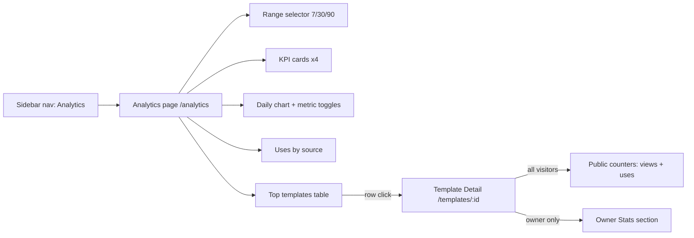
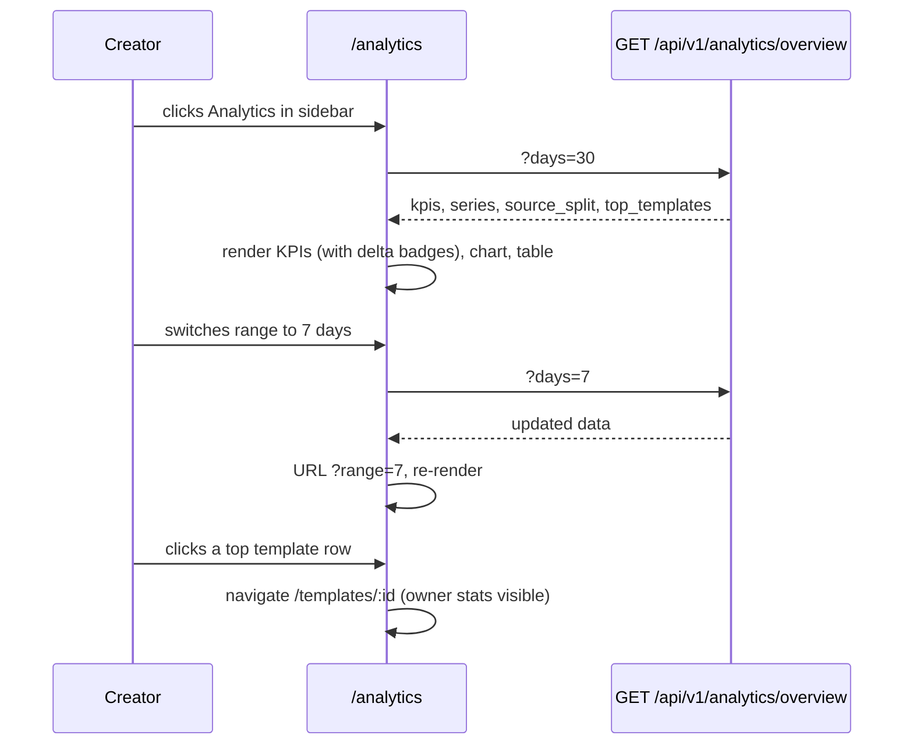
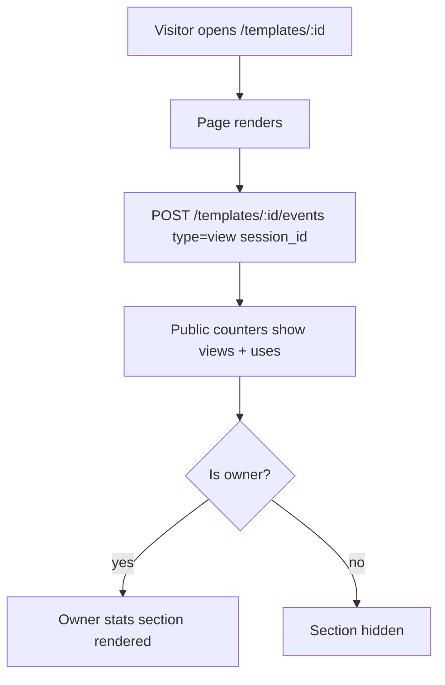

# Prompt Analytics — UI/UX Design

- **Feature ID:** prompt-analytics
- **Version:** 1.0
- **Status:** Proposed (for architecture review)
- **Author:** ui-ux-agent
- **Date:** 2025-06-25
- **Companion doc:** `prompt-analytics-requirements.md`

## 1. Design Principles

1. **Creator-first.** The analytics page answers three questions fast: how am I doing, what's trending, which templates matter. KPIs → chart → table, top to bottom.
2. **Aurora-native.** Reuse Layout/Sidebar shell, tokens, Modal, Spinner, NotificationContext. Charts are custom SVG in token colors — no new dependency.
3. **Progressive disclosure.** Public visitors see two new counters; owners get a stats section; creators get a full page. Nothing overwhelms.
4. **Honest numbers.** Every number has a tooltip explaining what counts (e.g., "views are deduplicated per session per 30 min"). No vanity metrics.
5. **Zero-friction capture.** View tracking is invisible; no consent banner, no visible "tracking" UI (privacy note in footer/docs instead).

## 2. Information Architecture



New route: `/analytics` (lazy-loaded, auth-guarded). Sidebar gains an "Analytics" nav item (visible to all logged-in users; empty state guides creators with no templates).

## 3. User Flows

### 3.1 Creator checks performance



### 3.2 Visitor views template



## 4. Page Layouts

### 4.1 Analytics page (`/analytics`)

```text
┌──────────────────────────────────────────────────────────────────────┐
│ Header (existing)                                                    │
├────────────┬─────────────────────────────────────────────────────────┤
│ Sidebar    │  Analytics                                    [30 days ▾]│
│ (existing  │  ┌─────────┐ ┌─────────┐ ┌─────────┐ ┌─────────┐        │
│  + new     │  │ Views   │ │ Uses    │ │ Likes   │ │Favorites│        │
│  Analytics │  │ 1,204   │ │ 186     │ │ 42      │ │ 17      │        │
│  nav item) │  │ ▲ +12%  │ │ ▲ +5%   │ │ ▼ -3%   │ │ ▲ +2%   │        │
│            │  └─────────┘ └─────────┘ └─────────┘ └─────────┘        │
│            │  ┌────────────────────────────────────────────────────┐ │
│            │  │ Daily activity        [Views ✓][Uses ✓][Likes][Fav]│ │
│            │  │  ▁▂▄▆▅▇▆▄▂▁▂▃▅▆▇█▇▆▅▃▂▁▂▃▄▅▆▅▄▃▂▁▂▃▄▅▆▇  │ │
│            │  │  Jun 1 ─────────────────────── Jun 30              │ │
│            │  └────────────────────────────────────────────────────┘ │
│            │  ┌──────────────────────────┐ ┌───────────────────────┐ │
│            │ │ Uses by source           │ │ Top templates         │ │
│            │ │ Web ████████████ 132     │ │ 1. Email writer  186u │ │
│            │ │ API ██████ 54            │ │ 2. Code reviewer  94u │ │
│            │ └──────────────────────────┘ │ 3. Logo brief     41u │ │
│            │                              │ … (top 10)            │ │
│            │                              └───────────────────────┘ │
└────────────┴─────────────────────────────────────────────────────────┘
```

### 4.2 Template detail — public counters (all visitors)

Added to the existing stats row (next to like/favorite counts):

```text
┌──────────────────────────────────────────────┐
│ Email Writer Template              [public]  │
│ …                                           │
│ 👁 1.2k   ▶ 186   ❤ 42   ★ 17              │
│ (views)  (uses)  (likes) (favorites)        │
└──────────────────────────────────────────────┘
```

### 4.3 Template detail — owner stats section (owner only)

Inserted below the template content, above comments (if any):

```text
┌──────────────────────────────────────────────┐
│ 📊 Owner stats (last 30 days)                │
│ Views 412 · Uses 58 · Likes +9 · Favs +4     │
│ View→Use rate 14.1%                          │
│ ▁▂▃▅▆▇▆▅▃▂▁▂▃▄▅▆▇▆▅▃▂▁ (daily views+uses)   │
└──────────────────────────────────────────────┘
```

## 5. Component Specifications

### 5.1 KpiCard

| Aspect | Spec |
|---|---|
| Content | Metric label (i18n), range total (locale-formatted), delta badge vs. previous range |
| Delta badge | ▲/▼ arrow + percentage; `--success` for positive, `--danger` for negative, `--text-2` for 0%/no data |
| Styling | `--surface-2` bg, `--border` stroke, `--radius-12`, padding 16px; label 13px `--text-2`; value 24px `--text-1` |
| Tooltip | Explains metric definition (e.g., "Uses = prompts created from this template via web or API") |
| A11y | Value announced via `aria-live` on data load; tooltip on focus + hover |

### 5.2 DailyChart (custom SVG)

| Aspect | Spec |
|---|---|
| Type | Stacked or grouped bar chart (daily buckets); bars use `--accent` (views), `--secondary` (uses), `--success` (likes), `--warning` (favorites) |
| Interactions | Hover/tap a bar → tooltip with date + values; metric toggles (checkbox-chips) show/hide series |
| Axes | Y auto-scaled with nice ticks (max 4 gridlines, `--border` color); X shows first/middle/last date labels |
| Empty | If all series hidden or no data: centered "No activity in this range" text |
| A11y | `role="img"` + `aria-label` summary ("Daily views and uses, Jun 1–30"); a "View as table" toggle renders an accessible `<table>` with the same data |
| Size | Responsive width, fixed 220px height |

### 5.3 SourceSplit

| Aspect | Spec |
|---|---|
| Content | Two horizontal bars: Web (count, `--accent`), API (count, `--secondary`); percentages on the right |
| Empty | "No uses in this range" |
| A11y | Values in text (not color-only); bars have `aria-label` |

### 5.4 TopTemplatesTable

| Aspect | Spec |
|---|---|
| Columns | # · Title · Views · Uses · New likes · New favorites · View→Use % |
| Rows | Top 10 by uses (ties → views); row click navigates to `/templates/:id`; title truncated with ellipsis |
| Sort | Fixed (by uses desc); no column sorting in v1 |
| Empty | "No template activity yet" + link to Prompt Square |
| Styling | Existing table patterns: `--surface-2` header row, `--border` row separators, hover `--surface-3` |
| A11y | Real `<table>` with `<th scope="col">`; row is a link (keyboard focusable) |

### 5.5 RangeSelector

| Aspect | Spec |
|---|---|
| Options | 7 days / 30 days / 90 days (segmented control, not dropdown — three buttons) |
| Behavior | Click → fetch + URL update (`?range=`); active segment `--accent`-soft bg + `--accent` text |
| A11y | `role="radiogroup"` with `aria-checked` per option |

### 5.6 PublicCounters (template detail)

| Aspect | Spec |
|---|---|
| Content | Eye icon + view count, play icon + use count, appended before existing like/favorite counts |
| Format | Compact (1.2k, 15.4k, 2.1M) via shared `formatCount` util; exact value in `title` attribute |
| A11y | `aria-label` per counter ("1,204 views"); icons decorative with `aria-hidden` |

### 5.7 OwnerStatsSection

| Aspect | Spec |
|---|---|
| Content | Header "Owner stats (last 30 days)", four counters, view→use rate, sparkline (mini SVG, 100% width × 40px, `--accent` line) |
| Visibility | Rendered only when `isOwner`; server enforces (FR-20) — client check is UX, not security |
| Sparkline | Views+uses combined daily line; no axes; tooltip on hover with date + values |
| A11y | `aria-label` summary text; sparkline `role="img"` |

### 5.8 Sidebar nav item

| Aspect | Spec |
|---|---|
| Label | "Analytics" / "数据分析" with bar-chart icon (existing Icons.jsx set or new simple SVG) |
| Placement | Below "My Favorites", above Categories |
| Visibility | Logged-in users only (matches "My Prompts"/"My Likes" pattern) |

## 6. Interaction Details

1. **View tracking call:** fired on template detail mount via `useEffect` (once per mount; React StrictMode double-invoke safe via ref guard); session id from localStorage (D-6); call is fire-and-forget with `catch(() => {})`.
2. **Range change:** fetches new data, updates URL via `setSearchParams` (push), keeps scroll position.
3. **Chart metric toggles:** purely client-side show/hide (data already loaded); no refetch.
4. **Deep link:** `/analytics?range=7` restores range on load; invalid values fall back to 30.
5. **Loading:** KPI cards and chart show skeleton blocks (same shimmer as search feature); table shows 5 skeleton rows.
6. **Error:** any analytics fetch failure → error banner with Retry; last successful data stays rendered.
7. **Race guard:** range switches use requestId pattern (same as search feature).
8. **Number formatting:** `formatCount` util (compact ≥10k, locale thousands separator below); percentages with one decimal.
9. **Delta calculation:** server returns current + previous totals; client renders badge (no client-side date math).

## 7. States Summary

| State | Trigger | UI |
|---|---|---|
| Loading (first) | Page load / range change | Skeleton KPIs + chart + table rows |
| Loaded with data | Successful fetch | Full page |
| Zero templates | Creator owns no templates | Empty state: illustration + "Create your first template" CTA |
| No activity | Templates exist, zero events in range | KPIs show 0 with neutral badges; chart shows "No activity"; table empty state |
| Error | API failure | Error banner + Retry; stale data kept |
| Anonymous | Not logged in | Redirect to /login (route guard) |

## 8. Visual Style (Aurora compliance)

- **KPI cards:** `--surface-2`, `--border`, `--radius-12`; delta up `--success`, down `--danger`.
- **Chart:** bars/lines in `--accent`/`--secondary`/`--success`/`--warning`; gridlines `--border`; axis text 11px `--text-3`; tooltip `--surface-3` + `--shadow-lg`.
- **Source split bars:** `--accent` (web), `--secondary` (api); track `--surface-3`.
- **Table:** header `--surface-2` 13px `--text-2` uppercase; rows `--text-1`; hover `--surface-3`; view→use rate as `--accent` text.
- **Public counters:** icons `--text-2`; counts `--text-1` 14px; same row as existing like/favorite.
- **Owner stats section:** `--surface-2` card, `--radius-12`, header with small chart icon; sparkline `--accent`.
- **Range selector:** segmented control on `--surface-3` track; active `--accent`-soft bg.
- **Dark/light:** token-only styling; both themes work automatically.

## 9. i18n Considerations (EN/ZH)

New namespace `analytics.*`:

```json
{
  "analytics": {
    "title": "Analytics",
    "range": { "7": "7 days", "30": "30 days", "90": "90 days" },
    "kpi": { "views": "Views", "uses": "Uses", "likes": "New Likes", "favorites": "New Favorites" },
    "kpi_tooltip": {
      "views": "Template detail page views, deduplicated per session per 30 minutes.",
      "uses": "Prompts created from your templates via web UI or API key.",
      "likes": "New likes in the selected range.",
      "favorites": "New favorites in the selected range."
    },
    "delta": { "up": "+{{value}}% vs. previous period", "down": "-{{value}}% vs. previous period", "flat": "No change vs. previous period" },
    "chart": { "title": "Daily activity", "empty": "No activity in this range", "view_as_table": "View as table", "date": "Date", "views": "Views", "uses": "Uses", "likes": "Likes", "favorites": "Favorites" },
    "source": { "title": "Uses by source", "web": "Web", "api": "API", "empty": "No uses in this range" },
    "top": { "title": "Top templates", "views": "Views", "uses": "Uses", "likes": "New likes", "favorites": "New favorites", "rate": "View→Use", "empty": "No template activity yet" },
    "owner_stats": { "title": "Owner stats (last 30 days)", "rate": "View→Use rate" },
    "public": { "views": "views", "uses": "uses" },
    "empty": { "title": "No templates yet", "body": "Create your first template to see analytics.", "cta": "Create a template" },
    "error": { "fetch": "Failed to load analytics.", "retry": "Retry" }
  }
}
```

ZH mirror:

```json
{
  "analytics": {
    "title": "数据分析",
    "range": { "7": "7 天", "30": "30 天", "90": "90 天" },
    "kpi": { "views": "浏览", "uses": "使用", "likes": "新增点赞", "favorites": "新增收藏" },
    "kpi_tooltip": {
      "views": "模板详情页浏览量，每会话每 30 分钟去重。",
      "uses": "通过 Web UI 或 API key 从你的模板创建的提示词数。",
      "likes": "所选范围内的新增点赞。",
      "favorites": "所选范围内的新增收藏。"
    },
    "delta": { "up": "较上一周期 +{{value}}%", "down": "较上一周期 -{{value}}%", "flat": "与上一周期持平" },
    "chart": { "title": "每日活动", "empty": "该范围内没有活动", "view_as_table": "以表格查看", "date": "日期", "views": "浏览", "uses": "使用", "likes": "点赞", "favorites": "收藏" },
    "source": { "title": "按来源使用", "web": "Web", "api": "API", "empty": "该范围内没有使用" },
    "top": { "title": "热门模板", "views": "浏览", "uses": "使用", "likes": "新增点赞", "favorites": "新增收藏", "rate": "浏览→使用", "empty": "还没有模板活动" },
    "owner_stats": { "title": "所有者统计（最近 30 天）", "rate": "浏览→使用率" },
    "public": { "views": "浏览", "uses": "使用" },
    "empty": { "title": "还没有模板", "body": "创建你的第一个模板以查看分析。", "cta": "创建模板" },
    "error": { "fetch": "加载分析数据失败。", "retry": "重试" }
  }
}
```

Notes: numbers use i18next formatting (`{{count, number}}`) for locale separators; compact formatting (1.2k) is a shared util with its own ZH handling (1.2万 for ≥10k is acceptable; keep 1.2k if simpler — developer choice, documented). "View→Use" is rendered as "浏览→使用" in ZH; the arrow is language-neutral.

## 10. Accessibility

- KPI values announced politely on load (`aria-live="polite"` region wrapping the KPI row).
- Chart: `role="img"` with descriptive `aria-label`; "View as table" toggle gives screen-reader users the raw daily data as a real table.
- Table: semantic `<table>`, `<th scope>`, row links focusable with visible focus ring.
- Range selector: radiogroup pattern, arrow-key navigation.
- Tooltips: appear on focus as well as hover; dismissible via Escape.
- Sparkline: `role="img"` + `aria-label` with summary ("Daily views and uses over the last 30 days, peak 42 on Jun 14").
- All colors meet WCAG AA in both themes (token-based).

## 11. Implementation Notes for Developer

1. **Routes:** add `/analytics` to App.js with lazy import + existing auth guard; add Sidebar nav item (logged-in only).
2. **API client:** new functions `getAnalyticsOverview(days)`, `getTemplateStats(id, days)`, `recordTemplateEvent(id, sessionId)` in services/api.js.
3. **Charts:** custom SVG components (DailyChart, Sparkline) — no dependency. If the team prefers recharts, the design's data contract (daily arrays) works unchanged; wrap recharts with the same props.
4. **View tracking:** in TemplateDetails.js `useEffect` — guard against StrictMode double-invoke with a ref; read/create `op_analytics_sid` in localStorage; POST fire-and-forget.
5. **formatCount util:** shared helper (compact + locale-aware); unit tests for boundaries (999, 1000, 9999, 10000, 1M).
6. **Data contract:** overview response `{kpis: {views, uses, likes, favorites, prev_views, prev_uses, prev_likes, prev_favorites}, series: [{date, views, uses, likes, favorites}], source_split: {web, api}, top_templates: [{id, title, views, uses, likes, favorites, rate}]}`; template stats response similar minus top_templates.
7. **Testing:** unit tests for formatCount, DailyChart data→path mapping, delta badge logic; component tests for KpiCard, RangeSelector, TopTemplatesTable (render + a11y); integration test for the analytics page (loading → loaded, range switch, empty states).
8. **Backend hooks:** instrument CreatePrompt and GetPromptByAlias with the event recorder (async); add `view_count`/`use_count` increment in the same write path; see requirements FR-1–FR-9, D-2/D-4.
