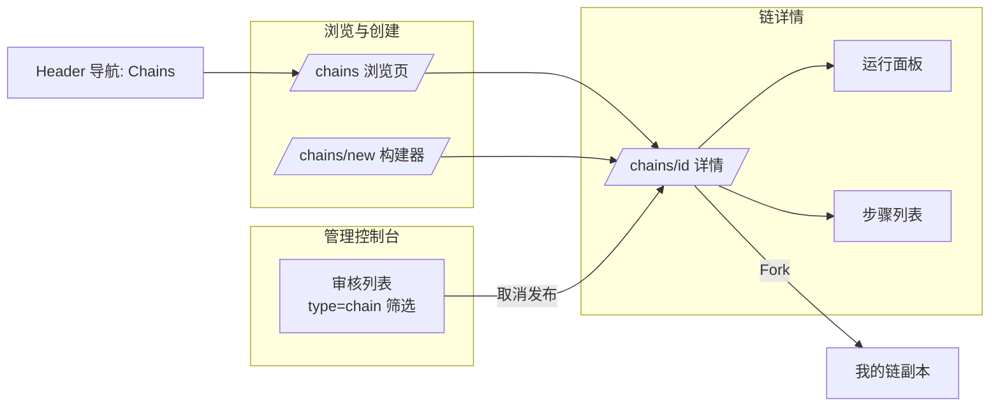
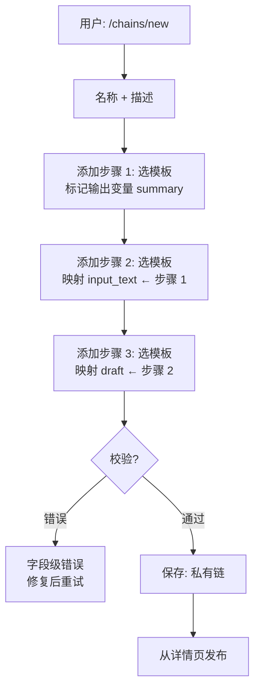
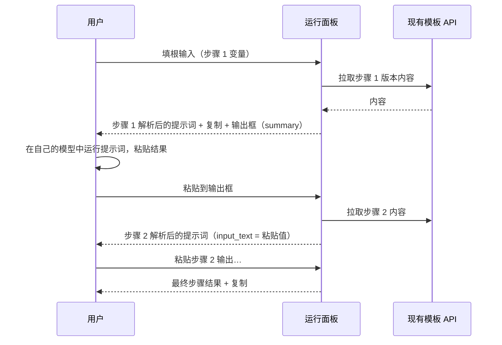

# 提示词链 — UI/UX 设计

- **Feature ID:** prompt-chaining
- **Version:** 1.0
- **Status:** Proposed（待架构评审）
- **Author:** ui-ux-agent
- **Date:** 2026-10-12
- **Companion doc:** `prompt-chaining-requirements-zh-CN.md`

## 1. 设计原则

1. **线性且易读。** 链像菜谱一样自上而下阅读：编号步骤、以纯文本明确表达"第 N 步的输出 → 第 M 步的变量 X"的接线。
2. **复用一切模式。** 模板选择器、变量输入、可见性徽标、发布/fork 操作、审核弹窗 —— 全部与模板/集合一致。零新增交互词汇。
3. **运行是主角。** 详情页的运行面板是价值落地处：填根输入、读每步解析后的提示词、粘贴输出、看它们流向下游。
4. **对范围诚实。** 产品组装提示词；用户自己的模型产生输出。输出捕获框让这个契约可见而非隐藏。
5. **Aurora 原生。** 步骤卡片为柔和面板，以垂直强调线连接；解析后的提示词用等宽字体。

## 2. 信息架构



| 界面 | 位置 | 内容 |
|---|---|---|
| `/chains` | 新路由 | 搜索、排序（最新/最多 fork）、链卡片网格 |
| `/chains/new` | 新路由，需登录 | 名称/描述 + 步骤构建器 |
| `/chains/{id}` | 新路由 | 头部、步骤列表、运行面板、操作（编辑/发布/fork/删除） |
| Header 导航 | 现有 header | "Chains" 入口（图标：链） |
| 管理 `/admin/templates` | 现有审核页 | `type=chain` 筛选；查看 + 取消发布操作 |
| 模板详情 | 现有页面 | 无变化（链引用模板；v1 无反向链接） |

## 3. 用户流程

### 3.1 构建链



### 3.2 运行链



## 4. 页面布局

### 4.1 `/chains` 浏览（桌面）

```
┌──────────────────────────────────────────────────────────────────────────┐
│ Header  [Logo]  Home  Templates  Collections  Chains      [user ▾]       │
├──────────────────────────────────────────────────────────────────────────┤
│  提示词链                                                  [+ 新建链]      │
│  [🔍 搜索链…                                  ] [最新 ▾]                 │
│ ┌────────────────┐ ┌────────────────┐ ┌────────────────┐                 │
│ │ Article → Reply │ │ Research Pack  │ │ Code Review    │                 │
│ │ 3 步 · by A     │ │ 5 步 · by B    │ │ 2 步 · by C    │                 │
│ │ 总结、提取、     │ │ 调研、大纲、    │ │ 先审查后        │                 │
│ │ 起草回复        │ │ 起草、润色      │ │ 重写            │                 │
│ │ 🔗 12 forks     │ │ 🔗 4 forks     │ │ 🔗 9 forks     │                 │
│ └────────────────┘ └────────────────┘ └────────────────┘                 │
│ ‹ 1 2 3 ›                                                                │
└──────────────────────────────────────────────────────────────────────────┘
```

### 4.2 `/chains/new` 构建器（桌面）

```
┌──────────────────────────────────────────────────────────────────────────┐
│  新建链                                                                    │
│  名称 [________________________]  描述 [____________________]             │
│ ┌──────────────────────────────────────────────────────────────────────┐ │
│ │ 步骤 1                                       [模板 ▾] [版本 ▾]        │ │
│ │ 模板: "Article Summarizer"（最新）                                    │ │
│ │ 变量:                                                                │ │
│ │   article_text   (•) 运行时输入   ( ) 映射自…                        │ │
│ │   tone           (•) 运行时输入   ( ) 映射自…                        │ │
│ │   summary        ★ 输出变量                                          │ │
│ │ [移除步骤]                                                           │ │
│ ├──────────────────────────────────────────────────────────────────────┤ │
│ │ 步骤 2                                       [模板 ▾] [版本 ▾]        │ │
│ │ 模板: "Action Items Extractor"（最新）                               │ │
│ │ 变量:                                                                │ │
│ │   input_text     ( ) 运行时输入   (•) 映射自 [步骤 1 ▾]              │ │
│ │   format         (•) 运行时输入   ( ) 映射自…                        │ │
│ │   actions        ★ 输出变量                                          │ │
│ │ [移除步骤]                                                           │ │
│ ├──────────────────────────────────────────────────────────────────────┤ │
│ │ [+ 添加步骤]                                2 / 10 步 · 1 / 20 条链    │ │
│ └──────────────────────────────────────────────────────────────────────┘ │
│                                            [取消] [保存链]                │
└──────────────────────────────────────────────────────────────────────────┘
```

### 4.3 `/chains/{id}` 详情 + 运行面板（桌面）

```
┌──────────────────────────────────────────────────────────────────────────┐
│  Article → Reply                                          [私有 🔒]       │
│  by Alice · 3 步 · 更新于 2 天前             [编辑] [发布] [Fork] [⋯]     │
│  总结文章、提取行动项、起草回复。                                           │
│ ┌───────────────────────────────┬──────────────────────────────────────┐ │
│ │ 链（步骤）                     │ 运行                                  │ │
│ │ ① Article Summarizer          │ 根输入:                               │ │
│ │    article_text [输入]         │  article_text [___________________]  │ │
│ │    tone [输入]                 │  tone [___________________]          │ │
│ │    summary ★输出               │  format [___________________]        │ │
│ │        │                      │ [▶ 运行链] [重置]                     │ │
│ │        ▼                      │ ──────────────────────────────────── │ │
│ │ ② Action Items Extractor      │ 步骤 1 结果                           │ │
│ │    input_text ← ① summary     │ ┌──────────────────────────────────┐ │ │
│ │    format [输入]               │ │ Summarize the following article… │ │ │
│ │    actions ★输出               │ │ （解析后的提示词，等宽）           │ │ │
│ │        │                      │ └──────────────────────────────────┘ │ │
│ │        ▼                      │ [📋 复制]                             │ │
│ │ ③ Reply Drafter               │ 输出 → summary:                       │ │
│ │    draft ← ② actions          │ [在此粘贴你的结果________________]    │ │
│ │    tone ← 根输入               │ [继续到步骤 2 →]  [跳过]              │ │
│ └───────────────────────────────┴──────────────────────────────────────┘ │
└──────────────────────────────────────────────────────────────────────────┘
```

### 4.4 移动端（<768px）

步骤与运行面板垂直堆叠；步骤卡片折叠为标题 + 变量徽标（点按展开）；运行面板的步骤结果堆叠且"继续"按钮吸底。

## 5. 组件规格

| 组件 | 基于 / 新建 | 规格 |
|---|---|---|
| `ChainsBrowsePage` | 复用 Home 网格模式 | 搜索输入、排序下拉（最新/最多 fork）、链卡片网格、分页 |
| `ChainCard` | 复用 PromptCard 模式 | 名称、步骤数、所有者、描述（2 行截断）、fork 数；点击 → 详情 |
| `ChainBuilderPage` | 新建 | 名称/描述表单 + 步骤列表 + 添加步骤；实时限额计数；保存/取消 |
| `StepCard`（构建器） | 新建 | 模板选择器（可搜索，复用）、版本下拉（最新 + 各版本）、带 输入/映射 单选与来源步骤下拉的变量行、输出变量星标切换、移除 |
| `ChainDetailPage` | 新建 | 头部（名称、所有者、可见性徽标、统计、操作）、描述、步骤列表、运行面板 |
| `StepListCard`（详情） | 新建 | 编号卡片：模板标题、版本/别名、变量徽标（`输入` 灰 / `← 步骤 N` 强调 / `★ 输出` 金），以垂直强调线连接 |
| `RunPanel` | 复用生成器输入样式 | 根输入（textarea）、运行/重置按钮、每步结果块：解析后的提示词（等宽、复制）、输出捕获 textarea、继续/跳过 |
| `VisibilityBadge` / `PublishButton` / `ForkButton` | 复用自集合/模板 | 样式与行为完全一致 |
| `AdminChainRow` | 复用管理审核行 | type=chain 筛选；查看（只读详情）+ 取消发布（原因弹窗、审计日志） |

## 6. 交互细节

1. **构建器添加步骤：** 步骤追加到末尾；通过上移/下移按钮重排（v1；拖拽可选后续）；移除步骤会重新编号并使指向它的映射失效（确认框列出受影响映射）。
2. **映射自下拉** 只列出已声明输出变量的更早步骤；选中即存储映射；切回运行时输入则移除。
3. **输出变量切换：** 每步一个（星标）；关闭时清除引用该步骤的下游映射（确认对话框列出它们）。
4. **运行流程：** 运行 → 渲染步骤 1 结果 → 用户复制提示词、用自己的模型、粘贴到输出框 → 继续推进（下游被映射变量的徽标显示粘贴值）→ 重复 → 最终步骤显示结果 + 复制。跳过将输出留空；下游仍以空值运行。
5. **重置** 清除所有运行状态（输入、输出、结果）并需确认。
6. **发布** 使用与集合相同的确认弹窗切换可见性；**Fork** 创建私有副本并跳转过去且显示成功通知；**删除**（所有者，⋯ 菜单）使用标准确认弹窗。
7. **不可用步骤：** 若步骤的模板被删，步骤卡片显示琥珀色"模板不可用"状态；构建器中提供 替换/移除 操作；运行被解释性横幅阻断。
8. **管理员取消发布** 使用现有的原因弹窗（3–500 字符）与审计日志；v1 不通知链所有者。
9. **键盘：** 构建器与运行面板全键盘可操作；输出框中回车 = 继续；步骤卡片是带 aria-label 的区域。

## 7. 状态汇总

| 状态 | 触发 | UI |
|---|---|---|
| 加载 | 页面/步骤拉取 | 卡片/面板骨架屏 |
| 空态（浏览） | 无公开链 | "还没有链" + 创建 CTA（已登录） |
| 空态（我的链） | 用户没有链 | "创建你的第一条链" CTA |
| 构建器校验错误 | FR-7 违规 | 字段级红色错误；保存禁用 |
| 达到限额 | FR-4 | 添加步骤/创建禁用并带计数 tooltip |
| 运行：步骤加载 | 拉取版本 | 结果块 shimmer |
| 运行：步骤不可用 | 模板被删 | 琥珀横幅；运行阻断 |
| 运行：跳过输出 | 用户跳过 | 下游徽标显示为空；结果以空值渲染 |
| 错误（API） | 保存/运行拉取失败 | 内联错误 + 重试 |

## 8. 国际化考量（EN/ZH）

- 文案位于 `frontend/src/locales/{en,zh}/translation.json` 的 `chains.*` 与 `admin.chains.*` 下。
- 关键术语："Chains" / "提示词链"；"New chain" / "新建链"；"Step" / "步骤"；"Run chain" / "运行链"；"Root inputs" / "根输入"；"run-time input" / "运行时输入"；"map from" / "映射自"；"Output variable" / "输出变量"；"Paste your result here" / "在此粘贴你的结果"；"Continue to step N" / "继续到第 N 步"；"Skip" / "跳过"；"Fork chain" / "Fork 链"；"Publish" / "发布"（现有键）；"template unavailable" / "模板不可用"；"most forked" / "最多 fork"。
- 接线文本使用插值：`t('chains.map.badge', {step: 2})` → "← step 2" / "← 第 2 步"。
- 变量名、模板标题与链名是用户内容 —— 绝不翻译。

## 9. 无障碍

- 步骤是有序列表（`<ol>`）；每个步骤卡片是带标签的区域；垂直连接线是装饰性的（`aria-hidden`）。
- 数据流以文字传达（"步骤 1 的输出 → 步骤 2 的变量 input_text"），绝不只靠颜色；徽标带文字标签。
- 运行面板：输入以变量名标记；结果块是带复制按钮的区域；输出捕获是带标签的 textarea；继续/跳过是真实按钮。
- `aria-live="polite"` 播报步骤结果（"步骤 1 结果就绪"）与构建器中的映射变化。
- 全键盘可操作；每个新步骤结果渲染时焦点移入。

## 10. 数据分析（可选，若 analytics 功能上线）

- `chain_created`、`chain_published`、`chain_run_started`、`chain_step_completed`（位置）、`chain_output_pasted`、`chain_forked`、`chain_unpublished`（管理）。

## 11. 不做范围（与需求文档 §8 一致）

- LLM 执行（输出捕获为手动粘贴）、分支/循环/节点图画布。
- 服务端持久化运行、运行历史、定时运行、链版本化。
- 协同编辑、整链 API 执行。
- 任何形式的变现。
