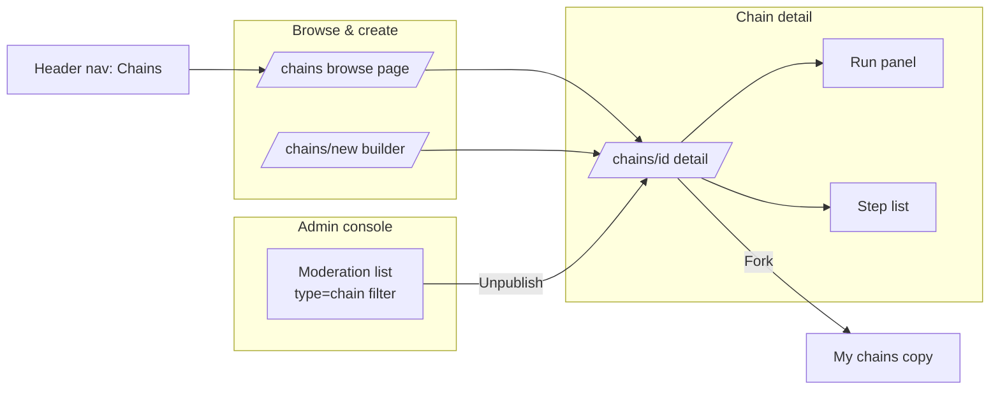
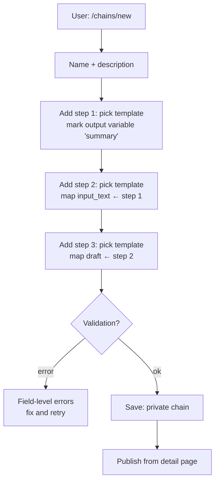
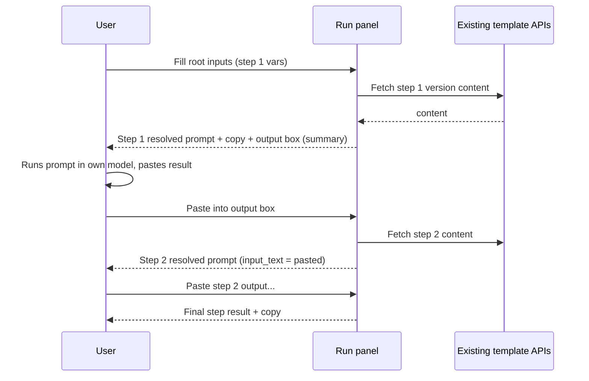

# Prompt Chaining — UI/UX Design

- **Feature ID:** prompt-chaining
- **Version:** 1.0
- **Status:** Proposed (for architecture review)
- **Author:** ui-ux-agent
- **Date:** 2026-10-12
- **Companion doc:** `prompt-chaining-requirements.md`

## 1. Design Principles

1. **Linear and legible.** A chain reads top-to-bottom like a recipe: numbered steps, explicit "output of step N → variable X of step M" wiring in plain text.
2. **Reuse every pattern.** Template pickers, variable inputs, visibility badges, publish/fork actions, moderation modals — all identical to templates/collections. Zero new interaction vocabulary.
3. **Run is the hero.** The detail page's run panel is where value lands: fill root inputs, read each step's resolved prompt, paste outputs, watch them flow downstream.
4. **Honest about scope.** The product assembles prompts; the user's own model produces outputs. The output-capture box makes this contract visible, not hidden.
5. **Aurora-native.** Step cards as soft panels connected by a vertical accent line; monospace for resolved prompts.

## 2. Information Architecture



| Surface | Location | Contents |
|---|---|---|
| `/chains` | New route | Search, sort (newest/most forked), chain cards grid |
| `/chains/new` | New route, authenticated | Name/description + step builder |
| `/chains/{id}` | New route | Header, step list, run panel, actions (edit/publish/fork/delete) |
| Header nav | Existing header | "Chains" entry (icon: link/chain) |
| Admin `/admin/templates` | Existing moderation page | `type=chain` filter; view + unpublish actions |
| Template detail | Existing page | No changes (chains reference templates; no back-link in v1) |

## 3. User Flows

### 3.1 Build a chain



### 3.2 Run a chain



## 4. Page Layouts

### 4.1 `/chains` browse (desktop)

```
┌──────────────────────────────────────────────────────────────────────────┐
│ Header  [Logo]  Home  Templates  Collections  Chains      [user ▾]       │
├──────────────────────────────────────────────────────────────────────────┤
│  Chains                                                    [+ New chain] │
│  [🔍 Search chains…                          ] [Newest ▾]                │
│ ┌────────────────┐ ┌────────────────┐ ┌────────────────┐                 │
│ │ Article → Reply │ │ Research Pack  │ │ Code Review    │                 │
│ │ 3 steps · by A  │ │ 5 steps · by B │ │ 2 steps · by C │                 │
│ │ Summarize,      │ │ Find, outline, │ │ Review then     │                 │
│ │ extract, draft  │ │ draft, polish  │ │ rewrite         │                 │
│ │ 🔗 12 forks     │ │ 🔗 4 forks     │ │ 🔗 9 forks      │                 │
│ └────────────────┘ └────────────────┘ └────────────────┘                 │
│ ‹ 1 2 3 ›                                                                │
└──────────────────────────────────────────────────────────────────────────┘
```

### 4.2 `/chains/new` builder (desktop)

```
┌──────────────────────────────────────────────────────────────────────────┐
│  New chain                                                                │
│  Name [________________________]  Description [____________________]      │
│ ┌──────────────────────────────────────────────────────────────────────┐ │
│ │ STEP 1                                          [template ▾] [ver ▾]  │ │
│ │ Template: "Article Summarizer"  (latest)                             │ │
│ │ Variables:                                                          │ │
│ │   article_text   (•) run-time input   ( ) map from…                 │ │
│ │   tone           (•) run-time input   ( ) map from…                 │ │
│ │   summary        ★ OUTPUT VARIABLE                                   │ │
│ │ [Remove step]                                                        │ │
│ ├──────────────────────────────────────────────────────────────────────┤ │
│ │ STEP 2                                          [template ▾] [ver ▾]  │ │
│ │ Template: "Action Items Extractor"  (latest)                        │ │
│ │ Variables:                                                          │ │
│ │   input_text     ( ) run-time input   (•) map from [Step 1 ▾]        │ │
│ │   format         (•) run-time input   ( ) map from…                 │ │
│ │   actions        ★ OUTPUT VARIABLE                                   │ │
│ │ [Remove step]                                                        │ │
│ ├──────────────────────────────────────────────────────────────────────┤ │
│ │ [+ Add step]                              2 / 10 steps · 1 / 20 chains│ │
│ └──────────────────────────────────────────────────────────────────────┘ │
│                                            [Cancel] [Save chain]         │
└──────────────────────────────────────────────────────────────────────────┘
```

### 4.3 `/chains/{id}` detail + run panel (desktop)

```
┌──────────────────────────────────────────────────────────────────────────┐
│  Article → Reply                                          [Private 🔒]    │
│  by Alice · 3 steps · updated 2d ago        [Edit] [Publish] [Fork] [⋯]  │
│  Summarize an article, extract action items, draft a reply.              │
│ ┌───────────────────────────────┬──────────────────────────────────────┐ │
│ │ CHAIN (steps)                 │ RUN                                  │ │
│ │ ① Article Summarizer          │ Root inputs:                         │ │
│ │    article_text [input]       │  article_text [___________________]  │ │
│ │    tone [input]               │  tone [___________________]          │ │
│ │    summary ★output            │  format [___________________]        │ │
│ │        │                      │ [▶ Run chain] [Reset]                │ │
│ │        ▼                      │ ──────────────────────────────────── │ │
│ │ ② Action Items Extractor      │ STEP 1 RESULT                        │ │
│ │    input_text ← ① summary     │ ┌──────────────────────────────────┐ │ │
│ │    format [input]             │ │ Summarize the following article… │ │ │
│ │    actions ★output            │ │ (resolved prompt, monospace)     │ │ │
│ │        │                      │ └──────────────────────────────────┘ │ │
│ │        ▼                      │ [📋 Copy]                            │ │
│ │ ③ Reply Drafter               │ Output → summary:                    │ │
│ │    draft ← ② actions          │ [paste your result here___________] │ │
│ │    tone ← root input          │ [Continue to step 2 →]  [Skip]       │ │
│ └───────────────────────────────┴──────────────────────────────────────┘ │
└──────────────────────────────────────────────────────────────────────────┘
```

### 4.4 Mobile (<768px)

Steps and run panel stack vertically; step cards collapse to title + variable badges (tap to expand); run panel's step results stack with sticky "Continue" button.

## 5. Component Specs

| Component | Based on / new | Spec |
|---|---|---|
| `ChainsBrowsePage` | Reuse Home grid patterns | Search input, sort dropdown (newest/most forked), chain cards grid, pagination |
| `ChainCard` | Reuse PromptCard patterns | Name, step count, owner, description (2-line clamp), fork count; click → detail |
| `ChainBuilderPage` | New | Name/description form + step list + add-step; live limit counters; save/cancel |
| `StepCard` (builder) | New | Template picker (searchable, reuse), version dropdown (latest + versions), variable rows with input/map radio + source-step dropdown, output-variable star toggle, remove |
| `ChainDetailPage` | New | Header (name, owner, visibility badge, stats, actions), description, step list, run panel |
| `StepListCard` (detail) | New | Numbered card: template title, version/alias, variable badges (`input` gray / `← step N` accent / `★ output` gold), connected by vertical accent line |
| `RunPanel` | Reuse generator input styling | Root inputs (textareas), Run/Reset buttons, per-step result blocks: resolved prompt (monospace, copy), output capture textarea, Continue/Skip |
| `VisibilityBadge` / `PublishButton` / `ForkButton` | Reuse from collections/templates | Identical styling and behavior |
| `AdminChainRow` | Reuse admin moderation row | type=chain filter; view (read-only detail) + unpublish (reason modal, audit log) |

## 6. Interaction Details

1. **Builder step add:** steps append at the end; reordering via move up/down buttons (v1; drag optional later); removing a step renumbers positions and invalidates mappings pointing to it (with a confirm noting affected mappings).
2. **Map-from dropdown** lists only earlier steps that have an output variable declared; selecting one stores the mapping; switching back to run-time input removes it.
3. **Output variable toggle:** one per step (star); toggling off clears downstream mappings that reference this step (confirm dialog lists them).
4. **Run flow:** Run → step 1 result renders → user copies prompt, uses their own model, pastes into output box → Continue advances (downstream mapped variables show the pasted value in their badges) → repeat → final step shows result + copy. Skip leaves output empty; downstream still runs with empty values.
5. **Reset** clears all run state (inputs, outputs, results) with confirm.
6. **Publish** flips visibility with the same confirm modal as collections; **Fork** creates the private copy and navigates to it with a success notification; **Delete** (owner, ⋯ menu) uses the standard confirm modal.
7. **Unavailable step:** if a step's template was deleted, the step card shows an amber "template unavailable" state; in the builder, Replace/Remove actions are offered; run is blocked with an explanatory banner.
8. **Admin unpublish** uses the existing reason modal (3–500 chars) and audit log; the chain owner is not notified in v1.
9. **Keyboard:** builder and run panel fully keyboard operable; Enter in output box = Continue; step cards are regions with aria-labels.

## 7. States Summary

| State | Trigger | UI |
|---|---|---|
| Loading | Page/step fetch | Skeletons for cards/panels |
| Empty (browse) | No public chains | "No chains yet" + create CTA (logged in) |
| Empty (my chains) | User has none | "Create your first chain" CTA |
| Builder validation error | FR-7 violation | Field-level red errors; save disabled |
| Limit reached | FR-4 | Add-step / create disabled with counter tooltip |
| Run: step loading | Fetching version | Shimmer in result block |
| Run: unavailable step | Deleted template | Amber banner; run blocked |
| Run: skipped output | User skips | Downstream badges show empty; results render with empty values |
| Error (API) | Save/run fetch fails | Inline error + retry |

## 8. i18n Considerations (EN/ZH)

- Strings under `chains.*` and `admin.chains.*` in `frontend/src/locales/{en,zh}/translation.json`.
- Key terms: "Chains" / "提示词链"; "New chain" / "新建链"; "Step" / "步骤"; "Run chain" / "运行链"; "Root inputs" / "根输入"; "run-time input" / "运行时输入"; "map from" / "映射自"; "Output variable" / "输出变量"; "Paste your result here" / "在此粘贴你的结果"; "Continue to step N" / "继续到第 N 步"; "Skip" / "跳过"; "Fork chain" / "Fork 链"; "Publish" / "发布" (existing key); "template unavailable" / "模板不可用"; "most forked" / "最多 fork".
- Wiring text is interpolated: `t('chains.map.badge', {step: 2})` → "← step 2" / "← 第 2 步".
- Variable names, template titles, and chain names are user content — never translated.

## 9. Accessibility

- Steps are an ordered list (`<ol>`); each step card is a labelled region; the vertical connector is decorative (`aria-hidden`).
- Data flow is conveyed in text ("output of step 1 → variable input_text of step 2"), never color alone; badges have text labels.
- Run panel: inputs labelled by variable name; result blocks are regions with copy buttons; output capture is a labelled textarea; Continue/Skip are real buttons.
- `aria-live="polite"` announces step results ("Step 1 result ready") and mapping changes in the builder.
- Full keyboard operability; focus moves to each new step result on render.

## 10. Analytics (optional, if analytics feature ships)

- `chain_created`, `chain_published`, `chain_run_started`, `chain_step_completed` (position), `chain_output_pasted`, `chain_forked`, `chain_unpublished` (admin).

## 11. Out of Scope (mirrors requirements §8)

- LLM execution (output capture is manual paste), branching/loops/graph canvases.
- Server-persisted runs, run history, scheduled runs, chain versioning.
- Collaborative editing, whole-chain API execution.
- Monetization of any kind.
