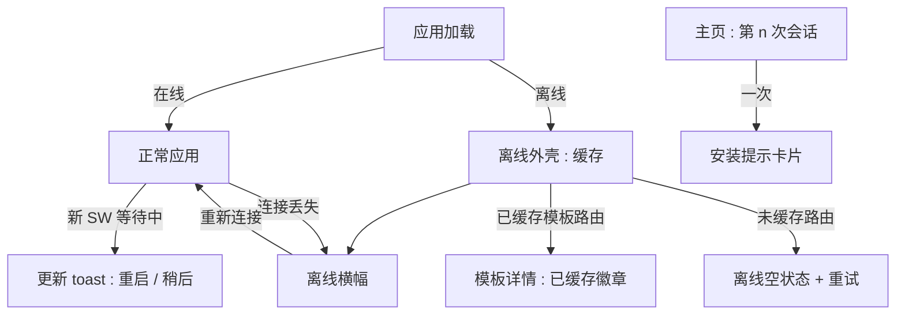
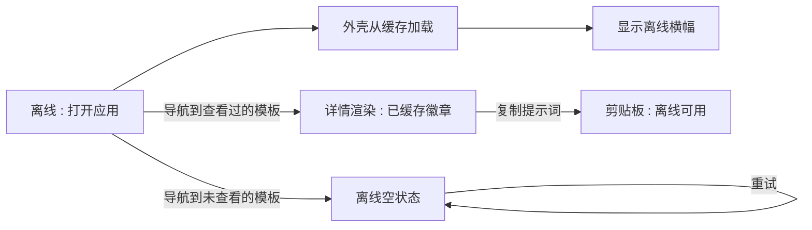
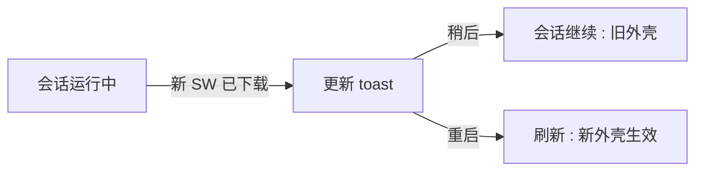

# PWA 与离线支持 — UI/UX 设计

- **功能 ID：** pwa-offline
- **版本：** 1.0
- **状态：** 已提案（待架构评审）
- **作者：** ui-ux-agent
- **日期：** 2026-10-12
- **配套文档：** `pwa-offline-requirements-zh-CN.md`

## 1. 设计原则

1. **以读为先的离线。** 离线体验对能做什么保持诚实：缓存阅读和复制可以，写不行 —— 没有虚假的成功状态。
2. **渐进增强不可见。** 在线用户看到零差异；每个离线功能只在相关时出现。
3. **类原生感受，Aurora 外观。** 安装后的应用是独立窗口中的同一个产品 —— 没有单独的"应用模式"设计语言。
4. **平静的连接信号。** 一条细横幅、缓存视图上的一个徽章、更新的一次 toast —— 绝不用模态打断。

## 2. 信息架构



| 界面 | 上下文 | 受众 | 目的 |
|---|---|---|---|
| 离线横幅 | 离线时的任何页面 | 所有用户 | 连接状态 + 预期管理 |
| 已缓存徽章 | 模板详情（已缓存） | 离线阅读者 | 标示数据新鲜度 |
| 离线空状态 | 离线时的未缓存页面 | 所有用户 | 友好解释 + 重试 |
| 更新 toast | 新外壳已下载 | 所有用户 | 可控的重启 |
| 安装提示卡片 | 主页，按阈值一次 | 新/回访用户 | 发现可安装性 |
| 禁用操作 tooltip | 离线时的写操作 | 所有用户 | 解释操作为何关闭 |

## 3. 用户流程

### 3.1 离线阅读会话



### 3.2 重新连接


### 3.3 应用更新



## 4. 页面布局

### 4.1 离线横幅（所有页面，头部之下）

```
+----------------------------------------------------------------------+
|  头部（正常）                                                         |
+----------------------------------------------------------------------+
|  ⚠ 您已离线 —— 正在显示缓存内容                                       |
+----------------------------------------------------------------------+
|  页面内容（缓存外壳 / 缓存模板 / 离线空状态）                          |
+----------------------------------------------------------------------+
```

细条（36 px），亮色主题琥珀色点缀 / 暗色主题柔和琥珀；预留空间使出现时不引起布局偏移；`role="status"`。

### 4.2 模板详情 — 离线已缓存（桌面端）

```
+----------------------------------------------------------------------+
|  ← 返回       Support Reply v3         [已缓存 · 2 小时前查看]        |
|                 by alice · 客服支持 · v3                              |
+----------------------------------------------------------------------+
|  | 提示词                                    | 点赞 42  ♡ / ★        |
|  | ┌──────────────────────────────────────┐  | （离线禁用）           |
|  | │ You are a support agent for...       │  |                      |
|  | │ $$product$$ $$tone$$                 │  | [复制提示词] ✓       |
|  | └──────────────────────────────────────┘  | [使用]（禁用）        |
+----------------------------------------------------------------------+
```

已缓存徽章位于标题旁；点赞/收藏/使用禁用并带 tooltip；复制保持可用。

### 4.3 离线空状态（未缓存页面）

```
+--------------------------------------+
|            [云朵-关闭 图标]           |
|        此页面离线不可用。              |
|   离线时可以查看最近打开过的           |
|   模板。                              |
|                                     |
|            [ 重试 ]                  |
+--------------------------------------+
```

居中卡片，标准空状态插画位，单一主操作。

### 4.4 更新 toast（右下角）

```
+------------------------------------------+
|  ↻ 有可用更新                              |
|  新版本已准备好安装。                      |
|           [ 重启 ]   [ 稍后 ]              |
+------------------------------------------+
```

标准 toast；10 秒自动关闭；"稍后"在本会话保持旧外壳。

### 4.5 安装提示卡片（主页，一次）

```
+--------------------------------------------------+
|  [图标]  安装 Open Prompts                        |
|  添加到桌面，一键访问。                            |
|                        [ 安装 ]   [×]              |
+--------------------------------------------------+
```

移动端文案："添加到主屏，一点即达。"卡片位于模板网格上方，点 × 永久关闭；安装按钮触发浏览器原生提示（在不支持的平台上显示平台安装指引）。

### 4.6 已安装应用（独立窗口）

与浏览器应用布局一致，仅去掉浏览器边框；主题跟随用户的应用内设置；头部仍是导航锚点（不添加返回按钮 —— 操作系统提供窗口控制）。

## 5. 组件规格

| 组件 | 行为 | 状态 |
|---|---|---|
| OfflineBanner | 细顶条；`role="status"`；预留高度；offline 事件时出现 | 隐藏 / 显示 |
| CachedBadge | 标题旁的小标签："已缓存 · {相对时间}查看" | 默认 |
| OfflineEmptyState | 图标 + 标题 + 正文 + 重试；用于任何未缓存路由 | 默认 |
| UpdateToast | 带重启/稍后的 toast；挂接 SW waiting 事件 | 显示 / 已关闭 |
| InstallHintCard | 主页一次性卡片；平台适配文案；原生安装触发 | 显示 / 已关闭 |
| DisabledAction | 既有按钮加 `disabled` + tooltip"离线不可用"；保持可聚焦 | 启用 / 禁用 |

## 6. 交互细节

1. **离线检测**使用 `navigator.onLine` + online/offline 事件；横幅绝不阻塞交互且绝不堆叠（单实例）。
2. **已缓存徽章**显示渲染时计算的相对时间（"2 小时前查看"）；页面获取到新数据时自动消失。
3. **离线空状态中的重试**重新拉取页面数据；仍离线时重新渲染相同状态（不刷错误 toast —— 每次手动重试最多一条 toast）。
4. **禁用的写操作**保持位置和可聚焦性；tooltip 在悬停/聚焦 500 毫秒后出现；屏幕阅读器通过 `aria-disabled` 获知"不可用"。
5. **离线复制提示词**可用，因为提示词文本在缓存载荷中；成功反馈是标准复制 toast。
6. **更新 toast**在新 SW 进入 `waiting` 时每会话出现一次；重启调用 `skipWaiting()` 后刷新；稍后在本会话关闭（更新在下次自然刷新时应用）。
7. **安装提示**在会话阈值（桌面 3 次 / 移动 5 次）后出现，每个浏览器配置仅一次；× 永久关闭；安装按钮在捕获到 `beforeinstallprompt` 时调用之，否则在小气泡中显示平台指引（如 Safari 的分享 → 添加到主屏幕）。
8. **登出**清除模板缓存；外壳保留，因此登录页仍可离线加载（若断网则带离线横幅）。
9. **主题**在独立窗口中与浏览器完全一致地运行时应用（manifest 颜色是亮色主题默认值；暗色用户通过既有的预水合主题脚本获得暗色首屏）。

## 7. 状态汇总

| 界面 | 加载 | 空 | 错误 |
|---|---|---|---|
| 离线外壳 | 照常骨架 | 不适用 | SW 不可用 → 正常在线行为 |
| 已缓存模板 | 即时（缓存） | 不适用 | 缓存未命中 → 离线空状态 |
| 离线空状态 | 不适用 | 默认状态 | 重试仍离线 → 相同状态 + 一条 toast |
| 更新 toast | 不适用 | 不适用 | SW 错误 → 静默（下次访问重试） |
| 安装提示 | 不适用 | 不适用 | `beforeinstallprompt` 不可用 → 指引气泡 |

## 8. 国际化

| 键（英文） | 中文 |
|---|---|
| offline.banner / You are offline — showing cached content | 您已离线 —— 正在显示缓存内容 |
| offline.badge / Cached · viewed {{time}} | 已缓存 · {{time}}查看 |
| offline.empty.title / This page isn't available offline | 此页面离线不可用 |
| offline.empty.body / You can view templates you've recently opened while offline. | 离线时可以查看最近打开过的模板。 |
| offline.retry / Retry | 重试 |
| offline.actionDisabled / Not available offline | 离线不可用 |
| pwa.update.title / Update available | 有可用更新 |
| pwa.update.body / A new version is ready to install. | 新版本已准备好安装。 |
| pwa.update.restart / Restart | 重启 |
| pwa.update.later / Later | 稍后 |
| pwa.install.title / Install Open Prompts | 安装 Open Prompts |
| pwa.install.body.desktop / Add it to your desktop for one-click access. | 添加到桌面，一键访问。 |
| pwa.install.body.mobile / Add to your home screen for one-tap access. | 添加到主屏，一点即达。 |
| pwa.install.action / Install | 安装 |
| pwa.install.instructions / Use your browser's share menu and choose "Add to Home Screen". | 使用浏览器的分享菜单并选择"添加到主屏幕"。 |

## 9. 无障碍

- 离线横幅：`role="status"` + `aria-live="polite"` —— 出现时播报一次，而非每次渲染。
- 已缓存徽章是纯文本（不依赖颜色）；相对时间通过 `aria-label` 为屏幕阅读器完整拼出。
- 禁用操作使用 `aria-disabled` 并保持可聚焦，键盘用户能发现它们并听到原因；tooltip 可聚焦触发。
- 离线空状态的重试是页面上唯一的焦点目标（出现时自动聚焦）。
- 更新 toast 遵循标准 toast 无障碍模式（礼貌 live region，不抢焦点）。
- 独立窗口继承所有既有键盘可操作性；不改变焦点顺序。

## 10. 数据分析（可选）

- `offline_banner_shown`、`offline_template_viewed`、`offline_copy_used`、`update_toast_shown/restarted`、`install_hint_shown/dismissed/installed` —— 仅产品使用事件。

## 11. 范围之外

- 离线编辑、写排队、后台同步。
- 推送通知。
- 显式"保存供离线使用"固定 UI。
- 应用商店打包（TWA）。
- 任何变现 —— 永久排除。
