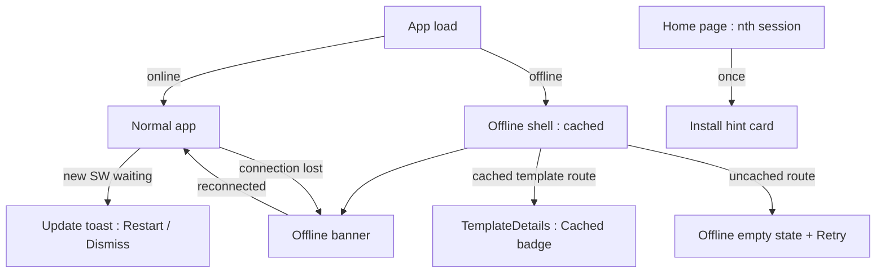
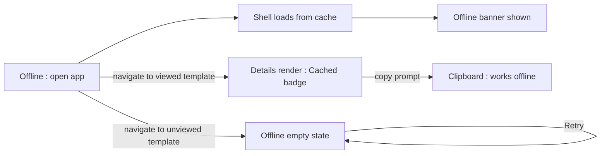
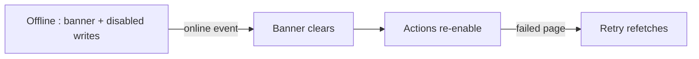
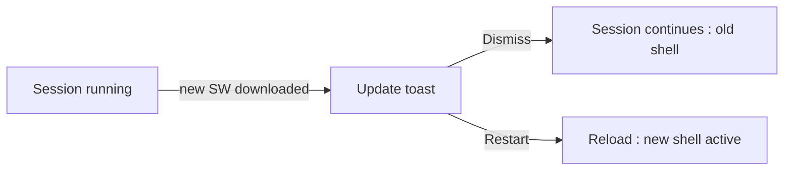

# PWA & Offline Support — UI/UX Design

- **Feature ID:** pwa-offline
- **Version:** 1.0
- **Status:** Proposed (for architecture review)
- **Author:** ui-ux-agent
- **Date:** 2026-10-12
- **Companion doc:** `pwa-offline-requirements.md`

## 1. Design Principles

1. **Read-first offline.** The offline experience is honest about what works: cached reading and copying yes, writing no — no fake success states.
2. **Progressive enhancement invisible.** Online users see zero difference; every offline affordance appears only when it is relevant.
3. **Native-feeling, Aurora-looking.** The installed app is the same product in a standalone window — no separate "app mode" design language.
4. **Calm connectivity signals.** One slim banner, one badge on cached views, one toast for updates — never modal interruptions.

## 2. Information Architecture



| Surface | Context | Audience | Purpose |
|---|---|---|---|
| Offline banner | Any page while offline | All users | Connectivity state + expectation setting |
| Cached badge | Template details (cached) | Offline readers | Signal data freshness |
| Offline empty state | Uncached pages offline | All users | Friendly explanation + retry |
| Update toast | New shell downloaded | All users | Controlled restart |
| Install hint card | Home, once per threshold | New/returning users | Discover installability |
| Disabled action tooltips | Offline, on write actions | All users | Explain why actions are off |

## 3. User Flows

### 3.1 Offline reading session



### 3.2 Reconnect



### 3.3 Update application



## 4. Page Layouts

### 4.1 Offline banner (all pages, below header)

```
+----------------------------------------------------------------------+
|  Header (normal)                                                     |
+----------------------------------------------------------------------+
|  ⚠ You are offline — showing cached content                          |
+----------------------------------------------------------------------+
|  Page content (cached shell / cached template / offline empty state) |
+----------------------------------------------------------------------+
```

Slim (36 px), amber accent in light theme / muted amber in dark; reserved space so appearance causes no layout shift; `role="status"`.

### 4.2 Template details — offline cached (desktop)

```
+----------------------------------------------------------------------+
|  ← Back        Support Reply v3        [Cached · viewed 2h ago]      |
|                 by alice · Customer Support · v3                     |
+----------------------------------------------------------------------+
|  | Prompt                                    | Likes 42  ♡ / ★      |
|  | ┌──────────────────────────────────────┐  | (disabled offline)   |
|  | │ You are a support agent for...       │  |                      |
|  | │ $$product$$ $$tone$$                 │  | [Copy prompt] ✓     |
|  | └──────────────────────────────────────┘  | [Use] (disabled)     |
+----------------------------------------------------------------------+
```

The Cached badge sits next to the title; like/favorite/use are disabled with tooltips; Copy remains active.

### 4.3 Offline empty state (uncached page)

```
+--------------------------------------+
|            [cloud-off icon]          |
|      This page isn't available       |
|            offline.                   |
|   You can view templates you've      |
|   recently opened while offline.     |
|                                     |
|            [ Retry ]                 |
+--------------------------------------+
```

Centered card, standard empty-state illustration slot, single primary action.

### 4.4 Update toast (bottom right)

```
+------------------------------------------+
|  ↻ Update available                       |
|  A new version is ready to install.      |
|           [ Restart ]   [ Later ]         |
+------------------------------------------+
```

Standard toast; auto-dismiss 10 s; "Later" keeps the old shell for this session.

### 4.5 Install hint card (home page, once)

```
+--------------------------------------------------+
|  [icon]  Install Open Prompts                    |
|  Add it to your desktop for one-click access.    |
|                        [ Install ]   [×]          |
+--------------------------------------------------+
```

Mobile copy: "Add to your home screen for one-tap access." The card sits above the template grid, dismisses permanently on ×, and the Install button triggers the browser's native prompt (or platform install instructions where unavailable).

### 4.6 Installed app (standalone window)

Identical layout to the browser app minus browser chrome; theme follows the user's in-app setting; the header remains the navigation anchor (no back button is added — the OS provides window controls).

## 5. Component Specs

| Component | Behavior | States |
|---|---|---|
| OfflineBanner | Slim top strip; `role="status"`; reserved height; appears on offline event | Hidden / shown |
| CachedBadge | Small chip next to template title: "Cached · viewed {rel-time}" | Default |
| OfflineEmptyState | Icon + headline + body + Retry; used for any uncached route | Default |
| UpdateToast | Toast with Restart/Later; hooks SW waiting event | Shown / dismissed |
| InstallHintCard | One-time card on home; platform-aware copy; native install trigger | Shown / dismissed |
| DisabledAction | Existing buttons with `disabled` + tooltip "Not available offline"; remain focusable | Enabled / disabled |

## 6. Interaction Details

1. **Offline detection** uses `navigator.onLine` + online/offline events; the banner never blocks interaction and never stacks (single instance).
2. **Cached badge** shows relative time ("viewed 2h ago") computed at render; it disappears automatically when the page is fetched fresh.
3. **Retry** in the offline empty state refetches the page data; while still offline it re-renders the same state (no error toast spam — one toast per manual retry).
4. **Disabled write actions** keep their position and focusability; tooltip appears on hover/focus after 500 ms; screen readers announce "unavailable" via `aria-disabled`.
5. **Copy prompt offline** works because the prompt text is in the cached payload; the success feedback is the standard copy toast.
6. **Update toast** appears once per session when a new SW reaches `waiting`; Restart calls `skipWaiting()` then reloads; Later dismisses for the session (the update applies on next natural reload).
7. **Install hint** appears after the session threshold (desktop 3 / mobile 5), once ever per browser profile; × dismisses permanently; Install invokes `beforeinstallprompt` if captured, else shows platform instructions (e.g., Safari's Share → Add to Home Screen) in a small popover.
8. **Logout** clears the template cache; the shell remains so the login page still loads offline (with the offline banner if disconnected).
9. **Theme** applies at runtime in the standalone window exactly as in the browser (manifest colors are the light-theme defaults; dark users get dark on first paint via the existing pre-hydration theme script).

## 7. States Summary

| Surface | Loading | Empty | Error |
|---|---|---|---|
| Offline shell | Skeleton as usual | n/a | SW unavailable → normal online behavior |
| Cached template | Instant (cache) | n/a | Cache miss → offline empty state |
| Offline empty state | n/a | Default state | Retry still offline → same state + one toast |
| Update toast | n/a | n/a | SW error → silent (next visit retries) |
| Install hint | n/a | n/a | `beforeinstallprompt` unavailable → instructions popover |

## 8. i18n

| Key (EN) | ZH |
|---|---|
| offline.banner / You are offline — showing cached content | 您已离线 —— 正在显示缓存内容 |
| offline.badge / Cached · viewed {{time}} | 已缓存 · {{time}}查看 |
| offline.empty.title / This page isn't available offline | 此页面离线不可用 |
| offline.empty.body / You can view templates you've recently opened while offline. | 离线时可以查看最近打开过的模板。 |
| offline.retry / Retry | 重试 |
| offline.actionDisabled / Not available offline | 离线不可用 |
| pwa.update.title / Update available | 有可用更新 |
| pwa.update.body / A new version is ready to install. | 新版本已准备好安装。 |
| pwa.update.restart / Restart | 重启 |
| pwa.update.later / Later | 稍后 |
| pwa.install.title / Install Open Prompts | 安装 Open Prompts |
| pwa.install.body.desktop / Add it to your desktop for one-click access. | 添加到桌面，一键访问。 |
| pwa.install.body.mobile / Add to your home screen for one-tap access. | 添加到主屏，一点即达。 |
| pwa.install.action / Install | 安装 |
| pwa.install.instructions / Use your browser's share menu and choose "Add to Home Screen". | 使用浏览器的分享菜单并选择"添加到主屏幕"。 |

## 9. Accessibility

- Offline banner: `role="status"` + `aria-live="polite"` — announced once on appearance, not on every render.
- Cached badge is plain text (color-independent); relative time is spelled out for screen readers via `aria-label`.
- Disabled actions use `aria-disabled` and remain focusable so keyboard users discover them and hear the reason; tooltips are focus-triggered.
- Offline empty state Retry is the single focus target on the page (auto-focus on appearance).
- Update toast follows the standard toast a11y pattern (polite live region, focus not stolen).
- The standalone window inherits all existing keyboard operability; no new focus order changes.

## 10. Analytics (optional)

- `offline_banner_shown`, `offline_template_viewed`, `offline_copy_used`, `update_toast_shown/restarted`, `install_hint_shown/dismissed/installed` — product usage events only.

## 11. Out of Scope

- Offline editing, write queueing, background sync.
- Push notifications.
- Explicit "save for offline" pinning UI.
- App-store packaging (TWA).
- Any monetization — permanently excluded.
