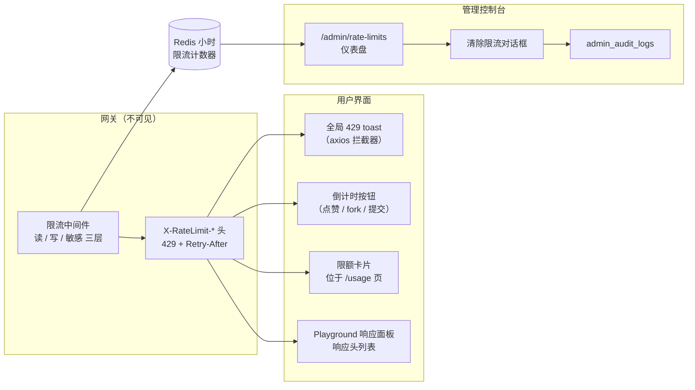
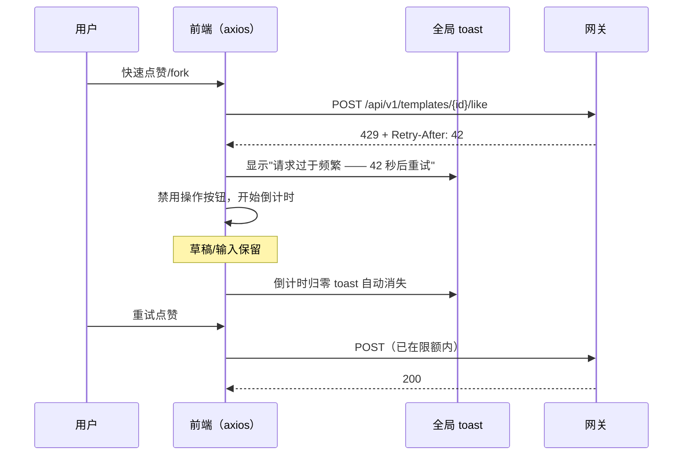
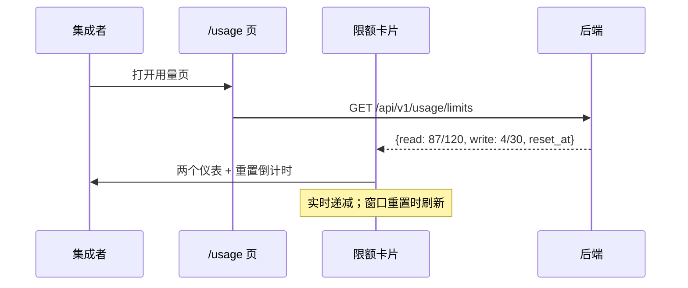
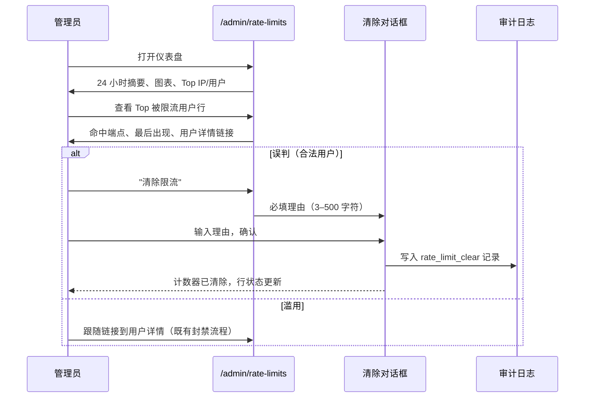
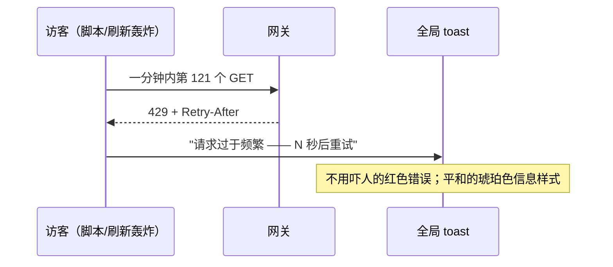

# 限流仪表盘（Rate Limit Dashboard）— UI/UX 设计

- **Feature ID:** rate-limit-dashboard
- **Version:** 1.0
- **Status:** Proposed（待架构评审）
- **Author:** ui-ux-agent
- **Date:** 2026-10-12
- **相关文档：** [需求](./rate-limit-dashboard-requirements-zh-CN.md) · [UI/UX Design (EN)](./rate-limit-dashboard-ui-ux-design.md)

## 1. 设计原则

1. **限流是正常状态，不是错误。** 429 界面平和、解释等待时间、绝不破坏用户输入。
2. **倒计时即信息。** 每个被限流的界面都显示实时"N 秒后可重试" —— 用户永远不该怀疑网站坏了。
3. **自助先于支持。** 响应头、仪表和 playground 面板让集成者自我调节；文档页距仪表只有一次点击。
4. **管理员看浪潮，不看噪音。** 仪表盘做聚合（总量、Top 执行者、图表）而不是列出每一条 429。
5. **补救可问责。** 清除限流要求理由并进入审计日志 —— 与封禁/解封相同模式。

## 2. 信息架构



## 3. 用户流程

### 3.1 用户触发写限额（点赞/fork 突发）



### 3.2 集成者在 /usage 查看预算



### 3.3 管理员排查限流爆发



### 3.4 匿名访客触发读限额



## 4. 页面布局（线框图）

### 4.1 全局 429 toast（所有界面）

```
┌──────────────────────────────────────────────────┐
│  ⏳  请求过于频繁 —— 42 秒后重试                  × │
└──────────────────────────────────────────────────┘
  琥珀色信息 toast，右下角（桌面）/ 底部居中（移动端）；
  倒计时归零自动消失
```

### 4.2 倒计时按钮状态（点赞/fork/提交）

```
  正常：        [ ♥ 点赞 ]
  被限流：      [ ⏳ 42 秒后可重试 ]   （禁用，实时跳动）
  恢复：        [ ♥ 点赞 ]             （重新启用）
```

### 4.3 /usage 页限额卡片

```
┌────────────────────────────────────────────────────────────┐
│  API 限额                                     [刷新]        │
│  ──────────────────────────────────────────────────────────│
│  读（GET）                              12 分 34 秒后重置    │
│  ████████████░░░░░░░░░░  87 / 120                           │
│                                                            │
│  写（POST/PUT/DELETE）                   12 分 34 秒后重置   │
│  █████░░░░░░░░░░░░░░░░░   4 / 30                           │
│                                                            │
│  ⓘ 限额按账户计算 —— 所有 API key 共享此预算。               │
│    查看文档 →                                               │
└────────────────────────────────────────────────────────────┘
  降级为："限额信息不可用，请稍后再试"（503）
```

### 4.4 管理仪表盘 — /admin/rate-limits

```
┌──────────────────────────────────────────────────────────────────────┐
│  ← 管理后台    限流                                                    │
│  ────────────────────────────────────────────────────────────────────│
│  ┌──────────────┐ ┌──────────────┐ ┌──────────────────────────┐     │
│  │ 被限流请求    │ │ 独立执行者    │ │ 被限流最多的端点          │     │
│  │ （24 小时）   │ │ （24 小时）   │ │ GET /api/v1/templates    │     │
│  │    1,284     │ │     37       │ │ （412 次）                │     │
│  └──────────────┘ └──────────────┘ └──────────────────────────┘     │
│                                                                      │
│  被限流请求 —— 过去 24 小时                                           │
│  ▂ ▁ ▁ ▃ ▅ ▇ █ ▆ ▃ ▂ ▁ ▁ ▂ ▂ ▁ ▁ ▁ ▁ ▁ ▁ ▁ ▁ ▁ ▁                  │
│  00:00        06:00        12:00        18:00        现在            │
│                                                                      │
│  生效限额：读 120/分钟 · 写 30/分钟 · 敏感 10/分钟                    │
│  附加领域限额：评论 5 次/分钟及 50 次/天 · 管理员登录每 IP             │
│  5 次失败/15 分钟                                                     │
│  ────────────────────────────────────────────────────────────────────│
│  Top 被限流 IP                     Top 被限流用户                     │
│  ┌─────────────────────────────┐  ┌─────────────────────────────┐   │
│  │ IP          次数  最后出现   │  │ 用户        次数  最后出现   │   │
│  │ 203.0.113.7  412  2 分钟前   │  │ alex@…      96   5 分钟前   │   │
│  │ 198.51.100.2 201  14 分钟前  │  │ bot@…       64   1 分钟前    │   │
│  │ …                           │  │ …                           │   │
│  │        [清除限流]            │  │  [清除]   [查看用户 →]       │   │
│  └─────────────────────────────┘  └─────────────────────────────┘   │
└──────────────────────────────────────────────────────────────────────┘
```

### 4.5 清除限流对话框

```
┌──────────────────────────────────────────────────────┐
│  清除 203.0.113.7 的限流                        [×]  │
│  ────────────────────────────────────────────────────│
│  这将删除该 IP 的所有限流计数器。                       │
│  该执行者可立即继续请求。                               │
│                                                      │
│  理由（必填，3–500 字符）                              │
│  ┌────────────────────────────────────────────────┐ │
│  │ 误判 —— CDN 健康检查 IP，已与基础设施            │ │
│  │ 团队核实。                                       │ │
│  └────────────────────────────────────────────────┘ │
│  52 / 500                                            │
│                                                      │
│                    [取消]   [ 清除限流 ]              │
└──────────────────────────────────────────────────────┘
  确认 → 成功 toast + 行状态"已清除" + 审计记录
```

## 5. 组件规格

| 组件 | 基于 | Props / 行为 |
|---|---|---|
| `RateLimitToast` | 既有 toast/通知系统 | 由全局 axios 拦截器在 429 时触发；琥珀色信息样式（非错误红）；消息带 `Retry-After` 实时倒计时；按窗口去重（每个活跃窗口一个 toast）；归零自动消失。 |
| `CountdownButton` | 既有按钮的 HOC/包装器 | `{retryUntil}`；禁用目标按钮，渲染每秒跳动的"N 秒后可重试"；归零重新启用；保留全部表单状态（绝不重置）。 |
| `LimitsCard` | 新建（位于 /usage） | 挂载时及窗口重置时请求 `GET /usage/limits`；两个进度仪表（读/写）带 `剩余/限额` 和重置倒计时；共享预算信息注；503 → "不可用"状态带重试链接。 |
| `RateLimitHeadersPanel` | playground 响应面板小节 | 存在时渲染 `X-RateLimit-Limit/Remaining/Reset` + `Retry-After` 行；等宽字体；`Remaining: 0` 琥珀色高亮。 |
| `AdminRateLimitsPage` | 既有管理页模式（AuditLogPage） | 摘要卡片、24 小时柱状图（小时桶）、生效限额条、两张表（IP/用户）带次数 + 最后出现 + 操作；无限流时空状态。 |
| `ClearThrottleDialog` | 既有管理对话框模式（理由必填） | `{actorType, actorId}`；3–500 字符文本域带实时计数；确认 → `DELETE /admin/rate-limits/throttle`；成功 toast + 行状态更新；错误内联。 |

## 6. 交互细节

1. **全局拦截器注册：** 共享 API 客户端中的一个 axios 响应拦截器；检查 `err.response.status === 429` 且 `config.url` 以 `/api/v1` 开头；除非 `config.skipRateLimitToast`（由拥有局部 UX 的 CommentComposer/AdminLoginPage 设置）否则显示 toast。
2. **倒计时事实来源：** `Retry-After` 头解析为秒；缺失/无效 → 默认 60 秒；倒计时客户端跳动，无轮询。
3. **Toast 去重：** 限流 toast 可见期间，同一窗口内的后续 429 更新现有 toast 的倒计时而不是堆叠。
4. **限额卡片刷新：** 挂载时请求；`reset_at` 时 `setTimeout` 重新请求（窗口已翻页）；手动刷新按钮；无轮询循环。
5. **仪表阈值：** 剩余 >50% → 绿色；20–50% → 琥珀色；<20% → 红色仪表 + "接近限额"提示文字。
6. **管理图表：** 过去 24 小时按小时分桶；悬停提示显示小时 + 次数；点击某小时将两张表过滤为该小时被限流的执行者（对已加载数据的客户端过滤）。
7. **清除限流保护：** 理由长度 ∈ [3,500] 之前确认按钮禁用；有效时 Enter 提交；Escape 取消；成功后该行在会话内显示"已清除"徽章。
8. **生效限额条：** 值来自反映环境变量配置的新管理端点（只读）；"附加领域限额"行是静态文档文字。
9. **Playground 集成：** 响应头行出现在既有响应面板的 headers 小节 —— 布局不变，只是数据。
10. **键盘：** 所有对话框焦点锁定；表格遵循既有管理表格键盘模式；倒计时文字 `aria-live="off"`（每秒变化 —— 只在状态变为"被限流"/"恢复"时播报）。

## 7. 状态汇总

| 状态 | 触发 | UI |
|---|---|---|
| 被限流（全局） | 无局部处理的任何 429 | 琥珀色 toast 带倒计时；自动消失 |
| 被限流（编辑器） | 评论 429 | 发布按钮局部倒计时；草稿保留 |
| 按钮倒计时 | 按钮操作 429 | 禁用按钮"N 秒后可重试"；归零启用 |
| 限额已加载 | /usage 访问 | 两个仪表 + 重置倒计时 |
| 限额不可用 | /usage/limits 503 | 卡片显示"不可用" + 重试链接 |
| 接近限额 | 仪表 <20% | 红色仪表 + 提示 |
| 仪表盘已加载 | /admin/rate-limits 访问 | 卡片 + 图表 + 表格 |
| 仪表盘为空 | 24 小时无限流 | "过去 24 小时没有被限流的请求" |
| 清除确认 | 点击清除限流 | 理由对话框，有效前确认禁用 |
| 清除成功 | DELETE 返回 200 | Toast + 行"已清除"徽章 |
| 清除失败 | 网络/4xx | 对话框内联错误，理由保留 |

## 8. i18n 字符串表

命名空间：`rate_limits`（新增）+ `usage`（扩展）。

| 键 / 中文 | 英文 |
|---|---|
| `rate_limits.toast_throttled` / 请求过于频繁 —— {{seconds}} 秒后重试 | Too many requests — try again in {{seconds}}s |
| `rate_limits.retry_in` / {{seconds}} 秒后可重试 | Retry in {{seconds}}s |
| `rate_limits.limits_title` / API 限额 | API limits |
| `rate_limits.read_tier` / 读（GET） | Read (GET) |
| `rate_limits.write_tier` / 写（POST/PUT/DELETE） | Write (POST/PUT/DELETE) |
| `rate_limits.resets_in` / {{time}}后重置 | resets in {{time}} |
| `rate_limits.shared_budget_note` / 限额按账户计算 —— 所有 API key 共享此预算。 | Limits apply per account — all API keys share this budget. |
| `rate_limits.approaching` / 接近限额 | Approaching limit |
| `rate_limits.unavailable` / 限额信息不可用，请稍后再试 | Limits unavailable — try again later |
| `rate_limits.refresh` / 刷新 | Refresh |
| `rate_limits.admin_title` / 限流 | Rate Limits |
| `rate_limits.admin_throttled_24h` / 被限流请求（24 小时） | Throttled requests (24h) |
| `rate_limits.admin_unique_actors` / 被限流独立执行者（24 小时） | Unique throttled actors (24h) |
| `rate_limits.admin_top_endpoint` / 被限流最多的端点 | Most throttled endpoint |
| `rate_limits.admin_chart_title` / 被限流请求 —— 过去 24 小时 | Throttled requests — last 24 hours |
| `rate_limits.admin_effective` / 生效限额 | Effective limits |
| `rate_limits.admin_domain_limits` / 附加领域限额：评论 5 次/分钟及 50 次/天 · 管理员登录每 IP 5 次失败/15 分钟 | Additional domain limits: comments 5/min & 50/day · admin login 5 fails/15min per IP |
| `rate_limits.admin_top_ips` / Top 被限流 IP | Top throttled IPs |
| `rate_limits.admin_top_users` / Top 被限流用户 | Top throttled users |
| `rate_limits.admin_hits` / 次数 | hits |
| `rate_limits.admin_last_seen` / 最后出现 | last seen |
| `rate_limits.admin_empty` / 过去 24 小时没有被限流的请求 | No throttled requests in the last 24 hours |
| `rate_limits.clear_title` / 清除 {{actor}} 的限流 | Clear throttle for {{actor}} |
| `rate_limits.clear_body` / 这将删除该执行者的所有限流计数器，其可立即继续请求。 | This deletes all rate-limit counters for this actor. They can immediately make requests again. |
| `rate_limits.clear_reason_label` / 理由（必填，3–500 字符） | Reason (required, 3–500 characters) |
| `rate_limits.clear_confirm` / 清除限流 | Clear throttle |
| `rate_limits.clear_success` / 已清除 {{actor}} 的限流 | Throttle cleared for {{actor}} |
| `rate_limits.cleared_badge` / 已清除 | Cleared |
| `usage.view_limits` / 查看限额 | View limits |

## 9. 无障碍说明

- 限流 toast 使用 `role="status"`（polite）—— 出现时播报一次，而非每次倒计时跳动都播报。
- 倒计时按钮保持可访问名称更新（"42 秒后可重试"），但跳动的播报被抑制（跳动 span `aria-live` off）；恢复启用时播报。
- 限额仪表是 `<div role="meter" aria-valuenow aria-valuemin aria-valuemax aria-valuetext="读请求剩余 87 / 120">`，带可见文本等价物（分数是真实文本，非仅颜色）。
- 颜色阈值（绿/琥珀/红）始终配文字（"接近限额"），绝不只靠颜色。
- 管理表格复用既有管理表格语义（caption、scope 表头）；图表有文字摘要行（"峰值：13:00 的 412 次"）作为可访问描述。
- 清除对话框：焦点锁定、Escape 取消、理由文本域带实时字符计数标签（`aria-describedby`）、确认禁用状态通过 `aria-disabled` 传达。
- 所有对话框关闭时焦点返回触发器。

## 10. 响应式行为

- **桌面（≥1024px）：** toast 右下角；管理仪表盘两表并排；限额卡片在 /usage 全宽一行。
- **平板（768–1023px）：** 管理表格纵向堆叠；图表全宽；摘要卡片 2+1 换行。
- **手机（<768px）：** toast 底部居中全宽；倒计时按钮标签缩为"42s"；限额卡片仪表堆叠；管理仪表盘单列，表格横向滚动且首列粘性；清除对话框全屏 sheet。
- Playground 响应头面板是等宽字体行 —— 任何宽度无需重排。

## 11. 分析事件（可选，若 analytics 已上线）

- `rate_limit_toast_shown` `{tier, retry_after}`
- `limits_card_viewed` / `limits_card_refreshed`
- `admin_rate_limits_viewed`
- `throttle_cleared` `{actor_type}`

## 12. 不做范围（UI）

- 按 key 的限额仪表（v1 单一共享预算）。
- 限额配置界面（仅环境变量）。
- 超过 24 小时的历史限流数据（仅 Redis 小时桶）。
- IP 封禁界面（block-users 覆盖用户级操作）。
- 文档页内容本身（被链接，不在此设计）。
