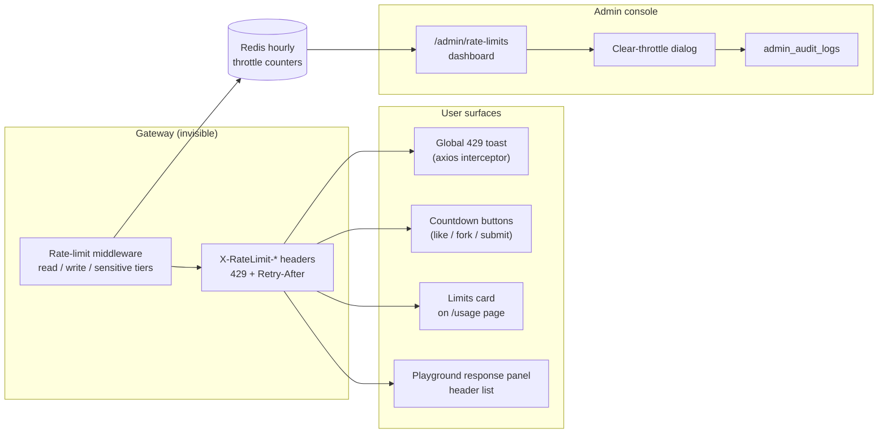
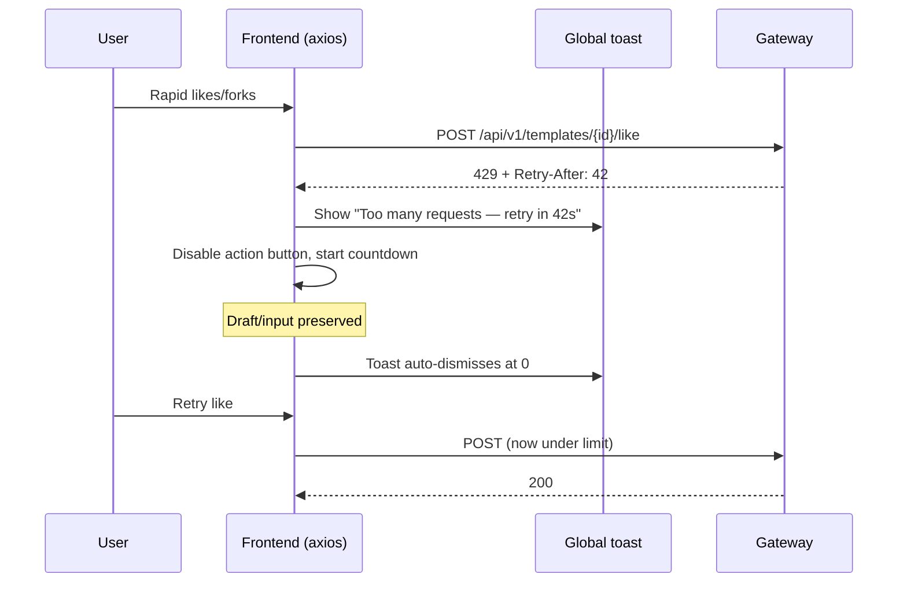
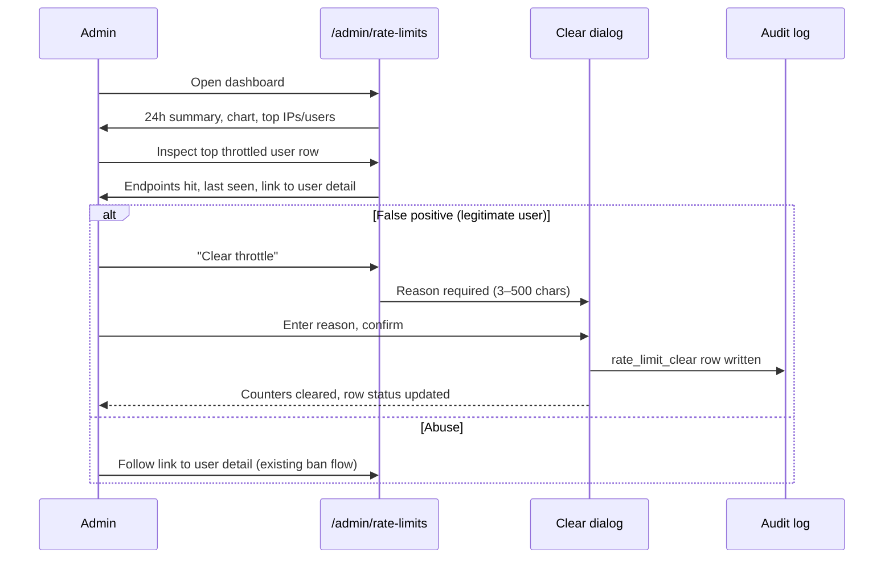

# Rate Limit Dashboard — UI/UX Design

- **Feature ID:** rate-limit-dashboard
- **Version:** 1.0
- **Status:** Proposed (for architecture review)
- **Author:** ui-ux-agent
- **Date:** 2026-10-12
- **Related docs:** [Requirements](./rate-limit-dashboard-requirements.md) · [中文 UI/UX 设计](./rate-limit-dashboard-ui-ux-design-zh-CN.md)

## 1. Design Principles

1. **Throttling is a normal state, not an error.** 429 UI is calm, explains the wait, and never destroys user input.
2. **The countdown is the message.** Every throttled surface shows a live "retry in Ns" — users should never wonder whether the site is broken.
3. **Self-service before support.** Headers, meters, and the playground panel let integrators regulate themselves; the docs page is one click from the meter.
4. **Admin sees the wave, not the noise.** The dashboard aggregates (totals, top actors, chart) instead of listing every 429.
5. **Remediation is accountable.** Clearing a throttle demands a reason and lands in the audit log — same pattern as ban/unban.

## 2. Information Architecture



## 3. User Flows

### 3.1 User hits a write limit (like/fork burst)



### 3.2 Integrator checks budget on /usage

```mermaid
sequenceDiagram
    participant I as Integrator
    participant UP as /usage page
    participant LC as Limits card
    participant BE as Backend
    I->>UP: Open Usage
    UP->>BE: GET /api/v1/usage/limits
    BE-->>LC: {read: 87/120, write: 4/30, reset_at}
    LC->>I: Two meters + reset countdown
    Note over LC: Ticks down live; refresh on window reset
```

### 3.3 Admin investigates a throttle burst



### 3.4 Anonymous visitor throttled on reads

```mermaid
sequenceDiagram
    participant V as Visitor (script/refresh spam)
    participant BE as Gateway
    participant GT as Global toast
    V->>BE: 121st GET within a minute
    BE-->>V: 429 + Retry-After
    V->>GT: "Too many requests — retry in Ns"
    Note over GT: No scary red error; calm amber info styling
```

## 4. Page Layouts (Wireframes)

### 4.1 Global 429 toast (all surfaces)

```
┌──────────────────────────────────────────────────┐
│  ⏳  Too many requests — try again in 42s        │  × │
└──────────────────────────────────────────────────┘
  amber info toast, bottom-right (desktop) /
  bottom-center (mobile); auto-dismiss at 0
```

### 4.2 Countdown button state (like/fork/submit)

```
  Normal:        [ ♥  Like ]
  Throttled:     [ ⏳ Retry in 42s ]   (disabled, live tick)
  Ready again:   [ ♥  Like ]           (re-enabled)
```

### 4.3 Limits card on /usage page

```
┌────────────────────────────────────────────────────────────┐
│  API limits                                    [Refresh]   │
│  ──────────────────────────────────────────────────────────│
│  Read (GET)                          resets in 12m 34s     │
│  ████████████░░░░░░░░░░  87 / 120                           │
│                                                            │
│  Write (POST/PUT/DELETE)              resets in 12m 34s    │
│  █████░░░░░░░░░░░░░░░░░   4 / 30                           │
│                                                            │
│  ⓘ Limits apply per account (all API keys share this       │
│    budget). See docs →                                     │
└────────────────────────────────────────────────────────────┘
  Degrades to: "Limits unavailable — try again later" (503)
```

### 4.4 Admin dashboard — /admin/rate-limits

```
┌──────────────────────────────────────────────────────────────────────┐
│  ← Admin        Rate Limits                                          │
│  ────────────────────────────────────────────────────────────────────│
│  ┌──────────────┐ ┌──────────────┐ ┌──────────────────────────┐     │
│  │ Throttled    │ │ Unique       │ │ Most throttled endpoint  │     │
│  │ requests 24h │ │ actors 24h   │ │ GET /api/v1/templates    │     │
│  │    1,284     │ │     37       │ │ (412 hits)               │     │
│  └──────────────┘ └──────────────┘ └──────────────────────────┘     │
│                                                                      │
│  Throttled requests — last 24 hours                                  │
│  ▂ ▁ ▁ ▃ ▅ ▇ █ ▆ ▃ ▂ ▁ ▁ ▂ ▂ ▁ ▁ ▁ ▁ ▁ ▁ ▁ ▁ ▁ ▁                  │
│  00:00        06:00        12:00        18:00        now            │
│                                                                      │
│  Effective limits: read 120/min · write 30/min · sensitive 10/min   │
│  Additional domain limits: comments 5/min & 50/day · admin login    │
│  5 fails/15min (per IP)                                              │
│  ────────────────────────────────────────────────────────────────────│
│  Top throttled IPs                Top throttled users                │
│  ┌─────────────────────────────┐  ┌─────────────────────────────┐   │
│  │ IP          hits  last seen │  │ User        hits  last seen │   │
│  │ 203.0.113.7  412  2 min ago │  │ alex@…      96   5 min ago │   │
│  │ 198.51.100.2 201  14 min ago│  │ bot@…       64   1 min ago  │   │
│  │ …                           │  │ …                           │   │
│  │        [Clear throttle]     │  │  [Clear]  [View user →]     │   │
│  └─────────────────────────────┘  └─────────────────────────────┘   │
└──────────────────────────────────────────────────────────────────────┘
```

### 4.5 Clear-throttle dialog

```
┌──────────────────────────────────────────────────────┐
│  Clear throttle for 203.0.113.7                [×]  │
│  ────────────────────────────────────────────────────│
│  This deletes all rate-limit counters for this IP.   │
│  The actor can immediately make requests again.      │
│                                                      │
│  Reason (required, 3–500 chars)                      │
│  ┌────────────────────────────────────────────────┐ │
│  │ False positive — CDN health-check IP, verified │ │
│  │ with infra team.                               │ │
│  └────────────────────────────────────────────────┘ │
│  52 / 500                                            │
│                                                      │
│              [Cancel]   [ Clear throttle ]           │
└──────────────────────────────────────────────────────┘
  Confirm → success toast + row status "Cleared" + audit row
```

## 5. Component Specifications

| Component | Based on | Props / Behavior |
|---|---|---|
| `RateLimitToast` | existing toast/notification system | Fired by global axios interceptor on 429; amber info styling (not error red); message with live countdown from `Retry-After`; dedupes by window (one toast per active window); auto-dismiss at 0. |
| `CountdownButton` | HOC/wrapper over existing buttons | `{retryUntil}`; disables target, renders "Retry in Ns" ticking every second; re-enables at 0; preserves all form state (never resets). |
| `LimitsCard` | new (on /usage) | Fetches `GET /usage/limits` on mount + on window reset; two progress meters (read/write) with `remaining/limit` and reset countdown; info note about shared budget; 503 → "unavailable" state with retry link. |
| `RateLimitHeadersPanel` | playground response panel section | Renders `X-RateLimit-Limit/Remaining/Reset` + `Retry-After` rows when present; monospace; highlights `Remaining: 0` in amber. |
| `AdminRateLimitsPage` | existing admin page pattern (AuditLogPage) | Summary cards, 24h bar chart (hourly buckets), effective-limits strip, two tables (IPs/users) with hits + last seen + actions; empty state when no throttles. |
| `ClearThrottleDialog` | existing admin dialog pattern (reason-gated) | `{actorType, actorId}`; textarea 3–500 chars with live counter; confirm → `DELETE /admin/rate-limits/throttle`; success toast + row status update; errors inline. |

## 6. Interaction Details

1. **Global interceptor registration:** one axios response interceptor in the shared API client; checks `err.response.status === 429` and `config.url` starts with `/api/v1`; surfaces toast unless `config.skipRateLimitToast` (set by CommentComposer/AdminLoginPage which own their local UX).
2. **Countdown source of truth:** `Retry-After` header parsed to seconds; missing/invalid → 60s default; countdown ticks client-side, no polling.
3. **Toast dedup:** while a throttle toast is visible, subsequent 429s within the same window update the existing toast's countdown instead of stacking.
4. **Limits card refresh:** fetch on mount; a `setTimeout` at `reset_at` refetches (window rolled over); manual Refresh button; no polling loop.
5. **Meter thresholds:** >50% remaining → green; 20–50% → amber; <20% → red meter + "approaching limit" hint text.
6. **Admin chart:** hourly buckets for last 24h; hover tooltip shows hour + count; clicking an hour filters both tables to actors throttled in that hour (client-side filter over loaded data).
7. **Clear-throttle guard:** Confirm disabled until reason length ∈ [3,500]; Enter submits only when valid; Escape cancels; after success the row shows a "Cleared" badge for the session.
8. **Effective limits strip:** values come from a new admin endpoint reflecting env-configured values (read-only); the "additional domain limits" line is static documentation text.
9. **Playground integration:** header rows appear in the existing response panel's headers section — no layout change, just data.
10. **Keyboard:** all dialogs focus-trapped; tables follow existing admin table keyboard patterns; countdown text is `aria-live="off"` (it changes every second — announced only on state change to "throttled"/"ready").

## 7. States Summary

| State | Trigger | UI |
|---|---|---|
| Throttled (global) | any 429 without local handler | Amber toast with countdown; auto-dismiss |
| Throttled (composer) | comment 429 | Local countdown on Post button; draft preserved |
| Button countdown | 429 on button action | Disabled button "Retry in Ns"; re-enable at 0 |
| Limits loaded | /usage visit | Two meters + reset countdown |
| Limits unavailable | /usage/limits 503 | Card shows "unavailable" + retry link |
| Approaching limit | meter <20% | Red meter + hint |
| Dashboard loaded | /admin/rate-limits visit | Cards + chart + tables |
| Dashboard empty | no throttles in 24h | "No throttled requests in the last 24 hours" |
| Clear confirm | Clear throttle click | Reason dialog, confirm disabled until valid |
| Clear success | 200 from DELETE | Toast + row "Cleared" badge |
| Clear error | network/4xx | Inline error in dialog, reason preserved |

## 8. i18n String Table

Namespace: `rate_limits` (new) + `usage` (extended).

| Key / EN | ZH |
|---|---|
| `rate_limits.toast_throttled` / Too many requests — try again in {{seconds}}s | 请求过于频繁 —— {{seconds}} 秒后重试 |
| `rate_limits.retry_in` / Retry in {{seconds}}s | {{seconds}} 秒后可重试 |
| `rate_limits.limits_title` / API limits | API 限额 |
| `rate_limits.read_tier` / Read (GET) | 读（GET） |
| `rate_limits.write_tier` / Write (POST/PUT/DELETE) | 写（POST/PUT/DELETE） |
| `rate_limits.resets_in` / resets in {{time}} | {{time}}后重置 |
| `rate_limits.shared_budget_note` / Limits apply per account — all API keys share this budget. | 限额按账户计算 —— 所有 API key 共享此预算。 |
| `rate_limits.approaching` / Approaching limit | 接近限额 |
| `rate_limits.unavailable` / Limits unavailable — try again later | 限额信息不可用，请稍后再试 |
| `rate_limits.refresh` / Refresh | 刷新 |
| `rate_limits.admin_title` / Rate Limits | 限流 |
| `rate_limits.admin_throttled_24h` / Throttled requests (24h) | 被限流请求（24 小时） |
| `rate_limits.admin_unique_actors` / Unique throttled actors (24h) | 被限流独立执行者（24 小时） |
| `rate_limits.admin_top_endpoint` / Most throttled endpoint | 被限流最多的端点 |
| `rate_limits.admin_chart_title` / Throttled requests — last 24 hours | 被限流请求 —— 过去 24 小时 |
| `rate_limits.admin_effective` / Effective limits | 生效限额 |
| `rate_limits.admin_domain_limits` / Additional domain limits: comments 5/min & 50/day · admin login 5 fails/15min per IP | 附加领域限额：评论 5 次/分钟及 50 次/天 · 管理员登录每 IP 5 次失败/15 分钟 |
| `rate_limits.admin_top_ips` / Top throttled IPs | Top 被限流 IP |
| `rate_limits.admin_top_users` / Top throttled users | Top 被限流用户 |
| `rate_limits.admin_hits` / hits | 次数 |
| `rate_limits.admin_last_seen` / last seen | 最后出现 |
| `rate_limits.admin_empty` / No throttled requests in the last 24 hours | 过去 24 小时没有被限流的请求 |
| `rate_limits.clear_title` / Clear throttle for {{actor}} | 清除 {{actor}} 的限流 |
| `rate_limits.clear_body` / This deletes all rate-limit counters for this actor. They can immediately make requests again. | 这将删除该执行者的所有限流计数器，其可立即继续请求。 |
| `rate_limits.clear_reason_label` / Reason (required, 3–500 characters) | 理由（必填，3–500 字符） |
| `rate_limits.clear_confirm` / Clear throttle | 清除限流 |
| `rate_limits.clear_success` / Throttle cleared for {{actor}} | 已清除 {{actor}} 的限流 |
| `rate_limits.cleared_badge` / Cleared | 已清除 |
| `usage.view_limits` / View limits | 查看限额 |

## 9. Accessibility Notes

- The throttle toast uses `role="status"` (polite) — it announces once on appearance, not on every countdown tick.
- Countdown buttons keep their accessible name updated ("Retry in 42 seconds") but tick announcements are suppressed (`aria-live` off on the ticking span); the transition back to enabled is announced.
- Limits meters are `<div role="meter" aria-valuenow aria-valuemin aria-valuemax aria-valuetext="87 of 120 read requests remaining">` with visible text equivalents (the fraction is real text, not color-only).
- Color thresholds (green/amber/red) always pair with text ("approaching limit"), never color alone.
- Admin tables reuse the existing admin table semantics (caption, scope headers); the chart has a text summary line ("Peak: 412 at 13:00") as its accessible description.
- Clear dialog: focus trap, Escape cancel, reason textarea labeled with live character counter (`aria-describedby`), confirm disabled state communicated via `aria-disabled`.
- All dialogs return focus to their trigger on close.

## 10. Responsive Behavior

- **Desktop (≥1024px):** toast bottom-right; admin dashboard two tables side-by-side; Limits card full-width row on /usage.
- **Tablet (768–1023px):** admin tables stack vertically; chart full-width; summary cards wrap 2+1.
- **Mobile (<768px):** toast bottom-center full-width; countdown buttons shrink label to "42s"; Limits card meters stack; admin dashboard single column, tables become horizontally scrollable with sticky first column; clear dialog full-screen sheet.
- The playground header panel is monospace rows — no reflow needed at any width.

## 11. Analytics Events (optional, if analytics ships)

- `rate_limit_toast_shown` `{tier, retry_after}`
- `limits_card_viewed` / `limits_card_refreshed`
- `admin_rate_limits_viewed`
- `throttle_cleared` `{actor_type}`

## 12. Out of Scope (UI)

- Per-key limit meters (single shared budget in v1).
- Limit configuration UI (env-only).
- Historical throttle data beyond 24h (Redis hourly buckets only).
- IP ban UI (block-users covers user-level actions).
- Docs page content itself (linked, not designed here).
