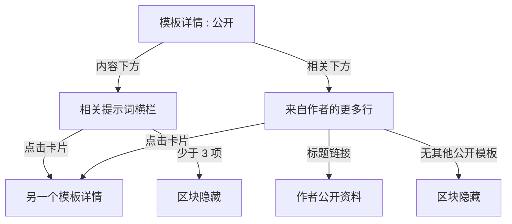
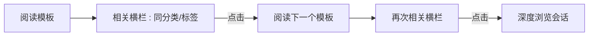
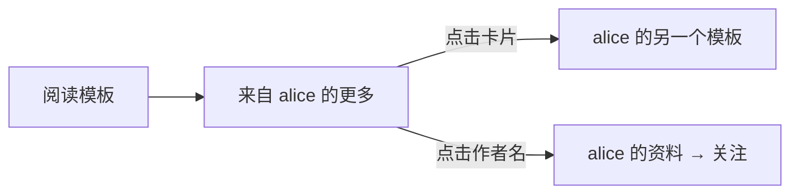

# 相关模板与发现 — UI/UX 设计

- **功能 ID：** related-templates
- **版本：** 1.0
- **状态：** 已提案（待架构评审）
- **作者：** ui-ux-agent
- **日期：** 2026-10-12
- **配套文档：** `related-templates-requirements-zh-CN.md`

## 1. 设计原则

1. **可解释的关联性。** 每个横栏都说明存在的原因（"相关 · 客服支持"）—— 没有黑盒建议。
2. **详情页变成走廊，而不是房间。** 内容下方两个安静的横栏把死胡同变成持续浏览。
3. **仅元数据，无监视。** 关联性来自分类/标签/作者 —— 不使用任何关于访问者的信息。
4. **复用一切。** TemplateCard、横向滚动模式、懒加载遵循既有惯例；零新视觉习惯。

## 2. 信息架构



| 界面 | 位置 | 受众 | 目的 |
|---|---|---|---|
| 相关提示词横栏 | 模板详情，内容下方 | 浏览用户 | 继续探索相似提示词 |
| 来自作者的更多行 | 模板详情，相关下方 | 浏览用户 | 发现作者的作品目录 |
| 横栏卡片 | 横栏内 | 所有人 | 复用 TemplateCard |

## 3. 用户流程

### 3.1 持续浏览



### 3.2 作者发现



## 4. 页面布局

### 4.1 带横栏的模板详情（桌面）

```
+----------------------------------------------------------------------+
|  ← 返回       Support Reply v3                                       |
|                 by alice · 客服支持 · v3 · ★ 128                     |
+----------------------------------------------------------------------+
|  | 提示词（内容、版本、操作 — 不变）                                  |
+----------------------------------------------------------------------+
|  相关 · 客服支持                                                      |
|  +----------+  +----------+  +----------+  +----------+  +------    |
|  | 卡片     |  | 卡片     |  | 卡片     |  | 卡片     |  | 卡片 →   |
|  | ★ 96     |  | ★ 71     |  | ★ 54     |  | ★ 48     |  | (滚动)   |
|  +----------+  +----------+  +----------+  +----------+  +------    |
+----------------------------------------------------------------------+
|  来自 alice 的更多                                                    |
|  +----------+  +----------+  +----------+  +----------+              |
|  | 卡片     |  | 卡片     |  | 卡片     |  | 卡片     |              |
|  +----------+  +----------+  +----------+  +----------+              |
+----------------------------------------------------------------------+
|  评论（既有）                                                         |
+----------------------------------------------------------------------+
```

### 4.2 移动端（单列）

```
+---------------------------+
|  Support Reply v3         |
|  by alice · ★ 128         |
+---------------------------+
|  提示词内容                |
|  [复制] [使用] [♡] [★]     |
+---------------------------+
|  相关 · 客服支持           |
|  → [卡片] [卡片] [卡片] → |  (横向滚动，吸附)
+---------------------------+
|  来自 alice 的更多         |
|  → [卡片] [卡片] →        |  (横向滚动)
+---------------------------+
|  评论                     |
+---------------------------+
```

横栏在移动端使用 scroll-snap；卡片宽度为视口的 72%，下一张卡片露出边缘。

## 5. 组件规格

| 组件 | 行为 | 状态 |
|---|---|---|
| RelatedRail | 带基础标签的区块 + 横向卡片列表；主内容后懒加载 | 加载中（骨架卡片）/ 已加载 / 隐藏（<3） |
| MoreFromAuthorRow | 带作者名（资料存在时为链接）的区块 + 最多 4 张卡片 | 加载中 / 已加载 / 隐藏（无） |
| RailCard | 既有 TemplateCard（名称、分类、点赞、所有者）；可聚焦链接 | 既有状态 |
| BasisLabel | "相关 · {分类/标签}" —— 数值按原样显示的纯文本 | 3 种变体（分类/标签/通用） |

## 6. 交互细节

1. **懒加载：** 横栏在详情页主内容渲染后获取（非阻塞）；骨架通常显示 < 300 毫秒。
2. **基础标签：** 从 API 的 `basis` 字段派生；分类/标签名不翻译（专有名词）。
3. **横向滚动：** 桌面端显示换行网格（2 行 × 4）；移动端使用 scroll-snap 加边缘渐隐提示；键盘用户逐卡 Tab（v1 无轮播按钮）。
4. **卡片点击** 导航到模板详情 —— 标准应用内导航（不开新标签）。
5. **作者链接** 在"来自 {作者} 的更多"中，follow-creators 界面存在时跳转公开资料；在此之前为纯文本。
6. **隐藏状态：** 相关项少于 3 个 → 无相关区块；无其他公开模板 → 无作者行；两者都隐藏 → 页面在内容后直接以评论结束。
7. **任何地方都没有个性化：** 同一模板对每个访问者显示相同的横栏（缓存 TTL 内）。

## 7. 状态汇总

| 界面 | 加载中 | 空状态 | 错误 |
|---|---|---|---|
| 相关横栏 | 骨架卡片 | 隐藏（<3 项） | 区块隐藏（静默） |
| 来自作者的更多 | 骨架卡片 | 隐藏（无） | 区块隐藏（静默） |

错误设计为静默：横栏是增强，绝不是失败界面。

## 8. 国际化

| 键（EN） | ZH |
|---|---|
| related.title.category / Related · {{category}} | 相关 · {{category}} |
| related.title.tag / Related · {{tag}} | 相关 · {{tag}} |
| related.title.generic / Related prompts | 相关提示词 |
| related.moreFromAuthor / More from {{author}} | 来自 {{author}} 的更多 |
| related.aria.rail / Related prompts section | 相关提示词区块 |
| related.aria.authorRow / More from this author | 来自此作者的更多 |

分类和标签名是专有名词，不翻译。

## 9. 无障碍

- 横栏是带 `h2` 标题的 `<section aria-label>` 补充区域。
- 卡片是 DOM 顺序中可聚焦的链接（Tab 逐卡移动）；横向滚动区域聚焦时可键盘滚动（原生 overflow 行为）。
- 无自动前进、无悬停暂停的轮播逻辑 —— 静态列表。
- 骨架状态为 `aria-hidden`；区块在加载完成前不播报任何内容。
- 移动端 scroll-snap 不困住焦点；卡片仍可单独到达。

## 10. 分析（可选）

- `related_rail_viewed`（基础）、`related_card_clicked`（位置）、`more_from_author_viewed`、`more_from_author_card_clicked` —— 仅产品使用事件。

## 11. 范围之外

- 个性化"为你推荐"横栏、浏览历史信号、共同交互数据。
- 主页推荐区块。
- 相关合集/链/团队；"不感兴趣"控件。
- 任何变现（赞助/推广横栏）—— 永久排除。
