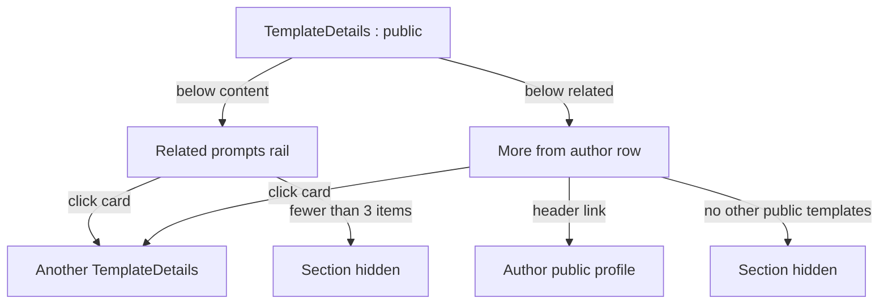
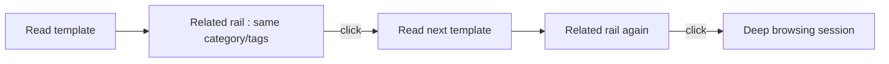
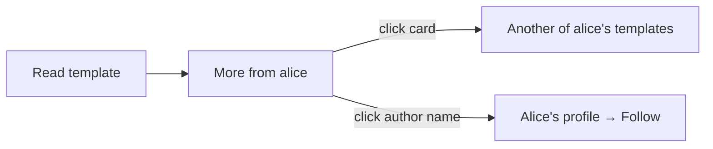

# Related Templates & Discovery — UI/UX Design

- **Feature ID:** related-templates
- **Version:** 1.0
- **Status:** Proposed (for architecture review)
- **Author:** ui-ux-agent
- **Date:** 2026-10-12
- **Companion doc:** `related-templates-requirements.md`

## 1. Design Principles

1. **Explainable relatedness.** Every rail says why it exists ("Related · Customer Support") — no black-box suggestions.
2. **The detail page becomes a corridor, not a room.** Two calm rails below the content turn dead ends into continued browsing.
3. **Metadata only, no surveillance.** Relatedness comes from category/tags/author — nothing about the viewer is used.
4. **Reuse everything.** TemplateCard, horizontal-scroll patterns, and lazy-loading follow existing conventions; zero new visual idioms.

## 2. Information Architecture



| Surface | Location | Audience | Purpose |
|---|---|---|---|
| Related prompts rail | Template detail, below content | Browsing users | Continue exploring similar prompts |
| More from author row | Template detail, below related | Browsing users | Discover the author's catalog |
| Rail card | Inside rails | All | Reused TemplateCard |

## 3. User Flows

### 3.1 Continuous browsing



### 3.2 Author discovery



## 4. Page Layouts

### 4.1 Template detail with rails (desktop)

```
+----------------------------------------------------------------------+
|  ← Back        Support Reply v3                                      |
|                 by alice · Customer Support · v3 · ★ 128             |
+----------------------------------------------------------------------+
|  | Prompt (content, versions, actions — unchanged)                  |
+----------------------------------------------------------------------+
|  Related · Customer Support                                          |
|  +----------+  +----------+  +----------+  +----------+  +------    |
|  | card     |  | card     |  | card     |  | card     |  | card →   |
|  | ★ 96     |  | ★ 71     |  | ★ 54     |  | ★ 48     |  | (scroll) |
|  +----------+  +----------+  +----------+  +----------+  +------    |
+----------------------------------------------------------------------+
|  More from alice                                                     |
|  +----------+  +----------+  +----------+  +----------+              |
|  | card     |  | card     |  | card     |  | card     |              |
|  +----------+  +----------+  +----------+  +----------+              |
+----------------------------------------------------------------------+
|  Comments (existing)                                                 |
+----------------------------------------------------------------------+
```

### 4.2 Mobile (single column)

```
+---------------------------+
|  Support Reply v3         |
|  by alice · ★ 128         |
+---------------------------+
|  Prompt content           |
|  [Copy] [Use] [♡] [★]     |
+---------------------------+
|  Related · Customer Support|
|  → [card] [card] [card] → |  (horizontal scroll, snap)
+---------------------------+
|  More from alice          |
|  → [card] [card] →        |  (horizontal scroll)
+---------------------------+
|  Comments                 |
+---------------------------+
```

Rails use scroll-snap on mobile; cards are 72% viewport width so the next card peeks.

## 5. Component Specs

| Component | Behavior | States |
|---|---|---|
| RelatedRail | Section with basis label + horizontal card list; lazy-loads after main content | Loading (skeleton cards) / loaded / hidden (<3) |
| MoreFromAuthorRow | Section with author name (link when profile exists) + up to 4 cards | Loading / loaded / hidden (none) |
| RailCard | Existing TemplateCard (name, category, likes, owner); focusable link | Existing states |
| BasisLabel | "Related · {category/tag}" — plain text with the value as-is | 3 variants (category/tag/generic) |

## 6. Interaction Details

1. **Lazy load:** rails fetch after the detail page's main content renders (non-blocking); skeletons show for < 300 ms typically.
2. **Basis label:** derived from the API's `basis` field; category/tag names render untranslated (proper nouns).
3. **Horizontal scroll:** desktop shows a wrapped grid (2 rows × 4); mobile uses scroll-snap with edge fade hints; keyboard users Tab through cards (no carousel buttons in v1).
4. **Card click** navigates to the template detail — standard in-app navigation (no new tab).
5. **Author link** in "More from {author}" goes to the public profile when the follow-creators surface exists; until then it is plain text.
6. **Hidden states:** fewer than 3 related items → no Related section; no other public templates → no author row; both hidden → page ends with comments directly after content.
7. **No personalization anywhere:** the same template shows the same rails to every visitor (within cache TTL).

## 7. States Summary

| Surface | Loading | Empty | Error |
|---|---|---|---|
| Related rail | Skeleton cards | Hidden (<3 items) | Section hidden (silent) |
| More from author | Skeleton cards | Hidden (none) | Section hidden (silent) |

Errors are silent by design: rails are enhancement, never a failure surface.

## 8. i18n

| Key (EN) | ZH |
|---|---|
| related.title.category / Related · {{category}} | 相关 · {{category}} |
| related.title.tag / Related · {{tag}} | 相关 · {{tag}} |
| related.title.generic / Related prompts | 相关提示词 |
| related.moreFromAuthor / More from {{author}} | 来自 {{author}} 的更多 |
| related.aria.rail / Related prompts section | 相关提示词区块 |
| related.aria.authorRow / More from this author | 来自此作者的更多 |

Category and tag names are proper nouns and are not translated.

## 9. Accessibility

- Rails are `<section aria-label>` complementary regions with `h2` headers.
- Cards are focusable links in DOM order (Tab moves card by card); the horizontal scroll region is keyboard-scrollable when focused (native overflow behavior).
- No auto-advance, no hover-pause carousel logic — static lists.
- Skeleton states are `aria-hidden`; the section announces nothing until loaded.
- Mobile scroll-snap does not trap focus; cards remain individually reachable.

## 10. Analytics (optional)

- `related_rail_viewed` (basis), `related_card_clicked` (position), `more_from_author_viewed`, `more_from_author_card_clicked` — product usage events only.

## 11. Out of Scope

- Personalized "for you" rails, view-history signals, co-interaction data.
- Home-page recommendation sections.
- Related collections/chains/teams; "not interested" controls.
- Any monetization (sponsored/promoted rails) — permanently excluded.
