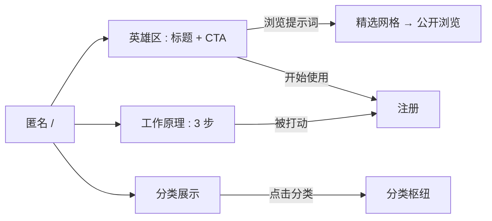
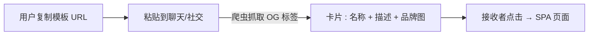

# SEO 与落地页改进 — UI/UX 设计

- **功能 ID：** seo-landing
- **版本：** 1.0
- **状态：** 已提案（待架构评审）
- **作者：** ui-ux-agent
- **日期：** 2026-10-12
- **配套文档：** `seo-landing-requirements-zh-CN.md`

## 1. 设计原则

1. **落地页卖产品，不卖登录墙。** 匿名访客在任何注册 CTA 之前先看到真实模板和清晰叙事。
2. **一个产品，两扇门。** 登录用户保留仪表盘；匿名用户获得营销界面 —— 相同的 Aurora 语言，不同的内容。
3. **诚实的元数据。** 标题、描述和爬虫 HTML 描述访客将看到的确切内容 —— 没有点击诱饵，没有私有数据。
4. **处处快速首屏。** 落地页和爬虫页服务端渲染且可缓存；SPA 仍是交互层。

## 2. 信息架构

```mermaid
flowchart TD
    A[匿名 /] --> B[落地页 : SSR]
    B -->|浏览提示词| C[公开浏览 : 匿名的主页网格]
    B -->|开始使用| D[/register]
    C -->|打开模板| E[模板详情 : 公开]
    E -->|爬虫 UA| F[SSR 模板页 : 完整 HTML + JSON-LD]
    E -->|浏览器| G[SPA 路由 : head meta 管理]
    H[分类枢纽 /c/:slug] -->|爬虫| I[SSR 列表 : 分页]
    H -->|浏览器| J[SPA 分类视图]
    K[登录 /] --> L[既有仪表盘 : 不变]
```

| 界面 | 路由 | 受众 | 目的 |
|---|---|---|---|
| 落地页 | `/`（匿名） | 匿名访客 | 产品叙事 + 精选内容 + CTA |
| 公开浏览 | `/` 浏览模式（匿名） | 匿名访客 | 无账号浏览公开模板 |
| SSR 模板页 | `/templates/{id}`（爬虫 UA） | 搜索引擎 | 可抓取、有描述的模板内容 |
| 分类枢纽 | `/c/{slug}` | 访客 + 爬虫 | 按分类浏览；SEO 枢纽 |
| 标签枢纽 | `/t/{tag}` | 访客 + 爬虫 | 按标签浏览；SEO 长尾 |
| SPA 路由 | 全部 | 用户 | 按路由的 head meta（标题/描述/OG） |

## 3. 用户流程

### 3.1 匿名访客从搜索落地

```mermaid
flowchart LR
    A[搜索结果 : 模板页] -->|爬虫 UA| B[SSR 页 : 内容 + CTA]
    A -->|浏览器| C[SPA 模板详情]
    B -->|在 Open Prompts 中打开| C
    C -->|使用/点赞时提示注册| D[/register]
    C -->|只是阅读| E[阅读 + 复制 : 无需账号]
```

### 3.2 首次访客探索落地页



### 3.3 分享正确展开



## 4. 页面布局

### 4.1 落地页 — 匿名 `/`（桌面端）

```
+----------------------------------------------------------------------+
|  头部: [logo] [浏览] [分类 ▾]                [登录] [开始使用]         |
+----------------------------------------------------------------------+
|                                                                      |
|        管理、版本化并分享你的 AI 提示词                                |
|        面向每日使用 AI 的人的提示词库：模板、                            |
|        版本、合集，以及简洁的 API。                                     |
|                    [ 开始使用 ]   [ 浏览提示词 ]                       |
|                                                                      |
+----------------------------------------------------------------------+
|  精选提示词                                                           |
|  +----------+  +----------+  +----------+  +----------+  ...        |
|  | 卡片     |  | 卡片     |  | 卡片     |  | 卡片     |             |
|  | ★ 128    |  | ★ 96     |  | ★ 87     |  | ★ 71     |             |
|  +----------+  +----------+  +----------+  +----------+             |
+----------------------------------------------------------------------+
|  按分类浏览                                                           |
|  [客服支持] [开发] [写作] [营销] [数据] [教育]                          |
+----------------------------------------------------------------------+
|  工作原理                                                             |
|  1. 创建      →  2. 版本与分享  →  3. 使用（网页或 API）               |
+----------------------------------------------------------------------+
|  页脚: 关于 · 文档 · API · 语言 · 主题                                |
+----------------------------------------------------------------------+
```

移动端：英雄区纵向堆叠（主标题 → 副标题 → 通栏 CTA）；精选网格 1–2 列；分类以标签流式换行；工作原理变为纵向步骤条。

### 4.2 SSR 模板页（爬虫视图）

```
<!doctype html>
<html lang="en">
<head>
  <title>Support Reply Prompt — Open Prompts</title>
  <meta name="description" content="A support reply template with tone and product variables. 128 likes. Free to use on Open Prompts.">
  <link rel="canonical" href="https://…/templates/{id}">
  <meta property="og:title" content="Support Reply Prompt">
  <meta property="og:description" content="…">
  <meta property="og:image" content="https://…/images/og-card.png">
  <meta name="twitter:card" content="summary_large_image">
  <script type="application/ld+json">{ …Article + BreadcrumbList… }</script>
</head>
<body>
  <header>Open Prompts</header>
  <main>
    <nav aria-label="Breadcrumb">Home → Customer Support → Support Reply Prompt</nav>
    <h1>Support Reply Prompt</h1>
    <p class="meta">by alice · Customer Support · updated 2026-09-30 · 128 likes</p>
    <h2>About this prompt</h2>
    <p>…description…</p>
    <h2>Prompt preview</h2>
    <pre>…提示词文本前 400 字符…</pre>
    <a class="cta" href="/templates/{id}">Open in Open Prompts →</a>
  </main>
</body>
</html>
```

### 4.3 分类枢纽 — `/c/{slug}`（浏览器视图）

```
+----------------------------------------------------------------------+
|  ← 全部分类                                                           |
|  客服支持                                                             |
|  142 个公开提示词                                                     |
+----------------------------------------------------------------------+
|  +----------+  +----------+  +----------+  +----------+              |
|  | 卡片     |  | 卡片     |  | 卡片     |  | 卡片     |              |
|  +----------+  +----------+  +----------+  +----------+              |
|  (分页 : 24/页)                                                      |
+----------------------------------------------------------------------+
```

同一 URL 的爬虫视图将相同卡片渲染为纯链接 + 片段（≤ 50/页）。

### 4.4 各 SPA 路由的 head meta（示例）

| 路由 | 标题 | 描述来源 |
|---|---|---|
| `/`（匿名） | Open Prompts — Manage, version, and share AI prompts | 静态落地文案 |
| `/`（登录） | Home — Open Prompts | 静态 |
| `/templates/{id}` | {模板名} — Open Prompts | 模板描述（截断 160 字符） |
| `/c/{slug}` | {分类} prompts — Open Prompts | 每分类静态文案 |
| `/t/{tag}` | {标签} prompts — Open Prompts | 静态模式 |
| `/api-keys` | API Keys — Open Prompts | 静态（noindex） |
| `/admin/*` | Admin — Open Prompts | 静态（noindex） |

## 5. 组件规格

| 组件 | 行为 | 状态 |
|---|---|---|
| LandingHero | 主标题、副标题、双 CTA；主题感知插画位 | 默认 |
| FeaturedGrid | 6 张公开模板卡片（周窗口按点赞取顶）；复用 TemplateCard | 加载（骨架）/ 已加载 / 空（隐藏区块） |
| CategoryShowcase | 前 6 个分类为带计数的标签 | 默认 |
| HowItWorks | 3 步横向步骤条（移动端纵向） | 默认 |
| LandingFooter | 产品链接、语言切换、主题切换 | 默认 |
| HeadManager | 按路由设置 title/description/canonical/OG/noindex；卸载时恢复 | 默认 |
| SSRPage（Go 模板） | 服务端渲染的模板/分类/落地 HTML，含 JSON-LD | 200 / 404（私有） |
| SitemapEndpoint | 来自数据库（公开 URL）的 `/sitemap.xml`，带缓存 | 200 |

## 6. 交互细节

1. **落地 CTA：**"开始使用"→ `/register`；"浏览提示词"→ 公开浏览（匿名主页网格）。两者都保留 `?lang=` 参数。
2. **精选网格**链接打开公开模板详情；匿名用户可阅读和复制；点赞/使用操作提示登录（既有行为）。
3. **分类标签**链接到 `/c/{slug}` 枢纽；枢纽分页为浏览器 24 / 爬虫 50 每页。
4. **HeadManager** 在路由变化和数据加载时更新（模板标题在 fetch 后到达 —— 数据落地时更新标题，之前有合理回退）。
5. **SSR CTA**（"在 Open Prompts 中打开"）链接到同一 URL；浏览器访问它获得 SPA 路由 —— 一个 URL，两种渲染，相同事实。
6. **语言：** 落地和 SSR 页面优先尊重 `?lang=`，其次 Accept-Language；落地页上的语言切换器往返传递该参数；`hreflang` 备选指向 `?lang=en` / `?lang=zh`。
7. **主题：** 落地页跟随站点主题（预水合脚本）；SSR 页面以默认亮色主题渲染，使用相同 Aurora 令牌。
8. **落地页的登录头部**在任何滚动位置都保持"登录"和"开始使用"可见（粘性头部，既有模式）。

## 7. 状态汇总

| 界面 | 加载 | 空 | 错误 |
|---|---|---|---|
| 落地精选网格 | 骨架卡片 | 隐藏区块 | 隐藏区块（落地页仍渲染） |
| 分类枢纽 | 卡片骨架 | "还没有公开提示词" | Toast + 重试 |
| SSR 模板页 | 不适用（服务端） | 不适用 | 404 页（私有/不存在） |
| Sitemap | 不适用 | 空 sitemap（合法 XML） | 500 → 下次刷新重试 |

## 8. 国际化

| 键（英文） | 中文 |
|---|---|
| landing.hero.title / Manage, version, and share your AI prompts | 管理、版本化并分享你的 AI 提示词 |
| landing.hero.subtitle / A prompt library for people who use AI daily… | 面向每日使用 AI 的人的提示词库：模板、版本、合集与简洁的 API。 |
| landing.cta.start / Get started | 开始使用 |
| landing.cta.browse / Browse prompts | 浏览提示词 |
| landing.featured / Featured prompts | 精选提示词 |
| landing.categories / Browse by category | 按分类浏览 |
| landing.how.title / How it works | 工作原理 |
| landing.how.1 / Create a prompt template with variables | 创建带变量的提示词模板 |
| landing.how.2 / Version it, collect it, share it | 版本管理、收藏与分享 |
| landing.how.3 / Use it on the web or through the API | 在网页上或通过 API 使用 |
| landing.footer.docs / Docs | 文档 |
| landing.footer.api / API | API |
| seo.category.title / {{category}} prompts | {{category}}提示词 |
| seo.tag.title / {{tag}} prompts | {{tag}}提示词 |
| seo.template.suffix / — Open Prompts | — Open Prompts |

## 9. 无障碍

- 落地页使用标准 landmark（header/nav/main/footer）和单一 `h1`（英雄主标题）；节标题为 `h2`。
- 精选网格复用无障碍 TemplateCard（按无障碍设计可键盘操作）。
- SSR 页面是普通的语义 HTML —— 标题、面包屑导航、提示词预览用 `pre` —— 天然可访问且可爬取。
- CTA 是带描述性标签的真实链接/按钮；焦点顺序遵循视觉顺序。
- 工作原理步骤条是一个列表（而非纯视觉时间线），屏幕阅读器能获得顺序。

## 10. 数据分析（可选）

- `landing_viewed`、`landing_cta_clicked`（开始/浏览）、`featured_template_opened`、`category_hub_opened` —— 仅产品使用事件。

## 11. 范围之外

- 博客/内容系统、A/B 测试、基于路径的语言区域（`/zh/…`）。
- AI 生成预览图；管理端 SEO 仪表盘。
- 任何变现内容（定价区块、套餐对比、升级 CTA）—— 永久排除。
