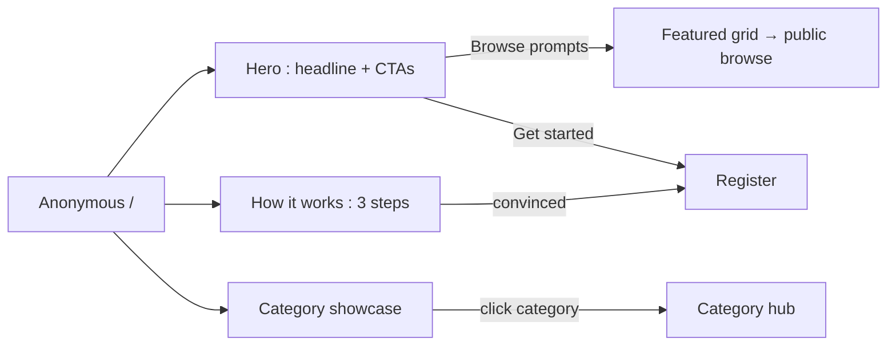
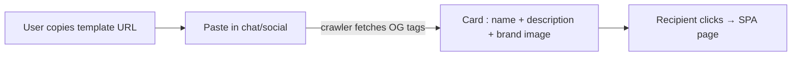

# SEO & Landing Improvements — UI/UX Design

- **Feature ID:** seo-landing
- **Version:** 1.0
- **Status:** Proposed (for architecture review)
- **Author:** ui-ux-agent
- **Date:** 2026-10-12
- **Companion doc:** `seo-landing-requirements.md`

## 1. Design Principles

1. **The landing sells the product, not a login wall.** Anonymous visitors see real templates and a clear narrative before any register CTA.
2. **One product, two doors.** Logged-in users keep their dashboard; anonymous users get the marketing surface — same Aurora language, different content.
3. **Honest metadata.** Titles, descriptions, and crawler HTML describe exactly what a visitor will see — no clickbait, no private data.
4. **Fast first paint everywhere.** The landing and crawler pages are server-rendered and cacheable; the SPA remains the interactive layer.

## 2. Information Architecture

```mermaid
flowchart TD
    A[Anonymous /] --> B[Landing page : SSR]
    B -->|Browse prompts| C[Public browse : home grid for anonymous]
    B -->|Get started| D[/register])
    C -->|open template| E[TemplateDetails : public]
    E -->|crawler UA| F[SSR template page : full HTML + JSON-LD]
    E -->|browser| G[SPA route : head meta managed]
    H[Category hub /c/:slug] -->|crawler| I[SSR listing : paginated]
    H -->|browser| J[SPA category view]
    K[Logged-in /] --> L[Existing dashboard : unchanged]
```

| Surface | Route | Audience | Purpose |
|---|---|---|---|
| Landing | `/` (anonymous) | Anonymous visitors | Product narrative + featured content + CTAs |
| Public browse | `/` browse mode (anonymous) | Anonymous visitors | Browse public templates without an account |
| SSR template page | `/templates/{id}` (crawler UA) | Search engines | Crawlable, described template content |
| Category hub | `/c/{slug}` | Visitors + crawlers | Browse by category; SEO hub |
| Tag hub | `/t/{tag}` | Visitors + crawlers | Browse by tag; SEO long-tail |
| SPA routes | all | Users | Per-route head meta (title/description/OG) |

## 3. User Flows

### 3.1 Anonymous visitor lands from search

```mermaid
flowchart LR
    A[Search result : template page] -->|crawler UA| B[SSR page : content + CTA]
    A -->|browser| C[SPA TemplateDetails]
    B -->|Open in Open Prompts| C
    C -->|sign up prompt on use/like| D[/register)
    C -->|just reading| E[Reads + copies : no account needed]
```

### 3.2 First-time visitor explores landing



### 3.3 Share unfurls correctly



## 4. Page Layouts

### 4.1 Landing — anonymous `/` (desktop)

```
+----------------------------------------------------------------------+
|  Header: [logo] [Browse] [Categories ▾]        [Sign in] [Get started]|
+----------------------------------------------------------------------+
|                                                                      |
|        Manage, version, and share your AI prompts                    |
|        A prompt library for people who use AI daily: templates,      |
|        versions, collections, and a clean API.                       |
|                    [ Get started ]   [ Browse prompts ]              |
|                                                                      |
+----------------------------------------------------------------------+
|  Featured prompts                                                    |
|  +----------+  +----------+  +----------+  +----------+  ...        |
|  | card     |  | card     |  | card     |  | card     |             |
|  | ★ 128    |  | ★ 96     |  | ★ 87     |  | ★ 71     |             |
|  +----------+  +----------+  +----------+  +----------+             |
+----------------------------------------------------------------------+
|  Browse by category                                                  |
|  [Customer Support] [Development] [Writing] [Marketing] [Data] [Edu] |
+----------------------------------------------------------------------+
|  How it works                                                        |
|  1. Create      →  2. Version & share  →  3. Use (web or API)        |
+----------------------------------------------------------------------+
|  Footer: About · Docs · API · Language · Theme                       |
+----------------------------------------------------------------------+
```

Mobile: hero stacks (headline → subheadline → CTAs full-width); featured grid 1–2 columns; categories wrap as chips; how-it-works becomes a vertical stepper.

### 4.2 SSR template page (crawler view)

```
<!doctype html>
<html lang="en">
<head>
  <title>Support Reply Prompt — Open Prompts</title>
  <meta name="description" content="A support reply template with tone and product variables. 128 likes. Free to use on Open Prompts.">
  <link rel="canonical" href="https://…/templates/{id}">
  <meta property="og:title" content="Support Reply Prompt">
  <meta property="og:description" content="…">
  <meta property="og:image" content="https://…/images/og-card.png">
  <meta name="twitter:card" content="summary_large_image">
  <script type="application/ld+json">{ …Article + BreadcrumbList… }</script>
</head>
<body>
  <header>Open Prompts</header>
  <main>
    <nav aria-label="Breadcrumb">Home → Customer Support → Support Reply Prompt</nav>
    <h1>Support Reply Prompt</h1>
    <p class="meta">by alice · Customer Support · updated 2026-09-30 · 128 likes</p>
    <h2>About this prompt</h2>
    <p>…description…</p>
    <h2>Prompt preview</h2>
    <pre>…first 400 chars of prompt text…</pre>
    <a class="cta" href="/templates/{id}">Open in Open Prompts →</a>
  </main>
</body>
</html>
```

### 4.3 Category hub — `/c/{slug}` (browser view)

```
+----------------------------------------------------------------------+
|  ← All categories                                                    |
|  Customer Support                                                    |
|  142 public prompts                                                  |
+----------------------------------------------------------------------+
|  +----------+  +----------+  +----------+  +----------+              |
|  | card     |  | card     |  | card     |  | card     |              |
|  +----------+  +----------+  +----------+  +----------+              |
|  (pagination : 24/page)                                              |
+----------------------------------------------------------------------+
```

The crawler view of the same URL renders the same cards as plain links + snippets (≤ 50/page).

### 4.4 Head meta per SPA route (examples)

| Route | Title | Description source |
|---|---|---|
| `/` (anonymous) | Open Prompts — Manage, version, and share AI prompts | Static landing copy |
| `/` (logged in) | Home — Open Prompts | Static |
| `/templates/{id}` | {Template name} — Open Prompts | Template description (truncated 160 chars) |
| `/c/{slug}` | {Category} prompts — Open Prompts | Static per-category copy |
| `/t/{tag}` | {Tag} prompts — Open Prompts | Static pattern |
| `/api-keys` | API Keys — Open Prompts | Static (noindex) |
| `/admin/*` | Admin — Open Prompts | Static (noindex) |

## 5. Component Specs

| Component | Behavior | States |
|---|---|---|
| LandingHero | Headline, subheadline, dual CTA; theme-aware illustration slot | Default |
| FeaturedGrid | 6 public template cards (top by likes, weekly window); reuses TemplateCard | Loading (skeleton) / loaded / empty (hidden section) |
| CategoryShowcase | Top 6 categories as chips with counts | Default |
| HowItWorks | 3-step horizontal stepper (vertical on mobile) | Default |
| LandingFooter | Product links, language switch, theme toggle | Default |
| HeadManager | Sets title/description/canonical/OG/noindex per route; restores on unmount | Default |
| SSRPage (Go template) | Server-rendered template/category/landing HTML with JSON-LD | 200 / 404 (private) |
| SitemapEndpoint | `/sitemap.xml` from DB (public URLs), cached | 200 |

## 6. Interaction Details

1. **Landing CTAs:** "Get started" → `/register`; "Browse prompts" → public browse (anonymous home grid). Both preserve the `?lang=` parameter.
2. **Featured grid** links open public template details; anonymous users can read and copy; like/use actions prompt sign-in (existing behavior).
3. **Category chips** link to `/c/{slug}` hubs; hubs paginate at 24 (browser) / 50 (crawler) per page.
4. **HeadManager** updates on route change and data load (template title arrives after fetch — title updates when data lands, with a sensible fallback before).
5. **SSR CTA** ("Open in Open Prompts") links to the same URL; a browser hitting it gets the SPA route — one URL, two renderings, identical facts.
6. **Language:** landing and SSR pages honor `?lang=` then Accept-Language; the language switcher on the landing round-trips the parameter; `hreflang` alternates point to `?lang=en` / `?lang=zh`.
7. **Theme:** the landing follows the site theme (pre-hydration script); SSR pages render in the default light theme with the same Aurora tokens.
8. **Sign-in header** on the landing keeps "Sign in" and "Get started" visible at all scroll positions (sticky header, existing pattern).

## 7. States Summary

| Surface | Loading | Empty | Error |
|---|---|---|---|
| Landing featured grid | Skeleton cards | Section hidden | Section hidden (landing still renders) |
| Category hub | Card skeletons | "No public prompts yet" | Toast + retry |
| SSR template page | n/a (server) | n/a | 404 page (private/nonexistent) |
| Sitemap | n/a | Empty sitemap (valid XML) | 500 → retried next refresh |

## 8. i18n

| Key (EN) | ZH |
|---|---|
| landing.hero.title / Manage, version, and share your AI prompts | 管理、版本化并分享你的 AI 提示词 |
| landing.hero.subtitle / A prompt library for people who use AI daily… | 面向每日使用 AI 的人的提示词库：模板、版本、合集与简洁的 API。 |
| landing.cta.start / Get started | 开始使用 |
| landing.cta.browse / Browse prompts | 浏览提示词 |
| landing.featured / Featured prompts | 精选提示词 |
| landing.categories / Browse by category | 按分类浏览 |
| landing.how.title / How it works | 工作原理 |
| landing.how.1 / Create a prompt template with variables | 创建带变量的提示词模板 |
| landing.how.2 / Version it, collect it, share it | 版本管理、收藏与分享 |
| landing.how.3 / Use it on the web or through the API | 在网页上或通过 API 使用 |
| landing.footer.docs / Docs | 文档 |
| landing.footer.api / API | API |
| seo.category.title / {{category}} prompts | {{category}}提示词 |
| seo.tag.title / {{tag}} prompts | {{tag}}提示词 |
| seo.template.suffix / — Open Prompts | — Open Prompts |

## 9. Accessibility

- Landing uses standard landmarks (header/nav/main/footer) and a single `h1` (hero headline); section headings are `h2`.
- Featured grid reuses the accessible TemplateCard (keyboard operable per the accessibility design).
- SSR pages are plain semantic HTML — headings, breadcrumb nav, `pre` for prompt preview — inherently accessible and crawler-readable.
- CTAs are real links/buttons with descriptive labels; focus order follows visual order.
- The how-it-works stepper is a list (not a purely visual timeline) so screen readers get the sequence.

## 10. Analytics (optional)

- `landing_viewed`, `landing_cta_clicked` (start/browse), `featured_template_opened`, `category_hub_opened` — product usage events only.

## 11. Out of Scope

- Blog/content system, A/B testing, path-based locales (`/zh/…`).
- AI-generated preview images; admin SEO dashboards.
- Any monetization content (pricing sections, plan comparisons, upgrade CTAs) — permanently excluded.
