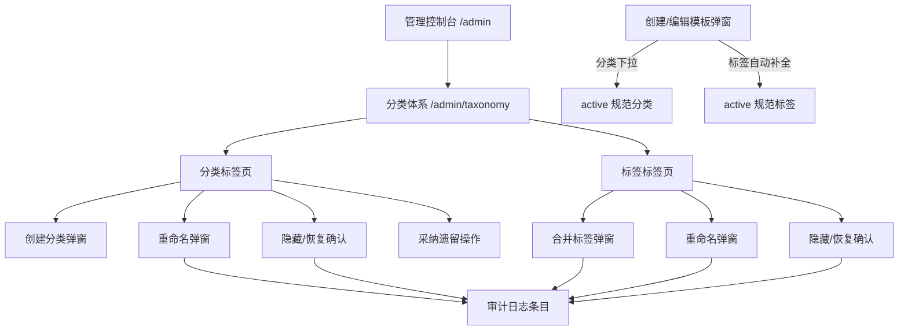
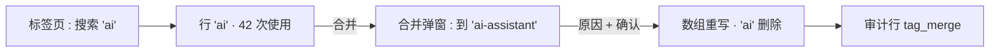
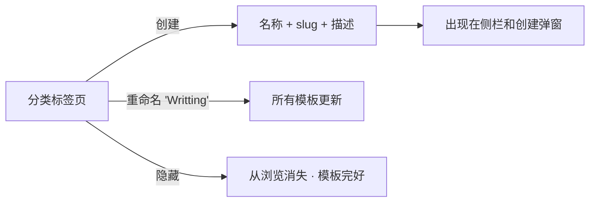
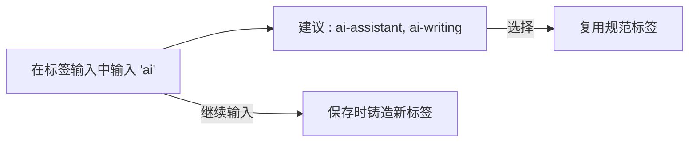

# 分类与标签管理（Taxonomy Management）— UI/UX 设计

- **功能 ID：** taxonomy-management
- **版本：** 1.0
- **状态：** 已提案（待架构评审）
- **作者：** ui-ux-agent
- **日期：** 2026-10-12
- **配套文档：** `taxonomy-management-requirements-zh-CN.md`

## 1. 设计原则

1. **管理员有力量，用户很平静。** 重量级策划工具位于 `/admin/taxonomy`；普通用户只看到更干净的下拉和更温和的标签输入。
2. **绝不销毁。** 隐藏和合并保留每个模板；UI 在确认框中明确说明这一点。
3. **复用控制台模式。** 页面遵循既有的管理列表页习惯（搜索 + 表格 + 分页 + 弹窗）—— 零新习惯。
4. **名称是数据。** 分类/标签名称按作者输入渲染；只有界面元素（标签、按钮、空状态）被翻译。

## 2. 信息架构



| 界面 | 位置 | 受众 | 目的 |
|---|---|---|---|
| 分类体系页面（2 个标签页） | `/admin/taxonomy` | 管理员 | 查看和管理分类与标签 |
| 创建/重命名/合并/隐藏弹窗 | 管理员分类体系页面 | 管理员 | 带原因捕获的变更 |
| 分类下拉 | 创建/编辑模板弹窗 | 创作者 | 从策划列表中选择 |
| 标签建议 | 创建/编辑模板弹窗 | 创作者 | 复用规范标签 |
| 审计行 | `/admin/audit-log`（既有） | 管理员 | 分类体系操作的监督 |

## 3. 用户流程

### 3.1 管理员清理标签漂移



### 3.2 管理员策划分类



### 3.3 创作者打标签



## 4. 页面布局

### 4.1 管理员分类体系页面（桌面）

```
+----------------------------------------------------------------------+
|  ← 管理        分类体系                                                |
+----------------------------------------------------------------------+
|  [ 分类 ] [ 标签 ]                              [ + 新建分类 ]         |
|  [ 搜索…            ] [ 状态: 全部 ▾ ] [ 遗留: 全部 ▾ ]              |
+----------------------------------------------------------------------+
|  名称            Slug            使用数  状态     更新时间     操作    |
|  Writing         writing          128   启用     2026-10-01  ⋯      |
|  Writting        writting           3   启用     2026-09-28  ⋯      |
|   └ 遗留徽章                                                          |
|  Customer Support  customer-support 96   启用     2026-10-02  ⋯      |
|  Old Topic       old-topic          0   已隐藏   2026-08-14  ⋯      |
|  « 上一页  第 1 页 / 共 4 页  下一页 »                                 |
+----------------------------------------------------------------------+
```

行 ⋯ 菜单：重命名 · 隐藏/恢复 · （分类）采纳遗留。

### 4.2 合并标签弹窗

```
+--------------------------------------+
|  合并标签                             |
|  将 'ai'（42 个模板）合并到：          |
|  [ ai-assistant            ▾ ]       |
|                                      |
|  原因（必填）                         |
|  [ 大小写变体重复                  ]  |
|                                      |
|  ⓘ 42 个模板将携带                   |
|    'ai-assistant'；'ai' 被移除。      |
|         [ 取消 ]  [ 合并 ]            |
+--------------------------------------+
```

### 4.3 创建/编辑模板弹窗 — 分类与标签（普通用户）

```
+--------------------------------------+
|  分类 *                              |
|  [ 选择分类…                  ▾ ]    |
|    Writing                           |
|    Customer Support                  |
|    Development                       |
|    （仅 active 规范列表）             |
|                                      |
|  标签                                |
|  [ ai ]  [ writing ]  [ + ]          |
|  ┌ ai-assistant ──────────────┐      |
|  │ ai-writing                 │      |  ← 自动补全（≤8）
|  └────────────────────────────┘      |
+--------------------------------------+
```

### 4.4 移动端（管理员分类体系）

单列：标签页在顶部，搜索在下方，表格行变成堆叠卡片（名称 + 使用数 + 状态 + ⋯ 菜单）。创作者弹窗与今天的移动布局相同，只是下拉选项和建议。

## 5. 组件规格

| 组件 | 行为 | 状态 |
|---|---|---|
| TaxonomyTabs | 分类/标签标签页切换，保留每个标签页的搜索/过滤状态 | 2 个标签页 |
| TaxonomyTable | 可排序列（名称、使用数、更新时间）；状态胶囊；遗留徽章；行 ⋯ 菜单 | 加载中 / 空 / 错误 |
| CreateCategoryModal | 名称（必填）、slug（自动派生、可编辑）、描述（可选） | 校验错误内联 |
| RenameModal | 新名称（分类含 slug）；冲突 → 内联错误；标签冲突时提供合并 | 默认 / 冲突 / 提交中 |
| MergeTagModal | 目标选择（可搜索）、原因（必填）、影响行（"42 个模板将携带…"） | 默认 / 提交中 |
| HideConfirm | 原因 + 明确的"模板保留其数据"说明 | 默认 / 提交中 |
| CategorySelect | 由 active 规范分类供给的既有下拉 | 空（无分类）/ 已加载 |
| TagSuggestions | 标签输入下方的下拉，≤8 个，可键盘导航，不区分大小写匹配 | 隐藏 / 可见 / 无匹配 |

## 6. 交互细节

1. **标签页状态：** 每个标签页保留自己的搜索字符串、状态过滤器和页码；切换标签页不重置另一个。
2. **Slug 自动派生：** 输入名称实时派生 slug（小写、连字符）；编辑 slug 后脱离自动派生。
3. **合并影响预览：** 合并弹窗在确认前获取并显示受影响模板数。
4. **重命名冲突（标签）：** 如果目标名称已存在，弹窗切换到合并模式并提示（"'ai-assistant' 已存在 —— 这将合并到它"）。
5. **原因捕获：** 每个变更弹窗包含必填原因字段（3–500 字符）带计数器；有效前确认禁用。
6. **无乐观更新：** 所有变更在确认时显示加载图标，然后成功 toast 和表格刷新（无乐观更新 —— 可审计性优先于速度）。
7. **遗留采纳：** 遗留过滤器隔离散落分类；"采纳"一键创建带派生 slug 的规范行（原因预填、可编辑）。
8. **标签自动补全：** ≥2 字符触发，200 毫秒防抖，前缀匹配优先再子串；方向键导航，回车选择，Esc 关闭；继续输入保留输入值。
9. **编辑弹窗中的隐藏分类：** 如果模板的分类被隐藏，下拉灰色显示并带"（已隐藏）"后缀；选择其他分类后丢失（按 FR-12）。
10. **计数刷新：** 任何变更后，表格的使用计数在服务端重新计算（无客户端计算）。

## 7. 状态汇总

| 界面 | 加载中 | 空状态 | 错误 |
|---|---|---|---|
| 分类体系表格 | 骨架行 | "没有匹配的分类/标签" + 清除过滤链接 | 错误横幅 + 重试 |
| 创建/重命名/合并弹窗 | 确认时加载图标 | — | 内联字段错误；服务器错误 toast |
| 分类下拉 | 既有下拉行为 | "暂无分类"禁用选项 | 回退到空列表 + 内联提示 |
| 标签建议 | 静默（无加载图标） | 无下拉（继续输入） | 静默（不显示建议） |

## 8. 国际化

| 键（EN） | ZH |
|---|---|
| adminTaxonomy.title / Taxonomy | 分类体系 |
| adminTaxonomy.tabs.categories / Categories | 分类 |
| adminTaxonomy.tabs.tags / Tags | 标签 |
| adminTaxonomy.newCategory / New category | 新建分类 |
| adminTaxonomy.search / Search… | 搜索… |
| adminTaxonomy.status.all / All | 全部 |
| adminTaxonomy.status.active / Active | 启用 |
| adminTaxonomy.status.hidden / Hidden | 已隐藏 |
| adminTaxonomy.legacy / Legacy | 遗留 |
| adminTaxonomy.uses / Uses | 使用数 |
| adminTaxonomy.rename / Rename | 重命名 |
| adminTaxonomy.merge / Merge | 合并 |
| adminTaxonomy.mergeInto / Merge '{{from}}' into | 将 "{{from}}" 合并到 |
| adminTaxonomy.mergeImpact / {{count}} templates will carry '{{into}}'; '{{from}}' is removed. | {{count}} 个模板将携带 "{{into}}"；"{{from}}" 被移除。 |
| adminTaxonomy.hide / Hide | 隐藏 |
| adminTaxonomy.restore / Restore | 恢复 |
| adminTaxonomy.hideNote / Templates keep their data. | 模板保留其数据。 |
| adminTaxonomy.adopt / Adopt | 采纳 |
| adminTaxonomy.reason / Reason (required) | 原因（必填） |
| create_template.choose_category / Choose category… | 选择分类… |
| create_template.label_tags / Tags | 标签 |
| create_template.tagSuggestion.none / No matching tags | 没有匹配的标签 |
| create_template.categoryHidden / {{category}} (hidden) | {{category}}（已隐藏） |

分类和标签名称是用户数据，绝不翻译。

## 9. 无障碍

- 标签页遵循 ARIA tabs 模式（方向键导航、`aria-selected`）。
- 表格行：⋯ 菜单按钮可通过 Tab 到达；菜单遵循既有的无障碍菜单模式（方向键、Esc）。
- 弹窗复用无障碍 `Modal`（焦点陷阱、Esc 关闭、初始焦点在第一个字段）。
- 原因字段的字符计数器为 `aria-live="polite"`。
- 标签建议列表框可键盘导航，带 `role="listbox"`/`option`，输入框上有 `aria-expanded`。
- 状态胶囊带文本（不仅靠颜色）；遗留徽章有无障碍提示。

## 10. 分析（可选）

- `admin_taxonomy_action`（操作、实体）—— 仅管理员使用；无面向用户的分析。

## 11. 范围之外

- 标签同义词表、分类层级、标签 wiki、批量多选操作。
- 分类体系趋势分析；面向用户的分类体系管理。
- 任何形式的变现 —— 本产品永久排除。
