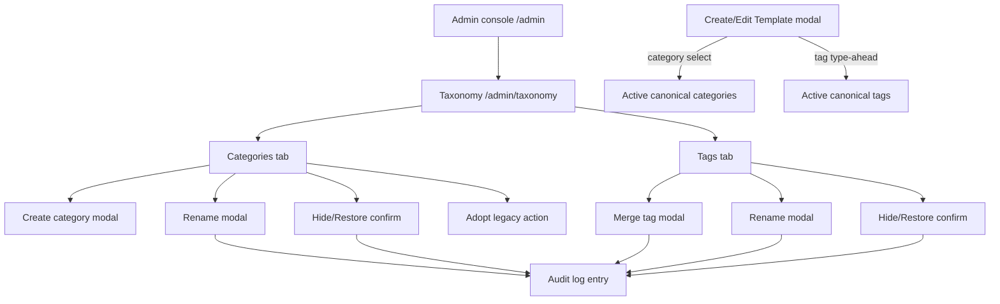
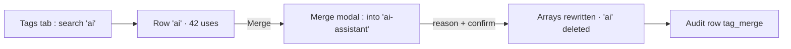
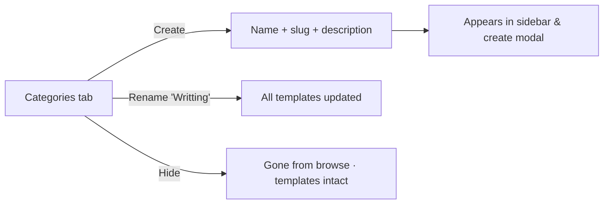
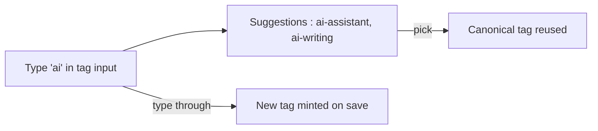

# Taxonomy Management (Categories & Tags) — UI/UX Design

- **Feature ID:** taxonomy-management
- **Version:** 1.0
- **Status:** Proposed (for architecture review)
- **Author:** ui-ux-agent
- **Date:** 2026-10-12
- **Companion doc:** `taxonomy-management-requirements.md`

## 1. Design Principles

1. **Admin power, user calm.** Heavy curation tools live in `/admin/taxonomy`; regular users only see a cleaner select and gentler tag input.
2. **Never destroy.** Hide and merge preserve every template; the UI says so explicitly in confirmations.
3. **Reuse the console pattern.** The page follows the existing admin list-page idiom (search + table + pagination + modal) — zero new idioms.
4. **Names are data.** Category/tag names render as authored; only chrome (labels, buttons, empty states) is translated.

## 2. Information Architecture



| Surface | Location | Audience | Purpose |
|---|---|---|---|
| Taxonomy page (2 tabs) | `/admin/taxonomy` | Admins | View/manage categories & tags |
| Create/Rename/Merge/Hide modals | Admin taxonomy page | Admins | Mutations with reason capture |
| Category select | Create/Edit Template modal | Creators | Pick from curated list |
| Tag suggestions | Create/Edit Template modal | Creators | Reuse canonical tags |
| Audit rows | `/admin/audit-log` (existing) | Admins | Oversight of taxonomy actions |

## 3. User Flows

### 3.1 Admin cleans up tag drift



### 3.2 Admin curates categories



### 3.3 Creator tags a template



## 4. Page Layouts

### 4.1 Admin taxonomy page (desktop)

```
+----------------------------------------------------------------------+
|  ← Admin        Taxonomy                                              |
+----------------------------------------------------------------------+
|  [ Categories ] [ Tags ]                        [ + New category ]    |
|  [ Search…            ] [ Status: All ▾ ] [ Legacy: All ▾ ]          |
+----------------------------------------------------------------------+
|  Name            Slug            Uses   Status    Updated     Actions |
|  Writing         writing          128   Active    2026-10-01  ⋯      |
|  Writting        writting           3   Active    2026-09-28  ⋯      |
|   └ Legacy badge                                                      |
|  Customer Support  customer-support 96   Active    2026-10-02  ⋯      |
|  Old Topic       old-topic          0   Hidden    2026-08-14  ⋯      |
|  « Prev  Page 1 of 4  Next »                                          |
+----------------------------------------------------------------------+
```

Row ⋯ menu: Rename · Hide/Restore · (Categories) Adopt legacy.

### 4.2 Merge tag modal

```
+--------------------------------------+
|  Merge tag                           |
|  Merge 'ai' (42 templates) into:     |
|  [ ai-assistant            ▾ ]       |
|                                      |
|  Reason (required)                   |
|  [ case-variant duplicate         ]  |
|                                      |
|  ⓘ 42 templates will carry          |
|    'ai-assistant'; 'ai' is removed.  |
|         [ Cancel ]  [ Merge ]        |
+--------------------------------------+
```

### 4.3 Create/Edit Template modal — category & tags (regular user)

```
+--------------------------------------+
|  Category *                          |
|  [ Choose category…          ▾ ]     |
|    Writing                           |
|    Customer Support                  |
|    Development                       |
|    (active canonical list only)      |
|                                      |
|  Tags                                |
|  [ ai ]  [ writing ]  [ + ]          |
|  ┌ ai-assistant ──────────────┐      |
|  │ ai-writing                 │      |  ← type-ahead (≤8)
|  └────────────────────────────┘      |
+--------------------------------------+
```

### 4.4 Mobile (admin taxonomy)

Single column: tabs on top, search below, table rows become stacked cards (name + uses + status + ⋯ menu). Creator modal unchanged from today's mobile layout except select options and suggestions.

## 5. Component Specs

| Component | Behavior | States |
|---|---|---|
| TaxonomyTabs | Categories/Tags tab switch, preserves each tab's search/filter state | 2 tabs |
| TaxonomyTable | Sortable columns (name, uses, updated); status pill; Legacy badge; row ⋯ menu | Loading / empty / error |
| CreateCategoryModal | Name (required), slug (auto-derived, editable), description (optional) | Validation errors inline |
| RenameModal | New name (+ slug for categories); conflict → inline error; for tags, conflict offers merge | Default / conflict / submitting |
| MergeTagModal | Target select (searchable), reason (required), impact line ("42 templates will carry…") | Default / submitting |
| HideConfirm | Reason + explicit "templates keep their data" note | Default / submitting |
| CategorySelect | Existing select fed by active canonical categories | Empty (no categories) / loaded |
| TagSuggestions | Dropdown under tag input, ≤8, keyboard navigable, case-insensitive match | Hidden / visible / no-match |

## 6. Interaction Details

1. **Tab state:** each tab keeps its own search string, status filter, and page; switching tabs does not reset the other.
2. **Slug auto-derive:** typing a name derives the slug live (lowercase, hyphens); editing the slug detaches auto-derivation.
3. **Merge impact preview:** the merge modal fetches and shows the affected-template count before confirm.
4. **Rename conflict (tags):** if the target name exists, the modal switches to merge mode with a notice ("'ai-assistant' already exists — this will merge into it").
5. **Reason capture:** every mutation modal includes the mandatory reason field (3–500 chars) with a counter; confirm disabled until valid.
6. **Optimistic-free:** all mutations show a spinner on confirm, then a success toast and table refresh (no optimistic updates — auditability over snappiness).
7. **Legacy adoption:** the Legacy filter isolates stray categories; "Adopt" creates the canonical row with a derived slug in one click (reason pre-filled, editable).
8. **Tag type-ahead:** triggers at ≥2 chars, debounced 200 ms, prefix matches first then substring; arrow keys navigate, Enter selects, Esc closes; typing through keeps the typed value.
9. **Hidden category in edit modal:** if the template's category is hidden, the select shows it greyed with "(hidden)" suffix; choosing another category loses it (per FR-12).
10. **Counts refresh:** after any mutation, the table's usage counts recompute server-side (no client math).

## 7. States Summary

| Surface | Loading | Empty | Error |
|---|---|---|---|
| Taxonomy table | Skeleton rows | "No categories/tags match" + clear-filters link | Error banner + retry |
| Create/Rename/Merge modals | Submitting spinner on confirm | — | Inline field errors; toast on server error |
| Category select | Existing select behavior | "No categories yet" disabled option | Falls back to empty list + inline hint |
| Tag suggestions | Silent (no spinner) | No dropdown (typing continues) | Silent (no suggestions shown) |

## 8. i18n

| Key (EN) | ZH |
|---|---|
| adminTaxonomy.title / Taxonomy | 分类体系 |
| adminTaxonomy.tabs.categories / Categories | 分类 |
| adminTaxonomy.tabs.tags / Tags | 标签 |
| adminTaxonomy.newCategory / New category | 新建分类 |
| adminTaxonomy.search / Search… | 搜索… |
| adminTaxonomy.status.all / All | 全部 |
| adminTaxonomy.status.active / Active | 启用 |
| adminTaxonomy.status.hidden / Hidden | 已隐藏 |
| adminTaxonomy.legacy / Legacy | 遗留 |
| adminTaxonomy.uses / Uses | 使用数 |
| adminTaxonomy.rename / Rename | 重命名 |
| adminTaxonomy.merge / Merge | 合并 |
| adminTaxonomy.mergeInto / Merge '{{from}}' into | 将 "{{from}}" 合并到 |
| adminTaxonomy.mergeImpact / {{count}} templates will carry '{{into}}'; '{{from}}' is removed. | {{count}} 个模板将携带 "{{into}}"；"{{from}}" 被移除。 |
| adminTaxonomy.hide / Hide | 隐藏 |
| adminTaxonomy.restore / Restore | 恢复 |
| adminTaxonomy.hideNote / Templates keep their data. | 模板保留其数据。 |
| adminTaxonomy.adopt / Adopt | 采纳 |
| adminTaxonomy.reason / Reason (required) | 原因（必填） |
| create_template.choose_category / Choose category… | 选择分类… |
| create_template.label_tags / Tags | 标签 |
| create_template.tagSuggestion.none / No matching tags | 没有匹配的标签 |
| create_template.categoryHidden / {{category}} (hidden) | {{category}}（已隐藏） |

Category and tag names are user data and are never translated.

## 9. Accessibility

- Tabs follow the ARIA tabs pattern (arrow-key navigation, `aria-selected`).
- Table rows: the ⋯ menu button is reachable via Tab; menus follow the existing accessible-menu pattern (arrow keys, Esc).
- Modals reuse the accessible `Modal` (focus trap, Esc to close, initial focus on first field).
- The reason field's character counter is `aria-live="polite"`.
- Tag suggestions listbox is keyboard navigable with `role="listbox"`/`option`, `aria-expanded` on the input.
- Status pills carry text (not color alone); Legacy badge has an accessible tooltip.

## 10. Analytics (optional)

- `admin_taxonomy_action` (action, entity) — admin usage only; no user-facing analytics.

## 11. Out of Scope

- Tag synonym tables, category hierarchies, tag wikis, bulk multi-select operations.
- Taxonomy trend analytics; user-facing taxonomy management.
- Monetization of any kind — permanently out of scope for this product.
