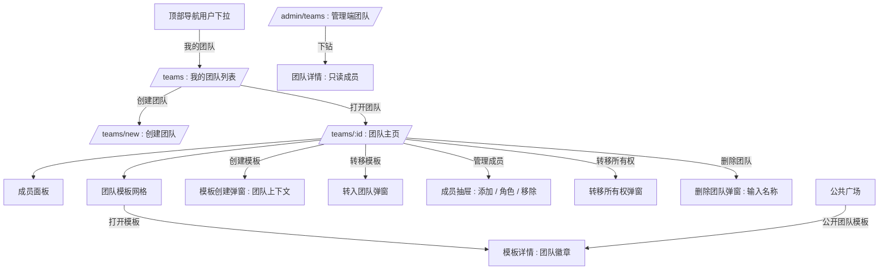
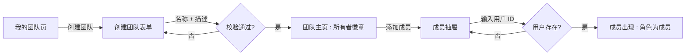
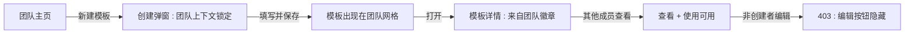
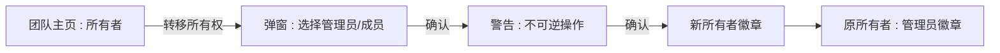

# 团队协作 — UI/UX 设计

- **功能 ID：** team-collaboration
- **版本：** 1.0
- **状态：** 已提案（待架构评审）
- **作者：** ui-ux-agent
- **日期：** 2026-10-12
- **配套文档：** `team-collaboration-requirements-zh-CN.md`

## 1. 设计原则

1. **团队是一个空间，不是新产品。** 团队页面复用 Aurora 设计系统、模板卡片和用户已熟悉的页面骨架；只有所有权语义变化。
2. **角色清晰优于权限矩阵。** 三种角色配徽章级可见性；每个破坏性操作都说明谁可以执行。
3. **个人工作保持个人属性。** 没有显式操作，任何内容不会进入团队；默认模板上下文仍是个人。
4. **按 ID 邀请，不做仪式感。** 添加成员是一个输入框 + 一次点击；没有邮件流程、没有邀请码。

## 2. 信息架构



| 界面 | 路由 | 受众 | 目的 |
|---|---|---|---|
| 我的团队 | `/teams` | 任何用户 | 列出我所属的团队；创建团队 |
| 创建团队 | `/teams/new` | 任何用户 | 名称 + 描述表单 |
| 团队主页 | `/teams/{id}` | 团队成员 | 成员、团队模板、管理操作 |
| 成员抽屉 | 团队主页上的浮层 | 所有者/管理员 | 按用户 ID 添加、变更角色、移除 |
| 转移所有权 | 团队主页上的弹窗 | 所有者 | 移交所有者角色 |
| 删除团队 | 团队主页上的弹窗 | 所有者 | 输入名称确认 |
| 管理端团队 | `/admin/teams` | 平台管理员 | 只读团队列表 + 成员下钻 |

## 3. 用户流程

### 3.1 创建团队并邀请首位成员



### 3.2 成员贡献模板



### 3.3 转移所有权



## 4. 页面布局

### 4.1 我的团队 — `/teams`（桌面端）

```
+----------------------------------------------------------------------+
|  顶部导航  [logo]  [搜索]  [主题]  [用户下拉: 我的团队 ▾]             |
+----------------------------------------------------------------------+
|                                                                      |
|  我的团队                                        [+ 创建团队]        |
|  +------------------------------------------------+  +------------+  |
|  | 团队卡片                                       |  | 创建       |  |
|  | [头像] Prompt Guild          [所有者徽章]      |  | 团队卡片   |  |
|  | 12 名成员 · 34 个模板 · 2 小时前更新           |  | (虚线)     |  |
|  +------------------------------------------------+  +------------+  |
|  | [头像] Dev Crew             [管理员徽章]       |                  |
|  | 5 名成员 · 18 个模板 · 昨天更新                |                  |
|  +------------------------------------------------+                  |
|  (空状态: "还没有团队 —— 为你的群体创建一个")                          |
+----------------------------------------------------------------------+
```

移动端：单列；团队卡片纵向堆叠；创建团队变为列表下方的通栏按钮。

### 4.2 团队主页 — `/teams/{id}`（桌面端）

```
+----------------------------------------------------------------------+
|  ← 我的团队                                                          |
+----------------------------------------------------------------------+
|  [团队头像]  Prompt Guild                    [所有者徽章]             |
|  客服团队的共享提示词库                                               |
|  12 名成员 · 34 个模板                                               |
|  [成员] [设置] [⋯ : 转移所有权 / 删除团队]                            |
+----------------------------------------------------------------------+
|  团队模板                                    [+ 新建] [转入]          |
|  +----------+  +----------+  +----------+  +----------+              |
|  | 卡片     |  | 卡片     |  | 卡片     |  | 卡片     |              |
|  | by alice |  | by bob   |  | by alice |  | by carol |              |
|  | [公开]   |  | [私有]   |  | [公开]   |  | [私有]   |              |
|  +----------+  +----------+  +----------+  +----------+              |
|  (分页)                                                              |
+----------------------------------------------------------------------+
|  成员 (12)                                              [管理]       |
|  [头像] alice   [所有者]   [头像] bob    [管理员]                     |
|  [头像] carol   [成员]     [头像] dave   [成员]                       |
|  (+ 还有 8 人)                                                       |
+----------------------------------------------------------------------+
```

移动端：头部纵向堆叠（头像在名称上方）；模板网格 1–2 列；成员区折叠为可展开面板。

### 4.3 成员抽屉（所有者/管理员）

```
+--------------------------------------+
|  成员 · Prompt Guild            [×]  |
|  +--------------------------------+  |
|  | 添加成员                       |  |
|  | [ 用户 ID 输入框        ] [添加]|  |
|  | 提示: 对方资料页展示的 ID       |  |
|  +--------------------------------+  |
|  [头像] alice    [所有者]             |
|  [头像] bob      [管理员]  [⋯ 角色]  |
|  [头像] carol    [成员]    [⋯ 角色]  |
|    ┌ 角色菜单: 成员 / 管理员         |
|    │            移出团队             |
+--------------------------------------+
```

### 4.4 管理端团队 — `/admin/teams`（桌面端）

```
+----------------------------------------------------------------------+
|  管理端侧边栏: 仪表盘 · 用户 · 模板 · 团队 · 审计日志                 |
+----------------------------------------------------------------------+
|  团队                                        [按名称搜索 🔍]          |
|  | 团队         | 所有者  | 成员数 | 模板数  | 创建时间  |            |
|  | Prompt Guild | alice   | 12     | 34      | 2026-08-01| [查看]    |
|  | Dev Crew     | bob     | 5      | 18      | 2026-09-12| [查看]    |
|  (分页)                                                              |
+----------------------------------------------------------------------+
|  下钻（查看）: 团队头部 + 只读成员表                                  |
+----------------------------------------------------------------------+
```

## 5. 组件规格

| 组件 | 行为 | 状态 |
|---|---|---|
| TeamCard | 头像、名称、角色徽章、成员/模板数、更新时间；点击 → 团队主页 | 默认 / 悬停（抬升） |
| RoleBadge | 文本 + 颜色：所有者（金色）、管理员（蓝色）、成员（灰色）；文本始终存在（无障碍） | 3 种变体 |
| CreateTeamForm | 名称（必填，≤80）、描述（≤500，可选）；行内校验 | 空 / 错误 / 提交中 |
| MembersDrawer | 右侧抽屉；按 ID 添加输入框带存在性校验；每个成员的角色菜单（按权限显示） | 加载 / 已加载 / 错误 |
| TeamTemplateCard | 既有 TemplateCard + 创建者行（"by {用户}"）+ 可见性标签 | 既有 + 团队扩展 |
| TransferOwnershipModal | 成员选择器（管理员/成员）、显式警告、确认按钮在勾选前禁用 | 默认 / 警告 / 提交中 |
| DeleteTeamModal | 输入名称确认（"输入 'Prompt Guild' 以确认"）；说明内容存续（FR-10） | 默认 / 不匹配 / 提交中 |
| TransferToTeamModal | 从个人模板上下文：选择团队（用户的团队）、确认；说明署名变化 | 默认 / 无团队 / 提交中 |
| AdminTeamsTable | 复用管理端列表模式：搜索、可排序列、分页、查看下钻 | 加载 / 空 / 错误 |

## 6. 交互细节

1. **创建团队**提交名称+描述；成功后进入团队主页，显示所有者徽章和空模板状态，并建议先邀请成员。
2. **添加成员**在客户端校验用户 ID 格式、服务端校验（存在、未封禁、不是成员）；错误显示在输入框下方；成功后追加成员行并短暂高亮。
3. **角色菜单**仅对有权变更该成员的操作者显示（所有者：除自己外的任何人；管理员：仅成员）。选择角色时显示确认气泡（"将 bob 设为管理员？"）。
4. **移除成员**需确认，并说明后果（"其团队模板保留在团队中"）。
5. **转移所有权**需要选择成员、确认警告，无需输入文字（按钮门控）；成功后操作者徽章立即变为管理员。
6. **删除团队**需要输入完全一致的团队名称；弹窗文案说明模板将以私有状态回归各创建者。
7. **团队上下文中新建模板**打开既有创建弹窗，带锁定的"团队：{名称}"上下文标签；保存后创建团队所有模板。
8. **转入**（个人 → 团队）列出用户的团队；转移后模板从个人模板中消失，出现在团队网格中并带"by {用户}"创建者行。
9. **退出团队**位于成员/管理员的 ⋯ 菜单中；所有者看到禁用态并带提示（"请先转移所有权或删除团队"）。
10. **模板详情上的团队徽章**对公开团队模板显示"by {团队名}"，副行显示"创建者 {用户}"；关注按钮关注团队（延迟到 follow-creators 集成）。
11. **管理端团队**的查看打开只读下钻；页面上不存在任何变更控件。

## 7. 状态汇总

| 界面 | 加载 | 空 | 错误 |
|---|---|---|---|
| 我的团队 | 骨架卡片 | "还没有团队" + 创建入口 | Toast + 重试 |
| 团队主页 | 骨架头部 + 网格 | 空模板状态带邀请提示 | 404（非成员）/ Toast |
| 成员抽屉 | 行骨架 | 不适用（团队始终 ≥1 名成员） | 行内添加成员错误 |
| 团队网格 | 卡片骨架 | "还没有模板 —— 创建第一个" | Toast + 重试 |
| 管理端团队 | 表格骨架 | "没有匹配的团队" | Toast + 重试 |

## 8. 国际化

| 键（英文） | 中文 |
|---|---|
| teams.title / My Teams | 我的团队 |
| teams.create / Create Team | 创建团队 |
| teams.members / Members | 成员 |
| teams.role.owner / Owner | 所有者 |
| teams.role.admin / Admin | 管理员 |
| teams.role.member / Member | 成员 |
| teams.addMember / Add member | 添加成员 |
| teams.addMember.hint / Enter the user id shown on their profile | 输入对方资料页展示的用户 ID |
| teams.transferOwnership / Transfer ownership | 转移所有权 |
| teams.delete / Delete team | 删除团队 |
| teams.delete.confirm / Type the team name to confirm | 输入团队名称以确认 |
| teams.leave / Leave team | 退出团队 |
| teams.templates / Team templates | 团队模板 |
| teams.transferIn / Transfer in | 转入模板 |
| teams.byTeam / by {{team}} | 来自 {{team}} |
| teams.empty / No teams yet | 还没有团队 |
| admin.teams.title / Teams | 团队 |

所有文案通过 i18next `teams.*` / `admin.teams.*` 命名空间；角色名绝不硬编码。

## 9. 无障碍

- RoleBadge 以文本优先传达角色（颜色为辅），在两种主题下均满足 WCAG 对比度。
- 成员抽屉和所有弹窗捕获焦点；Esc 关闭；焦点返回触发元素。
- 角色菜单和移除操作可键盘操作（方向键、Enter、Esc），复用既有下拉模式。
- 团队网格复用无障碍模板卡片模式（名称为链接、计数为文本）。
- 输入名称删除的输入框带有期望值的无障碍描述。

## 10. 数据分析（可选）

- `team_created`、`member_added`、`template_created_in_team`、`template_transferred_to_team`、`team_ownership_transferred`、`team_deleted` —— 标准产品分析事件；不进行产品使用之外的追踪。

## 11. 范围之外

- 邮件邀请、邀请链接、加入码。
- 团队合集/链、团队 API 密钥、团队动态流。
- 三种角色之外的按模板细粒度权限。
- 任何变现（团队套餐、席位定价、付费计划）—— 永久排除。
